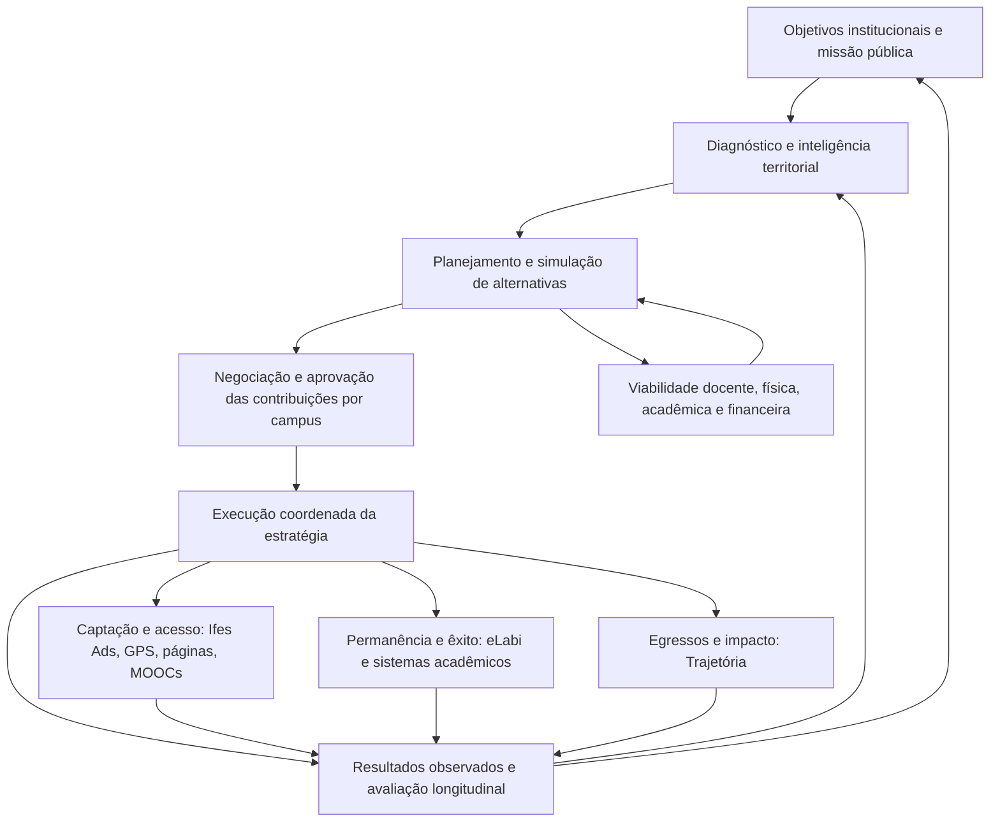
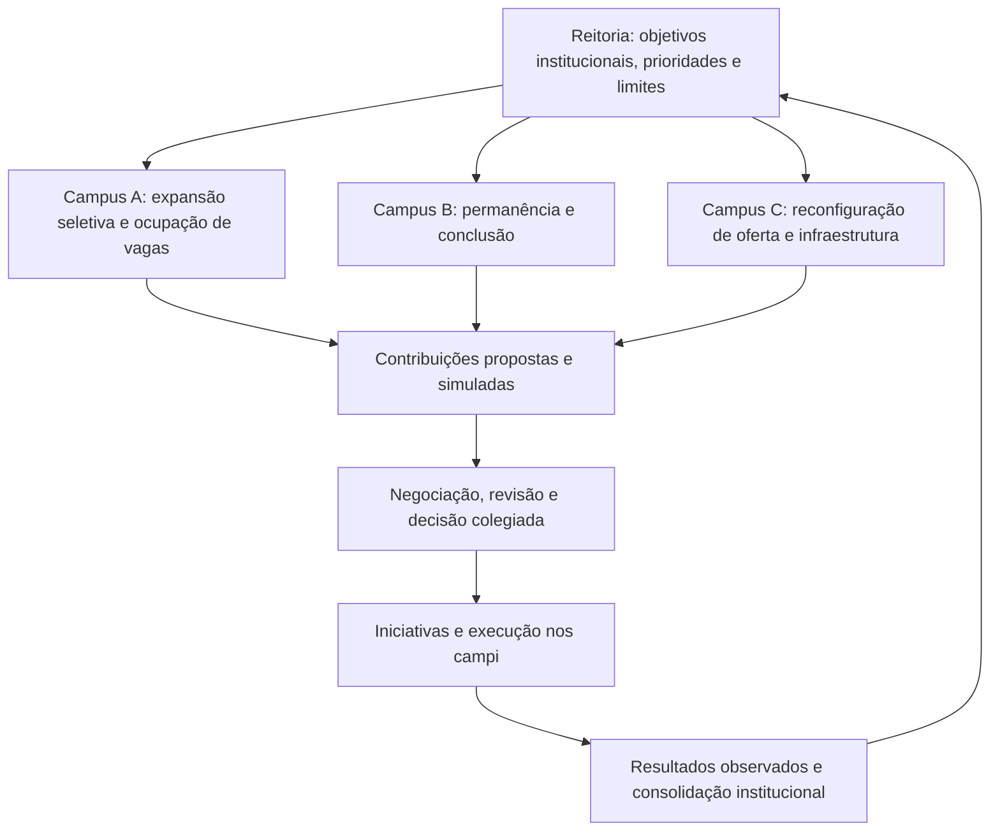

# Da Operação à Decisão
## Contexto fundador de uma Plataforma de Inteligência, Planejamento e Execução Estratégica Educacional

> **Documento de referência para iniciar um novo projeto**  
> **Versão:** 1.1 — 8 de novembro de 2026 (ênfase estratégica revisada para transferência a outro agente)  
> **Situação:** visão conceitual e hipóteses de produto; **não** é uma especificação aprovada de requisitos, uma proposta oficial do Ifes ou um compromisso de implementação.  
> **Âmbito inicial:** Instituto Federal do Espírito Santo (Ifes), com potencial de generalização a instituições públicas multicampi.  
> **Título de trabalho:** *Da Operação à Decisão*. O nome comercial/institucional do eventual produto ainda não foi definido.

---

## 0. Como usar este documento

Este arquivo preserva o raciocínio, as decisões conceituais e as perguntas abertas surgidas nas conversas de novembro de 2026, complementadas por discussões anteriores sobre inteligência educacional, jornada estudantil e Matriz CONIF. Deve servir como **contexto de entrada para uma equipe ou agente de produto**, evitando que o novo projeto comece diretamente pela programação.

**Convenções de maturidade:**

- **[VISÃO]**: direção conceitual defendida, ainda sem validação institucional.
- **[HIPÓTESE]**: relação causal, benefício ou suposição que precisa ser testada.
- **[PRINCÍPIO]**: restrição orientadora que deve ser preservada.
- **[PESQUISAR]**: dependência de norma, dado, metodologia ou decisão externa.
- **[MVP]**: candidato à primeira prova de valor, não compromisso de escopo.
- **[EVOLUÇÃO]**: funcionalidade desejável para fases posteriores.

**Frase-síntese:**

> Não basta melhorar a jornada do estudante. Precisamos melhorar as decisões que determinam quais jornadas educacionais serão possíveis.

**Pergunta fundadora:**

> Estamos executando cada vez melhor uma estratégia educacional que talvez não seja a melhor estratégia possível?

### 0.1. DIRETRIZ FUNDADORA — ordem de importância, não ordem de implementação

**[VISÃO CENTRAL, REFORÇADA EM 08/11/2026]** Este projeto **não é, em essência, um simulador isolado de cursos ou de campi**. Seu núcleo é a **governança estratégica distribuída**: transformar objetivos institucionais em contribuições diferentes, negociadas e mensuráveis dos campi; comparar o impacto conjunto dessas contribuições; acompanhar o que foi decidido e aprender com os resultados. O **principal instrumento quantitativo inicial** será a **simulação acadêmico-orçamentária de decisões de oferta, com foco na Matriz CONIF** e em seus efeitos locais e institucionais.

O simulador de campus é a **porta de entrada para entregar valor e validar a tese**, não uma fronteira definitiva do produto nem uma razão para adiar a discussão sobre governança. Mesmo na primeira prova de valor, é preciso tornar visível a cadeia:

**objetivo institucional → alternativas locais de oferta → projeção dos indicadores → efeitos condicionais na Matriz CONIF e na alocação interna → consolidação do Ifes → compromisso/decisão → acompanhamento.**

**Pergunta-exemplo para gestores e colegiados:** “Se este campus aumentar vagas, substituir ofertas ou mudar uma modalidade, o que acontece com as matrículas elegíveis, a participação orçamentária projetada e a contribuição do campus para as metas do Ifes — em quais exercícios, com quais premissas e restrições?” A pergunta sobre “orçamento do ano que vem” só terá resposta se houver correspondência comprovada entre período acadêmico, ano-base, exercício e fórmula aplicável; a repercussão pode ocorrer em outro exercício ou não se materializar.

**Para o próximo agente:** nunca reduzir o produto a um cadastro de cursos + calculadora local; nunca empurrar **o conceito** de governança distribuída para uma fase tardia. A sofisticação do fluxo de aprovação, por sua vez, pode ser incremental.

---

## 1. Resumo executivo

O Ifes já dispõe — ou vem construindo — soluções para reduzir fricções e melhorar resultados em diferentes etapas da jornada estudantil: **captação e acesso**, **permanência e êxito**, **relacionamento com egressos**. Entre os exemplos estão **Ifes Ads**, **GPS — Gestão de Processos Seletivos**, páginas de cursos e formulários de interesse, **MOOCs**, ambientes de aprendizagem, **eLabi** e **Trajetória/Portal do Egresso**.

Essas soluções atuam, sobretudo, **depois que uma estratégia institucional de oferta já foi definida**. Tornam mais eficiente a divulgação de cursos, a inscrição, o processo seletivo, o acompanhamento acadêmico, a permanência e o relacionamento com quem concluiu os estudos.

O insight que originou este novo projeto foi reconhecer uma camada anterior e mais decisiva: **a qualidade das escolhas sobre o que, onde, quando, para quem e com quais recursos a instituição deve ofertar**.

Hoje, decisões de abrir, manter, ampliar, reduzir, transformar ou encerrar ofertas podem ser conduzidas por conhecimentos locais, percepções de demanda, tradição acadêmica, disponibilidade de docentes, decisões colegiadas e oportunidades pontuais. Essas motivações têm legitimidade, mas nem sempre são acompanhadas por **simulações comparáveis e transparentes** que revelem, ao longo de vários anos, os impactos sobre:

1. Demanda social, territorial e educacional;
2. Vagas, ingressos, matrículas, permanência, conclusão e egressos;
3. Capacidade docente, por área e disponibilidade real;
4. Infraestrutura física, laboratórios, salas e disponibilidade temporal;
5. Custos operacionais, investimentos e capacidade orçamentária;
6. Indicadores institucionais e possíveis efeitos relativos na Matriz CONIF;
7. Atendimento à missão pública, ao planejamento institucional e aos requisitos legais.

A proposta é criar uma **plataforma de governança e apoio à decisão estratégica distribuída**, conectando objetivos institucionais às **escolhas locais inteligentes de oferta**, aos impactos acadêmico-orçamentários projetados, à consolidação institucional, à execução do ecossistema educacional e à aprendizagem baseada nos resultados observados.

**Hierarquia de valor:** (1) governança distribuída das escolhas e metas; (2) inteligência quantitativa para comparar cenários de oferta, sobretudo seu efeito condicionado na **Matriz CONIF**; (3) demonstração de viabilidade docente, física, territorial e financeira; (4) execução e acompanhamento integrados. **O primeiro caso de uso será o simulador, mas a justificativa estratégica do produto é o conjunto.**

**Não se pretende transformar campi em unidades empresariais que maximizam receita.** O orçamento é uma consequência e uma restrição relevante da decisão, não o único critério de escolha. O objetivo maior é **maximizar o valor público e a viabilidade de uma estratégia educacional responsável**.

---

## 2. Origem da ideia e mudança de perspectiva

### 2.1. O ecossistema já conhecido

A visão anterior poderia ser resumida assim:

**Atrair → permitir acesso → acompanhar → promover conclusão → relacionar-se com egressos → aprender com a trajetória.**

Ela é importante porque melhora a qualidade da experiência e a capacidade operacional institucional. Entretanto, pressupõe que alguém já definiu o conjunto de cursos, as modalidades, a distribuição territorial, as vagas e os recursos necessários.

### 2.2. O novo insight

A discussão sobre uma possível plataforma corporativa de gestão de estratégias, metas, execução e reconhecimento de colaboradores serviu de **provocação conceitual**: uma estratégia organizacional deve ser desdobrada em contribuições locais, ações e evidências de resultado. No caso educacional, isso expôs uma lacuna a montante dos sistemas já existentes.

**Exemplo da metáfora:** de pouco adianta aperfeiçoar a captação de estudantes para uma oferta estruturalmente desalinhada com a demanda, ou insistir em expandir uma oferta sem infraestrutura, docentes ou condições de permanência. Seria como otimizar o plantio sem avaliar a fertilidade do terreno.

Portanto, precisamos acrescentar uma etapa: **formular, comparar, selecionar e acompanhar alternativas estratégicas**, antes e durante sua execução.

### 2.3. Separação de iniciativas

Este projeto é **institucional/educacional**. Não deve ser confundido com a eventual oportunidade empresarial de SaaS de engajamento e desempenho de colaboradores idealizada por uma gerente de RH. Existe analogia em **gestão de objetivos e desdobramento de metas**, mas não identidade de produto, mercado, governança ou finalidade.

---

## 3. Tese de produto e posicionamento

**[VISÃO]** Uma plataforma de **governança distribuída e inteligência estratégica educacional** que ajude uma instituição multicampi a estabelecer objetivos comuns, simular escolhas de oferta, negociar **contribuições não uniformes entre campi**, estimar efeitos acadêmicos e orçamentários, acompanhar a execução e revisar decisões à luz de evidências.

**Eixo de governança:** Reitoria e instâncias competentes definem prioridades e metas; cada campus propõe o modo mais viável e socialmente adequado de contribuir; cenários locais são comparados e consolidados; decisões são negociadas, formalizadas e acompanhadas. **A Matriz CONIF é o primeiro motor quantitativo prioritário**, não a finalidade exclusiva da estratégia. O campus é a unidade inicial de experimentação, não o limite da solução.

Três perguntas progressivas:

| Nível de inteligência | Pergunta | Exemplos de evidência |
|---|---|---|
| **Descritivo** | O que está acontecendo e por quê? | PNP, matrícula, evasão, ocupação, orçamento, demanda, infraestrutura |
| **Preditivo e prescritivo** | O que poderá acontecer se mudarmos decisões? | Simulação de portfólio, coortes, capacidade, metas e custos |
| **Execução estratégica** | Como converter a escolha em resultado e aprender? | Contribuições por campus, iniciativas, acompanhamento, realizado × projetado |

**Proposta de valor:** permitir que dirigentes tomem decisões sobre o portfólio educacional **antes que seus efeitos se tornem custos, limitações físicas, frustrações de demanda ou resultados acadêmicos insatisfatórios**.

**Não é:** um dashboard isolado; um novo ERP acadêmico; um substituto da Plataforma Nilo Peçanha; uma ferramenta que reproduz somente a Matriz CONIF; uma agenda de tarefas genérica; um mecanismo automático para recomendar fechamento de cursos.

**É:** uma infraestrutura de **governança estratégica distribuída** que permite comparar alternativas locais e seus impactos institucionais, com modelagem de restrições, efeitos acadêmico-orçamentários e resultados longitudinais.

---

## 4. Arquitetura conceitual: da decisão ao aprendizado



**Camadas lógicas:**

1. **Diagnóstico:** estado atual da instituição, dos campi, dos cursos, da demanda, das pessoas e dos recursos.
2. **Estratégia:** objetivos, indicadores, prioridades e restrições institucionais.
3. **Simulação:** portfólio de cursos, turmas/coortes, capacidade docente, infraestrutura, custos e impactos acadêmicos-orçamentários.
4. **Governança distribuída (eixo transversal a todas as camadas):** objetivos compartilhados, contribuições propostas pelos campi, análise, negociação, aprovação e revisão. Não confundir sua posição nesta enumeração com uma etapa funcional que só deve existir depois da simulação.
5. **Execução:** ações conduzidas nos sistemas especializados já existentes, sem necessidade de substituí-los.
6. **Avaliação longitudinal:** comparação do previsto com o observado, com aprendizado para o ciclo seguinte.

**[PRINCÍPIO]** Um sistema operacional pode gerar dados para a estratégia, mas a nova plataforma não deve necessariamente assumir suas operações transacionais.

---

## 5. Ecossistema existente e integração pretendida

As soluções abaixo têm escopos e estados de maturidade diferentes. A tabela representa **papéis estratégicos e integrações possíveis**, não afirma que todas as integrações já existem ou estejam disponíveis por API.

| Solução / domínio | Papel conhecido | Contribuição potencial ao novo projeto |
|---|---|---|
| **Ifes Ads** | Divulgação orientada a dados, campanhas, segmentação e conversão | Diagnóstico de demanda, origem de interessados, sinais de procura, eficácia da captação |
| **GPS — Gestão de Processos Seletivos** | Editais, vagas, inscrições, classificação, resultados e convocações | Vagas planejadas × ofertadas, inscritos/vaga, funil de acesso, ocupação e sazonalidade |
| **Páginas de curso, formulários e funis de interesse** | Redução de fricções de descoberta e manifestação de interesse | Sinais preliminares de demanda por curso, município, modalidade ou público |
| **MOOCs e ofertas FIC** | Educação aberta, formação continuada e certificação | Portfólio flexível, busca por conteúdos e trajetórias complementares; validar o tratamento orçamentário de cada modalidade |
| **AVA e sistemas de aprendizagem** | Operação pedagógica e registros de interação | Dados de acompanhamento e indicadores, mediante regras de privacidade e qualidade |
| **eLabi** | Plataforma de permanência e acompanhamento de estudantes | Riscos, intervenções, efetividade e cenários de redução da evasão e aumento do êxito |
| **Trajetória / Portal do Egresso** | Instrumentos, relacionamento e acompanhamento de egressos | Resultados de longo prazo, continuidade dos estudos, empregabilidade, relevância percebida da formação |
| **qAcadêmico, Sistec e outros sistemas institucionais** | Registros acadêmicos e oficiais | Fonte de dados autorizados de matrículas, turmas, situação acadêmica e oferta |
| **PNP — Plataforma Nilo Peçanha** | Indicadores oficiais consolidados da Rede Federal | Linha de base, comparação com outras instituições, conceitos de indicadores e validação histórica |
| **Book Admin e outros sistemas de apoio acadêmico** | Operações específicas, incluindo gestão de cursos e reofertas | Informações de oferta e custos/processos, quando relevantes e validadas |

**Cuidados de interpretação:**

- Interesses de captação **não equivalem** a matrículas confirmadas.
- Certificados de cursos abertos **não devem ser convertidos automaticamente** em matrículas elegíveis à matriz; dependem de regras e condições oficiais.
- Indicadores de conclusão e egressos podem ter janelas de observação muito posteriores à decisão original.
- A integração não exige copiar todas as bases: preferir contratos de dados, indicadores derivados e proveniência auditável.

---

## 6. Questões estratégicas que o produto deve responder

### 6.1. Institucionais

- Nossa distribuição de ofertas está alinhada às necessidades sociais e econômicas dos territórios atendidos?
- Quais mudanças no portfólio gerariam maior impacto educacional, dentro das restrições acadêmicas e orçamentárias?
- Como melhorar evasão, conclusão, ocupação, eficiência acadêmica e resultados longitudinais?
- Quais contribuições cada campus pode assumir para alcançar objetivos globais?
- Como comparar alternativas sem impor a todos os campi a mesma meta percentual?
- Quanto cada decisão local contribui para os objetivos institucionais e para a participação orçamentária projetada do Ifes?
- Qual cenário permanece viável diante de diferentes hipóteses de orçamento público?

### 6.2. Por campus

- Quantas vagas e turmas podemos ofertar sem exceder docentes, laboratórios, salas e orçamento?
- Quais cursos têm demanda crescente, reprimida, insuficiente ou dependente de intervenções?
- O que acontece se criarmos, ampliarmos, reduzirmos, transformarmos ou encerrarmos uma oferta?
- Se alterarmos vagas ou substituirmos ofertas FIC/aperfeiçoamento/especialização ou técnico subsequente/integrado, como variam os indicadores elegíveis à matriz, os custos, os recursos exigidos e a contribuição institucional — **sem presumir que uma modalidade sempre tenha peso maior**?
- Quanto a decisão compromete a infraestrutura **nos anos seguintes**, quando novas turmas coexistirem com as anteriores?
- Qual recurso passa a ser gargalo: professor de uma área, laboratório especializado, sala, turno, equipamento ou custeio?
- Há capacidade ociosa que poderia atender outra demanda de alto valor público?

### 6.3. Por curso e por coorte

- Quantos estudantes se espera captar, matricular, reter e formar em cada período?
- Em que momento do curso cada turma exige mais salas, laboratórios, docentes e recursos?
- Quais ações podem reduzir a evasão e como essa melhora altera indicadores projetados?
- Os egressos obtêm resultados coerentes com a finalidade da oferta?

---

## 7. Primeiro domínio de simulação: portfólio educacional e cenários de oferta

A entidade conceitual não é apenas o nome do curso. É preciso distinguir:

- **Curso:** programa formativo, nível, modalidade, eixo/área, duração, carga horária, requisitos legais, matriz curricular e condições de oferta.
- **Oferta:** curso em determinado campus, modalidade, turno, calendário, quantidade de vagas e condições específicas.
- **Turma/coorte de ingresso:** grupo que inicia em certo período e percorre o curso ao longo de semestres/anos.
- **Componente curricular/atividade:** demanda concreta por docentes e espaços, possivelmente com regras específicas.
- **Cenário:** conjunto versionado de premissas, alterações de oferta e resultados projetados, sempre comparável com uma linha de base.

A identificação nominal do curso é útil, mas, para o cálculo, importam especialmente **variáveis oficiais e operacionais**: nível, modalidade, carga horária, duração, fatores de ponderação e esforço de curso, características de oferta, calendário, infraestrutura, demanda e permanência. **Os fatores efetivamente utilizados na matriz devem ser obtidos da metodologia correspondente ao exercício**, não inferidos de uma lista estática.

### 7.1. Operações do simulador

- Manter o portfólio de referência.
- Abrir nova oferta ou novo curso, observando os processos legais de autorização.
- Ampliar ou reduzir vagas e turmas.
- Alterar turno, modalidade ou calendário quando permitido.
- Reorganizar a utilização compartilhada de salas e laboratórios.
- Substituir gradualmente uma oferta por outra.
- Suspender novos ingressos sem apagar os compromissos com turmas em andamento.
- Encerrar uma oferta apenas após considerar suas obrigações acadêmicas remanescentes.
- Priorizar estratégias de permanência em vez de expansão da captação.
- Comparar opções híbridas: permanência + ocupação de vagas + reconfiguração do portfólio.

### 7.2. Horizonte plurianual e defasagem

**[PRINCÍPIO]** As decisões precisam ser simuladas para todo o ciclo de vida das turmas e para o horizonte de planejamento, não apenas para o próximo semestre.

É imprescindível identificar:

- ano/semestre em que a oferta entra em funcionamento;
- turmas simultâneas por período;
- evolução esperada da matrícula, retenção, evasão e conclusão;
- ano-base dos dados oficiais;
- defasagem entre o dado acadêmico e o eventual exercício orçamentário que o utiliza;
- versões da fórmula de cálculo aplicáveis a cada exercício.

**Exemplo real da necessidade de defasagem:** o IFMT registra que a proposta orçamentária de 2027 considerou matrículas de 2025/1 e 2025/2. Isso demonstra a relevância de horizontes mais longos, mas **não é uma regra temporal universal imutável** para todos os exercícios.

---

## 8. Nova dimensão incorporada: infraestrutura física e temporal dos campi

**[VISÃO CONFIRMADA NA CONVERSA]** Cada campus deverá poder registrar sua infraestrutura e utilizá-la para avaliar se o portfólio de cursos é fisicamente viável — agora e em cada fase futura de implantação.

### 8.1. Cadastro mínimo de espaços

Para cada campus, prédio, ambiente ou recurso relevante:

- Identificador, tipo e localização do espaço.
- **Salas de aula**: quantidade, capacidade de pessoas, acessibilidade, adequação pedagógica e recursos essenciais.
- **Laboratórios**: natureza/especialidade, capacidade, equipamentos críticos, requisitos de segurança e cursos/atividades compatíveis.
- **Outros ambientes críticos**: oficinas, áreas agrícolas, auditórios ou espaços especializados, quando funcionarem como restrição real da oferta.
- Situação: operacional, em manutenção, indisponível, compartilhado, planejado.
- Calendário de disponibilidade e períodos de indisponibilidade.
- Custos relevantes de operação, manutenção ou expansão, quando disponíveis.

A separação **por turno** é obrigatória no modelo conceitual. O detalhamento futuro pode abranger dias, blocos de horário, semanas, semestres e calendários específicos.

### 8.2. Ocupação versus disponibilidade

A plataforma não deve confundir **quantidade de salas** com **capacidade útil de atendimento**.

Uma sala pode existir, mas estar ocupada, ser pequena demais, não atender aos requisitos da atividade, estar indisponível no turno desejado ou demandar adaptações. Da mesma forma, um laboratório de informática não substitui automaticamente um laboratório químico.

A viabilidade dependerá de uma alocação temporal entre demanda e recursos compatíveis:

`atividade/turma + período + turno + capacidade + requisito técnico → ambiente elegível e disponível`

### 8.3. Progressão das coortes ao longo dos anos

**Exemplo fictício:** um campus tem 15 salas de aula. Uma nova oferta utiliza uma sala no primeiro ano, duas no segundo, três no terceiro e quatro no quarto, devido à sobreposição das coortes. A expansão pode parecer viável em 2027, mas produzir conflito em 2029 ou 2030.

A simulação deve projetar **o pico simultâneo de ocupação** ao longo do tempo e evidenciar:

1. Capacidade suficiente;
2. Capacidade insuficiente em determinado período/turno;
3. Dependência de laboratório ou recurso especializado;
4. Conflitos de sobreposição entre cursos;
5. Espaços subutilizados por cancelamento ou redução de ofertas;
6. Possibilidade de rearranjo entre turnos ou ambientes compatíveis;
7. Investimentos necessários para habilitar determinada alternativa.

### 8.4. Indicadores relevantes

- Ocupação planejada e observada por sala/laboratório, turno e semestre.
- Horas de disponibilidade e horas comprometidas.
- Taxa de utilização com denominador definido e visível.
- Pico simultâneo de demanda por ambientes compatíveis.
- Capacidade ociosa potencialmente reutilizável.
- Número e gravidade de conflitos de recursos.
- Capacidade liberada por descontinuação progressiva de oferta.
- Custo incremental de adequação ou expansão.

**[PRINCÍPIO]** Não começar por um sistema patrimonial completo, CAD/BIM, sensores de presença ou grade horária otimizada automaticamente. A primeira pergunta é se a infraestrutura **limita uma decisão estratégica de oferta**.

### 8.5. Demonstração de decisão

> “A reconfiguração do portfólio melhora a ocupação projetada e a demanda atendida, mas exige mais um laboratório especializado às terças-feiras no turno vespertino a partir do terceiro semestre. Mudar uma turma para o noturno elimina o conflito? Há docente disponível? Qual o custo incremental?”

Esse tipo de pergunta é mais estratégico do que simplesmente exibir quantas salas o campus possui.

---

## 9. Capacidade docente e operacional

**[PRINCÍPIO]** A soma de horas de docentes não demonstra, por si só, a viabilidade de abrir um curso.

O modelo deve distinguir:

- docentes e regime de trabalho (conforme dados autorizados);
- competências, áreas de atuação e habilitações;
- carga horária disponível para ensino após compromissos de pesquisa, extensão, gestão, atendimento e demais atividades;
- calendário, turno, simultaneidade e eventuais deslocamentos;
- componentes curriculares e seus requisitos;
- disponibilidade de técnicos, equipamentos, materiais e suporte laboratorial, quando críticos;
- efeitos de afastamentos, substituições e aposentadorias planejadas, quando houver fonte confiável.

**Maturidade progressiva:**

- **Nível 1:** capacidade docente agregada, com aviso explícito de que não assegura viabilidade.
- **Nível 2:** disponibilidade por área de conhecimento e turno.
- **Nível 3:** compatibilização com componentes curriculares e necessidades simultâneas.
- **Nível 4:** análise de alocação/sensibilidade com restrições mais detalhadas.

O simulador deve indicar os **gargalos** e não apenas retornar “viável” ou “inviável” sem explicação.

---

## 10. Inteligência territorial e demanda educacional

A proposta não pode avaliar a oferta apenas pelo orçamento que ela potencialmente movimenta. Deve ajudar a verificar **se a formação atende necessidades reais da comunidade**.

Fontes e sinais possíveis:

- histórico de candidatos/vaga e vagas não ocupadas;
- manifestação de interesse e desempenho da comunicação educacional;
- origem geográfica, modalidade e preferências dos públicos, nos limites éticos e legais;
- demografia e tendências regionais;
- setores produtivos e arranjos socioprodutivos locais;
- vulnerabilidades e barreiras de acesso;
- ofertas concorrentes/complementares na região;
- resultados de permanência e conclusão por curso;
- acompanhamento de egressos e continuidade de estudos;
- processos de escuta comunitária e deliberação acadêmica.

**[PRINCÍPIO]** Baixa demanda histórica não prova baixa relevância social. Pode refletir divulgação insuficiente, dificuldade de transporte, horários inadequados, barreiras de inscrição, condições econômicas ou necessidades emergentes que ainda não se converteram em procura.

A ferramenta deve mostrar evidências e sua qualidade, não produzir um “ranking definitivo” de cursos para fechamento.

---

## 11. Matriz CONIF: modelo de impacto, não promessa de receita

### 11.1. Relevância

**[PRIORIDADE DE DESCOBERTA]** A relação entre **decisões de oferta** e **efeitos acadêmico-orçamentários** é o **primeiro grande caso de uso quantitativo** do projeto. O objetivo não é apenas reproduzir a matriz oficial: é permitir simulações comparativas antes de a decisão ocorrer, explicando efeitos sobre o campus, o conjunto do Ifes e os cenários de distribuição. A governança distribuída é a razão pela qual essas comparações são feitas e consolidadas.

A Matriz de Distribuição Orçamentária da Rede Federal utiliza dados e indicadores acadêmicos e institucionais para apoiar a repartição de recursos. A oferta, a matrícula, a permanência e a conclusão podem influenciar indicadores relevantes. A **Plataforma Nilo Peçanha** é referência oficial para indicadores da Rede Federal, e o **Guia do CONIF** esclarece relações entre indicadores e a matriz.

### 11.2. Regras versionadas por exercício

A **Portaria MEC nº 243, de 10/03/2026**, instituiu nova regulamentação para a matriz e revogou a Portaria nº 646/2022, conforme página oficial de orçamento do IFMT com referência ao ato publicado no DOU. A metodologia e os efeitos exatos devem ser inspecionados na íntegra antes de codificação. **Não congelar parâmetros normativos como constantes permanentes.**

Na discussão preliminar foi utilizada a divisão de referência de **80% funcionamento/matrículas ponderadas, 10% administração central e 10% qualidade/eficiência**, após tratamento próprio da assistência estudantil. **Essas proporções não devem ser incorporadas à implementação sem conferir sua aplicabilidade e redação na norma/metodologia do exercício que será reproduzido.** Não é correto resumir todo o orçamento como “80% matrícula e 20% eficiência”.

### 11.3. Variáveis candidatas

A verificar, conforme a metodologia vigente para cada exercício:

- matrícula física, matrícula equivalente e matrícula ponderada;
- tipo/nível/modalidade de ensino;
- carga horária e fatores de equiparação;
- fatores de esforço de curso, pesos e classificações;
- condições e fatores de infraestrutura, área agrícola ou outros enquadramentos aplicáveis;
- indicadores de fluxo, permanência, conclusão, eficiência e gestão;
- relação matrícula/professor ou outros indicadores previstos;
- componentes específicos da assistência estudantil e de outras ações orçamentárias;
- base temporal e eventuais tratamentos de cursos ofertados na modalidade EaD ou de qualificação.

A **Portaria Setec/MEC nº 146/2021** é uma referência para conceitos de matrícula equivalente, carga horária e fator de esforço; seus conceitos **não substituem automaticamente** todas as fórmulas específicas da distribuição orçamentária.

### 11.4. Relação causal que precisa ser respeitada

```text
Decisão de oferta e permanência
  → coortes e trajetórias acadêmicas projetadas
  → indicadores elegíveis e reconhecidos em determinado ano-base
  → aplicação de regras oficiais versionadas
  → participação relativa da instituição no universo de distribuição
  → cenário de alocação condicionado ao montante distribuível
  → eventual distribuição interna aos campi, segundo regra própria
```

Portanto, **não existe conversão direta e garantida “mais uma matrícula = R$ X de receita”**.

O resultado depende, entre outros fatores, do orçamento disponível, das regras da distribuição, da evolução dos demais participantes da Rede e das decisões de alocação interna. A instituição **não controla isoladamente** todas essas variáveis.

### 11.5. Cenários orçamentários mínimos

- **Base histórica:** resultados oficiais conhecidos, metodologia e valores identificados.
- **Montante constante:** simulação do efeito relativo mantendo o bolo de referência.
- **Montante crescente:** hipótese explícita de expansão do valor distribuível.
- **Montante decrescente:** estresse orçamentário.
- **Comportamento dos demais IFs/instituições:** constante, tendência histórica ou hipóteses alternativas identificadas.
- **Regras futuras incertas:** não presumir continuação automática; explicitar hipótese regulatória.

O resultado deve apresentar faixas ou cenários, premissas, fontes e grau de incerteza, evitando falsa precisão.

### 11.6. Dois níveis financeiros distintos

1. **Distribuição nacional para o Ifes:** relação entre o desempenho relativo da instituição e a metodologia nacional de distribuição.
2. **Distribuição interna aos campi:** forma como recursos recebidos pelo Ifes são alocados internamente, que pode obedecer a critérios institucionais distintos.

Não é correto presumir que a variação projetada na participação nacional de um campus corresponda automaticamente ao mesmo percentual de acréscimo de orçamento próprio daquele campus.

### 11.7. Casos prioritários de comparação de ofertas

**Exemplos hipotéticos, não recomendações de substituição nem hierarquia presumida de pesos da matriz:**

| Decisão em análise | Comparação requerida | Saída mínima compreensível para o gestor |
|---|---|---|
| Ampliar vagas em curso já existente | Vagas adicionais × ocupação e permanência projetadas × capacidade docente/física | Mudança nas matrículas elegíveis, ano-base do efeito, indicadores, custos e participação relativa sob premissas explícitas |
| Reorganizar conjunto de FICs e aperfeiçoamentos para incluir especialização | Diferentes modalidades, duração, carga horária, regras de reconhecimento e demanda | Diferença calculada segundo fórmula do exercício, e não pela intuição de que especialização sempre “vale mais” |
| Reconfigurar uma oferta técnica subsequente de baixa procura e considerar integrado com maior demanda | Coortes, permanência, exigências legais, capacidade de laboratórios, turnos e distribuição territorial | Impacto plurianual e viabilidade, incluindo o primeiro período com gargalo e os efeitos orçamentários condicionais |
| Priorizar permanência em vez de abertura de vagas | Estudantes mantidos e concluintes × novas matrículas × custos de intervenção | Efeito nos indicadores reconhecidos, contribuição às metas globais e custos incrementais |

**Toda comparação precisa mostrar pelo menos quatro visões distintas:**

1. **Campus — acadêmico e operacional:** vagas, coortes, matrículas, docentes, salas, laboratórios, custos e limitações.
2. **Instituição — consolidação:** como as alterações do campus mudam os indicadores agregados do Ifes e a distância para as metas.
3. **Matriz — participação nacional condicionada:** como a posição relativa do Ifes poderia variar, sob premissas sobre as demais instituições, o montante distribuível e o exercício.
4. **Distribuição interna — alocação do campus:** efeito somente quando existir regra interna validada, que pode não acompanhar linearmente a parcela nacional. **Não apresentar variação local como receita garantida.**

Os resultados devem exibir o **quando** (ano de ingresso, ano-base, exercício de eventual efeito e horizonte de maturação das turmas), além do **quanto**, e indicar explicitamente componentes não calculáveis por ausência de dados.

### 11.8. Pesquisa especialmente pertinente

A dissertação de **Vitor Loyola Prest (UFES, 18/08/2026)**, *Uso de indicadores de desempenho na gestão orçamentária: um estudo de caso no Instituto Federal do Espírito Santo*, propõe uma **Matriz de Desempenho Institucional (Matriz IPP)** com indicadores ponderados e simulações para apoiar a distribuição **interna** de recursos de custeio. Deve ser revisada na íntegra durante a descoberta, especialmente para distinguir o que já foi estudado do novo recorte de **decisão sobre oferta, capacidade e efeitos plurianuais**.

Também há notícia do CONIF, de 30/07/2025, sobre a construção, pela Setec, de um sistema dedicado à elaboração da matriz oficial. **Diferenciação indispensável:** a plataforma aqui proposta não é uma cópia desse calculador; seu núcleo é a análise de decisões futuras e sua execução.

---

## 12. Sustentabilidade orçamentária e custos do campus

O usuário trouxe uma dimensão de gestão especialmente concreta: um campus possui infraestrutura e despesas recorrentes — portaria, limpeza, energia, água, manutenção, conectividade, serviços e materiais — e as decisões sobre oferta alteram o uso desses recursos.

O modelo deve diferenciar:

| Conceito | Definição de trabalho |
|---|---|
| **Dotação projetada** | Recurso público eventualmente distribuído sob premissas explícitas |
| **Dotação/alocação efetiva** | Recurso oficialmente aprovado/disponibilizado |
| **Custo operacional atual** | Despesas recorrentes associadas ao funcionamento da unidade |
| **Custo incremental** | Despesa adicional causada por uma mudança de cenário |
| **Investimento necessário** | Adaptação, reforma, equipamentos ou ampliação de infraestrutura |
| **Capacidade ociosa** | Recurso disponível que poderia absorver uma nova oferta, se compatível |
| **Margem de disponibilidade operacional** | Visão gerencial do orçamento discricionário restante diante de compromissos e necessidades, não lucro empresarial |

**[PRINCÍPIO]** Não usar “superávit”, “receita” ou “lucro” como se o campus operasse como uma empresa privada. A distinção entre pessoal e recursos discricionários é fundamental; reaproveitar um docente pode elevar a eficiência de oferta sem representar redução imediata de desembolso.

A economia do cenário deve compreender **custos fixos, variáveis, incrementais, indivisibilidades e investimentos**, sem sacrificar o valor público ou requisitos mínimos de funcionamento.

---

## 13. Governança distribuída e desdobramento de metas — núcleo da nova perspectiva

**Este é o núcleo do produto e o princípio que deve orientar a descoberta desde a Fase 0.** A simulação de oferta e a Matriz CONIF fornecem a primeira prova quantitativa de valor, mas não substituem a lógica de **metas institucionais → decisões locais distintas → efeitos consolidados → compromissos acompanháveis**.

O resultado desejado não é apenas melhorar uma escolha em um campus isolado. É permitir que **o Ifes construa e revise uma estratégia comum a partir de decisões locais inteligentes, fundamentadas, coordenadas e mensuráveis**. A formalização de fluxos, alçadas e aprovações pode ser progressiva; **a modelagem conceitual das contribuições e sua consolidação, não**.

**Problema a evitar:** determinar que *todos os campi reduzam a evasão em 10%*, ou que todos aumentem vagas na mesma proporção, desconsiderando suas condições locais.

**Proposta:** a instituição estabelece **objetivos globais**, e cada campus propõe **contribuições distintas e justificadas**. A soma/agregação dessas contribuições deve ser avaliada pela metodologia apropriada, preservando limites, autonomia e negociações institucionais.

### 13.1. Cadeia de governança proposta



### 13.2. Exemplo ilustrativo

**Objetivo institucional:** diminuir a evasão relativa, elevar a conclusão e melhorar a utilização responsável da capacidade.

- **Campus A:** já possui boa permanência, mas capacidade docente e salas disponíveis. Propõe ampliar uma oferta de alta demanda e melhorar ocupação de vagas.
- **Campus B:** tem baixa disponibilidade física, mas evasão elevada. Propõe iniciativas de permanência, acompanhamento e êxito, com apoio da eLabi.
- **Campus C:** enfrenta subutilização de alguns laboratórios e procura desigual entre ofertas. Propõe reconfigurar turnos e substituir progressivamente uma oferta, após análise acadêmica e territorial.

**Nenhum campus precisa executar a mesma ação ou receber a mesma meta percentual.** Todos contribuem para o resultado institucional dentro das restrições locais.

### 13.3. Metas agregáveis e metas não agregáveis

Não somar indiscriminadamente porcentagens. Por exemplo:

- **Matrículas e concluintes:** podem ser agregados, respeitando período, universo e eventuais duplicidades.
- **Taxa de evasão:** deve ser recalculada a partir dos numeradores e denominadores corretos, e não da média simples das taxas dos campi.
- **Matrícula equivalente:** precisa observar a regra de ponderação aplicável.
- **Ocupação de salas:** deve ser consolidada com base em unidades comparáveis (horas-capacidade, slots ou recursos), sem fazer média simples de percentuais incompatíveis.
- **Impacto orçamentário:** depende do modelo nacional e interno, não da soma de “receitas projetadas” por campus.

### 13.4. Ciclo de gestão

1. **Diagnóstico** comum e confiável.
2. **Definição de objetivos institucionais** com horizonte temporal.
3. **Propostas locais** de cenários, iniciativas e contribuições.
4. **Simulação e negociação** de compromissos e dependências.
5. **Aprovação institucional** conforme a autoridade competente.
6. **Execução** nos sistemas e processos adequados.
7. **Acompanhamento** do avanço e das evidências.
8. **Revisão periódica** de premissas, metas e cenários.

### 13.5. Governo dos dados e das decisões

Papéis conceituais sugeridos, sujeitos à governança institucional:

- **Reitoria/áreas de planejamento:** diretrizes, indicadores estratégicos e consolidação.
- **Pró-reitorias e diretorias sistêmicas:** avaliação técnica por domínio.
- **Direção dos campi:** propostas e compromissos locais.
- **Coordenações de cursos/áreas:** hipóteses pedagógicas, oferta, capacidade e iniciativas.
- **Áreas de orçamento, pessoal e infraestrutura:** validação de recursos e restrições.
- **Órgãos colegiados:** decisões que exigem deliberação e formalização.
- **TI/dados:** confiabilidade, integração, modelagem, segurança e rastreabilidade; **não** substituição das competências decisórias dos gestores.

A plataforma deve registrar propostas, pareceres, premissas, revisões e decisões, sem **automatizar indevidamente a autoridade administrativa**.

---

## 14. Restrições legais, institucionais e de valor público

A avaliação não deve tomar maximização de orçamento ou matrícula equivalente como função-objetivo única.

**Restrições a considerar:**

- Lei nº 11.892/2008 e seus dispositivos sobre finalidades, vagas, estrutura multicampi e competências institucionais;
- metas e condições de oferta técnica aplicáveis aos campi, incluindo a Portaria MEC nº 357/2026;
- PDI, planejamento institucional, PPCs e diretrizes pedagógicas;
- autorização/reconhecimento e outros requisitos aplicáveis às ofertas;
- assistência estudantil, equidade e acessibilidade;
- limites de pessoal, orçamento, espaços, laboratórios e segurança;
- processos colegiados e prazos de alteração do portfólio;
- proteção de dados pessoais e minimização de informações individualizadas.

**[PRINCÍPIO]** Ofertas de pequena escala podem ser socialmente necessárias. Uma instituição pública não deve abandonar um curso somente por baixa contribuição relativa à matriz ou por custo-aluno elevado, sem considerar missão, território, inclusão e alternativas.

A plataforma deve apoiar **decisão multicritério** e mostrar trade-offs, não ocultar conflitos sob uma pontuação opaca.

---

## 15. Motor de simulação: princípios técnicos e epistêmicos

### 15.1. Três naturezas de informação, mantidas separadas

- **Observado:** dado proveniente de fonte identificada e de período conhecido.
- **Projetado:** resultado de cenário, com hipóteses e incerteza explícitas.
- **Decidido/aprovado:** ato ou compromisso formal, com autoridade, data e evidência.

**[PRINCÍPIO]** Proposta de curso não é oferta aprovada; matrícula projetada não é matrícula oficial; ganho potencial de matriz não é recurso garantido.

### 15.2. Cenários reproduzíveis

Cada cenário deve preservar:

- versão da linha de base e das fontes;
- período e horizonte;
- premissas de demanda, evasão, conclusão, turmas e calendário;
- recursos e restrições;
- versão das regras de cálculo;
- alterações em relação ao cenário de referência;
- autor, data, justificativa e situação de análise;
- resultados, alertas e sensibilidade;
- histórico de versões e comparações.

### 15.3. Modelagem longitudinal

Abertura de um curso não gera instantaneamente todas as turmas, concluintes e recursos acadêmicos de um ciclo completo. A simulação deve projetar **coortes ao longo do tempo**, com ingressos, progressão, evasão, retenção, conclusão e demanda correspondente de docentes e ambientes.

### 15.4. Determinismo e explicabilidade

- Fórmulas normativas precisam ser **determinísticas, testáveis e versionadas**.
- Projeções estatísticas ou modelos preditivos devem indicar seus dados de treinamento/calibração e limites.
- Eventual IA generativa pode ajudar a **explicar** premissas, apontar inconsistências e apoiar a análise, mas **não** pode inventar regra oficial, resultado financeiro ou decisão administrativa.
- Resultados precisam permitir retorno aos dados e premissas usados.

### 15.5. Validação histórica antes da confiança prospectiva

Antes de divulgar previsões em reais, o motor deve **reproduzir um ou mais exercícios históricos conhecidos** com metodologia e entradas correspondentes, medindo e explicando diferenças para os valores oficiais. Se não conseguir reproduzir adequadamente o passado, a projeção futura deve ser tratada como exploratória, não como estimativa operacional validada.

---

## 16. Visões e experiências de usuário imaginadas

Estas são **jornadas conceituais**, não telas aprovadas.

### 16.1. Reitoria — “O que podemos alcançar?”

- Escolher objetivo estratégico, ano-base, horizonte e restrições globais.
- Ver diagnóstico e cenário de referência da instituição.
- Explorar contribuições submetidas pelos campi.
- Comparar a composição de alternativas, impactos acadêmicos, físicos e orçamentários.
- Identificar lacunas para atingir metas e negociar ajustes.
- Acompanhar o aprovado contra o observado.

### 16.2. Diretor-geral — “Qual é o melhor plano viável para meu campus?”

- Visualizar oferta atual, demanda, orçamento, pessoal e infraestrutura.
- Criar e comparar cenários de portfólio.
- Entender gargalos e quando surgirão.
- Ver consequências da estratégia sobre estudantes, custos e indicadores.
- Definir a contribuição local para objetivos institucionais.
- Encaminhar propostas com justificativas e hipóteses rastreáveis.

### 16.3. Coordenação de curso — “Que alteração faz diferença?”

- Avaliar turmas, turnos, ocupação, permanência e demanda.
- Simular vagas, horários, utilização de laboratórios e ações de permanência.
- Produzir evidências para subsidiar decisões colegiadas.

### 16.4. Área de planejamento/orçamento — “O cálculo é confiável?”

- Conferir dados e versões da metodologia.
- Separar impactos acadêmicos e financeiros.
- Rodar cenários de montante nacional, defasagem e sensibilidade.
- Explicar hipóteses e diferenças em relação a valores oficiais.

### 16.5. Infraestrutura e gestão de pessoas — “O plano cabe na capacidade real?”

- Validar inventário, disponibilidade, adequação de ambientes e especialidades docentes.
- Identificar conflitos por turno e período.
- Estimar adequações e investimentos necessários.

---

## 17. Exemplo ponta a ponta: decisão multicritério em um campus

> **Caso completamente fictício. Nenhum número abaixo corresponde a um campus real.**

**Situação-base:** campus com ofertas existentes, taxa de evasão relevante em parte dos cursos, 15 salas de aula, laboratórios de diferentes naturezas e disponibilidade docente limitada em uma área.

**Alternativa A — Manter o portfólio:** mantém a infraestrutura e os custos atuais, mas não aproveita integralmente uma oportunidade de demanda territorial.

**Alternativa B — Expandir o ingresso em um curso:** amplia matrículas potenciais, mas no terceiro ano passa a exigir 16 salas simultâneas no turno matutino, acima das 15 existentes. Também depende de docente de especialidade indisponível.

**Alternativa C — Investir em permanência:** mantém vagas e portfólio, melhora progressão e conclusão projetadas, mas pode aumentar a simultaneidade de estudantes ativos e a necessidade de espaços em períodos posteriores.

**Alternativa D — Reconfigurar oferta + turnos + permanência:** substitui gradualmente uma oferta de demanda historicamente menor, reorganiza um laboratório compatível e introduz ações de permanência. Pode se mostrar mais viável, porém depende de aprovação acadêmica e análise do impacto territorial da descontinuação.

**O que a plataforma deveria devolver:**

1. Linha do tempo de coortes, matrículas e concluintes por alternativa.
2. Mapa de ocupação por turno/semestre, destacando o primeiro conflito.
3. Análise de capacidade docente por especialidade.
4. Demanda territorial e valor público esperado, com limites das evidências.
5. Custos incrementais e investimentos necessários.
6. Efeitos estimados sobre indicadores elegíveis à matriz, com defasagem e incerteza.
7. Dependências legais, acadêmicas e administrativas.
8. Comparação transparente dos trade-offs e **não uma recomendação automática de encerramento de curso**.

---

## 18. Modelo de informação mínimo (conceitual)

Entidades sugeridas, sem compromisso com esquema relacional ou tecnologia:

| Entidade | Exemplos de atributos / relações |
|---|---|
| `Instituicao`, `Campus` | identificação, localização, atributos institucionais e vínculo hierárquico |
| `ObjetivoEstrategico`, `Indicador`, `Meta` | período, unidade de medida, fórmula, baseline, objetivo e responsável |
| `ContribuicaoCampus` | proposta, justificativa, metas locais, dependências e situação |
| `Curso`, `Oferta`, `TurmaCoorte` | nível, modalidade, carga horária, turno, calendário, vagas, duração |
| `ComponenteCurricular` | exigências de área docente e recursos pedagógicos/físicos |
| `AmbienteFisico`, `TipoAmbiente`, `EquipamentoCritico` | local, capacidade, compatibilidade, disponibilidade |
| `JanelaTemporal`, `AlocacaoEspaco` | turno, dia/bloco, período, utilização planejada e observada |
| `CapacidadeDocente` | área, disponibilidade agregada e restrições por período |
| `HistoricoAcademicoAgregado` | ingressos, matrículas, evasão, conclusão, permanência por corte |
| `SinalDemandaTerritorial` | fonte, recorte territorial, data, validade, interpretação |
| `Custo`, `Investimento`, `PremissaFinanceira` | categoria, período, valor de referência, natureza, incerteza |
| `RegraCalculo`, `VersaoMatriz` | exercício, fundamento, fórmula, parâmetros, fontes |
| `Cenario`, `PremissaCenario`, `ResultadoCenario` | linha de base, horizonte, versões, impactos e advertências |
| `Proposta`, `Parecer`, `Decisao`, `Iniciativa` | autoria, análise, aprovação, execução e documentação |
| `FonteDado`, `Snapshot`, `Evidencia` | proveniência, atualização, qualidade, abrangência e rastreio |

**Perguntas de modelagem para resolver cedo:**

- A unidade temporal da simulação será semestre, mês, semana ou combinação de granularidades?
- A unidade de ocupação será sala por turno, bloco de horário ou hora-capacidade?
- Qual granularidade acadêmica é necessária para identificar conflitos reais sem criar um agendador completo?
- Como representar ofertas com ciclos distintos, EaD, atividades híbridas, campos de estágio e períodos intensivos?
- Como tratar cursos compartilhados entre campi, docentes itinerantes e infraestrutura externa?
- Como registrar ausência, baixa confiabilidade ou defasagem de dados?

---

## 19. Indicadores e qualidade dos dados

Um indicador só deve aparecer como evidência utilizável quando possuir, no mínimo:

**nome, definição, unidade, fórmula, população/universo, período, fonte, última atualização, metodologia, nível de agregação e eventuais limitações**.

Conjuntos candidatos:

- **Acesso:** vagas, candidatos, inscritos/vaga, confirmação, matrículas, ocupação, conversão do funil.
- **Percurso:** retenção, evasão, permanência, conclusão, êxito, progressão das coortes.
- **Oferta:** cursos, turmas, modalidades, turnos, capacidade, matrículas equivalentes elegíveis.
- **Pessoas:** capacidade docente por área, disponibilidade e adequação à demanda.
- **Infraestrutura:** disponibilidade, ocupação, pico simultâneo, conflito, capacidade ociosa.
- **Financeiro:** custeio atual e incremental, investimento, alocação projetada, sensibilidade de cenários.
- **Estratégia:** contribuições por campus, avanço de metas, iniciativas, desvios, revisões.
- **Valor público:** alcance territorial, equidade, relevância social, oportunidades e resultados dos egressos.

Evitar indicadores de vaidade e dashboards que apenas repetem números sem ligação com **decisões acionáveis**.

---

## 20. Princípios de UX para o futuro produto

1. **Decisão antes da complexidade:** começar pela pergunta do gestor, não por formulários extensos.
2. **Cenários comparáveis:** referência, alternativa e diferenças lado a lado, com destaque dos trade-offs.
3. **Causalidade visível:** “alterei vagas/turno/permanência → o que mudou, quando e por quê?”.
4. **Explicabilidade das restrições:** identificar o recurso, o turno e o semestre que inviabilizam a alternativa.
5. **Projeção diferente de fato:** sinais visuais consistentes para observado, estimado e aprovado.
6. **Incerteza explícita:** fontes, hipóteses, defasagem e intervalos, não um número mágico em reais.
7. **Governança negociada:** não estimular competição simplista ou ranking absoluto entre campi de realidades distintas.
8. **Valor público em primeiro plano:** tornar visíveis efeitos sociais e pedagógicos, além de orçamento e eficiência.
9. **Cadastramento progressivo:** evitar exigir inventário minucioso de toda a instituição antes de oferecer qualquer valor.
10. **Acessibilidade e linguagem clara:** permitir que gestores compreendam o raciocínio sem dominar terminologia atuarial ou sistemas acadêmicos.

---

## 21. O que está fora do escopo inicial

**[PRINCÍPIO]** Não antecipar uma plataforma monolítica que tente resolver todos os processos institucionais.

Candidatos claros a **não objetivos do primeiro produto**:

- Substituir GPS, AVA, eLabi, Trajetória, qAcadêmico, Sistec ou PNP.
- Criar uma plataforma oficial paralela de cálculo/execução orçamentária.
- Automatizar decisões de criação ou encerramento de cursos.
- Implantar cadastro patrimonial exaustivo, manutenção predial ou gestão de ativos de TI.
- Construir grade horária otimizada para todas as turmas e professores.
- Realizar previsões financeiras de alta precisão sem metodologia histórica validada.
- Presumir que IA generativa é necessária para o núcleo do sistema.
- Substituir PDI, processos colegiados e instâncias de deliberação.
- Concluir que o curso com melhor “retorno de matriz” é necessariamente a melhor oferta.
- Implementar prematuramente uma plataforma genérica de OKRs/tarefas para toda a instituição.

---

## 22. Caminho sugerido para começar o projeto

**Orientação estrutural:** governança distribuída é **fundamento desde a descoberta**, não um módulo que só aparece na Fase 3. A **primeira entrega prática** deve demonstrar a relação entre **escolha local, indicador orçamentário e contribuição institucional**, com modelos progressivamente mais confiáveis. Simular o campus é uma forma de começar; explicar seu efeito no todo é parte do valor.

### Fase 0 — Descoberta da governança e da decisão acadêmico-orçamentária

**Entrega:** problema decisório real, papéis institucionais, objetivos e contribuições, fontes, metodologia da Matriz CONIF, restrições e hipóteses prioritárias.

- Entrevistar direção de campi, planejamento, orçamento, ensino, infraestrutura e gestão de pessoas.
- Escolher **uma decisão real ou recorrente de oferta** (por exemplo, aumentar vagas ou reconfigurar subsequente/integrado) e mapear como conselhos e gestores decidem hoje.
- Identificar o **objetivo institucional** a que a decisão responde e como uma contribuição local seria medida e consolidada com as demais.
- Identificar normas da matriz aplicáveis a exercícios históricos, bases PNP, dados de oferta e dados internos; mapear ano-base e defasagens.
- Ler a dissertação da UFES sobre a Matriz IPP e distinguir o novo problema de pesquisas existentes.
- Mapear dados mínimos de salas, laboratórios, turnos, coortes e docentes.
- Delimitar quem pode propor, analisar, aprovar e acompanhar cenários, sem antecipar um workflow complexo.

**Critério de saída:** é possível descrever uma escolha local, suas alternativas, seus efeitos na matriz e sua conexão com uma meta do Ifes, identificando o que sabemos e o que ainda não sabemos?

### Fase 1 — Prova de valor integrada: decisão local → impacto institucional

**[MVP CANDIDATO]** Dois campi, um conjunto reduzido de ofertas e três ou quatro alternativas, **com uma meta institucional explícita e contribuições distintas por campus**.

- Linha de base de cursos, turmas, vagas e coortes; horizonte plurianual.
- Simular decisões sobre vagas, tipo de oferta e permanência; calcular indicadores acadêmicos pertinentes **somente com fórmulas e premissas verificadas**.
- Mostrar **alteração local** e **contribuição ao indicador agregado do Ifes** para cada cenário; não somar porcentagens indevidamente.
- Mostrar a ponte conceitual para a Matriz CONIF, inclusive pesos/fatores aplicáveis, ano-base e exercício de eventual efeito; exibir valores em reais apenas nas partes já validadas, evitando projeções financeiras não sustentadas.
- Capacidade docente agregada com ressalvas; inventário mínimo de salas/laboratórios por turno e conflitos ao longo dos semestres.
- Comparação lado a lado: referência × alternativa, limitações, efeitos, trade-offs e distância para a meta institucional.
- Registrar autor, justificativa e situação da proposta, sem implementar todo o rito administrativo.

**Critério de saída:** dois gestores conseguem comparar decisões locais diferentes e compreender o efeito conjunto nos indicadores institucionais e o caminho até um eventual impacto orçamentário?

### Fase 2 — Validação histórica e estimativas financeiras condicionadas

- Reproduzir um ou mais exercícios históricos com dados e fórmulas versionadas (**antes de confiar em estimativas prospectivas em reais**).
- Diferenciar matrículas reais, equivalentes e elegíveis aos componentes da matriz.
- Incorporar custos incrementais e investimentos, quando houver evidência.
- Modelar cenários de montante nacional e participação relativa das demais instituições.
- Separar distribuição nacional ao Ifes da eventual distribuição interna aos campi.
- Exibir sensibilidade, defasagens, faixas de resultados, hipóteses e limites do modelo.

**Critério de saída:** resultados acadêmico-orçamentários rastreáveis, com diferenças históricas explicadas e sem promessas de ganho financeiro garantido.

### Fase 3 — Amadurecimento do ciclo de governança distribuída

**A governança já está presente nas Fases 0–1.** Aqui evoluem sua formalização e a operação contínua:

- Negociação de compromissos e responsabilidades por campus e área.
- Versionamento e aprovação das propostas conforme competências institucionais.
- Revisão de metas e cenários, registro de pareceres e dependências.
- Acompanhamento de iniciativas e resultados reais, com sinalização de desvios.
- Consolidação explicável por indicadores e atualização das metas institucionais.

**Critério de saída:** a instituição pode acompanhar continuamente como **contribuições diferentes** compõem e revisam uma estratégia coerente.

### Fase 4 — Integração longitudinal e expansão

- Conectores com fontes institucionais autorizadas.
- Sinais de demanda do Ifes Ads e GPS.
- Permanência e intervenções da eLabi.
- Resultados de egressos via Trajetória.
- Aprendizagem baseada em observado × projetado, com recalibração de premissas.
- Generalização progressiva para mais campi e outras instituições, se a viabilidade de governança permitir.

**[PRINCÍPIO]** Esta sequência é um roteiro de aprendizado, não um cronograma aprovado nem uma promessa de implantação.

---

## 23. Riscos principais e como enfrentá-los

| Risco | Consequência | Resposta sugerida |
|---|---|---|
| **Precisão ilusória** | Valores em reais apresentados como certeza | Sensibilidade, intervalos, fonte e versão de regra |
| **Norma desatualizada** | Simulação orçamentária incorreta | Motor de regras por exercício, testes históricos |
| **Dados ruins/desiguais** | Comparações injustas e projeções enganosas | Proveniência, qualidade, dados faltantes e confiança |
| **Redução da estratégia a orçamento** | Incentivo perverso à seleção de ofertas | Critérios de missão, equidade e impacto territorial |
| **Otimização local contra o coletivo** | Campi competindo por indicadores | Governança e metas negociadas, resultados consolidados |
| **Gargalos invisíveis** | Oferta aprovada sem docente/laboratório/sala futura | Projeções plurianuais e compatibilidade temporal |
| **Escopo excessivo** | Projeto longo sem valor entregue | Caso decisório real, pilotos e escopo mínimo |
| **Confundir proposta com decisão** | Risco jurídico e administrativo | Estados e fluxos separados, autoridade documentada |
| **Dependência de dados individuais** | Privacidade e governança complexas | Agregações, minimização, acesso por finalidade |
| **Tentar substituir sistemas existentes** | Duplicação e resistência operacional | Contratos de integração e modularidade |
| **Projeção enviesada de demanda** | Desvalorização de ofertas socialmente relevantes | Métodos multicritério, participação humana e explicação |
| **Premissas não calibradas** | Perda de credibilidade | Backtesting, análise de erros e revisão periódica |

---

## 24. Questões abertas prioritárias

### Estratégia e governança

1. Quem seria o patrocinador institucional e quem decidiria sobre adoção e escopo: planejamento, ensino, orçamento, dirigentes de campus ou arranjo conjunto?
2. A primeira decisão simulada será abertura de curso, reconfiguração de oferta, redução de evasão ou ocupação da infraestrutura?
3. Quais decisões estão sob autonomia do campus e quais dependem de colegiados e instâncias superiores?
4. Quais metas pertencem ao PDI e quais são instrumentos complementares de gestão?
5. Como incorporar equidade e valor territorial na comparação sem transformá-los em pesos arbitrários?

### Dados e metodologia

6. Qual é a versão **efetivamente utilizada** da matriz no exercício-alvo e quais bases entram no cálculo?
7. É possível reproduzir o resultado histórico de um exercício conhecido?
8. Quais dados são oficiais, quais são administrativos e quais são hipóteses?
9. O Ifes dispõe de inventário suficientemente confiável de salas/laboratórios por capacidade e turno?
10. Existem dados de carga docente por área e período com granularidade adequada?
11. Quais dados longitudinais de coortes e egressos podem ser usados legalmente e com qualidade?

### Simulação e UX

12. Qual a granularidade temporal mínima para detectar conflitos relevantes: turno-semestre, dia/turno ou bloco horário?
13. Como modelar EaD e formação aberta sem projetar ocupação presencial indevida?
14. Como comparar cenários parcialmente viáveis e indicar investimentos/deslocamentos necessários?
15. Que decisões o usuário consegue compreender após cinco minutos usando um protótipo?

### Escopo e sustentabilidade

16. Qual seria o menor conjunto de dados que produz uma comparação realmente útil?
17. Quais integrações são viáveis e quais exigem acordos de governança?
18. Qual equipe multidisciplinar deve validar o motor (não apenas TI)?
19. O produto permanecerá uma solução institucional ou poderá futuramente ser generalizado à Rede Federal?
20. Como medir valor do próprio projeto: tempo economizado em análises, antecipação de gargalos, qualidade das decisões e resultados educacionais?

---

## 25. Instrução inicial para uma nova equipe ou agente de projeto

> **Tese que não pode ser perdida:** o núcleo do projeto é a **governança estratégica distribuída**. O Ifes define objetivos e diretrizes; cada campus examina escolhas inteligentes de oferta, permanência e uso de recursos, propõe contribuições **diferentes** e mensuráveis; a instituição consolida os impactos e acompanha compromissos. O simulador de oferta/campus é a **primeira prova prática**, não a definição completa nem o limite do produto. A **Matriz CONIF e seus efeitos orçamentários condicionais** são o primeiro foco quantitativo prioritário.
>
> **Contexto:** Estamos concebendo “Da Operação à Decisão”, uma camada de inteligência e governança anterior e conectada ao ecossistema de execução da jornada estudantil (Ifes Ads, GPS, ofertas digitais e MOOCs, eLabi e Trajetória). Atualmente gestores e colegiados frequentemente precisam comparar alternativas de oferta com poucos dados e sem simulações transparentes de impactos locais e institucionais. Exemplos de decisões: aumentar vagas de um curso; comparar uma combinação de FICs/aperfeiçoamentos com a oferta de uma especialização; reconfigurar um curso técnico subsequente de baixa demanda diante de procura por integrado; priorizar permanência em vez de expansão. Não presumir qual alternativa gera maior peso na matriz: **calcular conforme a metodologia oficial aplicável, com horizonte plurianual e restrições**.
>
> **Objetivo imediato:** elaborar um **estudo de concepção e descoberta**, não iniciar código. Modelar, desde o começo, a cadeia **objetivo institucional → proposta de contribuição do campus → alternativas de oferta → indicadores projetados → efeitos na matriz → consolidação para o Ifes → decisão e acompanhamento**. Identificar usuários decisores, decisões reais, fontes e regras, lacunas de dados, riscos e proposta de prova de valor com dois campi e resultados locais/globais.
>
> **Não negociáveis:** separar observado, projetado e aprovado; regras da matriz versionadas por exercício; mostrar ano-base e defasagem; não prometer orçamento futuro, pois depende de montante nacional, desempenho relativo e regras internas; considerar missão, valor público e restrições legais; modelar coortes, capacidade docente e salas/laboratórios por turno/semestre; permitir contribuições locais distintas, agregando corretamente os indicadores; integrar sistemas existentes em vez de substituí-los; evitar overengineering.
>
> **Primeira pergunta de investigação:** como uma escolha concreta de oferta de um campus altera seus indicadores, a contribuição para metas do Ifes e a participação orçamentária projetada nos exercícios aplicáveis — e como duas escolhas locais diferentes se combinam numa estratégia institucional?
>
> **Entregáveis iniciais sugeridos:** (1) mapa de atores, metas e decisões; (2) inventário de fontes e qualidade; (3) glossário/modelo de domínio; (4) normas, regras, defasagens e limites do cálculo; (5) três jornadas decisórias; (6) comparação narrativa e numérica condicionada de cenários locais e consolidados; (7) hipóteses e pendências; (8) proposta de POC, critérios de confiança e de sucesso. **Somente depois** considerar specs e implementação.

---

## 26. Referências e pesquisa a aprofundar

**Fontes externas consultadas para contextualização em 08/11/2026.** Links documentais ajudam a iniciar a pesquisa, mas o texto integral de cada norma/metodologia deverá ser conferido antes de qualquer implementação de cálculo.

1. **Lei nº 11.892/2008 (texto atualizado)** — criação da Rede Federal, finalidade dos Institutos Federais, exigências acadêmicas e organização multicampi.  
   https://www2.camara.leg.br/legin/fed/lei/2008/lei-11892-29-dezembro-2008-585085-normaatualizada-pl.html
2. **Portaria MEC nº 243/2026** — matriz de distribuição orçamentária (a Portaria nº 646/2022 aparece como revogada na referência institucional). Consultar o ato no DOU; referência e acesso pela página do IFMT.  
   https://ifmt.edu.br/pro-reitorias/administracao/orcamento/orcamento-anual/  
   https://www.in.gov.br/web/dou/-/portaria-mec-n-243-de-10-de-marco-de-2026-692098706
3. **Portaria MEC nº 357/2026** — metas de oferta de educação profissional técnica de nível médio nos campi.  
   https://mecnormas.mec.gov.br/pesquisa/detalhar/10470
4. **Portaria Setec/MEC nº 146/2021** — conceitos de matrícula equivalente e fatores de cálculo de indicadores da Rede Federal; referência técnica acessível pelo IFSP.  
   https://manuais.ifsp.edu.br/books/planilha-de-impacto-com-fator-de-esforco-de-curso-fec/page/portaria-no-146-de-25-de-marco-de-2021
5. **CONIF — Guia de análise e interpretação de indicadores da Matriz Orçamentária.**  
   https://portal.conif.org.br/estudos/guia-de-analise-e-interpretacao-de-indicadores-da-matriz-orcamentaria-da-rede-federal-de-educacao-profissional-cientifica-e-tecnologica
6. **CONIF — Conif e Setec trabalham em novo sistema para a matriz orçamentária**, 30/07/2025.  
   https://portal.conif.org.br/comunicacao/gerais/conif-e-setec-trabalham-em-novo-sistema-para-a-matriz-orcamentaria-da-rede-federal
7. **UFES — Vitor Loyola Prest, *Uso de indicadores de desempenho na gestão orçamentária: um estudo de caso no Instituto Federal do Espírito Santo***, dissertação, 18/08/2026, 94 f.; Matriz IPP e proposta de distribuição interna. **Ler o trabalho completo.**  
   https://dspace4.ufes.br/entities/publication/fab5eff3-a721-4f94-bcde-9b272ae5ce68
8. **IFMT — Orçamento anual e matrizes 2025–2027**; referência especialmente útil para observar a relação entre ano-base das matrículas e PLOA.  
   https://ifmt.edu.br/pro-reitorias/administracao/orcamento/orcamento-anual/
9. **Plataforma Nilo Peçanha / Rede Federal — MEC**; bases e indicadores institucionais.  
   https://portal.mec.gov.br/rede-federal-inicial/
10. **CONIF — Debate sobre matriz e indicadores em 2026**; reforça o caráter evolutivo e institucional da metodologia.  
    https://portal.conif.org.br/comunicacao/gerais/presidencia-do-conif-fortalece-alinhamento-com-forplan-sobre-matriz-orcamentaria

**Referências internas a recuperar na descoberta:** documentação e dados do Ifes Ads, GPS, eLabi, Trajetória, MOOC, fontes acadêmicas e orçamentárias, PDI, inventário de ambientes, planejamento docente e apresentação *Da Operação à Decisão — Visão Estratégica Ifes* (novembro/2026). Este documento **não** substitui essas fontes.

---

## 27. Decisões conceituais já consolidadas e não decisões

### Consolidadas como visão

- Falta uma camada **a montante** do ecossistema de execução da jornada educacional.
- O foco é **qualidade da decisão institucional** e **governança distribuída de metas e contribuições por campus**, não só otimização operacional.
- A plataforma deve permitir **simulação de alternativas de oferta** e seus efeitos longitudinais; o simulador é o **ponto de partida prático**, não o limite da visão.
- **Infraestrutura por tipo, capacidade, turno e progressão das turmas** é uma dimensão essencial.
- Capacidade docente deve ser avaliada por restrições reais, evoluindo em granularidade.
- A **Matriz CONIF é a prioridade quantitativa inicial** para comparar escolhas de oferta e seus efeitos local/institucional; seu resultado é **condicionado e relativo**, não promessa automática de receita.
- **Governança distribuída é o núcleo do produto desde a concepção:** objetivos globais podem ser atendidos por contribuições locais diferentes, negociadas e matematicamente consolidadas, com acompanhamento de seus efeitos.
- Captação, permanência e egressos devem alimentar a inteligência estratégica, respeitando seus domínios transacionais.
- Valor público, equidade, missão e requisitos legais não podem ser subordinados a indicadores orçamentários.
- Uma prova de valor pequena e explicável deve preceder a implementação abrangente.

### Ainda não decididas

- Nome definitivo da plataforma.
- Patrocínio, mandato, escopo institucional e instâncias de governança.
- Stack tecnológica, repositório, arquitetura de implantação ou infraestrutura.
- Fórmulas versionadas específicas e sua validação histórica.
- Granularidade ótima de alocação de espaços e carga docente no MVP.
- Integrações autorizadas e disponibilidade efetiva dos dados.
- Métodos de projeção, pesos multicritério e indicadores de sucesso do projeto.
- Cronograma, equipe, orçamento e eventual estratégia de expansão para a Rede Federal.

---

## 28. Encerramento: a ambição correta

A visão não é “construir um simulador que diga qual curso dá mais dinheiro”. Tampouco é “criar um dashboard para a Reitoria”. **O simulador é o primeiro instrumento de inteligência; a governança distribuída é a finalidade estruturante.**

A ambição é **permitir ao Ifes construir uma estratégia institucional a partir de decisões locais inteligentes, fundamentadas, coordenadas e mensuráveis**, tornando explícitas e examináveis as consequências das escolhas educacionais antes da execução — com dados, projeções, restrições, incertezas e acompanhamento.

A plataforma deve ajudar a instituição a enxergar, ao mesmo tempo:

**Onde há necessidade social. O que podemos ofertar. Qual capacidade temos. O que precisamos mudar. Como cada campus pode contribuir. Que resultados podemos esperar. O que de fato aconteceu. O que aprenderemos para decidir melhor.**

> **Da operação à decisão; da decisão à execução; da execução ao aprendizado institucional.**

