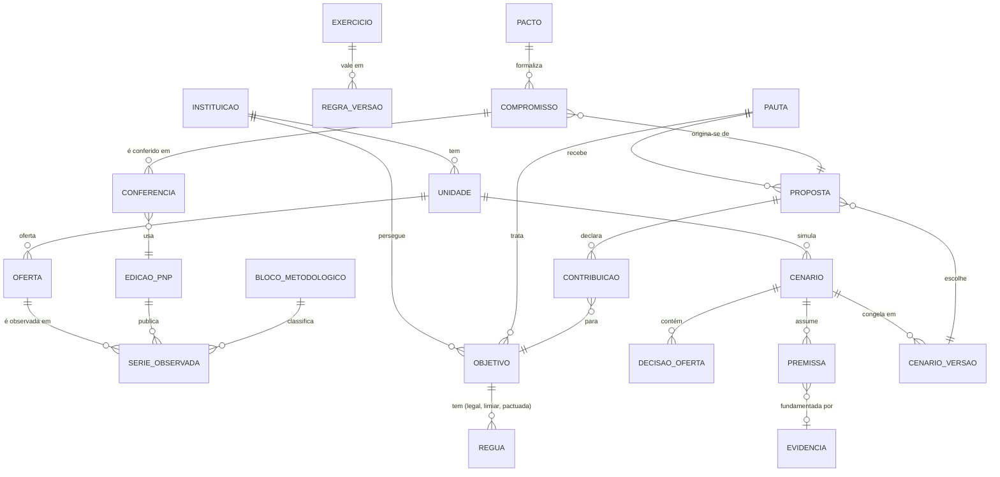

# 3 · Arquitetura e stack

> **Estudo de concepção de 12/11/2026, revisado na segunda rodada no mesmo dia.** Recomendação para o plano da primeira especificação.
> **Segunda rodada:** novo § 11 com o que muda no motor, no modelo de dados e na interface para acomodar capacidade, projeção longitudinal e estrela-guia. A recomendação de stack não muda. Os [princípios do projeto](../../../.specify/memory/constitution.md) dizem que nenhuma tecnologia está definida e que a escolha deve ser "a mais simples que respeite os princípios II, III e IX". Este documento argumenta qual é essa escolha.

---

## 1. O que determina a arquitetura

A arquitetura não sai de uma preferência por tecnologia. Sai de oito exigências do produto:

| # | Exigência | Origem | Consequência técnica |
|---|---|---|---|
| 1 | Todo número carrega natureza, fonte, regra e premissas | Princípio II | O resultado de um cálculo é um objeto rico, não um `float`. A proveniência é parte do modelo |
| 2 | Cálculo determinístico, reproduzível e testado contra referência | Princípios X e governança | O motor é código puro, sem banco nem rede, com testes de valores de referência |
| 3 | Fato, premissa, projeção e decisão separados | Princípio III | Esquema com tabelas distintas; cenários e compromissos imutáveis por versão |
| 4 | Regras versionadas por exercício | Princípio IV | Regras são dados versionados, com variantes "texto" × "prática" |
| 5 | Recálculo interativo na bancada e na mesa | Experiência (doc. 2) | Cálculo rápido: dezenas de ofertas × uma década. Cabe em milissegundos no servidor |
| 6 | Dados públicos compartilhados, dados da instituição isolados | Princípio IX | Duas zonas de dados no mesmo banco, com isolamento por instituição |
| 7 | Atualização anual de dados e regras | Ciclo anual | Pipeline de carga reexecutável, com edição e manifesto |
| 8 | Equipe pequena, produto que começa pequeno | Contexto | Um repositório, um processo, uma linguagem principal, um banco |

Volume de dados: a exportação inteira da PNP tem 93 MB e cerca de 500 mil linhas. Com 41 instituições, 22 campi cada e alguns objetivos, o volume de cenários e propostas é pequeno. **Não há problema de escala.** O problema é de correção, rastreabilidade e clareza.

---

## 2. Recomendação

**Monólito modular em Python/Django com PostgreSQL. Motor de cálculo como pacote Python puro, independente do Django. Interface renderizada no servidor com HTMX, e componentes interativos isolados onde a experiência exige.**

```
┌────────────────────────────── Django (um processo) ──────────────────────────────┐
│                                                                                   │
│  Interface (templates + HTMX + Alpine.js; gráficos com Observable Plot)           │
│     Agenda · Objetivo · Campus · Bancada · Mesa · Pacto · Como calcula            │
│                                    │                                              │
│  Aplicação (casos de uso: simular, compor, propor, pactuar, conferir)             │
│                                    │                                              │
│  ┌──────────── domínio ────────────┼───────────────────────────┐                  │
│  │ rede        regras   planejamento   governanca   evidencias │  instituicoes    │
│  └─────────────────────────────────┼───────────────────────────┘  (contas, papéis)│
│                                    │                                              │
│  prumo_motor  ← pacote Python puro, sem Django: coortes, composição,             │
│                 decomposição, regras da matriz, reprojeção de desvio              │
│                                                                                   │
│  ingestao (comandos): PNP, demonstrativos da matriz, portarias → zona pública     │
└────────────────────────────────────┬──────────────────────────────────────────────┘
                                     │
                         PostgreSQL (zona pública + zona por instituição)
                         Armazenamento de arquivos (fontes brutas, manifestos)
```

### 2.1. Por que Django

- **O domínio é rico e relacional:** instituições, unidades, ofertas, séries, regras, cenários, propostas, compromissos, papéis. O ORM e as migrações do Django cobrem isso sem esforço.
- **O Admin resolve a curadoria de dados** sem construir telas: correspondência de unidades entre edições da PNP, regras do exercício, configuração da instituição. É exatamente o tipo de tela interna que não merece desenho próprio.
- **Autenticação, permissões, sessões, formulários e proteção contra ataques comuns** vêm prontos.
- **A análise de dados já é Python.** Os extratores, o estudo da PNP e os testes de auditoria da matriz estão em Python. A carga da PNP e o motor de regras ficam na mesma linguagem.
- **É a escolha de menor risco para uma equipe pequena** e para quem herdar o sistema numa instituição pública.

### 2.2. Por que HTMX, e não uma SPA

A maior parte do produto é composta de páginas com endereço próprio, tabelas, registros e documentos: objetivo, campus, oferta, proposta, compromisso. Isso é o que a renderização no servidor faz melhor, com menos código e menos estado duplicado.

As interações ricas são poucas e bem delimitadas:

| Interação | Como resolver |
|---|---|
| Trocar alternativa por campus na mesa e ver totais | Requisição HTMX que devolve o fragmento da mesa; o cálculo leva milissegundos |
| Editar uma premissa e ver o quadro mudar | Idem, com atraso curto para não recalcular a cada tecla |
| Gráficos (ponte, funis, trajetórias, faixas) | Observable Plot, alimentado por JSON embutido no fragmento |
| Gaveta "Como calcula" | Fragmento HTMX carregado sob demanda |
| Modo reunião | Mesma tela, outra folha de estilo |

**Regra de escape:** se a mesa de composição ou a bancada precisarem de manipulação direta que o HTMX não sustente bem (arrastar, comparar dezenas de composições, animação contínua), aquele componente específico vira uma **ilha** em Svelte ou React, montada dentro da página Django e consumindo o mesmo endpoint JSON. Não se adota SPA para o produto inteiro por causa de uma tela.

### 2.3. Por que o motor fica no servidor, e não no navegador

Os protótipos calculavam em JavaScript no navegador. No produto, o motor fica em Python, no servidor:

- **uma única implementação** do cálculo, testada contra os valores de referência; não há risco de o navegador e o relatório divergirem;
- o resultado registrado numa proposta é **exatamente** o que foi exibido, porque vem do mesmo código;
- o custo é uma ida ao servidor por recálculo, que é aceitável para o volume em questão.

O comportamento dos motores dos protótipos (`coortes.js`, `coortes002.js`) é referência de especificação e fonte de casos de teste, não código a portar linha a linha.

---

## 3. Alternativas consideradas

| Alternativa | A favor | Contra | Quando reconsiderar |
|---|---|---|---|
| **FastAPI + React (SPA)** | Interatividade máxima; separação clara de API | Duas bases de código, dois estados, autenticação e admin a construir; mais trabalho para as telas de registro, que são a maioria | Se a equipe já for forte em React e o produto precisar de app móvel ou integrações via API cedo |
| **Django + React (SPA) com API** | Admin e ORM do Django; interface rica | Mesmo custo de duas aplicações; perde a simplicidade das páginas com endereço | Se mais da metade das telas virar manipulação direta |
| **Next.js / TypeScript de ponta a ponta** | Uma linguagem; os motores dos protótipos já estão em JS | Pior ecossistema para carga e análise de dados; regras da matriz e auditoria estão em Python | Se a equipe for essencialmente front-end |
| **Streamlit ou Dash** | Velocidade de protótipo analítico | Não sustenta produto multiusuário, com papéis, registro e auditoria; experiência engessada | Para estudos internos e análises de dados, não para o produto |
| **Planilha com macros ou BI comercial** | Familiar | Não separa fato de premissa, não versiona, não compõe nem registra compromisso | Nunca para o núcleo |

---

## 4. Organização do domínio

Apps Django com fronteiras claras. As dependências apontam para baixo; nada no domínio depende da interface.

| Módulo | Responsabilidade | Zona de dados |
|---|---|---|
| `prumo_motor` (pacote puro) | Coortes (vagas → ingressantes → matrículas → concluintes), composição por razão das somas, decomposição (ponte por campus, numerador × denominador, ingresso × tempo de vínculo), regras da matriz por exercício, reprojeção de desvio. Entrada e saída em estruturas de dados simples; cada saída com natureza e proveniência | Nenhuma |
| `rede` | Instituições, unidades com identidade estável, ofertas, séries observadas por edição e bloco metodológico, comparáveis | Pública |
| `regras` | Normas, versões por exercício, parâmetros (faixas, pesos, fatores, defasagem), variantes texto × prática | Pública |
| `instituicoes` | Instituição cliente, configuração (unidades atípicas, regra interna de distribuição, comparáveis padrão), usuários e papéis | Privada |
| `planejamento` | Objetivos e réguas, cenários, decisões de oferta, premissas, parâmetros de capacidade | Privada |
| `governanca` | Pautas, propostas, pareceres, pactos, compromissos, conferências e revisões | Privada |
| `evidencias` | Evidências e hipóteses registradas, com recorte e método | Privada |
| `ingestao` | Comandos de carga, validação e publicação das edições | Pública |

**Por que o motor é separado:** é a parte que mais precisa de testes, que mais tempo vai viver e que pode precisar ser executada fora do Django (cadernos de análise, reprodução por terceiros, auditoria). Mantê-lo puro é barato e protege o princípio X.

---

## 5. Modelo de dados conceitual



**Zona pública** (sem `instituicao_id` de cliente): `EDICAO_PNP`, `SERIE_OBSERVADA`, `BLOCO_METODOLOGICO`, `UNIDADE` e `OFERTA` como observadas, `EXERCICIO`, `REGRA_VERSAO`.
**Zona privada** (com `instituicao_id`): todo o resto.

### 5.1. Decisões de modelagem que importam

1. **Séries em formato longo e versionadas por edição.** Uma linha por (unidade ou oferta, indicador, ano-base, edição). Uma nova edição da PNP não sobrescreve a anterior: um compromisso conferido com a edição de 2027 continua reproduzível depois de 2028.
2. **Unidade com identidade própria.** A PNP identifica campus por nome. Uma tabela de correspondência curada liga nomes por edição a um identificador estável, com registro de renomeações e incorporações.
3. **Bloco metodológico como dado.** Cada série sabe a que bloco pertence (ex.: matrícula equivalente 2021–2025). A interface e o motor recusam série que atravessa quebra.
4. **Cenário mutável, versão imutável.** O gestor edita o cenário à vontade. Ao encaminhar uma proposta, o cenário é congelado numa `CENARIO_VERSAO` com o conteúdo completo: decisões, premissas com valor e origem, edição da PNP, versão das regras e versão do motor. Proposta e compromisso apontam para a versão, nunca para o cenário vivo.
5. **Resultado com proveniência.** Toda saída do motor segue a forma `{valor, faixa, natureza, fonte, regra, premissas, versão do motor}`. O que vai para a tela e para o registro é o mesmo objeto.
6. **Premissa com origem tipada:** histórico próprio, empréstimo (de qual oferta), comparáveis, norma, julgamento do gestor. A origem decide o marcador na tela.
7. **Governança como registro de eventos.** Propostas, pareceres, pactos, compromissos e revisões são acrescentados, não editados. Uma revisão de meta cria um novo registro que aponta para o anterior. Isso dá auditoria e histórico sem ferramenta extra.
8. **Regra interna de distribuição** é configuração da instituição, versionada como as regras nacionais. Sem ela, os valores por campus aparecem como "não estimado".

---

## 6. Dados: ingestão e atualização

### 6.1. PNP

```
arquivo bruto ─► manifesto (hash, data, origem) ─► área de preparação
   ─► validação (somas entre arquivos fecham? colunas esperadas? anos?)
   ─► normalização (unidade estável, classificação de oferta, bloco metodológico)
   ─► publicação como nova EDICAO_PNP (transação única)
   ─► relatório "o que mudou" + conferência automática dos compromissos
```

- Ferramentas: Python com **Polars** ou **DuckDB** para ler e transformar os CSV; resultado gravado no PostgreSQL. Executado como comando do Django.
- As verificações que o estudo da PNP fez à mão viram **testes da carga**: matrículas fecham entre `DadosGerais`, `TaxaEvasao` e `SituacaoMatricula`; ME de `DadosGerais` = `PercentuaisLegais` ÷ 100; percentuais do Ifes reproduzem os da matriz.
- Uma carga que não passa nas verificações não é publicada.
- **Frequência:** anual, com cargas extras quando a PNP corrigir dados.

### 6.2. Matriz e normas

Demonstrativos públicos (como o do IFMT), portarias e o que a fonte canônica já reproduziu entram como `REGRA_VERSAO` e parâmetros por exercício. A fonte canônica continua sendo o dossiê de auditoria; o produto implementa apenas o que é decisório (faixas de Qualidade, defasagem, fatores de modalidade, regra de MT quando for usada) e cita a RMO correspondente.

### 6.3. Dados da instituição

Na primeira versão, **nenhuma integração**. O que não é público entra como parâmetro informado pelo gestor, no ponto em que a decisão precisa dele (docentes por área de uma oferta, ambiente crítico, custo incremental). Integrações com sistemas acadêmicos (por exemplo, coortes do qAcadêmico) ficam para quando a pergunta exigir e houver acordo de dados.

---

## 7. Infraestrutura

### 7.1. Implantação inicial

- Um contêiner com a aplicação Django (Gunicorn), um PostgreSQL gerenciado e um armazenamento de arquivos para fontes brutas.
- Uma máquina virtual ou uma plataforma de aplicação simples. Na fase Ifes, pode rodar na infraestrutura da própria instituição.
- Ambientes: desenvolvimento, homologação e produção. Cópia de segurança diária do banco e dos arquivos brutos.
- Tarefas longas (carga anual) rodam como comando; não é preciso fila de tarefas na primeira versão.

### 7.2. Evolução para várias instituições

| Momento | O que muda |
|---|---|
| Uma instituição (Ifes) | `instituicao_id` em toda tabela privada desde o início, mesmo com uma só. Filtro obrigatório por instituição na camada de acesso a dados |
| Segunda instituição | **Row-Level Security do PostgreSQL** como segunda barreira; testes automáticos de isolamento; papéis por instituição |
| Várias | Acesso por subdomínio ou por seleção de instituição; login institucional via OIDC ou SAML (ex.: provedor de identidade de cada instituição ou gov.br) |

Recomenda-se **banco compartilhado com isolamento por linha**, não um esquema ou banco por cliente: os dados públicos são comuns e grandes; os privados são pequenos. Esquema por cliente multiplica migrações sem ganho.

### 7.3. Autenticação, papéis e auditoria

- **Papéis no modelo desde o início** (princípio IX): institucional (planejamento, pró-reitorias), local (direção de campus, restrita às suas unidades), leitura (colegiado), curador de dados, administrador.
- Primeira versão: contas locais do Django com convite. Login institucional quando houver segunda instituição.
- **Auditoria:** os objetos de governança já são registro de eventos (§ 5.1, item 7). Para os demais, um histórico de alterações por objeto. Acesso a cenários de outro campus é registrado.
- **Dados pessoais:** o núcleo não usa nenhum. Só os dados de cadastro de usuários. Isso simplifica a LGPD e deve ser preservado.

### 7.4. Escalabilidade

Não é um problema previsível. Se a mesa de composição ficar lenta com muitas unidades e objetivos, a primeira medida é **cache do resultado por hash das entradas** (o motor é determinístico, então o cache é exato). Réplicas de leitura, filas e serviços separados só com medição que os justifique.

---

## 8. Inteligência artificial

### 8.1. O que deve ser determinístico e independente de modelo de linguagem

Tudo o que produz número ou decisão: carga e validação de dados, séries, decomposições, comparáveis (critério declarado), motor de coortes, composição, regras da matriz, reprojeção de desvio, conferência de compromissos. **Princípio X.**

### 8.2. Casos de uso avaliados

| Caso | Valor | Risco | Recomendação |
|---|---|---|---|
| **Redação da nota técnica** de uma proposta ou pacto a partir dos resultados já calculados | Alto: é trabalho real e demorado do planejamento | Inventar ou alterar números; tom de recomendação | **Fazer depois do MVP**, com as salvaguardas do § 8.3 |
| Explicar em linguagem simples um cálculo da gaveta "Como calcula" | Médio | Explicação errada de regra | Avaliar depois; a gaveta estruturada vem primeiro |
| Resumo de "o que mudou" na PNP | Baixo: a decomposição já é a explicação | Leitura causal indevida | Não fazer; o texto é gerado por regra |
| Perguntas em linguagem natural sobre os dados | Baixo para o decisor; alto risco de número errado | Alto | Não planejar |
| Sugerir alternativas ou "melhor composição" | Contraria "não recomenda" | Alto | Não fazer |
| Classificar ofertas (ex.: formação de professores por nome de curso) | Médio | Classificação errada silenciosa | Só como sugestão para o curador, com revisão humana |

### 8.3. Salvaguardas, quando houver uso

- O modelo recebe **apenas resultados calculados** e devolve texto; todo número no texto é um marcador preenchido pelo sistema a partir do cálculo, ou passa por um verificador que rejeita números ausentes do conjunto calculado.
- Texto gerado é sempre rascunho editável, marcado como tal.
- Interface própria e trocável para o provedor; funcionalidade desligada por padrão e ativada por instituição.
- O produto funciona inteiro sem ela.

---

## 9. Qualidade e testes

| Tipo | O que garante | Exemplos já disponíveis no repositório |
|---|---|---|
| **Valores de referência** | O motor reproduz números conhecidos | Percentuais legais do Ifes 2024 (0,4403; 0,1206; 0,0186); professor-equivalente; casos da regra de MT |
| **Teste fora da amostra** | Capacidade preditiva do motor de coortes | Teste da recomposição: ajuste 2017–2021, teste 2022–2025 |
| **Propriedades** | Invariantes que nunca podem falhar | Matrícula = no prazo + retidos; sem negativos; suspender ingresso zera a oferta após o ciclo; composição = razão das somas |
| **Carga** | Dados publicados são coerentes | Fechamento entre arquivos da PNP |
| **Isolamento** | Uma instituição nunca vê dados de outra | A partir da segunda instituição |

O critério de aceite do motor por tipo de oferta (qual erro fora da amostra é aceitável) é uma decisão de produto a tomar na primeira especificação (próximo passo, § 3.5, item 3).

---

## 10. Resumo da recomendação

| Camada | Escolha | Alternativa principal |
|---|---|---|
| Linguagem | Python | TypeScript, se a equipe for front-end |
| Aplicação | Django, monólito modular | FastAPI |
| Cálculo | `prumo_motor`, pacote puro, no servidor | Motor em JS no navegador (rejeitado: duas verdades) |
| Interface | Templates + HTMX + Alpine; ilhas em Svelte/React se necessário | SPA em React |
| Gráficos | Observable Plot | ECharts, se precisar de mais interação |
| Banco | PostgreSQL, zonas pública e privada, isolamento por linha | — |
| Carga de dados | Polars ou DuckDB em comandos Django | Pandas |
| Implantação | Um contêiner + PostgreSQL gerenciado | — |
| IA | Nenhuma no MVP; nota técnica depois, com salvaguardas | — |

---

## 11. Segunda rodada: o que muda na arquitetura

A stack recomendada não muda. Mudam o conteúdo do motor, algumas entidades e o peso dos gráficos na interface.

### 11.1. Motor (`prumo_motor`)

| Componente | Conteúdo | Origem e teste |
|---|---|---|
| **Coortes** | Ocupação, evasão, conclusão no prazo e retenção separadas; alavancas combináveis com ano de início; horizonte de dez anos; sensibilidade das hipóteses | Comportamento de `poc/coortes002.js`. Teste: reproduzir os resultados da POC 0.0.2 (Vitória A +85 matrículas em 2032, +92 concluintes, +2,9 professores-equivalentes; Serra C +44, +55, +2,1; Ifes 44,74% mantendo e 45,14% com Vitória B + Serra C), como o protótipo v2 já faz |
| **Capacidade** | Turmas simultâneas por oferta, turno e ano; uso de salas, ambientes críticos e docentes por área; primeira restrição; ociosidade | Novo. Teste de propriedade: suspender ingressos zera turmas ao fim do ciclo; mudar o turno das turmas novas move o uso de um turno para outro sem alterar o total |
| **Matriz** | MT por parâmetros de oferta (RMO-066); referência marginal de Funcionamento + Reitoria; faixas e F-29 para Qualidade; calendário ano-base → exercício | Teste: degraus de V-13 (técnico +R$ 2.055.405; RAP −R$ 726.914; EJA +R$ 311.368), já reproduzidos pelo protótipo v2 para técnico |
| **Fases do efeito** | Começa, intensifica, estabiliza, restrição | Regras do [documento 8, § 3.3](08-capacidade-e-projecao.md#33-quando-o-impacto-começa-intensifica-estabiliza-e-esbarra) |
| **Composição** | Trajetória institucional por combinação; separação entre unidades calculadas e não calculadas | Razão das somas, como antes |

O motor continua puro e determinístico. A projeção de uma instituição inteira (22 campi, dezenas de ofertas, dez anos, três variantes de sensibilidade) cabe em dezenas de milissegundos; o cache por hash das entradas (§ 7.4) cobre a mesa.

### 11.2. Novas entidades (zona privada)

| Entidade | Conteúdo | Observação |
|---|---|---|
| `CapacidadeCampus` | Versão anual por unidade: salas por turno, horas de aula por professor, alunos por turma | Congelada junto da proposta |
| `AmbienteCritico` | Nome, capacidade semanal por turno, ofertas que o usam, aulas por turma | No máximo três por unidade na primeira jornada |
| `AreaDocente` | Nome da área agregada, docentes disponíveis, ofertas atendidas | Sem nomes de pessoas |
| `ParametroMatrizOferta` | Carga horária anual, peso, agropecuário, fator de modalidade, origem (norma, premissa ou planilha importada) | Importável da planilha da matriz da instituição |
| `VerificacaoCapacidade` | Uso calculado em 2025 × confirmado pelo campus, com o fator de ajuste aplicado | Registra que o modelo foi conferido |

`EXERCICIO` (zona pública, § 5) ganha os dados da Rede por exercício (somas ponderadas, submontantes, preço) para o mapa de degraus e a taxa de câmbio.

### 11.3. Interface

Os gráficos passam a ser o centro da bancada e da mesa. Recomendações:

- **Observable Plot** continua adequado para curvas com faixas, pequenos múltiplos de capacidade e mapa de calor.
- A bancada é a tela com maior chance de exigir uma **ilha interativa** (§ 2.2): muitas alavancas, recálculo a cada mudança e vários gráficos sincronizados. Recomenda-se prever essa ilha desde o plano da SPEC-001, consumindo um endpoint JSON do motor, em vez de descobrir o limite do HTMX no meio da construção.
- O protótipo v2 funciona inteiramente com HTML e SVG gerados no navegador, sem biblioteca, o que mostra que o volume de dados não exige nada pesado.

### 11.4. Dado institucional novo

A **planilha da matriz** que a instituição recebe a cada exercício (no Ifes, a "6ª fase"; no IFMT, o demonstrativo público C5) passa a ser um insumo opcional da primeira jornada, para preencher parâmetros por oferta. Ela fica na zona privada da instituição e nunca no repositório de código, como já acontece neste repositório exploratório. **[HIPÓTESE]** Todas as instituições recebem planilha equivalente; a confirmar com uma segunda instituição.
