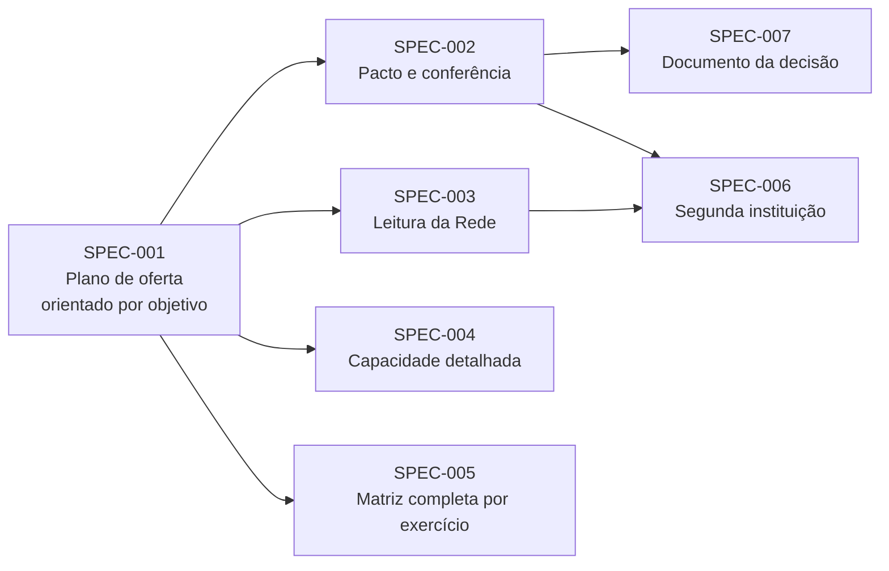

# 4 · Mapa de funcionalidades e de especificações

> **Estudo de concepção de 12/11/2026, revisado na segunda rodada no mesmo dia.** Proposta de organização funcional e de sequência de especificações para o Spec Kit.
> **Terceira rodada (13/11):** a SPEC-001 ganha desafio institucional, pauta de decisões, nível do curso e recurso compartilhado; a SPEC-002 ganha o acompanhamento por item ([documento 10](10-terceira-rodada.md)). Nenhuma especificação nova; OKR e workflow de aprovação continuam fora (§ 1).
> **Mudanças da segunda rodada:** estrela-guia na Leitura (M2); capacidade mínima e projeção longitudinal na Bancada (M3) e na SPEC-001; SPEC-004 e SPEC-005 redefinidas como aprofundamento; novo § 6 com o equilíbrio entre o essencial e a sofisticação. Justificativas no [documento 9](09-segunda-rodada.md). Respeita as regras de fluxo dos [princípios do projeto](../../../.specify/memory/constitution.md#fluxo-de-trabalho): uma jornada por vez, a primeira partindo da finalidade, nenhuma organizada em torno de um protótipo.

---

## 1. Módulos que não devem existir

Antes de dizer o que o PRUMO tem, vale dizer o que ele não deve ter, mesmo sendo comum em sistemas corporativos:

| Módulo comum | Veredito | Motivo |
|---|---|---|
| Cadastro de cursos e ofertas | **Não** | As ofertas vêm da PNP. O gestor só acrescenta o que não existe (oferta nova num cenário) |
| Painel de indicadores | **Não como módulo** | A PNP já é o painel. A leitura existe dentro de objetivo, campus e oferta, sempre ligada a uma decisão |
| Gestão de metas genérica (OKR, BSC) | **Não** | Metas existem como réguas de objetivos e como compromissos de propostas. Um cadastro de metas solto repete os sistemas de PDI |
| Workflow de aprovação com alçadas | **Não agora; talvez leve, depois** | A decisão é das instâncias. O PRUMO registra a decisão e quem a tomou. Pareceres são texto |
| Gestão de iniciativas e tarefas | **Não** | A execução acontece fora, nos sistemas e processos que a instituição já tem |
| Inventário de infraestrutura | **Não; modelo mínimo de capacidade, sim** | Salas por turno, até três ambientes críticos e docentes por área, cadastrados uma vez por campus ([documento 8](08-capacidade-e-projecao.md)). Sem patrimônio, sem horário |
| Relatórios configuráveis | **Não** | Exportação de proposta e pacto, com formato fixo e fundamentado |
| Chat com os dados | **Não** | Ver documento 3, § 8 |

---

## 2. Organização funcional

Seis capacidades de produto e uma de suporte. Elas desdobram as três capacidades da visão (inteligência, simulação, governança) em partes construíveis.

```
                ┌───────────────────────────────────────────────────────────┐
                │ M6 · Transparência: natureza, proveniência, "como calcula" │  (transversal)
                └───────────────────────────────────────────────────────────┘
 M1 Base da Rede ──► M2 Leitura ──► M3 Bancada ──► M4 Mesa e pacto ──► M5 Conferência
   (dados)          (inteligência)   (simulação)    (governança)       (governança + inteligência)
                         ▲                                                 │
                         └──────────────── nova edição da PNP ─────────────┘
 M7 · Instituição e acesso (suporte)
```

### M1 · Base da Rede

| | |
|---|---|
| **Objetivo** | Ter a série pública da Rede Federal correta, versionada por edição, com unidades estáveis e quebras de série como metadado |
| **Problema** | A PNP é rica mas cheia de armadilhas (fórmula da ME em 2021, pandemia, rótulos instáveis, campus sem código). Sem curadoria, todo o resto mente |
| **Usuários** | Curador de dados; indiretamente, todos |
| **Funcionalidades essenciais** | Carga da exportação da PNP com validação; correspondência de unidades entre edições; classificação de ofertas (tipo, forma, modalidade, presencial/EaD, FIC); blocos metodológicos; regras e parâmetros por exercício; relatório da carga |
| **Informações** | Exportação dos Indicadores de Gestão da PNP; demonstrativos públicos da matriz; portarias |
| **Telas** | Admin de curadoria; relatório da carga |
| **Dependências** | Nenhuma |
| **Prioridade** | **1**, mas só o necessário para o primeiro objetivo |
| **Relação** | Alimenta M2, M3 e M5 |

### M2 · Leitura (inteligência)

| | |
|---|---|
| **Objetivo** | Responder "onde estamos, como chegamos aqui, o que aconteceu em casos parecidos" |
| **Problema** | O gestor vê retratos, não mecanismos; não sabe se a mudança veio dele, da Rede ou de uma oferta em pulso |
| **Usuários** | Planejamento, reitoria, direção de campus |
| **Funcionalidades essenciais** | **[2ª rodada]** Estrela-guia: participação na matriz decomposta por bloco e mapa de degraus ([documento 7](07-estrela-guia-e-indicadores.md)); posição do objetivo nas réguas; ponte de contribuição por campus; decomposições (ingresso × tempo de vínculo; numerador × denominador; o que fizemos × o que a Rede fez); funis por oferta; "o que mudou" na edição; comparáveis por trajetória com critério declarado; precedentes; guardar evidência e hipótese |
| **Informações** | M1; critério de comparáveis (padrão do produto, ajustável pela instituição) |
| **Telas** | Agenda; Objetivo; Ficha do campus; Oferta; Rede |
| **Dependências** | M1 |
| **Prioridade** | **1** para objetivo e campus; **3** para o explorador da Rede |
| **Relação** | Fornece evidências às premissas de M3 e aos pareceres de M4; consome a nova edição para M5 |

### M3 · Bancada de alternativas (simulação e capacidade)

| | |
|---|---|
| **Objetivo** | Transformar decisões de oferta em consequências no tempo, com viabilidade, e compará-las |
| **Problema** | Decide-se vaga sem ver concluintes, recursos e prazo; o efeito chega dois a três anos depois; a alternativa atraente pode não caber no campus |
| **Usuários** | Direção de campus; planejamento |
| **Funcionalidades essenciais** | Alavancas combináveis (ampliar ou reduzir vagas, abrir, suspender, migrar, preencher melhor, reduzir evasão, mudar turno, prover capacidade); linha de base "manter"; motor de coortes com ocupação, evasão, conclusão no prazo e retenção separadas; **[2ª rodada]** curvas observado → manter → cenário com faixas para matrículas, ingressantes, concluintes, ocupação, retidos, matrícula equivalente, MT estimada e docentes; fases do efeito (começa, intensifica, estabiliza, restrição); **[2ª rodada]** capacidade mínima do campus (turmas simultâneas, salas por turno, até três ambientes críticos, docentes por área) com verificação em 2025 e primeira restrição; **[2ª rodada]** efeito na matriz (MT, referência, percentuais legais, distância aos degraus, exercício); premissas com procedência; "o que precisa ser verdade"; resposta em texto; encaminhar como proposta |
| **Informações** | M1 (séries por oferta); cadastro de capacidade do campus; parâmetros de matriz por oferta (padrão ou importados); premissas do gestor |
| **Telas** | Ficha do campus (portfólio, capacidade, sinais); Bancada |
| **Dependências** | M1, M2 (evidências), motor |
| **Prioridade** | **1** |
| **Relação** | Gera as propostas de M4; suas premissas e sua capacidade são o que M5 confere |

### M4 · Mesa de composição e pacto (governança)

| | |
|---|---|
| **Objetivo** | Compor contribuições diferentes dos campi e registrar o que foi pactuado |
| **Problema** | Metas iguais para todos, ou diferentes sem fundamento; conflitos entre objetivos invisíveis; nenhuma memória do pactuado |
| **Usuários** | Planejamento (opera); colegiado (decide); campi (propõem) |
| **Funcionalidades essenciais** | Pauta do ciclo; propostas com contribuição, recursos, contrapartidas e premissas; pareceres; **[2ª rodada]** trajetória institucional 2021–2035 por combinação, com comparação de até três combinações e separação entre unidades calculadas e não calculadas; cruzamento de degrau e exercício; mesa campi × objetivos com razão das somas; conflitos; distância às réguas; alavancas restantes; modo reunião; registro do pacto e dos compromissos com responsável, indicador e horizontes; exportação |
| **Informações** | Propostas (M3); objetivos e réguas; regra interna (opcional) |
| **Telas** | Mesa; Proposta; Pacto |
| **Dependências** | M3 |
| **Prioridade** | **1** para mesa e proposta; **2** para pacto e compromissos |
| **Relação** | É a finalidade; consome M2 e M3; alimenta M5 |

### M5 · Conferência (acompanhamento e revisão)

| | |
|---|---|
| **Objetivo** | Conferir compromissos com o observado e explicar desvios |
| **Problema** | Acompanhamento hoje é semáforo, ou não existe; a revisão é política, não técnica |
| **Usuários** | Planejamento; direção de campus |
| **Funcionalidades essenciais** | Horizontes (execução, intermediário, longo prazo); conferência automática na carga de nova edição; desvio explicado por reprojeção; revisão de premissa com propagação; revisão de meta com justificativa |
| **Informações** | Compromissos (M4); nova edição (M1) |
| **Telas** | Pacto e acompanhamento; seção na Agenda |
| **Dependências** | M4, M1 |
| **Prioridade** | **2** |
| **Relação** | Fecha o ciclo; devolve premissas revistas a M3 |

### M6 · Transparência (transversal)

| | |
|---|---|
| **Objetivo** | Que todo número possa ser explicado e reproduzido |
| **Funcionalidades essenciais** | Marcadores de natureza; gaveta "Como calcula"; erro do modelo por tipo de oferta; versões de regra e de edição; glossário |
| **Prioridade** | **1**, desde a primeira tela. Não é um módulo a construir depois |

### M7 · Instituição e acesso (suporte)

| | |
|---|---|
| **Objetivo** | Instituição como parâmetro; papéis; isolamento |
| **Funcionalidades essenciais** | Configuração da instituição (unidades atípicas, comparáveis, regra interna); usuários e papéis; isolamento entre instituições; login institucional |
| **Prioridade** | Modelo desde o início; controle de acesso completo quando houver uso real por mais de uma equipe ou segunda instituição |

---

## 3. O que se calcula com quê

> **[2ª rodada]** A classificação completa, indicador por indicador, em quatro classes (calculável, projetável, dependente de dado institucional, não estimável) está no [documento 7, § 6](07-estrela-guia-e-indicadores.md#6-classificação-dos-indicadores). A tabela abaixo continua válida como resumo.

| Grupo | O quê | Natureza na tela |
|---|---|---|
| **Só com dados oficiais públicos** (funciona para qualquer das 41 instituições, sem nada da instituição) | Posição e trajetória por objetivo (percentuais legais, matrículas, ingressantes, concluintes, evasão anual, professor-equivalente); ponte por campus; decomposições; funis por oferta; comparáveis; precedentes; "o que mudou"; faixas de Qualidade e distância aos limiares institucionais (2026); calendário ano-base → exercício; ajuste do motor de coortes e erro fora da amostra; linha de base "manter" | Fato ou estimado |
| **Exige parâmetros da instituição** | Decisões de oferta e suas premissas; objetivos escolhidos e meta pactuada; recurso crítico de uma decisão (docentes por área, ambiente por turno); custo incremental; regra interna de distribuição; critérios próprios de comparáveis | Premissa |
| **Depende de dados ainda indisponíveis** | Separar evasão, retenção e duração por turma (exige coortes do sistema acadêmico); efeito de ações de permanência; IEA e RAP da matriz a partir da PNP (não reconciliam); matrícula total da matriz por campus a partir de dados acadêmicos; formação de professores por curso; demanda territorial; valor em reais por campus | Não estimado (ou hipótese com faixa larga) |

**Consequência:** o PRUMO pode abrir para qualquer instituição da Rede com as duas primeiras telas cheias e honestas. A simulação funciona com dados públicos mais poucas premissas. Os dados indisponíveis não bloqueiam nada: aparecem como lacuna nomeada, que também é informação útil ao gestor.

---

## 4. Mapa de especificações

Sete especificações, cada uma uma jornada com valor demonstrável. As três primeiras formam o primeiro produto utilizável (documento 5).

### SPEC-001 · Plano de oferta orientado por objetivo

| | |
|---|---|
| **Objetivo** | A jornada integrada mínima: da estrela-guia e dos objetivos institucionais à proposta viável do campus e à composição |
| **Problema** | Não existe hoje um caminho que ligue uma meta agregada às decisões de vagas dos campi, com o efeito no tempo, na capacidade e na matriz visível antes de decidir |
| **Escopo funcional** | Carga da PNP (o necessário); estrela-guia por bloco e mapa de degraus (2026); dois objetivos (formação técnica e concluintes técnicos); régua tripla; ponte por campus; ficha do campus com funis, **capacidade mínima e verificação 2025**; bancada com **alavancas combináveis e curvas observado → manter → cenário até 2035 com faixas**; motor de coortes; **turmas simultâneas, docentes por área, salas por turno e até três ambientes críticos**; **MT estimada por parâmetros de matriz por oferta e referência condicional por exercício**; premissas com procedência; proposta; mesa com **trajetória institucional** e cruzamento de degrau; "como calcula"; uma instituição |
| **Requisitos principais** | Princípios II a VIII; composição por razão das somas; um segundo objetivo cabe sem mudança de estrutura; motor aceito só com erro medido fora da amostra por tipo de oferta; capacidade verificada contra o uso de 2025 antes de simular; unidades sem simulação nunca somadas silenciosamente à trajetória calculada; nenhuma recomendação |
| **Dependências** | Nenhuma |
| **Critérios de aceite** | (1) O planejamento vê a participação na matriz por bloco, o mapa de degraus e quem explica a variação de cada objetivo. (2) Um diretor responde, para o próprio campus, à pergunta do critério de sucesso da segunda rodada: quantos estudantes a mais atende e forma, que indicadores melhoram, de que recursos precisa, quando esbarra na capacidade e como contribui para os objetivos. (3) A mesa compõe propostas de pelo menos quatro unidades, mostra a trajetória institucional até 2035, conflitos e cruzamento de degrau. (4) Todo número abre "como calcula". (5) Os valores de referência do portão de dados, da POC 0.0.2 e de V-13, e os testes fora da amostra, passam |
| **Valor demonstrável** | Preparar com fundamento a reunião de pactuação do ciclo de vagas, com a estrela-guia à vista |

**[3ª rodada] Acréscimos à SPEC-001:**

- **Desafio institucional:** partida, meta, horizonte em exercício e cenário da Rede, sem cota por unidade.
- **Pauta como unidade de composição:**
  - cada item tem origem, situação, operações, variantes e recurso exigido;
  - itens de um campus rodam juntos no motor;
  - oferta repetida fica fora da soma;
  - recurso compartilhado tem um único destino.
- **Contribuição no nível do curso,** com operações por oferta.
- **Comparação em quatro anos:** sem novas decisões × item × conjunto × falta.

**Critério de aceite (6):** a mesa responde, para uma pauta de pelo menos 30 itens, *"se aprovarmos esta combinação, como muda a trajetória da instituição nos próximos quatro anos, o que ainda falta para a meta e de que recursos isso depende?"*. A resposta tem de chegar igual entrando pelo desafio da Reitoria ou pela proposta de um curso.

Corresponde ao § 3.3 do [próximo passo](../../produto/proximo-passo.md#33-primeira-especificação-jornada-de-decisão-estratégica-institucional), com quatro mudanças propostas: dois objetivos em tensão em vez de um; a ficha do campus como entrada do diretor (documento 6, §§ 3.1 e 3.3); **[2ª rodada]** capacidade mínima e projeção longitudinal; **[2ª rodada]** estrela-guia e efeito na matriz.

### SPEC-002 · Pacto e conferência

| | |
|---|---|
| **Objetivo** | Fechar o ciclo: registrar o pactuado e conferi-lo com a PNP seguinte |
| **Problema** | O que se decide não é lembrado nem conferido; a revisão é política |
| **Escopo funcional** | Pauta do ciclo; pareceres; registro do pacto; compromissos com responsável, indicador e três horizontes; carga de nova edição com conferência automática; desvio explicado; revisão de premissa e de meta; exportação do pacto |
| **Requisitos principais** | Governança como registro de eventos; versões imutáveis de cenário; compromisso avaliado só no horizonte observável |
| **Dependências** | SPEC-001 |
| **Critérios de aceite** | (1) Um pacto registrado em 2023 com dados até o ano-base 2022 é conferido com as edições 2023–2025 (**conferência retroativa**), com desvios explicados. (2) Revisar uma premissa mostra os cenários afetados. (3) **[2ª rodada]** A participação observada na matriz do exercício seguinte é decomposta em "o que fizemos" e "o que a Rede fez". (4) **[3ª rodada]** Cada item pactuado tem indicador acompanhado, responsável e primeira conferência; nada em disputa ou sobreposto é pactuado |
| **Valor demonstrável** | A primeira vez que a instituição vê uma decisão passada conferida e explicada |

### SPEC-003 · Leitura da Rede

| | |
|---|---|
| **Objetivo** | Ampliar a inteligência: comparáveis, precedentes, trajetórias, "o que mudou" |
| **Problema** | Comparar com "quem cresceu mais" leva a copiar trajetórias ruins (caso IFMA) |
| **Escopo funcional** | Explorador de trajetórias decompostas; seleção de comparáveis por perfil e mecanismo de crescimento; busca de precedentes (decisões parecidas em outras unidades); evidências e hipóteses com "o que confirmaria" |
| **Requisitos** | Sem ranking; critério declarado; associação sem causa |
| **Dependências** | SPEC-001 |
| **Critérios de aceite** | Os quatro casos do estudo da PNP (Ifes, IFMA, IFPR, IFPE) são reproduzidos pela ferramenta |
| **Valor** | Premissas e argumentos melhores; porta de entrada para outras instituições |

### SPEC-004 · Capacidade detalhada

> **[2ª rodada]** Redefinida. O modelo mínimo de capacidade (nível 2) passou para a SPEC-001. Esta especificação aprofunda.

| | |
|---|---|
| **Objetivo** | Tornar a verificação de viabilidade mais fina quando o modelo mínimo não bastar |
| **Escopo funcional** | Componentes curriculares por área; disponibilidade por dia e bloco quando o turno não bastar; equipamentos críticos; custo de adequação e investimento por alternativa; custeio incremental; docentes compartilhados entre campi; capacidade liberada por descontinuação, com transição |
| **Requisitos** | Continua sem grade horária, sem alocação nominal de professores e sem inventário patrimonial |
| **Dependências** | SPEC-001 |
| **Critérios de aceite** | O caso de Itapina (laboratório esgotado em 2029, antes do efeito na matriz) é reproduzido com custo de adequação; uma restrição detectada no nível 2 é confirmada ou desfeita no nível 3 |
| **Valor** | Evitar aprovar oferta que não cabe, e saber quanto custa fazê-la caber |

### SPEC-005 · Matriz completa por exercício

> **[2ª rodada]** Redefinida. Mapa de degraus, MT por parâmetros de oferta e referência condicional passaram para a SPEC-001. Esta especificação trata da reprodução completa e dos cenários da Rede.

| | |
|---|---|
| **Objetivo** | Reproduzir a participação da instituição no exercício e projetá-la sob cenários declarados da Rede |
| **Escopo funcional** | Reprodução da MT dos ciclos existentes pela regra operacional (com a planilha da matriz da instituição); variantes "prática 2026" × "texto da Portaria 243"; cenários de crescimento da Rede por modalidade; art. 7º e pisos; regra interna de distribuição como configuração e retorno ao campus; decomposição "o que fizemos × o que a Rede fez" |
| **Requisitos** | Princípio VI; "mantidas as demais" como padrão; nunca receita do campus |
| **Dependências** | SPEC-001; memória de cálculo da matriz 2027 (pedido à Setec) |
| **Critérios de aceite** | Os 2.322 ciclos do Ifes e os 1.086 do IFMT são reproduzidos (testes já existentes); a participação de 2026 é reconstruída por bloco; o valor por campus sem regra interna aparece como "não estimado" |
| **Valor** | Participação projetada com rigor de auditoria; incentivos do pacto explícitos |

### SPEC-006 · Segunda instituição

| | |
|---|---|
| **Objetivo** | Abrir o PRUMO para outra instituição sem trabalho manual |
| **Escopo funcional** | Isolamento por linha; papéis e login institucional; configuração inicial da instituição; Agenda e Objetivo "começam sabendo" |
| **Dependências** | SPEC-001 a 003 |
| **Critérios de aceite** | Uma instituição nova vê seus objetivos e campi preenchidos em minutos; testes de isolamento passam |
| **Valor** | Prova de produto replicável (hipóteses H7 e H8 da visão) |

### SPEC-007 · Documento da decisão

| | |
|---|---|
| **Objetivo** | Produzir a nota técnica de uma proposta ou pacto |
| **Escopo funcional** | Documento com formato fixo; anexos de cálculo; redação assistida opcional (documento 3, § 8) |
| **Dependências** | SPEC-002 |
| **Valor** | Encurtar o trabalho do planejamento e fazer a decisão circular no processo administrativo |

---

## 5. Sequência e dependências



| Marco | Especificações | O que se consegue demonstrar |
|---|---|---|
| **Primeiro produto utilizável** | 001 (e 002 em seguida) | Uma rodada completa do ciclo de vagas, da leitura à pactuação, e uma conferência retroativa |
| **Produto do Ifes** | 003, 004 | Comparáveis e precedentes; restrições de capacidade |
| **Produto da Rede** | 005, 006 | Matriz completa e cenários da Rede; segunda instituição |
| **Produto maduro** | 007 | A decisão sai do PRUMO como documento |

A ordem entre 003, 004 e 005 deve seguir o que os gestores pedirem depois do primeiro uso real, e não esta tabela.

---

## 6. Essencial × sofisticação (segunda rodada)

O número de especificações continua sete. O que muda é a fronteira entre a primeira e as evolutivas.

| Capacidade | Essencial para decidir com fundamento (SPEC-001) | Sofisticação posterior |
|---|---|---|
| **Projeção** | Curvas observado → manter → cenário até 2035, com faixas, para matrículas, ingressantes, concluintes, ocupação, retidos, ME, MT e docentes; fases do efeito | Calibração por coortes do sistema acadêmico; cenários probabilísticos; mais de um motor por tipo de oferta (só se o erro exigir) |
| **Capacidade** | Turmas simultâneas; salas por turno; até três ambientes críticos; docentes por área; verificação em 2025; primeira restrição; ociosidade; mudar turno como alavanca | Componentes curriculares, dia e bloco, equipamentos, custo de adequação, investimento, custeio incremental, docentes compartilhados (SPEC-004) |
| **Matriz** | Participação por bloco no exercício observado; mapa de degraus; MT por parâmetros de oferta; referência condicional de Funcionamento + Reitoria e de Qualidade por exercício, Rede constante | Reprodução exata dos ciclos; variantes de regra; cenários da Rede; art. 7º; regra interna e retorno ao campus (SPEC-005) |
| **Governança** | Proposta com recursos e restrição; mesa com trajetória institucional, comparação de combinações, conflitos e cruzamento de degrau | Pacto formal, horizontes, conferência, desvio explicado (SPEC-002) |
| **Inteligência** | Objetivo, ficha do campus, evidência junto da premissa | Explorador da Rede, comparáveis, precedentes (SPEC-003) |

**Regra de corte usada:** entra na SPEC-001 o que é necessário para que o gestor **não tome uma decisão de oferta sem ver quando ela esbarra na capacidade e quanto ela move a estrela-guia**. Fica para depois o que torna essas respostas mais finas, mas não muda a decisão na maioria dos casos.
