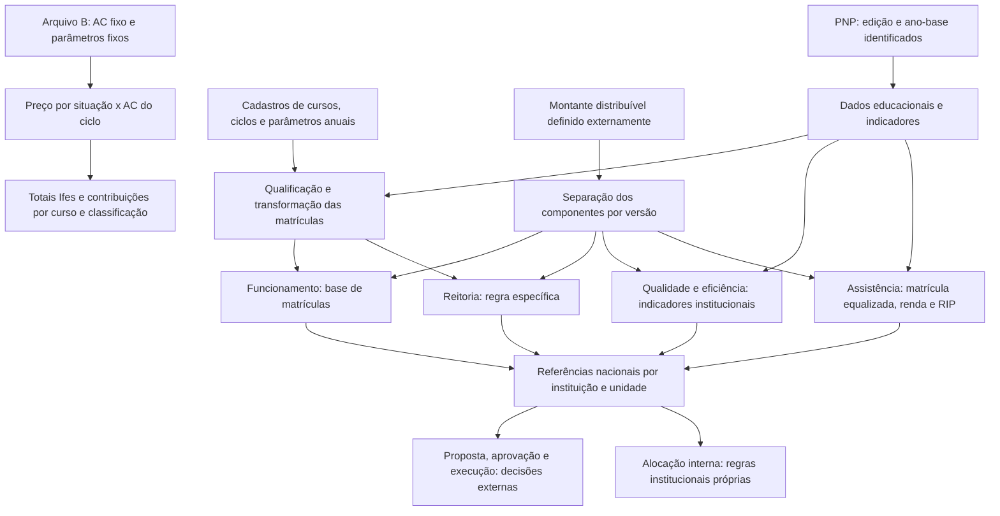

# Matriz Orçamentária da Rede Federal: fonte canônica do domínio

## 0. Metadados e controle de versão

| Campo | Conteúdo |
|---|---|
| Finalidade | Consolidar evidências para compreender a matriz, auditar o caso Ifes 2026 e orientar futuros requisitos e cálculos. |
| Escopo | Livro de 2025; pasta de participação das matrículas de 2026; verificação externa dos atos e de documentação institucional. Nenhum simulador foi implementado. |
| Exercícios | Histórico descrito no livro até 2025; caso operacional denominado 2026, com dados de 2024; atualização normativa localizada em 2026, cuja íntegra não pôde ser verificada. |
| Data da análise e das consultas externas | 08/11/2026, America/Sao_Paulo. |
| Versão | 1.0.0, primeira consolidação rastreável. |
| Situação | Revisão documental e conferência aritmética concluídas no alcance declarado. Validação de domínio e homologação institucional pendentes. |
| Responsável pela análise | Agente Codex, a pedido do projeto Prumo/Ifes. |
| Responsável pela validação de domínio | Não indicado. Recomenda-se responsável pela matriz no Ifes e, nas questões nacionais, Comissão Paritária/Setec/Forplan. |
| Limite de autoridade | Esta consolidação não substitui os atos oficiais nem certifica valores de LOA ou receita. Uma fórmula reproduzida pode implementar um parâmetro incorreto. |
| Prontidão | Suficiente para reproduzir a aritmética do arquivo recebido, mantendo suas entradas fixas e suas ressalvas. Insuficiente para calcular a matriz nacional vigente inteira ou projetar receita garantida. |

### 0.1. Registro das fontes

Identificadores de fonte são usados em todo o documento. Referências de páginas de **A** usam primeiro a página impressa, seguida da posição no PDF quando necessário. Neste exemplar, das páginas numeradas examinadas, a página impressa corresponde à posição no PDF mais um. Assim, **p. 44 = PDF 43**. Os nomes das abas e os endereços de **B** são literais.

| ID | Fonte e identificação | Exame efetivo e condição de uso |
|---|---|---|
| A | *A Matriz Orçamentária da Rede Federal de Educação Profissional, Científica e Tecnológica: um guia abrangente*, Editora IFSertãoPE, 2025. Arquivo `LIVRO-MATRIZ-NOVA-CONFIGURACAO.pdf`, 65 páginas físicas, ISBN digital 978-65-89380-47-4. [Registro editorial](https://releia.ifsertaope.edu.br/jspui/handle/123456789/1651). | Texto integral extraído e lido; figuras, tabelas e equações relevantes renderizadas e examinadas visualmente. Evidência metodológica/histórica, não confirmação automática de norma vigente. |
| B | `6ª Fase - Participação matrículas totais 2026 IFES - cópia.xlsx`, arquivo fornecido na raiz do projeto. | Todas as quatro abas e todas as células não vazias, fórmulas, resultados armazenados e estruturas do pacote XLSX examinados sem salvar ou alterar o original. |
| N1 | [Decreto nº 7.313, de 22/09/2010, texto do Planalto](https://www.planalto.gov.br/ccivil_03/_ato2007-2010/2010/decreto/d7313.htm), especialmente art. 4º, caput e §§ 1º–2º. | Texto oficial consultado integralmente. A página consultada não exibia indicação de revogação; isto não equivale a certidão de vigência ou pesquisa exaustiva de atos posteriores. |
| N2 | Portaria MEC nº 646, de 25/08/2022: [publicação original](https://www.in.gov.br/web/dou/-/portaria-n-646-de-25-de-agosto-de-2022-425194865), [republicação](https://www.in.gov.br/en/web/dou/-/portaria-n-646-de-25-de-agosto-de-2022-%2A-430796902), [DOU de 21/09/2022, seção 1, p. 122](https://pesquisa.in.gov.br/imprensa/servlet/INPDFViewer?captchafield=firstAccess&data=21%2F09%2F2022&jornal=515&pagina=122). | A íntegra não foi recuperada: DOU retornou erro de acesso. Foram verificáveis, no texto indexado da página oficial 122, art. 1º, art. 2º e parágrafo único, início do art. 3º e abertura do Anexo sobre os quatro blocos e sua granularidade. Somente esses trechos sustentam regras NORMATIVAS deste documento. O restante é atribuído explicitamente a A. |
| N3 | [Portaria MEC nº 243, de 10/03/2026](https://www.in.gov.br/web/dou/-/portaria-mec-n-243-de-10-de-marco-de-2026-692098706). | Ato localizado, mas íntegra e anexos inacessíveis: respostas 502 pelo leitor web, 403 ou encerramento de conexão na obtenção direta; navegador indisponível. Dispositivos, data de vigência, transição e diferenças metodológicas NÃO confirmados. |
| C1 | [IFMT, Orçamento Anual](https://ifmt.edu.br/pro-reitorias/administracao/orcamento/orcamento-anual/), seções 2026 e documentos relacionados. | Página institucional consultada. Informa uso de dados 2024/1 e 2024/2 na matriz 2026 e identifica a nº 646/2022 como revogada pela nº 243/2026. É evidência institucional da atualização, não leitura do dispositivo revogador. Os valores orçamentários do IFMT não foram importados como parâmetros do Ifes. |
| C2 | [IFPB, Principais Normas e Legislação](https://www.ifpb.edu.br/ead/principais-normas-e-legislacao), portarias nacionais. | Página institucional confirma título, data, objeto e link de N3. Não fornece seu articulado. |
| C3 | [Protocolo Integrado, processo 23000.029104/2020-53](https://protocolointegrado.gov.br/Protocolo/documento/detalhes_documento.jsf?protocolo=23000029104202053). | Histórico oficial de tramitação consultado: registro de encaminhamento da publicação de N3 em 12/03/2026. Não utilizado para inferir suas equações ou vigência. |
| C4 | [Conif, página do Guia de Análise e Interpretação de Indicadores](https://portal.conif.org.br/estudos/guia-de-analise-e-interpretacao-de-indicadores-da-matriz-orcamentaria-da-rede-federal-de-educacao-profissional-cientifica-e-tecnologica). | Página de apresentação consultada; descreve conexão PNP–matriz e menciona custeio e capital da 20RL. O PDF vinculado não foi incorporado como fonte integralmente analisada. |
| P1 | `contexto_projeto_inteligencia_estrategica_educacional_ifes_v1_1.md`, especialmente §11. | Contexto de produto e pista para buscar N3. Não é fonte comprobatória de regra da matriz. |

Identidade dos originais, SHA-256:

```text
A  43b62247deb2beec8cfe415737899f823a91060a749343b43992f91584499486
B  7f62a6ebcf6fac12a7b63805e6f936a68469d2e13e3f71759c7d550cb5de5d33
```

Uma cópia oficial de edição do DOU disponível no FNDE foi examinada, mas terminava na p. 183 de 30/08/2022, contendo apenas a abertura de N2; não resolveu a falta do articulado e do Anexo. Nenhuma notícia secundária foi usada para confirmar fórmulas de N3. Não foi obtida a edição da PNP exportada para B, o cadastro nacional que originou os parâmetros nem a memória de cálculo anterior à sexta fase.

### 0.2. Convenções de evidência e manutenção

| Classificação | Como interpretar |
|---|---|
| NORMATIVA | Comportamento expresso em dispositivo oficial efetivamente verificável; a extensão da verificação consta da fonte. |
| METODOLÓGICA | Descrição técnica do livro; pode conter ambiguidade, erro editorial ou versão anterior. |
| OPERACIONAL | Comportamento observado em B; válido para essa cópia, não automaticamente para outros exercícios. |
| HISTÓRICA | Comportamento atribuído a um período passado por A. Não aplicar prospectivamente sem outra evidência. |
| DERIVADA | Consequência demonstrável de regras identificadas e de premissas expressas. |
| HIPÓTESE | Cenário ou interpretação ainda não comprovado. |
| NÃO DETERMINADA | As fontes não permitem estabelecer um procedimento completo. |

Confiança **alta** significa evidência direta e reprodução quando pertinente; **média**, descrição direta com alcance ou consistência incompletos; **baixa**, interpretação provisória ou ausência de prova. Confiança não substitui classificação nem aplicabilidade. “Confirmada” em regra OPERACIONAL confirma a observação, não sua legalidade. Não se reclassifica uma regra histórica como vigente apenas porque não se encontrou revogação.

Manter os IDs RMO ao revisar. Registrar nova versão, fonte, exercício e efeito da alteração; se um entendimento for substituído, preservar o anterior no histórico. Não substituir os parâmetros de B por números de outra fonte sem criar uma versão de cálculo distinta.

## 1. Visão geral — Entenda a matriz em cinco minutos

A Matriz Orçamentária é um método de repartir um montante definido externamente entre instituições e componentes da Rede Federal. O Decreto nº 7.313/2010 exige sua observação na proposta anual dos institutos federais. A matrícula educacional passa por qualificadores para representar uma unidade de distribuição: duas pessoas matriculadas podem contribuir de maneira diferente segundo carga horária, ciclo, peso do curso e modalidade. O resultado é uma referência de participação e de valor distribuído, sujeita à versão da metodologia e ao orçamento disponível [RMO-001, 005–015].

O livro de 2025 apresenta custeio e assistência estudantil como foco. Após separar a assistência, divide o remanescente em Funcionamento (80%), Reitoria (10%) e Qualidade e Eficiência (10%). O Decreto também menciona despesas de capital, enquanto A exclui o investimento de sua descrição operacional e C4 menciona capital da 20RL: esta diferença de escopo está aberta em L-03. Folha de pagamento não é calculada pela pasta analisada. Não se deve usar essa pasta para estimar todo o orçamento institucional [RMO-001, 006; §14].

As entradas gerais são dados educacionais da Plataforma Nilo Peçanha (PNP), parâmetros de cursos e ciclos, indicadores institucionais, renda e limites anuais de recursos. As saídas possíveis são matrículas ajustadas, coeficientes de participação, referências por componente e totalizações. A planilha recebida contém apenas dados do Ifes e parâmetros nacionais fixos: calcula valores de contribuição por ciclo e os agrega por curso e classificação. Não contém o cálculo dos indicadores de eficiência, o rateio de assistência, a parcela de Reitoria nem uma tabela das demais instituições.

**Exemplo conceitual fictício:** um componente dispõe de R$ 1.000; a instituição A tem 20 unidades elegíveis e as demais têm 80. Em um rateio proporcional, A participa com 20/(20+80) = 20%, correspondendo a R$ 200 de referência. Se A passa a 30 e as demais permanecem em 80, sua participação passa a 30/110 = 27,2727%, e não a 30%. Se todas crescem na mesma proporção, a participação não muda. Esses números não são parâmetros oficiais. Uma referência de R$ 200 não comprova aprovação, disponibilização financeira ou recebimento [RMO-053–058].

**Alerta de versão:** em 08/11/2026 há indicação institucional de que N3 substituiu N2. A documentação do livro é de 2025 e B usa dados de 2024 para um exercício intitulado 2026. Não há evidência para aplicar retroativamente N3 à elaboração de B, nem para considerar toda a descrição do livro vigente após N3 [RMO-060].

## 2. Mapa geral de funcionamento



O Anexo de N2, na abertura verificável, situa Funcionamento e Assistência no nível de unidades acadêmicas e Reitoria e Qualidade no nível institucional. Isso não prova que os percentuais de contribuição de B sejam percentuais de distribuição interna aprovados. Uma política interna do Ifes, eventuais reservas, fundos comuns e deliberações precisam de fontes próprias, ausentes nesta investigação [RMO-004, 043–046, 059].

### 2.1. Inventário do livro

| Parte | Páginas impressas (posição PDF) | Conteúdo e cobertura |
|---|---|---|
| Apresentação e introdução | 11–15 (10–14) | Propósito, planejamento e limites orçamentários; não fornece algoritmo completo. |
| Capítulo 1, §§1.1–1.2.1 | 16–26 (15–25) | História, formação do orçamento e categorias de despesa; figura 1 e quadro 1 examinados. |
| Capítulo 2, §§2.1–2.2 | 27–35 (26–34) | Evolução 2015–2023, fontes e marco regulatório; quadro de portarias examinado. |
| Capítulo 3 | 36–40 (35–39) | Dados e divisão dos recursos; figura 2 e gráfico 1 examinados. |
| Capítulo 4, bloco de matrículas | 41–45 (40–44) | Critérios, pesos, retenção, carga horária; quadro de qualificadores e figuras 3–4 examinados. |
| §4.1, qualidade e eficiência | 45–51 (44–50) | IEA, RAP, IAPL; figuras 5–12 examinadas visualmente, inclusive tabelas de faixas e fluxos matemáticos. |
| §4.2, assistência | 51–54 (50–53) | Matrícula equalizada, renda e RIP; figuras 13–15 examinadas. |
| §4.3, conclusões, referências e organizadores | 54–65 (53–64) | Implicações de gestão, referências e autoria; sem cadeia adicional de cálculo. |

As duas capas e a contracapa foram examinadas visualmente. Texto restante de créditos, dedicatória, prefácio e agradecimentos lido. Não há um sumário formal extraído que substitua este mapeamento. O livro repete o rótulo “Quadro 2” para portarias e qualificadores: a página desambigua a referência.

### 2.2. Inventário integral da pasta B

| Aba | Dimensão gravada; área de dados efetiva | Fórmulas / valores fixos não vazios | Finalidade, entradas e saídas |
|---|---|---:|---|
| `Parâmetros` | A1:N220; conteúdo até linha 16 | 8 / 32 | Limite proposto, assistência proposta, percentuais, totais nacionais e preços unitários. Alimenta CICLOS. |
| `CLASSIFICAÇÕES` | A1:AH370; detalhe A7:N170, 164 grupos | 1.165 / 1.002 | Agrega CICLOS por instituição, unidade, modalidade, nível, tipo de curso e oferta. |
| `CURSOS` | A1:Z485; detalhe A7:N285, 279 grupos | 1.962 / 1.686 | Agrega CICLOS por instituição, unidade, modalidade, nível, tipo de curso e nome do curso. |
| `CICLOS` | A1:AS2329; detalhe linhas 7:2328, 2.322 ciclos | 46.448 / 48.806 | Entradas por ciclo; matrícula total já calculada; preços, valores, participações e diagnóstico auxiliar. |

Total: **49.583 fórmulas**, **51.526 valores fixos não vazios** e **101.109 células não vazias**. Dimensões gravadas incluem formatação vazia; não indicam registros adicionais. Todas as abas estão visíveis. Linha 1 oculta em CLASSIFICAÇÕES, CURSOS e CICLOS. Colunas ocultas: Parâmetros A, H, L:N; CLASSIFICAÇÕES P; CICLOS A. As colunas auxiliares AK:AS de CICLOS não estão ocultas. Não há agrupamentos por nível de estrutura de linhas/colunas.

Filtros: `CLASSIFICAÇÕES!B6:J6`, `CURSOS!A6:J6` e `CICLOS!A6:AS2328`; nenhum critério ativo nem estado de ordenação gravado. Os dois primeiros intervalos abrangem só o cabeçalho, uma limitação concreta da configuração. Não há linhas de dados ocultas no estado recebido. Não há tabelas estruturadas, nomes definidos, tabelas dinâmicas, gráficos, imagens, validações de entrada, conexões, macros ou vínculos externos no pacote. Ausência de vínculo XLSX não implica ausência de dados calculados externamente.

Dependências: `Parâmetros → CICLOS → CLASSIFICAÇÕES/CURSOS`. CICLOS usa seus totais para percentuais; estes totais leem valores dos ciclos, sem referência circular. As abas de resumo não alimentam o cálculo dos ciclos. Os comentários em J6 dos resumos e AF6 de CICLOS descrevem percentuais por campus, mas suas fórmulas usam totais da aba inteira. `CURSOS!H4` está vazio; a soma dos contabilizados está disponível nos detalhes e nos outros resumos.

## 3. Glossário de conceitos

As siglas não explicitamente expandidas pela fonte são identificadas como rótulos, evitando lhes atribuir um significado oficial inventado.

| Nome / sigla | Definição simples e técnica / cálculo | Unidade | Fonte e relações |
|---|---|---|---|
| Matriz de Distribuição Orçamentária / MDO | Método anual de repartir recursos; combina componentes e bases específicas segundo a versão aplicável. | Referências em R$ e participações | N1 art. 4º; N2 art. 1º; A caps. 2–4. |
| Matriz CONIF | Nome da metodologia desenvolvida pela Rede e designação ainda usada no material; não identifica sozinho uma versão. | Método | A pp. 18–20, 27–31. |
| Rede Federal / RFEPCT | Conjunto institucional educacional; o universo da Rede não deve ser confundido com o universo elegível de um ato. | Instituições/unidades | A pp. 16–17; N2 art. 1º delimita destinatários. |
| Instituição / autarquia | Unidade institucional que consolida unidades acadêmicas e indicadores. B contém apenas IFES. | Instituição | A p. 46; B CICLOS D7:D2328. |
| Campus / unidade acadêmica | Unidade de oferta e agregação; não é uma autarquia independente neste arquivo. | Unidade | B CICLOS E7:E2328; N2 Anexo, abertura. |
| PNP | Plataforma Nilo Peçanha, fonte consolidada de informações; separar edição publicada, ano-base educacional e exercício orçamentário. | Base de dados anual | N2 art. 2º; B Parâmetros E3:F3. |
| Alunos em curso | Contagem importada por ciclo em Y. Não comprova quantidade de pessoas únicas na instituição nem detalha situações acadêmicas individuais. | Registros de matrícula | B CICLOS Y7:Y2328. |
| Matrícula total / MT | Medida qualificada de participação, que envolve ajustes de carga, ciclo e peso. Em B, AC é entrada fixa; soma 57.061,7501, não 54.826 pessoas. | Unidade de matrícula ajustada | A pp. 27–28, 41–45; B AC7:AC2328; RMO-038. |
| Matrícula equalizada / MECHDA | Matrícula ajustada por carga horária e dias ativos, anterior ao peso de curso e ao bônus agropecuário na descrição da assistência. | Unidade equalizada | A p. 51. AQ de B usa os NÃO contabilizados e pertence ao diagnóstico auxiliar: não é a base principal de assistência. |
| Matrícula ponderada / aluno-matriz | Expressões descritivas de medidas após ponderações; a equivalência exata com AC deve ser demonstrada para cada fonte/versão. | Unidade ajustada | A pp. 41–45; RMO-007, 056. |
| Matrícula equivalente | Medida mencionada no numerador da RAP, distinta da contagem simples do IEA; não há fórmula integral desta medida em B. | Matrícula equivalente | A pp. 46, 48. Não equiparar automaticamente a MT. |
| Ciclo de matrícula | Oferta/coorte com início, término previsto e carga horária; identificador N é único em B. | Ciclo | A p. 43; B N:Q. |
| DIC / DTC / DJ | Início do ciclo, término previsto e data de jubilamento do cadastro. Em B, datas são fórmulas de conversão de literais, não datas derivadas dinamicamente. | Data civil | B P:R. |
| CHC / CHMC / CHM | Carga horária do ciclo, do catálogo MEC e para matriz. U não é universalmente `MIN(S,T)`. | Horas | B S:U; RMO-014, 047. |
| PC | Peso do curso, entrada fixa W. | Multiplicador | A pp. 42–44; B W. |
| ICQA | Índice Correção Quantidade de aluno, expansão no comentário de Z6. Vale 0, 0,5 ou 1 conforme datas. | Multiplicador | B Z6:Z2328; RMO-035. |
| Alunos contabilizados / não contabilizados | AA = Y×Z; AB = Y−AA. Podem ser fracionários e não classificam individualmente pessoas como evadidas. | Unidades de contagem ajustada | B AA:AB; RMO-036. |
| Apto Matriz | Flag X importada, coincidente com Z>0 no arquivo; não aparece como condição nas fórmulas monetárias. | SIM/NÃO | B X; RMO-038. |
| EAD FP | Rótulo operacional de EAD “SEM PROGRAMA ASSOCIADO”, associado a fator 0,8. FP não é expandido formalmente na pasta. | Categoria | B AG e Parâmetros A16/E12. |
| EAD / EAD MOOC | Categorias de classificação financeira operacional; MOOC corresponde a “OUTROS MOOC” e não tem chave na tabela A14:A16. | Categoria | B AG; RMO-037, 041. |
| Valor Aluno / valor do ciclo | Coeficiente monetário por unidade de MT, não custo contábil; valor do ciclo é coeficiente×AC. | R$/MT e R$ | B Parâmetros D14:D16; CICLOS AE. |
| Contribuição | Participação no total monetizado do próprio Ifes em B; não participação nacional nem percentual aprovado para repasse ao campus. | Fração / % | B AF e resumos J; RMO-043. |
| IEA | Indicador de Eficiência Acadêmica; considera concluintes e potencial de conclusão de retidos no recorte descrito por A. | Índice / % | A pp. 46–48; RMO-016–018. |
| RAP / RAPP | Relação Aluno-Professor Presencial; matrículas equivalentes presenciais em relação a docentes ponderados pelo regime. | Alunos equivalentes/docente equivalente | A pp. 48–49; rótulo RAPP em N2. |
| IAPL / IAML | Livro usa Atendimento aos Percentuais Legais; N2 usa Marcos Legais. Relação conceitual é descrita, mas não se presume identidade de toda fórmula entre versões. | Índices / % | A pp. 49–51; N2; RMO-021–022. |
| RFP / renda per capita | Renda familiar dividida pelos integrantes, classificada em faixas de salário mínimo para ponderação. | Salários mínimos por pessoa | A pp. 51–54; sem microdados em B. |
| AE / RIP | Assistência Estudantil e Regime de Internato Pleno; componentes que exigem base própria. | R$ / estudantes | A §4.2; RMO-023–027. |
| “Custo Evadido” | Nome da coluna AI; diagnóstico monetário auxiliar de alunos não contabilizados, sem prova de evasão ou despesa recuperável. | R$ de referência | B AI; RMO-051, 055. |
| PLOA / LOA | Proposta orçamentária / lei aprovada; não são a mesma etapa nem equivalem ao valor realizado de um componente. | R$ por exercício | A pp. 21–22; RMO-005, 058. |

## 4. Dicionário de dados

Nas tabelas abaixo, **c** significa ciclo; **g**, grupo de classificação/curso; **i**, instituição; **R**, universo da Rede. Campos de B são do retrato recebido, não conexão automática à PNP. A periodicidade é **por edição anual da matriz**, salvo datas e cadastros, atualizados conforme a oferta. “Obrigatório” significa necessário para reproduzir a regra indicada, não uma exigência de cadastro oficialmente homologada. Validações propostas para implementação são requisitos de integridade; não se afirma que o arquivo as aplique (não há validação de entrada gravada).

### 4.1. Entradas e cadastros efetivamente disponíveis

| ID / campo de B | Tipo; unidade; granularidade | Fonte, periodicidade e obrigatoriedade | Validação e uso / disponibilidade |
|---|---|---|---|
| D01 / Parâmetros E3:F3 | Datas; intervalo anual; edição | B; anual; obrigatório ICQA e referência temporal | 01/01/2024–31/12/2024. E3 é usado em Z; F3 não é usado nas fórmulas da pasta. RMO-034–035. |
| D02 / D4 | Decimal; R$; R | B; anual; obrigatório preço | 2.803.219.878,73 fixo; rótulo diz “Matriz 2025 (proposta)”. Não renomear como valor homologado 2026. RMO-033. |
| D03 / D5 | Decimal; R$; R | B; anual; obrigatório preço | 597.241.857,2028826 fixo. Exigir coerência com D4 antes de nova versão. RMO-033, 039. |
| D04 / D6 | Decimal; fração; R | B; anual; obrigatório preço | 0,8 fixo; condição 0≤f≤1 para uso prospectivo. RMO-039. |
| D05 / D9:D12 | Decimais; MT por situação; R | B; anual; obrigatório denominador | Valores nacionais fixos; não reconciliáveis à base da Rede ausente. Não calcular a partir apenas do Ifes. RMO-033, 039. |
| D06 / E9:E12 | Decimais; fatores; situação | B; anual; obrigatório preço | 1; 0,25; 0; 0,8. Fórmula D15 contém ainda `/4`. RMO-039–040. |
| D07 / A14:A16 | Textos; categoria; situação | B; por versão; obrigatório busca | PRESENCIAL, EAD, EAD FP. Chave EAD MOOC ausente. RMO-041. |
| D08 / CICLOS A | Identificador de campus; c | B; cadastro; indisponível | Todas as 2.322 células vazias e coluna oculta. Não usar como chave sem completar. |
| D09 / B:C | Textos; UF e cidade; c | B; cadastro; não usados diretamente em fórmula | ES e municípios; não existe cálculo de IDH ou custo regional a partir deles. |
| D10 / D:E | Textos; instituição e unidade; c | B; cadastro; obrigatórios agrupamentos | IFES e 22 nomes de unidade distintos; nenhuma chave externa de campus preenchida. RMO-044–045. |
| D11 / F:G | Textos; modalidade e financiamento; c | B; por oferta; obrigatórios AG | Correspondência exata na tabela §9.3, inclusive espaços/acentos. Categoria nova provoca falha de MATCH, não autorização para assumir presencial. RMO-037. |
| D12 / H:I | Textos; nível e tipo de curso; c | B; cadastro; obrigatórios agrupamentos | Preservar diferenças SUPERIOR/GRADUAÇÃO. Não inferir oferta a partir de nível. RMO-044–045. |
| D13 / J:K | Textos; nome e área/eixo; c | B; cadastro; J obrigatório CURSOS | Nome não é identificador único nacional de curso. K não é usado nas fórmulas principais. |
| D14 / L | Texto; flag agropecuária; c | B; cadastro; obrigatório AR | Todas as linhas são SIM, inclusive Administração e Informática. Não homologado semanticamente. RMO-011, 050; L-08. |
| D15 / M | Texto; tipo de oferta; c | B; cadastro; obrigatório CLASSIFICAÇÕES | '-', INTEGRADO, CONCOMITANTE, SUBSEQUENTE e duas categorias PROEJA; não existe fórmula de piso de peso aqui. |
| D16 / N:O | Inteiro/texto; ID e descrição do ciclo; c | B; por oferta; para rastreabilidade | 2.322 IDs N distintos. Descrição não substitui datas P:Q. |
| D17 / P:Q | Datas via DATEVALUE de literal; dias civis; c | B; por oferta; obrigatórias duração/ICQA | Q≥P e duração inclusiva positiva; todas as fórmulas de data conferidas. RMO-034, 048. |
| D18 / R | Data via DATEVALUE de literal; c | B; por oferta; obrigatória ICQA | R−Q=1.095 nos 1.267 não FIC; R=Q nos 1.055 FIC. Não existe fórmula que a atualize ao alterar Q. RMO-034–035. |
| D19 / S:T | Decimais; horas de ciclo e catálogo; c | B; cadastro; S obrigatório auxiliares; T informativo aqui | Origem dos catálogos não fornecida. Valores fixos, não fórmulas. RMO-014, 047–048. |
| D20 / U | Decimal; horas para matriz; c | B; por versão; obrigatório V/auxiliares | Valor fixo; não é universalmente min(S,T), nem T. Não recomputar silenciosamente. RMO-047–048. |
| D21 / W | Decimal; multiplicador; c | B; por versão; obrigatório AR | 1; 1,5; 2; 2,5; 3,75 observados. Todos os 73 stricto sensu têm 3,75; nenhuma fórmula de atribuição do peso. RMO-009–012. |
| D22 / X | Texto; aptidão; c | B; por edição; informativo no grafo principal | SIM/NÃO; coincide com Z>0 em todas as linhas, mas X não governa AE. RMO-038. |
| D23 / Y | Inteiro; alunos em curso; c | B; anual; obrigatório AA/AB/AI | Não negativo; 54.826 registros somados, sem identificador de pessoa para deduplicação. RMO-036. |
| D24 / AC | Decimal; MT; c | B; anual; obrigatório valor principal | Entrada fixa com quatro casas observadas, sem fórmula upstream. 57.061,7501 no total. RMO-038, 056. |
| D25 / A:F dos resumos | Textos; dimensões de agrupamento; g | B; por edição; obrigatórios SUMIFS | 164 classificações e 279 cursos/grupos. Todas as chaves cobrem os ciclos uma única vez em cada resumo. RMO-044–045. |

### 4.2. Indicadores derivados disponíveis

| Campo | Tipo/unidade/grão | Origem, obrigatoriedade e validação | Uso |
|---|---|---|---|
| Parâmetros D7/F9:F12/D14:D16 | Decimais, R$ / MT / R$/MT; R/situação | Fórmulas, por edição; necessários AE; denominador positivo no retrato | F-01–03; RMO-039–041. |
| CICLOS V | Decimal, horas/c | S−U; anual; pode ser negativo; não tem piso zero | RMO-047. |
| CICLOS Z/AA/AB | Fator e contagens ajustadas/c | Datas e Y; anual; Z∈{0;0,5;1}, AA+AB=Y | RMO-035–036. |
| CICLOS AE/AF/AG | R$, fração e categoria/c | AC×preço, razão ao total e classificação; anual | RMO-037, 042–043. |
| CICLOS AK:AS | Dias, h/dia, h/ano, fatores, ME auxiliar, MT auxiliar, R$/c | Diagnóstico; sem vínculo de saída para AC | RMO-048–050. |
| CICLOS AI | Decimal, R$/c | Diagnóstico nomeado “Custo Evadido”; obrigatório apenas seus resumos | RMO-051, 055. |
| Resumos G:H/I:J/L:N | Contagens, R$, fração, horas, contagem, R$/g | SUMIFS e participação; anual; cobertura e unicidade conferidas | RMO-044–046. |
| Totais na linha 4 | Mesmas unidades das colunas; i/visão | SUBTOTAL(109); dependem de visibilidade das linhas | RMO-046. |

### 4.3. Dados necessários, ausentes ou não confirmados

| ID | Campo e tipo/unidade/grão | Fonte esperada e periodicidade | Obrigatoriedade, validação e disponibilidade real |
|---|---|---|---|
| D26 | Dias ativos por matrícula; inteiro/dias/pessoa-ciclo | PNP/Sistec, anual | Necessário para reconstrução individual de MT e ME; não presente. Não substituir pelo dia do ano de Q. RMO-056. |
| D27 | Situação, conclusão, evasão, retenção; categoria/evento | PNP e registros, anual | Necessários IEA e causalidade; contagens AB não substituem estes eventos. Ausentes. |
| D28 | IEA, RAP, IAML/IAPL e denominadores nacionais; decimais/i/R | PNP, por edição | Necessários rateios de qualidade; validar recorte e faixas por versão; ausentes. |
| D29 | Docentes por regime e afastamento; quantidade/horas/i | Base de pessoal/PNP, anual | Necessários RAP; ponderações completas não verificadas; ausentes. |
| D30 | Renda per capita, faixa e declaração; SM/matrícula | PNP, anual | Necessária AE; validar limites e faltantes; ausente. |
| D31 | Estudantes RIP elegíveis e parâmetros de manutenção; quantidade/R$/unidade | PNP e regulamento anual | Necessários RIP; ausentes e algoritmo não determinado. |
| D32 | Montantes por componente, atos de atualização, transição, pisos e unidades novas | Setec/Comissão/atos, por exercício | Necessários matriz inteira; D4:D6 não comprovam estes montantes e tratamentos. |
| D33 | Base das demais instituições, universos e exclusões | PNP/Setec, anual | Necessária participação nacional e sensibilidades; só agregados fixos D9:D12 disponíveis. |
| D34 | Regra interna Ifes, orçamento aprovado e execução | Atos e sistemas institucionais, por exercício | Necessários alocação interna e estimativa financeira efetiva; ausentes. |
| D35 | Versão de catálogo, pesos e relação de programas financiadores | Setec/MEC, por atualização | Necessária atribuição de U/W/AC; há valores fixos, sem cadastro de origem ou regra de importação. |

## 5. Catálogo de regras de negócio

#### RMO-001 — Escopo legal da matriz na proposta orçamentária

**Objetivo:** Delimitar o objeto da distribuição.

**Explicação simples:** A matriz orienta a divisão de recursos na proposta anual dos institutos.

**Definição técnica:** O art. 4º determina observar matriz na alocação de Outras Despesas Correntes e de Capital; não especifica neste dispositivo uma fórmula de matrícula nem um preço unitário.

**Classificação:** NORMATIVA

**Vigência/aplicabilidade:** Decreto de 2010, texto oficial consultado em 08/11/2026; execução depende dos atos aplicáveis ao exercício.

**Entradas:** Proposta anual e classificação das despesas.

**Fórmula ou algoritmo:** Procedimento: identificar as despesas abrangidas e aplicar a versão documentada da matriz.

**Saídas:** Referência de alocação orçamentária.

**Condições:** Elaboração da proposta dos IFs.

**Exceções:** Não autoriza inferir cobertura de qualquer ação ou da folha de pessoal.

**Dependências:** RMO-002, 005.

**Exemplo:** O 0,8 de B não consta do art. 4º: é outro nível de evidência.

**Fonte:** N1 art. 4º, caput; A pp. 32–33.

**Situação da validação:** confirmada

**Nível de confiança:** alta

**Observações:** Há divergência de escopo de capital entre A e C4; ver L-03. A norma não comprova que todo investimento efetivo passe pela planilha B.

#### RMO-002 — Parâmetros definidos por comissão e critérios amplos

**Objetivo:** Registrar a governança dos parâmetros.

**Explicação simples:** Os pesos e critérios precisam de definição institucional competente.

**Definição técnica:** Comissão paritária MEC/representação dos reitores define parâmetros; o §2º enumera matrículas, ingressantes, concluintes, relação aluno/docente, áreas/eixos e outros critérios acadêmicos, científicos e institucionais. A enumeração não significa presença de cada critério na fórmula operacional.

**Classificação:** NORMATIVA

**Vigência/aplicabilidade:** N1, versão consultada; parâmetros concretos exigem ato/metodologia anual.

**Entradas:** Critérios e deliberações da comissão.

**Fórmula ou algoritmo:** Procedimento de definição de parâmetros; não há equação única no decreto.

**Saídas:** Parâmetros formalizados.

**Condições:** Construção/revisão da matriz.

**Exceções:** A não implementação de um critério em B não prova que o decreto o excluiu.

**Dependências:** RMO-001.

**Exemplo:** Patentes são citadas no decreto, mas não há campo nem fórmula de patente em B.

**Fonte:** N1 art. 4º, §§1º–2º, incisos I–XI; A pp. 32–37.

**Situação da validação:** confirmada

**Nível de confiança:** alta

**Observações:** Não extrapolar além da versão e da cobertura das fontes indicadas.

#### RMO-003 — Base PNP e responsabilidade pela informação

**Objetivo:** Fixar a proveniência institucional dos dados.

**Explicação simples:** A qualidade dos dados enviados pela instituição afeta o cálculo.

**Definição técnica:** N2 adota a última versão publicada da PNP e atribui às instituições o fornecimento fidedigno e tempestivo das informações. Deve-se registrar qual edição foi usada, sem confundir publicação com ano-base.

**Classificação:** NORMATIVA

**Vigência/aplicabilidade:** N2, dispositivo verificado em trecho oficial; substituição por N3 indicada por C1, vigência exata não conferida.

**Entradas:** Edição PNP, dados institucionais e exercício.

**Fórmula ou algoritmo:** Selecionar e identificar a edição publicada exigida pela versão normativa.

**Saídas:** Base de cálculo com proveniência.

**Condições:** Aplicação da metodologia de N2.

**Exceções:** A íntegra do ato referenciado de criação da PNP não foi examinada.

**Dependências:** RMO-034, 060.

**Exemplo:** B define ano-base 2024 em E3:F3, mas não informa identificador do arquivo de exportação da PNP.

**Fonte:** N2 art. 2º e parágrafo único, trecho oficial indexado do DOU de 21/09/2022 p. 122.

**Situação da validação:** parcialmente validada

**Nível de confiança:** alta

**Observações:** Alta confiança no conteúdo do trecho; confirmação incompleta da vigência e da edição PNP efetivamente usada em B.

#### RMO-004 — Quatro blocos e duas granularidades de distribuição

**Objetivo:** Evitar a aplicação de uma base única a todos os componentes.

**Explicação simples:** Funcionamento, Reitoria, Qualidade e Assistência têm funções e níveis próprios.

**Definição técnica:** A abertura verificável do Anexo de N2 enumera quatro blocos e situa Funcionamento e Assistência nas unidades acadêmicas, Reitoria e Qualidade nas instituições. O agrupamento didático em três blocos de A reúne visualmente matrículas e Reitoria.

**Classificação:** NORMATIVA

**Vigência/aplicabilidade:** Descrição de N2; aplicação atual sujeita a N3 e seus anexos não verificados.

**Entradas:** Componente e unidade destinatária.

**Fórmula ou algoritmo:** Classificar o componente antes de selecionar base e nível de agregação.

**Saídas:** Identificação do nível de cálculo.

**Condições:** Interpretação dos resultados nacionais e locais.

**Exceções:** Não estabelece por si só a regra interna de alocação do Ifes.

**Dependências:** RMO-005, 059.

**Exemplo:** Um índice institucional de qualidade não pode ser dividido por campus usando J de CURSOS sem uma regra interna adicional.

**Fonte:** N2 Anexo, abertura indexada na p. 122 de 21/09/2022; A figura 2 p. 38 e p. 46.

**Situação da validação:** parcialmente validada

**Nível de confiança:** alta

**Observações:** Não extrapolar além da versão e da cobertura das fontes indicadas.

#### RMO-005 — Referência de distribuição e orçamento efetivo

**Objetivo:** Evitar promessa de recursos a partir de um indicador.

**Explicação simples:** A matriz reparte um montante; o orçamento aprovado e sua execução são outras etapas.

**Definição técnica:** O montante é definido fora do cálculo das participações. A descreve a passagem da proposta para aprovação orçamentária. Valores de contribuição calculados com propostas não comprovam LOA, liberação ou receita.

**Classificação:** METODOLÓGICA

**Vigência/aplicabilidade:** A, metodologia explicada em 2025; distinção necessária para interpretar B.

**Entradas:** Montante proposto, regra de rateio e estágio orçamentário.

**Fórmula ou algoritmo:** Manter campos distintos para referência, proposta, aprovado e realizado; não há conversão automática entre eles.

**Saídas:** Valores identificados por estágio, em R$.

**Condições:** Qualquer interpretação financeira.

**Exceções:** A nomenclatura “arrecadação” de A não comprova receita própria ou disponibilidade financeira.

**Dependências:** RMO-001, 058.

**Exemplo:** AE4 de B é R$ 62.782.149,757751994 calculados com parâmetros propostos; não há prova de que este seja o orçamento aprovado do Ifes.

**Fonte:** A pp. 20–22, 37, 41; B Parâmetros C4:C7 e CICLOS AE4.

**Situação da validação:** confirmada

**Nível de confiança:** alta

**Observações:** Não extrapolar além da versão e da cobertura das fontes indicadas.

#### RMO-006 — Divisão do remanescente em 80%, 10% e 10%

**Objetivo:** Separar parcelas com finalidades diferentes.

**Explicação simples:** Primeiro se separa a assistência; depois se divide o restante.

**Definição técnica:** Na descrição de A, R=B−A_E; Funcionamento=0,8R, Reitoria=0,1R e Qualidade=0,1R. Os percentuais não incidem sobre o total antes da assistência.

**Classificação:** METODOLÓGICA

**Vigência/aplicabilidade:** Modelo apresentado no livro de 2025; B confirma apenas o cálculo dos 80%.

**Entradas:** B: montante global; A_E: assistência.

**Fórmula ou algoritmo:** F=0,8×(B−A_E); Re=0,1×(B−A_E); Q=0,1×(B−A_E).

**Saídas:** Três montantes em R$.

**Condições:** Mesma versão e mesmo conjunto de recursos, com B≥A_E.

**Exceções:** Não comprova o modo de fixar A_E nem o rateio de Reitoria/Qualidade em B.

**Dependências:** RMO-005, 026, 039.

**Exemplo:** Exemplo fictício: B=1.000 e A_E=200 resultam em 640, 80 e 80.

**Fonte:** A pp. 38–40, gráfico 1; B Parâmetros D7.

**Situação da validação:** parcialmente validada

**Nível de confiança:** alta

**Observações:** Não extrapolar além da versão e da cobertura das fontes indicadas.

#### RMO-007 — Separação das medidas de matrícula

**Objetivo:** Preservar a unidade de cada variável.

**Explicação simples:** Pessoa matriculada, aluno contabilizado e matrícula ajustada são medidas diferentes.

**Definição técnica:** A distingue matrícula de registro e aluno-matriz; define MECHDA antes do peso de curso e do bônus. A contagem AA de B, a MT em AC e a matrícula equivalente da RAP não são sinônimos.

**Classificação:** METODOLÓGICA

**Vigência/aplicabilidade:** Conceitos de A e nomes de B, sem equivalência universal entre fontes.

**Entradas:** Contagem bruta, dados de qualificação e definição da medida.

**Fórmula ou algoritmo:** Selecionar a medida exigida pela regra; não converter uma na outra sem cadeia comprovada.

**Saídas:** Medida com unidade e proveniência explícitas.

**Condições:** Toda agregação ou comparação.

**Exceções:** Não deduplicar pessoas com base apenas em ciclos ou nomes de curso.

**Dependências:** RMO-023, 036, 038, 056.

**Exemplo:** Em B: Y4=54.826; AA4=50.591; AC4=57.061,7501. São três resultados distintos.

**Fonte:** A pp. 41–45, 48, 51; B CICLOS Y4/AA4/AC4.

**Situação da validação:** confirmada

**Nível de confiança:** alta

**Observações:** Não extrapolar além da versão e da cobertura das fontes indicadas.

#### RMO-008 — Referência anual de 800 horas para equalização

**Objetivo:** Comparar cargas de formação em uma base comum.

**Explicação simples:** A carga de referência usada nos ajustes é de 800 horas anuais.

**Definição técnica:** A cita equalização anual de 800 horas; B divide a carga anual auxiliar por 800. Isso não basta para reconstruir os valores principais AC.

**Classificação:** METODOLÓGICA

**Vigência/aplicabilidade:** A relata origem histórica e método apresentado em 2025; divisor observado no auxiliar B.

**Entradas:** Carga de referência e duração.

**Fórmula ou algoritmo:** No auxiliar de B: AN=AM/800 se AK>365; caso contrário AN=U/800.

**Saídas:** Fator adimensional de carga horária.

**Condições:** Cálculo auxiliar e interpretação conceitual.

**Exceções:** Não usar automaticamente essa expressão como fórmula completa de AC.

**Dependências:** RMO-048, 056.

**Exemplo:** AN7=753,0085959885387/800=0,9412607449856734.

**Fonte:** A p. 28; B CICLOS AN7:AN2328.

**Situação da validação:** parcialmente validada

**Nível de confiança:** alta

**Observações:** Não extrapolar além da versão e da cobertura das fontes indicadas.

#### RMO-009 — Pesos de curso segundo infraestrutura descrita

**Objetivo:** Representar diferenças de estrutura exigida pela oferta.

**Explicação simples:** O livro associa mais laboratórios a maior peso de curso.

**Definição técnica:** A apresenta 1 laboratório→1; 2→1,5; 3→2; 4 ou mais→2,5, vinculando a atribuição aos catálogos. B importa W sem fórmula nem inventário de laboratórios.

**Classificação:** METODOLÓGICA

**Vigência/aplicabilidade:** Tabela metodológica de A em 2025; cadastro de W próprio de B.

**Entradas:** Exigência de infraestrutura e versão do catálogo.

**Fórmula ou algoritmo:** Consultar o cadastro homologado da versão; tabela de A não autoriza contar laboratórios físicos arbitrariamente.

**Saídas:** Peso PC, adimensional.

**Condições:** Ofertas abrangidas pelo cadastro da metodologia.

**Exceções:** Integrado e stricto sensu têm tratamentos específicos; mapeamento de todos os bacharelados não fornecido.

**Dependências:** RMO-010, 012.

**Exemplo:** W7=2,5 é verificável; a justificativa cadastral desse peso não pode ser reconstituída pelo arquivo.

**Fonte:** A pp. 42–43, quadro de qualificadores; B CICLOS W7:W2328.

**Situação da validação:** parcialmente validada

**Nível de confiança:** média

**Observações:** Não extrapolar além da versão e da cobertura das fontes indicadas.

#### RMO-010 — Piso de peso para oferta integrada

**Objetivo:** Registrar a particularidade da formação integrada.

**Explicação simples:** O livro atribui peso mínimo 1,5 à oferta integrada.

**Definição técnica:** A afirma piso 1,5 mesmo quando o catálogo indicaria um laboratório. Não há fórmula MAX em B; W é importado.

**Classificação:** METODOLÓGICA

**Vigência/aplicabilidade:** Descrição de A em 2025; extrapolação para N3 não verificada.

**Entradas:** Tipo de oferta, peso-base de cadastro.

**Fórmula ou algoritmo:** Conceitualmente PC≥1,5 para INTEGRADO no recorte descrito; atribuição completa depende do cadastro.

**Saídas:** Peso mínimo adimensional.

**Condições:** Ofertas explicitamente enquadradas como integrado.

**Exceções:** Não estender automaticamente a todas as variantes PROEJA por semelhança de nome.

**Dependências:** RMO-009.

**Exemplo:** Exemplo fictício: peso-base 1 em oferta elegível integrada passa ao piso 1,5.

**Fonte:** A p. 43; B M e W como entradas fixas.

**Situação da validação:** parcialmente validada

**Nível de confiança:** média

**Observações:** Não extrapolar além da versão e da cobertura das fontes indicadas.

#### RMO-011 — Bonificação agropecuária descrita no livro

**Objetivo:** Representar infraestrutura de fazenda e manutenção específica.

**Explicação simples:** O livro prevê acréscimo de 50% para cursos da área agrícola/agropecuária.

**Definição técnica:** O fator descrito é 1,5 sobre a medida ponderada elegível. O cadastro de elegibilidade precisa ser comprovado. B usa a flag L apenas em AR, auxiliar, e todas as linhas têm SIM.

**Classificação:** METODOLÓGICA

**Vigência/aplicabilidade:** A, pp. 28 e 42; aplicação geral vigente não confirmada.

**Entradas:** Matrícula ajustada, peso e enquadramento agropecuário.

**Fórmula ou algoritmo:** Fator agro=1,5 se elegível; caso contrário 1, segundo a descrição.

**Saídas:** Unidade ponderada bonificada.

**Condições:** Enquadramento documentado.

**Exceções:** L de B não está semanticamente validada e não permite afirmar bonificação de todo o Ifes em AC.

**Dependências:** RMO-009, 050, 056.

**Exemplo:** AR33=0,021575342465753423×3,75×1,5=0,121361301369863; este é o auxiliar, não AC33=0,2109.

**Fonte:** A p. 42; B CICLOS L7:L2328 e AR33.

**Situação da validação:** divergente

**Nível de confiança:** média

**Observações:** A observação de L uniforme precisa de saneamento ou explicação humana antes de qualquer atribuição nova de bônus.

#### RMO-012 — Peso final de pós-graduação stricto sensu

**Objetivo:** Distinguir o peso-base do acréscimo já incorporado.

**Explicação simples:** O livro informa peso final 3,75 para stricto sensu.

**Definição técnica:** A descreve base 2,5 acrescida de 50%, resultando em 3,75. Os 73 ciclos de mestrado, mestrado profissional e doutorado de B possuem W=3,75.

**Classificação:** METODOLÓGICA

**Vigência/aplicabilidade:** Descrição de A e cadastro de B, sem confirmação da tabela vigente de N3.

**Entradas:** Tipo de curso e cadastro de peso.

**Fórmula ou algoritmo:** 2,5×1,5=3,75; se W já contém 3,75, não reaplicar esse bônus específico.

**Saídas:** Multiplicador PC.

**Condições:** Stricto sensu no enquadramento descrito.

**Exceções:** Não confundir este acréscimo com o fator agrícola de AR nem concluir que ambos se aplicam legitimamente a todo curso.

**Dependências:** RMO-009, 011.

**Exemplo:** W33=3,75; AR33 multiplica esse W novamente por L=SIM, cuja validade está aberta.

**Fonte:** A p. 44; B CICLOS I/W, incluindo W33.

**Situação da validação:** parcialmente validada

**Nível de confiança:** alta

**Observações:** Não extrapolar além da versão e da cobertura das fontes indicadas.

#### RMO-013 — Fatores de modalidade e financiamento do livro

**Objetivo:** Diferenciar financiamento próprio e externo de EAD.

**Explicação simples:** Presencial, EAD de esforço próprio e EAD com fomento externo recebem fatores diferentes.

**Definição técnica:** A descreve presencial=1; EAD com financiamento da própria instituição=0,8; EAD com fomento externo=0,25 do valor presencial.

**Classificação:** METODOLÓGICA

**Vigência/aplicabilidade:** A, metodologia apresentada em 2025; não certifica o fator vigente depois de N3.

**Entradas:** Modalidade e fonte de financiamento.

**Fórmula ou algoritmo:** Valor de referência da situação=fator×valor presencial.

**Saídas:** Coeficiente monetário relativo.

**Condições:** Enquadramento documental do financiamento.

**Exceções:** B D15 aplica ainda /4 ao fator 0,25; registrar a diferença, sem corrigi-la. MOOC exige tratamento próprio.

**Dependências:** RMO-037, 040.

**Exemplo:** Com preço presencial de B, 25% seriam R$ 305,0997143462381; B usa R$ 76,27492858655953 para EAD externo.

**Fonte:** A p. 42; B Parâmetros D14:D16 e E9:E12.

**Situação da validação:** divergente

**Nível de confiança:** alta

**Observações:** Não extrapolar além da versão e da cobertura das fontes indicadas.

#### RMO-014 — Carga horária de referência e excesso de PPC

**Objetivo:** Distinguir horas ofertadas de horas reconhecidas no rateio.

**Explicação simples:** Horas acrescentadas ao projeto do curso não aumentam necessariamente sua base orçamentária.

**Definição técnica:** A afirma uso da carga de catálogo e exemplifica 3.600 ofertadas versus 3.200 consideradas. B dispõe de S, T e U fixos, com exceções que impedem estabelecer U=min(S,T) universal.

**Classificação:** METODOLÓGICA

**Vigência/aplicabilidade:** A, descrição de 2025; B como cadastro de exercício específico.

**Entradas:** Carga de ciclo, de catálogo e enquadramento da oferta.

**Fórmula ou algoritmo:** Procedimento de seleção de CHM pelo cadastro da versão; fórmula universal não determinada.

**Saídas:** Horas consideradas.

**Condições:** Oferta sujeita ao catálogo/metodologia respectiva.

**Exceções:** FIC, bacharelados e outras diferenças de U requerem cadastro; não corrigir cargas negativas de V automaticamente.

**Dependências:** RMO-047, 056.

**Exemplo:** Em B, S7=3.660, T7=U7=3.600; V7=60. Há 83 linhas com S<U.

**Fonte:** A pp. 43–44; B S:V.

**Situação da validação:** parcialmente validada

**Nível de confiança:** média

**Observações:** Não extrapolar além da versão e da cobertura das fontes indicadas.

#### RMO-015 — Ciclo regular, retenção e limite temporal descritos

**Objetivo:** Considerar o vínculo dentro do período de referência.

**Explicação simples:** A permanência além do término pode reduzir ou eliminar a contabilização.

**Definição técnica:** A descreve 100% no ciclo regular, participação parcial até 1.095 dias após o fim e zero além desse limite. A expressão de A sobre quem iniciou fora do período é ambígua e não deve excluir todos os ciclos iniciados em anos anteriores.

**Classificação:** METODOLÓGICA

**Vigência/aplicabilidade:** Descrição de A p. 43; B implementa recorte em Z e datas R pré-calculadas.

**Entradas:** Início, término, limite e período de análise.

**Fórmula ou algoritmo:** Procedimento conceitual de elegibilidade; algoritmo operacional específico em RMO-035.

**Saídas:** Fator de contagem.

**Condições:** Vínculo e datas da versão examinada.

**Exceções:** Em B, FIC tem R=Q; o prazo adicional não está cadastrado para esses ciclos.

**Dependências:** RMO-034–036.

**Exemplo:** P7 é 2022, anterior ao ano-base 2024, e Z7=1; logo “fora do período” não pode ser transplantado literalmente.

**Fonte:** A p. 43; B P7/Q7/R7/Z7 e R197=Q197.

**Situação da validação:** divergente

**Nível de confiança:** média

**Observações:** Não extrapolar além da versão e da cobertura das fontes indicadas.

#### RMO-016 — Conceito e recorte do IEA

**Objetivo:** Relacionar conclusão e retenção ao componente de eficiência.

**Explicação simples:** O IEA considera êxito e potencial de conclusão no recorte de ciclos definido.

**Definição técnica:** A usa matrículas, não matrículas equivalentes, de ciclos com término previsto no ano anterior ao ano de referência. Cita conclusão, evasão e retenção, mas não oferece em texto a equação completa do indicador de origem.

**Classificação:** METODOLÓGICA

**Vigência/aplicabilidade:** A, §4.1 de 2025; edição PNP necessária.

**Entradas:** IEA publicado ou eventos e coortes necessários à sua apuração.

**Fórmula ou algoritmo:** Usar indicador da PNP com seu recorte; cálculo upstream completo não determinado nesta investigação.

**Saídas:** IEA, índice ou %.

**Condições:** Mesma edição e universo da metodologia de qualidade.

**Exceções:** AA/AB de B não permitem calcular IEA. Filtros de ofertas do indicador exigem documentação própria.

**Dependências:** RMO-017–018.

**Exemplo:** Dois valores fictícios de IEA, 50% e 60%, podem alimentar a etapa de ponderação; não são calculados com Y4 de B.

**Fonte:** A p. 46.

**Situação da validação:** parcialmente validada

**Nível de confiança:** média

**Observações:** Não extrapolar além da versão e da cobertura das fontes indicadas.

#### RMO-017 — Faixas de peso de IEA mostradas na figura 6

**Objetivo:** Registrar os limiares efetivamente publicados no livro.

**Explicação simples:** A figura atribui pesos por intervalos de eficiência.

**Definição técnica:** Faixas impressas: 42,07%–47,07%→0,5; 47,08%–51,78%→1,5; 51,79%–56,48%→2; 56,49%–100%→2,5. Não há cobertura explícita abaixo de 42,07% nem dos intervalos contínuos entre limites centesimais.

**Classificação:** METODOLÓGICA

**Vigência/aplicabilidade:** Tabela ilustrada por A com fonte MEC (2022); não comprovada como tabela fixa de 2026.

**Entradas:** IEA e tabela de faixas versionada.

**Fórmula ou algoritmo:** Consulta de faixa somente para valores inequivocamente cobertos.

**Saídas:** Peso adimensional do IEA.

**Condições:** Valor e regra de arredondamento compatíveis com a tabela.

**Exceções:** Não inventar peso inferior nem arredondamento para fechar lacunas.

**Dependências:** RMO-016, 018.

**Exemplo:** IEA fictício 50% está na segunda faixa: peso 1,5. IEA 47,075% exige esclarecimento.

**Fonte:** A p. 47, figura 6, examinada visualmente.

**Situação da validação:** parcialmente validada

**Nível de confiança:** média

**Observações:** Não extrapolar além da versão e da cobertura das fontes indicadas.

#### RMO-018 — Ponderação, normalização e valor do IEA

**Objetivo:** Transformar indicadores em participação no subcomponente.

**Explicação simples:** O indicador ponderado é comparado com o de todas as instituições.

**Definição técnica:** IEAP_i=IEA_i×peso_i; participação=IEAP_i/ΣIEAP_j; valor=participação×orçamento específico de IEA. Figura 5 indica 2,5 pontos percentuais do remanescente para IEA; figura 7 usa Orçamento IEA.

**Classificação:** METODOLÓGICA

**Vigência/aplicabilidade:** A, §4.1; montante e pesos precisam ser confirmados por exercício.

**Entradas:** IEA e pesos de todas as instituições; orçamento IEA.

**Fórmula ou algoritmo:** F-21.

**Saídas:** Fração e R$.

**Condições:** Denominador positivo e mesmo universo.

**Exceções:** Texto da p. 47 menciona o bloco inteiro; não multiplicar pelo total dos 10% sem resolver L-04.

**Dependências:** RMO-006, 016–017.

**Exemplo:** Exemplo fictício: 0,5×1,5=0,75 e 0,6×2,5=1,5; participações 1/3 e 2/3.

**Fonte:** A pp. 46–48, figuras 5–7.

**Situação da validação:** divergente

**Nível de confiança:** média

**Observações:** Não extrapolar além da versão e da cobertura das fontes indicadas.

#### RMO-019 — RAP presencial e faixas de ponderação

**Objetivo:** Representar relação entre atendimento e força docente.

**Explicação simples:** A relação usa alunos presenciais equivalentes e professores ponderados.

**Definição técnica:** A descreve matrículas equivalentes presenciais/docentes efetivos ponderados por regime. Figura 8: 0–17,99→0; 18–19,99→1; 20–21,99→2; 22–100→2,5. Não fornece todos os detalhes de equivalência docente.

**Classificação:** METODOLÓGICA

**Vigência/aplicabilidade:** A, descrição e tabela de 2025 com referência MEC (2022).

**Entradas:** Numerador de matrículas equivalentes, denominador docente, RAP publicado e pesos.

**Fórmula ou algoritmo:** RAP de origem não integralmente reconstruída; peso por faixa publicada.

**Saídas:** Relação alunos/docente e multiplicador.

**Condições:** Ofertas presenciais e recorte próprio da PNP.

**Exceções:** Lacunas entre limites decimais e valores >100 não resolvidos. RAP não é Y/número bruto de professores.

**Dependências:** RMO-020.

**Exemplo:** RAP fictícia 20,5 recebe peso 2; denominador docente zero não tem tratamento descrito em A.

**Fonte:** A p. 48, figura 8 e texto.

**Situação da validação:** parcialmente validada

**Nível de confiança:** média

**Observações:** Não extrapolar além da versão e da cobertura das fontes indicadas.

#### RMO-020 — Normalização e valor do subcomponente RAP

**Objetivo:** Ratear o montante específico de RAP.

**Explicação simples:** A participação depende do indicador de todas as instituições.

**Definição técnica:** RAPPond_i=RAP_i×peso_i; participação=RAPPond_i/ΣRAPPond_j; valor=participação×orçamento RAP. Figura 5 indica 2,5 pontos percentuais do remanescente.

**Classificação:** METODOLÓGICA

**Vigência/aplicabilidade:** A, §4.1; parâmetros anuais não confirmados.

**Entradas:** RAP e pesos da Rede; montante RAP.

**Fórmula ou algoritmo:** F-22.

**Saídas:** Fração e R$.

**Condições:** Denominador positivo.

**Exceções:** Texto p. 49 cita orçamento do bloco, figura 9 cita Orçamento RAP; preservar divergência.

**Dependências:** RMO-006, 019.

**Exemplo:** Com RAP fictícias 20 e 22, os ponderados são 40 e 55; participações 40/95 e 55/95.

**Fonte:** A pp. 46, 48–49, figuras 5, 8 e 9.

**Situação da validação:** divergente

**Nível de confiança:** média

**Observações:** Não extrapolar além da versão e da cobertura das fontes indicadas.

#### RMO-021 — Estrutura e faixas de atendimento aos percentuais legais

**Objetivo:** Separar as prioridades técnicas, formação docente e EJA.

**Explicação simples:** O livro divide o subcomponente legal em três partes.

**Definição técnica:** Figuras 5/10 atribuem 5 pontos percentuais do remanescente ao IAPL e pesos internos 70% técnicos, 20% formação de professores e 10% EJA. Figura 11 mostra marcos: técnicos 0%→0, 50%→1, 60%→2; professores 10%→1, 15%→2, 20%→2,5; Proeja 2,5%→1, 5%→2, 10%→2,5.

**Classificação:** METODOLÓGICA

**Vigência/aplicabilidade:** A, figuras de 2025; não comprovado como tabela vigente após N3.

**Entradas:** Percentuais legais publicados e pesos por faixa.

**Fórmula ou algoritmo:** Consulta à tabela versionada e divisão do orçamento IAPL em 0,7/0,2/0,1.

**Saídas:** Pesos e montantes por subindicador.

**Condições:** Instituições e ofertas elegíveis da versão.

**Exceções:** Figura não define operadores de intervalo nem pesos abaixo de certos marcos. Não interpolar.

**Dependências:** RMO-022.

**Exemplo:** Exemplo fictício: orçamento IAPL=100 produz parcelas 70, 20 e 10.

**Fonte:** A pp. 46, 50–51, figuras 5, 10–12.

**Situação da validação:** parcialmente validada

**Nível de confiança:** média

**Observações:** O texto da p. 50 diz “5% da parcela” do bloco, incompatível com a leitura de 5 pontos percentuais da figura. Ver L-04.

#### RMO-022 — Ponderação e normalização dos subindicadores legais

**Objetivo:** Consolidar três rateios em uma participação IAPL.

**Explicação simples:** Cada tipo de atendimento é comparado com seu próprio total na Rede.

**Definição técnica:** Para k∈{técnicos, professores, EJA}, z_ik=a_ik×pesoFaixa_ik; s_ik=z_ik/Σ_j z_jk; s_i=Σ_k β_k s_ik; valor=s_i×orçamento IAPL.

**Classificação:** METODOLÓGICA

**Vigência/aplicabilidade:** Reconstrução da figura 12 de A; pesos e universos anuais não confirmados.

**Entradas:** Percentuais a, pesos de faixa, β e montante IAPL.

**Fórmula ou algoritmo:** F-23, com β=(0,7;0,2;0,1).

**Saídas:** Participação e R$.

**Condições:** Denominadores de cada k positivos.

**Exceções:** Se um denominador for zero, a redistribuição não está especificada. Limites de faixas pendentes.

**Dependências:** RMO-021.

**Exemplo:** Se a instituição tem 20% de participação normalizada em cada k, recebe 0,7×0,2+0,2×0,2+0,1×0,2=20% do subcomponente.

**Fonte:** A p. 51, figura 12, examinada visualmente.

**Situação da validação:** parcialmente validada

**Nível de confiança:** média

**Observações:** Não extrapolar além da versão e da cobertura das fontes indicadas.

#### RMO-023 — Base própria de assistência estudantil

**Objetivo:** Evitar usar a matrícula ponderada de funcionamento na assistência.

**Explicação simples:** Assistência usa matrícula equalizada e renda, com tratamento próprio de internato.

**Definição técnica:** A define MECHDA antes de peso de curso e bônus agropecuário para presencial/EAD; distingue presencial, EAD e RIP. Não há cálculo desse rateio em B, apenas D5 proposto deduzido do total.

**Classificação:** METODOLÓGICA

**Vigência/aplicabilidade:** A, §4.2; parâmetros anuais e norma atual não integralmente verificados.

**Entradas:** MECHDA, renda e enquadramento presencial/EAD/RIP.

**Fórmula ou algoritmo:** Selecionar base específica de assistência; não substituir por AC ou AQ de B.

**Saídas:** Base elegível de assistência.

**Condições:** Cálculo do componente AE.

**Exceções:** FIC passou a integrar AE historicamente em 2021; não há microdados de renda ou RIP em B.

**Dependências:** RMO-024–027.

**Exemplo:** O peso W33=3,75 não deve ser multiplicado automaticamente na base de AE descrita por A.

**Fonte:** A pp. 30, 51–54; B Parâmetros D5.

**Situação da validação:** parcialmente validada

**Nível de confiança:** alta

**Observações:** Não extrapolar além da versão e da cobertura das fontes indicadas.

#### RMO-024 — Ponderação por faixa de renda e suas inconsistências

**Objetivo:** Registrar a relação de vulnerabilidade com o peso.

**Explicação simples:** Rendas mais baixas recebem pesos maiores na descrição do livro.

**Definição técnica:** Figura 13: 0<RFP≤0,5→2,5; 0,5<RFP≤1→2; 1<RFP≤1,5→1,5; 1,5<RFP≤2,5→1; 2,5<RFP≤3,5→0,5; não declarada→0. A última faixa impressa diz RFP≤3,5→0, contradizendo as anteriores; texto afirma >3,5→0 e repete incorretamente outra faixa.

**Classificação:** METODOLÓGICA

**Vigência/aplicabilidade:** A, p. 52; não homologado como tabela atual.

**Entradas:** RFP em salários mínimos e declaração.

**Fórmula ou algoritmo:** Tabela parcial descrita; limite zero e última faixa exigem norma íntegra.

**Saídas:** Peso de renda, adimensional.

**Condições:** Dados de renda e versão identificados.

**Exceções:** Não transformar peso zero de distribuição em decisão individual de indeferimento de benefício.

**Dependências:** RMO-023, 025.

**Exemplo:** RFP fictícia de 0,75 SM recebe peso 2 nas duas descrições compatíveis. Para RFP=0, a figura não define enquadramento inequívoco.

**Fonte:** A p. 52, figura 13 e parágrafo seguinte.

**Situação da validação:** divergente

**Nível de confiança:** média

**Observações:** Não extrapolar além da versão e da cobertura das fontes indicadas.

#### RMO-025 — Agregação de renda e limite da equação publicada

**Objetivo:** Preservar a fórmula da fonte sem convertê-la em algoritmo falso.

**Explicação simples:** O livro soma participações de renda ponderadas, mas o rateio final está inconsistente.

**Definição técnica:** Figura 15 mostra RF ponderada=%MD×peso; VR=ΣRF ponderada; R$ Renda=VR×MECHDA×Orçamento IEA. P. 54 define ID RPC, não usado no fluxo. Falta normalização do universo e o orçamento citado é de outro componente.

**Classificação:** METODOLÓGICA

**Vigência/aplicabilidade:** A, figura 15 de 2025. Não pronta para implementação de valor de assistência.

**Entradas:** Percentuais por faixa, pesos, MECHDA e montante correto ainda a confirmar.

**Fórmula ou algoritmo:** Expressão F-X1 preservada como divergente; não existe equação monetária validada nesta investigação.

**Saídas:** VR adimensional; valor final não determinado.

**Condições:** Leitura crítica da fonte.

**Exceções:** Não corrigir silenciosamente “Orçamento IEA” para AE nem inventar denominador.

**Dependências:** RMO-023–024.

**Exemplo:** Exemplo fictício da parte verificável: 60%×2,5+40%×2=2,3 de VR. Isso não basta para determinar R$ de AE.

**Fonte:** A pp. 53–54, figura 15.

**Situação da validação:** divergente

**Nível de confiança:** baixa

**Observações:** Não é apropriado contar a expressão monetária como fórmula de rateio reconstruída.

#### RMO-026 — Separação prévia e atualização do montante de assistência

**Objetivo:** Distinguir fixação do montante e sua repartição.

**Explicação simples:** O livro propõe preservar assistência e acrescentar inflação antes dos demais blocos.

**Definição técnica:** A descreve atualização do valor anterior por um indicador de inflação, mas não fixa índice, data, fator ou fórmula legal. B contém D5 já fixado. Correção pela inflação isolada preserva poder de compra sob as mesmas premissas; não demonstra ganho real adicional.

**Classificação:** METODOLÓGICA

**Vigência/aplicabilidade:** Descrição de A para 2025; não confirmada como obrigação normativa.

**Entradas:** Montante anterior, índice e decisão anual.

**Fórmula ou algoritmo:** Procedimento não inteiramente determinado; somente a dedução de D5 é reproduzível em B.

**Saídas:** Montante AE em R$.

**Condições:** Parâmetros anuais documentados.

**Exceções:** Exemplo de A mistura anos e não permite inferir taxa de inflação.

**Dependências:** RMO-006, 039.

**Exemplo:** Exemplo fictício condicionado: 200×1,05=210 se o índice autorizado for 5%; não é taxa oficial.

**Fonte:** A pp. 38–39; B Parâmetros D5/D7.

**Situação da validação:** parcialmente validada

**Nível de confiança:** média

**Observações:** Não extrapolar além da versão e da cobertura das fontes indicadas.

#### RMO-027 — Rateio e parâmetros de internato pleno não determinados

**Objetivo:** Impedir que RIP seja tratado como simples matrícula presencial.

**Explicação simples:** As fontes citam internato, mas não permitem calcular sua parcela.

**Definição técnica:** A identifica RIP como item da AE, sem população, preço, orçamento, pesos e fórmula suficientes; B não contém campos de internato.

**Classificação:** NÃO DETERMINADA

**Vigência/aplicabilidade:** Cobertura desta investigação em 08/11/2026.

**Entradas:** Cadastro elegível RIP, parâmetros e montante.

**Fórmula ou algoritmo:** Não determinado.

**Saídas:** Valor RIP não calculável com B.

**Condições:** Exigência de simular ou repartir RIP.

**Exceções:** Ausência de campo não significa inexistência desse componente na Rede.

**Dependências:** RMO-023, 060.

**Exemplo:** Não é possível desagregar D5 de B em presencial/EAD/RIP.

**Fonte:** A pp. 28, 51; inventário integral de B.

**Situação da validação:** pendente

**Nível de confiança:** baixa

**Observações:** Não extrapolar além da versão e da cobertura das fontes indicadas.

#### RMO-028 — Blocos e pisos descritos para 2015

**Objetivo:** Preservar o desenho anterior sem aplicá-lo a 2026.

**Explicação simples:** A matriz antiga distinguia expansão, pré-expansão e parcelas de incentivo.

**Definição técnica:** A relata Reitoria com piso+complemento por campus; pré-expansão com mais de 5 anos e complemento ao mínimo; expansão com menos de 5 anos e tipologias agrícola/capital/padrão; assistência com matrículas/IDH; EAD 80% MT+20% linear; pesquisa e extensão 50% linear+50% proporcional.

**Classificação:** HISTÓRICA

**Vigência/aplicabilidade:** 2015, segundo A; sem comprovação das tabelas originais.

**Entradas:** Campi, idades, tipologias, MT, IDH e pisos históricos.

**Fórmula ou algoritmo:** Procedimentos históricos; valores de pisos e denominadores originais indisponíveis.

**Saídas:** Parcelas históricas.

**Condições:** Consulta histórica.

**Exceções:** Situação de exatamente 5 anos não esclarecida pela redação.

**Dependências:** RMO-029–032.

**Exemplo:** Não usar a divisão EAD 80/20 de 2015 no preço EAD de B.

**Fonte:** A pp. 28–29.

**Situação da validação:** parcialmente validada

**Nível de confiança:** média

**Observações:** Não extrapolar além da versão e da cobertura das fontes indicadas.

#### RMO-029 — Alterações de EAD e inovação em 2016–2017

**Objetivo:** Versionar ajustes de incentivo e operação.

**Explicação simples:** A relata outra divisão de EAD e critérios para pisos.

**Definição técnica:** 2016: EAD 90% com base em MT e 10% linear, criação do bloco de inovação; 2017: sistema de suporte e critérios de pisos/complementos baseados na necessidade anterior.

**Classificação:** HISTÓRICA

**Vigência/aplicabilidade:** 2016–2017 conforme A.

**Entradas:** Dados e parâmetros históricos.

**Fórmula ou algoritmo:** Distribuição 90/10 é relato histórico; fórmula integral dos pisos não disponível.

**Saídas:** Parcelas e cadastros históricos.

**Condições:** Reconstituição histórica.

**Exceções:** Não tratar sistema de suporte como nova equação de matrícula.

**Dependências:** RMO-028, 030.

**Exemplo:** As proporções 90/10 não aparecem como regra do preço da pasta 2026.

**Fonte:** A p. 29.

**Situação da validação:** parcialmente validada

**Nível de confiança:** média

**Observações:** Não extrapolar além da versão e da cobertura das fontes indicadas.

#### RMO-030 — Mudança de EAD e critérios de pesos em 2018

**Objetivo:** Distinguir mudança na contagem de mudança no rateio de incentivo.

**Explicação simples:** O livro passa a descrever esforço próprio a 80% e financiamento externo a 25%.

**Definição técnica:** Em 2018, A registra percentuais sobre as matrículas por tipo de financiamento e pesos segundo exigência de laboratórios dos catálogos. Isso é distinto das divisões linear/proporcional de 2015–2016.

**Classificação:** HISTÓRICA

**Vigência/aplicabilidade:** 2018 conforme A; continuidade posterior descrita em RMO-009 e 013, sem prova normativa atual.

**Entradas:** MT por financiamento e cadastro de cursos.

**Fórmula ou algoritmo:** Fatores históricos 0,8 e 0,25.

**Saídas:** Unidades ponderadas históricas.

**Condições:** Consulta histórica e comparação de versões.

**Exceções:** Não somar 80% e 25% como se repartissem um mesmo bolo; são fatores de grupos diferentes.

**Dependências:** RMO-009, 013, 028–029.

**Exemplo:** 100 unidades próprias e 100 externas ponderam 80+25=105 unidades, no exemplo fictício.

**Fonte:** A p. 29.

**Situação da validação:** parcialmente validada

**Nível de confiança:** média

**Observações:** Não extrapolar além da versão e da cobertura das fontes indicadas.

#### RMO-031 — PNP, carga de catálogo e assistência em 2019–2021

**Objetivo:** Registrar a mudança das bases de dados e da assistência.

**Explicação simples:** A relata adoção da PNP e transição do fator IDH para renda.

**Definição técnica:** 2019: PNP substitui Sistec como base consolidada e carga de catálogo orienta orçamento; 2020: projetos de ensino e custo amazônico; 2021: FIC e matrícula equalizada entram em AE, com transição de 25% renda e 75% IDH.

**Classificação:** HISTÓRICA

**Vigência/aplicabilidade:** 2019–2021 conforme A; não presumir persistência das proporções em 2026.

**Entradas:** PNP, ME, renda, IDH e parâmetros históricos.

**Fórmula ou algoritmo:** Procedimentos e mistura histórica de critérios; cadeia completa não fornecida.

**Saídas:** Bases e parcelas históricas.

**Condições:** Consulta histórica.

**Exceções:** Não há IDH, custo amazônico nem fórmula de transição de AE em B.

**Dependências:** RMO-023, 032.

**Exemplo:** O 25/75 de renda/IDH de 2021 não é o 25% de EAD externo.

**Fonte:** A p. 30.

**Situação da validação:** parcialmente validada

**Nível de confiança:** média

**Observações:** Não extrapolar além da versão e da cobertura das fontes indicadas.

#### RMO-032 — Tipificação em 2022 e descontinuidade relatada em 2023

**Objetivo:** Separar pisos tipológicos da metodologia posterior.

**Explicação simples:** A descreve uma matriz por tipo de unidade que deixou de ser usada.

**Definição técnica:** A relata tipificação agrícola/não agrícola para pisos e análise de despesas em 2022 e sua descontinuidade em 2023 na metodologia associada a N2.

**Classificação:** HISTÓRICA

**Vigência/aplicabilidade:** 2022–2023 conforme A, sem concluir que todo piso futuro foi extinto.

**Entradas:** Tipificação, despesas e pisos do período.

**Fórmula ou algoritmo:** Classificação e atribuição de pisos históricos, sem tabela numérica fornecida.

**Saídas:** Referências por unidade do período.

**Condições:** Consulta histórica.

**Exceções:** Um eventual novo piso de N3 não foi verificado e não pode ser descartado por este relato.

**Dependências:** RMO-028, 060.

**Exemplo:** Nenhuma fórmula de tipificação de campus está presente nas quatro abas de B.

**Fonte:** A pp. 30–31.

**Situação da validação:** parcialmente validada

**Nível de confiança:** média

**Observações:** Não extrapolar além da versão e da cobertura das fontes indicadas.

#### RMO-033 — Parâmetros fixos e universo nacional da cópia recebida

**Objetivo:** Tornar o cenário financeiro auditável.

**Explicação simples:** A pasta usa números nacionais digitados/importados, não calcula a Rede inteira.

**Definição técnica:** D4=2.803.219.878,73; D5=597.241.857,2028826; D6=0,8. D9:D12=(1.371.414,6047;66.307,6637;23.139,6926;72.598,3466), para presencial/EAD/MOOC/FP. Todos são valores fixos, sem vínculo externo.

**Classificação:** OPERACIONAL

**Vigência/aplicabilidade:** Somente B, nomeado 2026; C4 mantém rótulo 2025 proposta.

**Entradas:** D02–D06.

**Fórmula ou algoritmo:** Usar os valores armazenados para reproduzir este retrato; não homologá-los como atuais.

**Saídas:** Parâmetros em R$, MT e frações.

**Condições:** Auditoria de B.

**Exceções:** Não reconciliáveis à base nacional ausente; outro valor publicado para 2026 não deve substituí-los.

**Dependências:** RMO-039, 060.

**Exemplo:** O total nacional ponderado reconstruído é 1.446.070,197905, não o total MT do Ifes.

**Fonte:** B Parâmetros C4:F12.

**Situação da validação:** confirmada

**Nível de confiança:** alta

**Observações:** Não extrapolar além da versão e da cobertura das fontes indicadas.

#### RMO-034 — Ano-base e datas literais dos ciclos

**Objetivo:** Registrar a defasagem e as dependências reais das datas.

**Explicação simples:** As datas dos ciclos já vieram prontas; não são derivadas umas das outras na pasta.

**Definição técnica:** E3:F3=01/01/2024–31/12/2024. P:R são DATEVALUE de literais ISO em 6.966 fórmulas. Nos 1.267 ciclos não FIC, R−Q=1.095; nos 1.055 FIC, R=Q. Alterar Q não atualiza R.

**Classificação:** OPERACIONAL

**Vigência/aplicabilidade:** Retrato B para ano-base 2024/exercício intitulado 2026.

**Entradas:** Literais de P:R e E3:F3.

**Fórmula ou algoritmo:** Converter literal em data civil. Não interpretar DATEVALUE como regra que produziu a data.

**Saídas:** Datas.

**Condições:** Leitura dos ciclos.

**Exceções:** F3 não participa de nenhuma fórmula atual; não há corte explícito pelo fim de 2024 em Z.

**Dependências:** RMO-015, 035.

**Exemplo:** P7=14/03/2022; Q7=22/12/2026; R7=21/12/2029.

**Fonte:** B Parâmetros E3:F3; CICLOS P7:R2328.

**Situação da validação:** confirmada

**Nível de confiança:** alta

**Observações:** Não extrapolar além da versão e da cobertura das fontes indicadas.

#### RMO-035 — ICQA por término e jubilamento em relação ao início do ano-base

**Objetivo:** Reconstituir o fator de contagem observado.

**Explicação simples:** Ciclos encerrados reduzem a contagem; os já fora do limite recebem zero.

**Definição técnica:** Z=0 se R<E3; senão Z=1 se Q≥E3; senão Z=0,5. O teste de R ocorre antes do de Q; igualdade R=E3 não exclui, e Q=E3 dá 1.

**Classificação:** OPERACIONAL

**Vigência/aplicabilidade:** B, ano-base 2024.

**Entradas:** D17–D18, E3.

**Fórmula ou algoritmo:** F-06; Excel: `=IF(R7<Parâmetros!$E$3,0,IF(Q7>=Parâmetros!$E$3,1,0.5))`.

**Saídas:** Fator 0/0,5/1.

**Condições:** Todos os ciclos de B com datas válidas.

**Exceções:** Não testa P ou F3. Não reproduz dias ativos individuais.

**Dependências:** RMO-034, 036.

**Exemplo:** Z11=0,5, pois R11=28/02/2024 e Q11=28/02/2021. Distribuição: 1.668 linhas em 1, 418 em 0,5 e 236 em 0.

**Fonte:** B CICLOS Z7:Z2328 e comentário Z6.

**Situação da validação:** confirmada

**Nível de confiança:** alta

**Observações:** Não extrapolar além da versão e da cobertura das fontes indicadas.

#### RMO-036 — Contabilizados e não contabilizados por ICQA

**Objetivo:** Quantificar a redução de contagem do diagnóstico.

**Explicação simples:** A contagem é multiplicada pelo fator e a diferença é registrada.

**Definição técnica:** AA=IFERROR(Y×Z,0); AB=Y−AA. Contagens fracionárias são preservadas.

**Classificação:** OPERACIONAL

**Vigência/aplicabilidade:** B, ano-base 2024.

**Entradas:** Y e Z.

**Fórmula ou algoritmo:** F-07.

**Saídas:** AA e AB em unidades de contagem ajustada.

**Condições:** Entradas numéricas; em erro de AA, retorno operacional zero.

**Exceções:** AB não mede evasão individual e não gera AC por fórmula.

**Dependências:** RMO-035, 038, 051.

**Exemplo:** Linha 11: Y=3, Z=0,5, AA=1,5, AB=1,5; totais 54.826=50.591+4.235.

**Fonte:** B CICLOS AA7:AB2328; Y4/AA4/AB4.

**Situação da validação:** confirmada

**Nível de confiança:** alta

**Observações:** Não extrapolar além da versão e da cobertura das fontes indicadas.

#### RMO-037 — Classificação de situação por modalidade e financiamento

**Objetivo:** Selecionar o preço de cada tipo de oferta.

**Explicação simples:** A pasta combina modalidade e financiamento para escolher uma categoria.

**Definição técnica:** AG faz MATCH exato da concatenação F+"."+G em 12 chaves e INDEX de situações, reproduzidas no §9.3. O resultado é PRESENCIAL, EAD, EAD FP ou EAD MOOC.

**Classificação:** OPERACIONAL

**Vigência/aplicabilidade:** B, cadastro fechado da fórmula AG.

**Entradas:** Modalidade F e financiamento G.

**Fórmula ou algoritmo:** F-04 e tabela §9.3.

**Saídas:** Categoria textual.

**Condições:** Uma das 12 chaves existentes.

**Exceções:** Chave desconhecida produz erro de correspondência; não existe IFERROR nessa fórmula.

**Dependências:** RMO-013, 041.

**Exemplo:** ENSINO A DISTANCIA.SEM PROGRAMA ASSOCIADO→EAD FP; ENSINO A DISTANCIA.UAB→EAD.

**Fonte:** B CICLOS AG7:AG2328; comentário AG6.

**Situação da validação:** confirmada

**Nível de confiança:** alta

**Observações:** Não extrapolar além da versão e da cobertura das fontes indicadas.

#### RMO-038 — Matrícula total como entrada fixa da cadeia principal

**Objetivo:** Definir o limite da engenharia reversa.

**Explicação simples:** O valor orçamentário usa a matrícula total pronta da coluna AC.

**Definição técnica:** AC7:AC2328 contém 2.322 números fixos, não fórmulas. AE depende de AC e do preço por AG. AA, X, U, W e auxiliares não são precedentes computacionais de AC ou AE nessa pasta.

**Classificação:** OPERACIONAL

**Vigência/aplicabilidade:** B recebido; não se infere como AC foi produzido anteriormente.

**Entradas:** AC e AG/preço.

**Fórmula ou algoritmo:** AE=AC×preço(AG); etapa anterior de AC não disponível.

**Saídas:** MT importada e valor em R$.

**Condições:** Reprodução com AC preservado.

**Exceções:** Ausência de fórmula não elimina regras upstream. Os 236 X=NÃO têm AC=0, compatibilidade observada sem prova de algoritmo gerador.

**Dependências:** RMO-041–042, 056.

**Exemplo:** AC7=141,1891 e preço presencial=1.220,3988573849524 geram AE7=172.307,01631520977.

**Fonte:** B CICLOS AC7:AC2328 e AE7:AE2328.

**Situação da validação:** confirmada

**Nível de confiança:** alta

**Observações:** Não extrapolar além da versão e da cobertura das fontes indicadas.

#### RMO-039 — Montante de funcionamento, denominador e preço-base

**Objetivo:** Reproduzir a base monetária comum da pasta.

**Explicação simples:** O total de funcionamento é dividido pelas matrículas nacionais ponderadas.

**Definição técnica:** D7=(D4−D5)×D6; F9:F12=D9:D12×E9:E12; p=D7/ΣF9:F12, com IFERROR retornando zero em D14.

**Classificação:** OPERACIONAL

**Vigência/aplicabilidade:** B, parâmetros fixos RMO-033.

**Entradas:** D02–D06.

**Fórmula ou algoritmo:** F-01–03.

**Saídas:** R$ de funcionamento, MT ponderada e R$/MT.

**Condições:** Denominador não nulo no retrato.

**Exceções:** A origem nacional não está validada; IFERROR também mascara erros além de divisão por zero.

**Dependências:** RMO-033.

**Exemplo:** D7=1.764.782.417,221694; denominador=1.446.070,197905; D14=1.220,3988573849524.

**Fonte:** B Parâmetros D7/F9:F12/D14.

**Situação da validação:** confirmada

**Nível de confiança:** alta

**Observações:** Não extrapolar além da versão e da cobertura das fontes indicadas.

#### RMO-040 — Redução adicional por quatro no preço EAD externo

**Objetivo:** Expor a diferença entre fator declarado e preço utilizado.

**Explicação simples:** A pasta usa 6,25% do preço presencial para a categoria EAD.

**Definição técnica:** D15=D14×E10/4. Com E10=0,25, a proporção efetiva é 0,0625. O denominador F10 usa apenas 0,25. A razão dessa assimetria não está documentada.

**Classificação:** OPERACIONAL

**Vigência/aplicabilidade:** Apenas B; não é norma geral de 2026.

**Entradas:** Preço-base e E10.

**Fórmula ou algoritmo:** p_EAD=p×0,25/4.

**Saídas:** Preço EAD externo em R$/MT.

**Condições:** AG=EAD.

**Exceções:** A p. 42 descreve 25%, sem esse divisor. Não corrigir automaticamente a pasta.

**Dependências:** RMO-013, 039, 041.

**Exemplo:** D15=76,27492858655953; 25% de D14 seriam 305,0997143462381.

**Fonte:** B Parâmetros D15 e F10; A p. 42.

**Situação da validação:** divergente

**Nível de confiança:** alta

**Observações:** Reproduzido integralmente; validade de negócio pendente, L-06.

#### RMO-041 — Busca de preço e ausência da chave MOOC

**Objetivo:** Documentar o tratamento de categorias na monetização.

**Explicação simples:** O preço é buscado numa pequena tabela, e MOOC acaba sem valor.

**Definição técnica:** SUMIF em A14:A16 retorna D14 para PRESENCIAL, D15 para EAD e D16=p×0,8 para EAD FP. EAD MOOC não consta da tabela e a soma sem correspondência retorna zero.

**Classificação:** OPERACIONAL

**Vigência/aplicabilidade:** B, tabela e fórmulas atuais.

**Entradas:** AG, A14:A16 e D14:D16.

**Fórmula ou algoritmo:** preço(s)=Σ preços das linhas cuja chave=s.

**Saídas:** R$/MT.

**Condições:** Categoria classificada por AG.

**Exceções:** Zero de MOOC decorre da ausência da chave e coincide com E11=0; a fórmula não lê E11 diretamente nessa busca. Duplicar uma chave somaria preços.

**Dependências:** RMO-037, 039–040.

**Exemplo:** AG99=EAD MOOC; AC99=0,175; AE99=0. D16=976,319085907962.

**Fonte:** B Parâmetros A14:A16/D14:D16 e CICLOS AE/AS.

**Situação da validação:** confirmada

**Nível de confiança:** alta

**Observações:** Não extrapolar além da versão e da cobertura das fontes indicadas.

#### RMO-042 — Valor por ciclo e total institucional da cadeia principal

**Objetivo:** Consolidar as contribuições monetizadas.

**Explicação simples:** Cada ciclo multiplica MT pelo preço de sua situação.

**Definição técnica:** AE_r=preço(AG_r)×AC_r; AE4=SUBTOTAL(109,AE7:AE2328). Em estado sem linhas de dados ocultas, equivale à soma dos 2.322 ciclos.

**Classificação:** OPERACIONAL

**Vigência/aplicabilidade:** B, parâmetros e estado de filtro recebidos.

**Entradas:** AC, AG e tabela de preços.

**Fórmula ou algoritmo:** F-05.

**Saídas:** Valor do ciclo e total de referência, R$.

**Condições:** Entradas numéricas e classificação válida.

**Exceções:** Não soma Reitoria, qualidade ou assistência; subtotal muda com visibilidade.

**Dependências:** RMO-038–041, 046.

**Exemplo:** AE4=62.782.149,757751994; soma por situações consta do §9.4.

**Fonte:** B CICLOS AE7:AE2328 e AE4.

**Situação da validação:** confirmada

**Nível de confiança:** alta

**Observações:** Não extrapolar além da versão e da cobertura das fontes indicadas.

#### RMO-043 — Contribuição percentual com denominador do Ifes

**Objetivo:** Esclarecer qual universo está sendo comparado.

**Explicação simples:** Os percentuais comparam cada linha com todo o Ifes presente na aba.

**Definição técnica:** AF_r=IFERROR(AE_r/$AE$4,0). Nos resumos, J_r=IFERROR(I_r/$I$4,0). Não há condição de campus no denominador.

**Classificação:** OPERACIONAL

**Vigência/aplicabilidade:** B, estado de visibilidade atual.

**Entradas:** Valor da linha e total monetizado da aba.

**Fórmula ou algoritmo:** F-19.

**Saídas:** Fração adimensional, exibida em %.

**Condições:** Total não nulo; IFERROR retorna zero nos erros.

**Exceções:** Comentários AF6 e J6 dizem campus; conflitam com as fórmulas. Não é participação nacional.

**Dependências:** RMO-042, 044–046.

**Exemplo:** AF7=0,002744522399759563=0,2744522399759563% do total Ifes.

**Fonte:** B CICLOS AF7/$AE$4; CLASSIFICAÇÕES e CURSOS J7/$I$4; comentários dos cabeçalhos.

**Situação da validação:** divergente

**Nível de confiança:** alta

**Observações:** Não extrapolar além da versão e da cobertura das fontes indicadas.

#### RMO-044 — Agregação por classificação com seis critérios

**Objetivo:** Somar contribuições equivalentes por tipo de oferta.

**Explicação simples:** Cada classificação reúne ciclos com as mesmas seis características.

**Definição técnica:** A:F da linha de CLASSIFICAÇÕES correspondem a CICLOS D,E,F,H,I,M. SUMIFS soma Y→G; AA→H; AE→I; V→L; AB→M; AI→N; J calcula participação. Todos os intervalos de dados dos critérios são $7:$2328.

**Classificação:** OPERACIONAL

**Vigência/aplicabilidade:** B, 164 grupos em linhas 7:170.

**Entradas:** D10–D12, D15 e medidas dos ciclos.

**Fórmula ou algoritmo:** F-20: soma apenas quando todas as seis dimensões correspondem.

**Saídas:** Contagens, R$, horas e frações por grupo.

**Condições:** Chaves de agrupamento exatas.

**Exceções:** Linha 1 oculta contém modelos contra linha 999999; não integra o detalhe.

**Dependências:** RMO-036, 042–043, 047, 051.

**Exemplo:** CLASSIFICAÇÕES I7=540.472,4281353299; J7=0,008608695787270262.

**Fonte:** B CLASSIFICAÇÕES G7:N170, linha 4; CICLOS D:M e medidas.

**Situação da validação:** confirmada

**Nível de confiança:** alta

**Observações:** Não extrapolar além da versão e da cobertura das fontes indicadas.

#### RMO-045 — Agregação por curso e rótulo de tipo de oferta

**Objetivo:** Documentar a chave real do resumo de cursos.

**Explicação simples:** O resumo agrupa pelo tipo e pelo nome do curso, além de campus e modalidade.

**Definição técnica:** CURSOS A:F correspondem a CICLOS D,E,F,H,I,J. Coluna E tem cabeçalho Tipo de Oferta, mas compara CICLOS I, Tipo de Curso. Medidas e participação seguem o mesmo mapeamento de RMO-044.

**Classificação:** OPERACIONAL

**Vigência/aplicabilidade:** B, 279 grupos em linhas 7:285.

**Entradas:** D10–D13 e medidas dos ciclos.

**Fórmula ou algoritmo:** F-20, com chave distinta da classificação.

**Saídas:** Medidas por curso/grupo.

**Condições:** Correspondência exata das seis dimensões.

**Exceções:** Não agrupa pelo código de curso; ofertas M distintas podem ser combinadas pelo mesmo nome/tipo. H4 está vazio.

**Dependências:** RMO-044.

**Exemplo:** CURSOS I7, AGRONOMIA/ALEGRE=486.414,0064682633; J7=0,007747648150710296.

**Fonte:** B CURSOS E6/E7, G7:N285 e fórmulas; CICLOS I/J.

**Situação da validação:** divergente

**Nível de confiança:** alta

**Observações:** Aritmética e cobertura conferidas; divergência é semântica do cabeçalho e dos comentários de participação.

#### RMO-046 — Subtotais sensíveis à visibilidade e limites dos filtros

**Objetivo:** Preservar o efeito da interface na leitura dos totais.

**Explicação simples:** Ocultar linhas pode mudar totais e percentuais.

**Definição técnica:** Totais usam SUBTOTAL(109), que exclui linhas filtradas e manualmente ocultas. SUMIFS dos grupos não se converte em soma apenas das linhas visíveis de CICLOS. Resumos têm filtros gravados só no cabeçalho; CICLOS tem filtro completo.

**Classificação:** OPERACIONAL

**Vigência/aplicabilidade:** B, estado recebido sem filtros ativos e sem dados ocultos.

**Entradas:** Visibilidade de linhas e intervalos das fórmulas.

**Fórmula ou algoritmo:** Somar valores numéricos visíveis do intervalo; aplicar razões ao subtotal resultante.

**Saídas:** Totais de uma visão e percentuais.

**Condições:** Reprodução deve registrar o estado de visibilidade.

**Exceções:** Filtrar apenas CICLOS pode reduzir AE4 e alterar AF, mantendo resumos calculados sobre todos os ciclos; o denominador não é total imutável.

**Dependências:** RMO-042–045.

**Exemplo:** Sem filtros, AF4≈1. Se uma linha com AE>0 é ocultada, o subtotal diminui e a fração de uma linha visível aumenta, mantidas as entradas.

**Fonte:** B linhas 4 das três abas e autoFilter descritos no §2.2.

**Situação da validação:** confirmada

**Nível de confiança:** alta

**Observações:** Efeito deduzido da semântica SUBTOTAL/SUMIFS; não houve alteração nem teste interativo no Excel original.

#### RMO-047 — Excedente de carga horária como diferença simples

**Objetivo:** Mostrar horas fora da referência importada.

**Explicação simples:** A coluna subtrai horas para matriz das horas de ciclo.

**Definição técnica:** V=S−U; não usa MAX(0,...). Totais somam diferenças por ciclo, sem multiplicar por alunos ou duração anual. U é entrada fixa.

**Classificação:** OPERACIONAL

**Vigência/aplicabilidade:** B recebido.

**Entradas:** S e U.

**Fórmula ou algoritmo:** F-08.

**Saídas:** Horas por ciclo e soma de horas-ciclo.

**Condições:** Entradas numéricas.

**Exceções:** 83 diferenças negativas; soma não é carga anual institucional perdida nem receita. U coincide com min(S,T) em 1.870 linhas e diverge em 452.

**Dependências:** RMO-014, 048.

**Exemplo:** V7=3.660−3.600=60; V280=2.870−3.200=−330; V4=240.989.

**Fonte:** B CICLOS V7:V2328/V4, S:U; resumos L.

**Situação da validação:** confirmada

**Nível de confiança:** alta

**Observações:** Não extrapolar além da versão e da cobertura das fontes indicadas.

#### RMO-048 — Duração e equalização de carga no diagnóstico auxiliar

**Objetivo:** Reconstituir a preparação da medida auxiliar.

**Explicação simples:** O diagnóstico calcula duração inclusiva e uma carga anualizada.

**Definição técnica:** AK=Q−P+1; AL=min(S,U)/AK; se AK>365, AM=AL×365, senão AM=U; AN=AM/800 se AK>365, senão U/800.

**Classificação:** OPERACIONAL

**Vigência/aplicabilidade:** B, colunas auxiliares, sem substituição de AC.

**Entradas:** P,Q,S,U.

**Fórmula ou algoritmo:** F-09–12, nessa ordem.

**Saídas:** Dias; h/dia; h/ano de referência; fator de carga.

**Condições:** Duração positiva.

**Exceções:** Ramo curto usa U mesmo se S<U. Divisor fixo 365, inclusive para anos bissextos.

**Dependências:** RMO-034, 047, 049–050.

**Exemplo:** AK7=1.745; AL7=3.600/1.745; AM7=753,0085959885387; AN7=0,9412607449856734.

**Fonte:** B CICLOS AK7:AN2328.

**Situação da validação:** confirmada

**Nível de confiança:** alta

**Observações:** Não extrapolar além da versão e da cobertura das fontes indicadas.

#### RMO-049 — Fator auxiliar de dias calculado pelo término do ciclo

**Objetivo:** Impedir confusão entre dias ativos observados e posição no calendário.

**Explicação simples:** O auxiliar usa o dia do ano da data prevista de término.

**Definição técnica:** AO=(Q−DATE(YEAR(Q),1,1)+1)/365. Não usa ano-base de E3/F3, data individual de saída, nem interseção entre ciclo e ano-base.

**Classificação:** OPERACIONAL

**Vigência/aplicabilidade:** B, diagnóstico auxiliar.

**Entradas:** Q.

**Fórmula ou algoritmo:** F-13.

**Saídas:** Fator adimensional rotulado feda.

**Condições:** Data válida.

**Exceções:** 120 linhas resultam em fator>1, em 31/12 de ano bissexto. Não limitar a 1 sem criar outra regra.

**Dependências:** RMO-034, 048, 050.

**Exemplo:** AO19=366/365=1,0027397260273974, pois Q19=31/12/2024; AO7=356/365.

**Fonte:** B CICLOS AO7:AO2328.

**Situação da validação:** confirmada

**Nível de confiança:** alta

**Observações:** Não extrapolar além da versão e da cobertura das fontes indicadas.

#### RMO-050 — Cadeia auxiliar para valor suposto dos não contabilizados

**Objetivo:** Separar a estimativa auxiliar da matrícula principal importada.

**Explicação simples:** O diagnóstico estima uma medida para as contagens não reconhecidas.

**Definição técnica:** AP=AN×AO; AQ=AP×AB; AR=AQ×W×IF(L="SIM",1,5,1); AS=preço(AG)×AR. O grafo termina em AS/AI, sem alimentar AC.

**Classificação:** OPERACIONAL

**Vigência/aplicabilidade:** B, diagnóstico auxiliar apenas.

**Entradas:** AN,AO,AB,W,L,AG e preços.

**Fórmula ou algoritmo:** F-14–17.

**Saídas:** Fatores, ME auxiliar, MT auxiliar e valor suposto em R$.

**Condições:** Dependências válidas.

**Exceções:** AQ usa AB, não Y/AA; todas as flags L são SIM; peso stricto já pode conter bônus próprio. Validade de negócio não homologada.

**Dependências:** RMO-011–012, 036–041, 048–049.

**Exemplo:** Na linha 11, AR=0,908624229979466 e AS=1.108,8839720592225, diferentes de AC/AE.

**Fonte:** B CICLOS AP7:AS2328, especialmente AQ11/AR11/AS11.

**Situação da validação:** parcialmente validada

**Nível de confiança:** alta

**Observações:** Alta confiança na reprodução aritmética; significado prospectivo limitado por L-08 e L-09.

#### RMO-051 — Cálculo da coluna denominada Custo Evadido

**Objetivo:** Reproduzir o diagnóstico sem alterar seu significado.

**Explicação simples:** A pasta atribui um valor auxiliar aos não contabilizados.

**Definição técnica:** Se Z=0, AI=AS; senão AI=IFERROR(AE/Y×AB,0). No ramo parcial, AE já é valor produzido a partir de AC importado; AI não desfaz necessariamente a redução original de AC.

**Classificação:** OPERACIONAL

**Vigência/aplicabilidade:** B, diagnóstico.

**Entradas:** Z,AS,AE,Y,AB.

**Fórmula ou algoritmo:** F-18.

**Saídas:** R$ de referência auxiliar.

**Condições:** Aplicar a ordem dos ramos.

**Exceções:** Não é custo contábil nem prova de evasão. Não converter AI em receita recuperável; a expressão não faz novo rateio da Rede.

**Dependências:** RMO-036, 050, 055.

**Exemplo:** AI11=2.286,6613390821853/3×1,5=1.143,3306695410927; AI57=AS57=4.805,982482011378; total AI4=1.767.883,2646845004.

**Fonte:** B CICLOS AI7:AI2328 e AI4; resumos N.

**Situação da validação:** confirmada

**Nível de confiança:** alta

**Observações:** Não extrapolar além da versão e da cobertura das fontes indicadas.

#### RMO-052 — Precisão, erros e modelos ocultos

**Objetivo:** Definir o comportamento computacional efetivamente presente.

**Explicação simples:** A exibição arredonda valores, mas as fórmulas preservam casas internas.

**Definição técnica:** Não há ROUND/ARRED nas fórmulas. AC contém números fixos com até quatro casas observadas; monetários exibem duas e participações três casas percentuais. IFERROR em AA, AF, J, D14 e ramo de AI retorna zero. Linha 1 de CLASSIFICAÇÕES usa referências à linha 999999 como modelos e resultados zero.

**Classificação:** OPERACIONAL

**Vigência/aplicabilidade:** B recebido; sem regra geral de arredondamento oficial.

**Entradas:** Valores numéricos, fórmulas e formatos.

**Fórmula ou algoritmo:** Preservar números armazenados e aritmética; arredondar apenas apresentação, salvo nova regra comprovada.

**Saídas:** Resultados com precisão interna.

**Condições:** Reprodução do retrato.

**Exceções:** Erro mascarado como zero não comprova integridade. Pequenas diferenças de soma decorrem da ordem binária; não alterar para forçar igualdade textual.

**Dependências:** RMO-039, 043–046, 051.

**Exemplo:** AF4=0,9999999999999991 e CURSOS J4=1,0000000000000009 são compatíveis com total unitário na precisão numérica.

**Fonte:** B formatos AC/AE/AF, fórmulas das quatro abas e CLASSIFICAÇÕES G1:N1.

**Situação da validação:** confirmada

**Nível de confiança:** alta

**Observações:** Não extrapolar além da versão e da cobertura das fontes indicadas.

#### RMO-053 — Participação nacional condicionada e efeito do denominador

**Objetivo:** Explicar por que crescimento próprio não produz ganho linear garantido.

**Explicação simples:** A participação depende também de todas as outras instituições.

**Definição técnica:** Sob rateio proporcional coerente, q_i=x_i/Σx_j e V_i=B_c q_i. Se apenas i cresce em Δ, q_i'=(x_i+Δ)/(S+Δ). Para S>x_i e Δ>0 a participação aumenta, mas com efeito relativo.

**Classificação:** DERIVADA

**Vigência/aplicabilidade:** Somente componentes proporcionais e parâmetros mantidos; não comprova a normalização global assimétrica de B.

**Entradas:** Base própria x_i, base total S, montante do componente B_c.

**Fórmula ou algoritmo:** q_i'−q_i=Δ(S−x_i)/(S(S+Δ)); dV_i/dx_i=B_c(S−x_i)/S².

**Saídas:** Fração e R$.

**Condições:** S>0, S+Δ>0, universo e pesos consistentes.

**Exceções:** Pisos, transições, fatores diferentes e nova norma podem alterar o comportamento.

**Dependências:** RMO-005, 039–042.

**Exemplo:** Exemplo fictício do §1: 20/100→30/110.

**Fonte:** Derivação algébrica da proporcionalidade de A figura 4 p. 45 e RMO-039–042.

**Situação da validação:** confirmada

**Nível de confiança:** alta

**Observações:** Não extrapolar além da versão e da cobertura das fontes indicadas.

#### RMO-054 — Cancelamento do preço comum nas contribuições internas

**Objetivo:** Distinguir participação interna de valor monetário.

**Explicação simples:** Se todos os preços mudam pela mesma proporção, os percentuais internos permanecem iguais.

**Definição técnica:** Em B, AE_r=p×α_s×AC_r, com α=(1;0,0625;0,8;0). Sem filtros, AF_r=α_s AC_r/Σα_s AC_r. O fator monetário p cancela quando p≠0.

**Classificação:** DERIVADA

**Vigência/aplicabilidade:** B, pesos e visibilidade mantidos.

**Entradas:** AC, situações e fatores α.

**Fórmula ou algoritmo:** F-19 na forma cancelada.

**Saídas:** Participação interna.

**Condições:** Mesmo preço-base multiplicativo e total positivo.

**Exceções:** Se p=0, IFERROR retorna zero; filtros ou alteração relativa de modalidade invalidam o cancelamento comparativo simples.

**Dependências:** RMO-039–043, 046.

**Exemplo:** Dobrar D7 dobraria AE7/AE4 na mesma proporção, deixando AF7 em 0,2744522399759563%.

**Fonte:** Derivação das fórmulas B Parâmetros D14:D16, CICLOS AE/AF.

**Situação da validação:** confirmada

**Nível de confiança:** alta

**Observações:** Não extrapolar além da versão e da cobertura das fontes indicadas.

#### RMO-055 — Limite causal do diagnóstico Custo Evadido

**Objetivo:** Evitar interpretar um indicador auxiliar como contrafactual de receita.

**Explicação simples:** Recuperar uma matrícula não significa receber exatamente o valor da coluna AI.

**Definição técnica:** AI usa AC fixo ou auxiliar baseado em datas de término e AB; não recalcula denominadores nacionais, indicadores, transições nem aprovação orçamentária. Portanto sua soma não é uma diferença validada entre dois orçamentos possíveis.

**Classificação:** DERIVADA

**Vigência/aplicabilidade:** Interpretação de B, sob dependências observadas.

**Entradas:** AI e grafo de precedentes.

**Fórmula ou algoritmo:** Não existe algoritmo validado AI→receita recuperável.

**Saídas:** Limitação de interpretação.

**Condições:** Análises de permanência e orçamento.

**Exceções:** Uma nova simulação com bases completas pode calcular um efeito condicionado distinto.

**Dependências:** RMO-005, 038, 049–053.

**Exemplo:** AI57>0, mas AE57=0; não há garantia de acréscimo de R$ 4.805,98 se os dois alunos forem mantidos.

**Fonte:** Derivação do grafo B CICLOS AI/AS/AE/AC e RMO-051.

**Situação da validação:** confirmada

**Nível de confiança:** alta

**Observações:** Não extrapolar além da versão e da cobertura das fontes indicadas.

#### RMO-056 — Transformação de nova oferta em MT principal não determinada

**Objetivo:** Delimitar a implementação possível de um futuro simulador.

**Explicação simples:** Não basta editar alunos ou carga horária para obter uma nova matrícula total confiável.

**Definição técnica:** Faltam dias ativos por matrícula, situações individuais, memória de cálculo de AC e cadastro anual de pesos/cargas/elegibilidade. A não apresenta cadeia completa suficiente para reproduzir AC de B a partir dessas entradas.

**Classificação:** NÃO DETERMINADA

**Vigência/aplicabilidade:** Cobertura disponível em 08/11/2026.

**Entradas:** D26–D27, D35 e regras do exercício.

**Fórmula ou algoritmo:** Não determinado; não substituir AC pelo auxiliar AR.

**Saídas:** Nova MT de oferta ainda não calculável de forma canônica.

**Condições:** Simular vagas, turmas, duração, retenção ou modalidade desde o dado educacional.

**Exceções:** Um cenário de ΔAC assumido é possível, mas precisa se declarar como entrada hipotética.

**Dependências:** RMO-007–015, 034–038, 050.

**Exemplo:** Mudar Y7 sem alterar AC7 muda AA7, mas não AE7; isto é dependência de B, não efeito causal completo da oferta.

**Fonte:** B AC fixo e grafo completo; A pp. 41–45; D26/D35 ausentes.

**Situação da validação:** pendente

**Nível de confiança:** baixa

**Observações:** Não extrapolar além da versão e da cobertura das fontes indicadas.

#### RMO-057 — Crescimento da Rede como premissa prospectiva

**Objetivo:** Tornar explícito o que o cenário não observa.

**Explicação simples:** Projetar as outras instituições exige uma premissa separada.

**Definição técnica:** Fixar as demais instituições ou adotar uma taxa de crescimento é escolha de cenário, não regra extraída de B. Totais nacionais recebidos são uma fotografia sem série nem microdados.

**Classificação:** HIPÓTESE

**Vigência/aplicabilidade:** Somente cenários futuros declarados, nunca validação histórica automática.

**Entradas:** Taxas, horizonte e universo projetados.

**Fórmula ou algoritmo:** Aplicar RMO-053 somente depois de fornecer bases projetadas e versão da metodologia.

**Saídas:** Participação prospectiva condicionada.

**Condições:** Premissas registradas pelo cenário.

**Exceções:** Não selecionar taxa oficial inexistente nem usar D9:D12 indefinidamente como universo futuro.

**Dependências:** RMO-053, 056, 060.

**Exemplo:** “Demais instituições constantes” no exemplo do §1 é hipótese, não previsão do MEC.

**Fonte:** Ausência de base e série da Rede em B; derivação de RMO-053.

**Situação da validação:** pendente

**Nível de confiança:** baixa

**Observações:** Não extrapolar além da versão e da cobertura das fontes indicadas.

#### RMO-058 — Passagem para LOA e execução do Ifes não determinada

**Objetivo:** Separar valor de referência de disponibilidade real.

**Explicação simples:** O arquivo não contém atos que garantam os valores calculados.

**Definição técnica:** Não há quadro homologado do orçamento Ifes 2026, LOA por ação, ajustes, recomposições, limites ou execução que reconciliem AE4 ao recebido.

**Classificação:** NÃO DETERMINADA

**Vigência/aplicabilidade:** Caso Ifes 2026, limitado aos arquivos fornecidos.

**Entradas:** D34 e memória da proposta/aprovação/execução.

**Fórmula ou algoritmo:** Não determinado; exigir conciliação por estágio, exercício, ação e fonte.

**Saídas:** Valor aprovado/realizado não apurado.

**Condições:** Pedido de estimar recursos disponíveis ou validar receita.

**Exceções:** D4 é total nacional proposto, não prova de dotação Ifes.

**Dependências:** RMO-005, 042.

**Exemplo:** Não se pode somar AE4 com um percentual genérico para reconstruir a LOA inteira.

**Fonte:** Inventário integral de B; A pp. 21–26.

**Situação da validação:** pendente

**Nível de confiança:** baixa

**Observações:** Não extrapolar além da versão e da cobertura das fontes indicadas.

#### RMO-059 — Parcela de Reitoria e política interna do Ifes incompletas

**Objetivo:** Evitar rateio interno inventado.

**Explicação simples:** O livro informa a parcela de Reitoria, mas o arquivo não a calcula.

**Definição técnica:** Há descrição de 10% do remanescente e de mesma base de Funcionamento em N2; B não contém algoritmo de rateio de Reitoria nem ato de distribuição interna do Ifes. Não se confirma eventual combinação de pisos, parcela linear ou reservas.

**Classificação:** NÃO DETERMINADA

**Vigência/aplicabilidade:** A/N2 e caso B; nenhum ato interno homologado recebido.

**Entradas:** MT institucional/nacional, montante Reitoria e ato interno D34.

**Fórmula ou algoritmo:** Montante conceitual em RMO-006; distribuição efetiva não determinada.

**Saídas:** Valor de Reitoria/interno não apurado.

**Condições:** Consolidar todos os componentes ou distribuir recursos aos campi.

**Exceções:** Não adotar como regra Ifes uma metodologia interna de outra instituição.

**Dependências:** RMO-004–006, 043.

**Exemplo:** AF7 não prova que 0,27445224% de todo o orçamento Ifes deva ir ao ciclo 7.

**Fonte:** A pp. 39–40; N2 art. 3º, II, trecho indexado; ausência nas quatro abas de B.

**Situação da validação:** pendente

**Nível de confiança:** baixa

**Observações:** Não extrapolar além da versão e da cobertura das fontes indicadas.

#### RMO-060 — Regime da Portaria nº 243/2026 e regras de transição pendentes

**Objetivo:** Impedir que o livro de 2025 seja declarado norma vigente integral.

**Explicação simples:** Foi localizada nova portaria; suas regras precisam ser lidas antes de codificar a versão atual.

**Definição técnica:** C1 declara revogação de N2 por N3, C2 identifica o objeto de N3 e C3 registra sua publicação. A íntegra do dispositivo revogador, anexos, vigência, pisos e transições não pôde ser obtida. Não há confirmação de aplicação retroativa à elaboração da pasta 2026.

**Classificação:** NÃO DETERMINADA

**Vigência/aplicabilidade:** Consulta de 08/11/2026; versão jurídica atual incompletamente verificada.

**Entradas:** N3 íntegra, anexos e eventuais alterações até a data de análise.

**Fórmula ou algoritmo:** Não determinado; registrar os regimes separadamente e não reaproveitar automaticamente constantes.

**Saídas:** Versão atual ainda não homologada neste documento.

**Condições:** Implementação que pretenda cumprir norma vigente ou simular exercício futuro.

**Exceções:** Uma referência institucional de revogação não comprova cada fórmula da nova portaria.

**Dependências:** RMO-001–004, 028–033, 056–059.

**Exemplo:** Não atribuir a N3 o divisor /4 observado em B sem texto que o fundamente.

**Fonte:** N3 URL oficial inacessível; C1 documentos relacionados; C2 portarias nacionais; C3 movimentação de 12/03/2026.

**Situação da validação:** pendente

**Nível de confiança:** baixa

**Observações:** Não extrapolar além da versão e da cobertura das fontes indicadas.


## 6. Fórmulas matemáticas consolidadas

### 6.1. Notação, unidades e execução

`r` é linha de ciclo (7:2328); `i` é instituição; `j` percorre todas as instituições do universo aplicável; `k` é subindicador legal; `s` é situação de financiamento. `B` e `A_E` são montantes em R$, `f` é fração de funcionamento, `N_s` é MT nacional fixa por situação e `w_s` é seu peso no denominador. `p` é preço-base em R$/MT. `m_r` designa AC importado, `v_r` designa AE e `T` seu total. `n_r` é Y; `z_r` é Z; `a_r` é AA; `b_r` é AB. `S_r`/`U_r` são horas S/U, `P_r`/`Q_r`/`R_r` são datas P/Q/R e `t_0` é E3. `PC_r` é W; `g_r` é 1,5 se L=SIM, caso contrário 1, **somente no auxiliar observado**.

Subtrair datas significa dias civis, sem fuso/horário; duração inclusiva soma um dia. Multiplicações e divisões seguem os parênteses indicados. Não há arredondamento explícito nas fórmulas operacionais; manter precisão interna, formatos de exibição e ordem das somas. Não converter entrada ausente em zero fora do comportamento observado. Para novos dados, denominadores zero, datas invertidas e chaves desconhecidas exigem erro explícito ou decisão de domínio documentada; o retorno zero de IFERROR de B é uma característica daquela pasta.

Os números apresentados usam vírgula decimal no texto. Fórmulas Excel foram preservadas em inglês, com ponto decimal e vírgula de argumentos. Cada entrada da tabela é uma **família de cálculo**, não uma contagem de todas as operações algébricas contidas nela. São **23 famílias reconstruídas**, F-01–F-23; 20 operacionais/derivadas de B e três metodológicas de A. A expressão F-X1 está preservada como divergente e não entra nessa contagem. O algoritmo upstream de AC não foi reconstruído.

### 6.2. Cadeia principal de B

| ID | Expressão, ordem e parâmetros | Condições e unidades | Exemplo reproduzível e rastreabilidade |
|---|---|---|---|
| F-01 | `F=(B−A_E)×f` | Primeiro deduzir assistência, depois multiplicar; B=D4, A_E=D5 e f=D6; saída R$. | (2.803.219.878,73−597.241.857,2028826)×0,8=1.764.782.417,221694. `Parâmetros!D7`; RMO-006/039. |
| F-02 | `D=Σ_s N_s w_s`; termos F9:F12 | MT ponderada. N=D9:D12; w=E9:E12=(1;0,25;0;0,8). | 1.371.414,6047+16.576,915925+0+58.078,67728=1.446.070,197905. RMO-033/039. |
| F-03 | `p=F/D`; `p_P=p`; `p_E=p×0,25/4`; `p_FP=p×0,8` | D>0 no retrato. IFERROR em D14 retorna 0 nos erros. Saídas R$/MT. `/4` é literal adicional, não parâmetro anual nomeado. | p=1.220,3988573849524; p_E=76,27492858655953; p_FP=976,319085907962. `Parâmetros!D14:D16`; RMO-039–040. |
| F-04 | `s_r=mapa_exato(F_r,G_r)`; `p(s)=Σ preços com chave=s` | Classificar por §9.3, depois somar preços na tabela A14:A16. Ausência de chave MOOC→0. | Linha 21→EAD FP→976,319085907962; linha 99→EAD MOOC→0. `CICLOS!AG/AE`, RMO-037/041. |
| F-05 | `v_r=m_r×p(s_r)`; `T=SUBTOTAL109(v)` | AC é MT fixa, p é R$/MT; saída R$. T usa linhas visíveis. | 141,1891×1.220,3988573849524=172.307,01631520977 em AE7. T=62.782.149,757751994 em AE4. RMO-038/042. |
| F-06 | `z_r=0 se R_r<t_0; senão 1 se Q_r≥t_0; senão 0,5` | Testes ordenados, datas; saída fator. t_0=01/01/2024, não F3. | R11≥t_0 e Q11<t_0→Z11=0,5. `CICLOS!Z`; RMO-035. |
| F-07 | `a_r=IFERROR(n_r z_r,0)`; `b_r=n_r−a_r` | Contagens ajustadas, preservando frações. | Y11=3→AA11=1,5; AB11=1,5. `CICLOS!AA:AB`; RMO-036. |
| F-08 | `V_r=S_r−U_r` | Horas por ciclo; valores negativos permitidos operacionalmente; não multiplicar por Y. | V7=60; V280=−330. `CICLOS!V`; RMO-047. |

### 6.3. Cadeia auxiliar de B, que não produz AC

Nos identificadores F-09–F-18, as variáveis de saída têm os mesmos nomes das colunas auxiliares. Todas as fórmulas estão preenchidas em 7:2328, sem exceção de fórmula relativa detectada. Seus significados de negócio estão limitados pelas divergências de L, de dias ativos e de “Custo Evadido”. Não utilizar esta cadeia como substituta da metodologia principal de matrícula.

| ID | Expressão e ordem | Unidade, condições e parâmetros | Exemplo / fonte / regra |
|---|---|---|---|
| F-09 | `AK=Q−P+1` | Dias de ciclo, duração inclusiva; exigir >0 para entradas novas. | AK7=1.745; B AK7; RMO-048. |
| F-10 | `AL=min(S,U)/AK` | h/dia; requer AK positivo. Usa U, não T diretamente. | AL7=3.600/1.745=2,0630372492836675; B AL7; RMO-048. |
| F-11 | `AM=AL×365 se AK>365; senão U` | Horas por referência anual/curta; 365 literal fixo. Ramo curto ignora min(S,U) calculado em AL. | AM7=753,0085959885387; no ciclo 99, AK=31 e AM=20. B AM; RMO-048. |
| F-12 | `AN=AM/800 se AK>365; senão U/800` | Fator de carga, divisor literal 800. | AN7=0,9412607449856734; AN99=0,025. B AN; RMO-008/048. |
| F-13 | `AO=(Q−1º/01 do ano de Q+1)/365` | Fator de posição no calendário; não dias ativos do ano-base. | AO7=356/365=0,9753424657534246; AO19=366/365. B AO; RMO-049. |
| F-14 | `AP=AN×AO` | Fator combinado adimensional. | AP11=0,999315537303217×0,16164383561643836=0,16153319644079397. B AP11; RMO-050. |
| F-15 | `AQ=AP×AB` | ME auxiliar dos não contabilizados, não matrícula equalizada da instituição. | AQ11=0,16153319644079397×1,5=0,24229979466119095. B AQ11; RMO-050. |
| F-16 | `AR=AQ×PC×g` | MT auxiliar; PC=W, g=(1,5 se L=SIM; 1 caso contrário). | AR11=0,24229979466119095×2,5×1,5=0,908624229979466. B AR11; RMO-011/050. |
| F-17 | `AS=p(s)×AR` | R$ supostos, mesmo preço usado em AE. | AS11=1.108,8839720592225. B AS11; RMO-041/050. |
| F-18 | `AI=AS se Z=0; senão IFERROR(AE/Y×AB,0)` | R$ auxiliares. Executar primeiro teste Z=0; somente outro ramo divide por Y. | AI11=1.143,3306695410927; AI57=4.805,982482011378. B AI11/AI57; RMO-051. |

### 6.4. Agregação e participação em B

| ID | Expressão e variáveis | Unidades, condições e parâmetros | Exemplo e fonte |
|---|---|---|---|
| F-19 | `q_r=v_r/T`; em grupos, `q_g=I_g/I4`; IFERROR(...,0). Com preço comum e T>0, `q_r=α_s m_r/Σ α_s m_r`. | Fração; α=(1;0,0625;0,8;0), segundo a monetização efetiva de B. Denominador é total da visão da aba, não soma por campus. Exibir ×100 para %. | AF7=0,002744522399759563. RMO-043/046/054; B AF e resumos J. |
| F-20 | `M_g=Σ_{r: chave(r)=g} medida_r` para G,H,I,L,M,N | Somar medidas apenas na interseção dos seis critérios; chaves de §9.2. Cada medida preserva sua unidade. Campos fixos da chave são parâmetros de seleção, não pesos. | CURSOS I7=486.414,0064682633 e CLASSIFICAÇÕES I7=540.472,4281353299; RMO-044–045. |

### 6.5. Rateios metodológicos de qualidade em A

| ID | Expressão com variáveis definidas | Condições, unidades e orçamento | Exemplo fictício auditável / fonte |
|---|---|---|---|
| F-21 | `z_i=e_i w_i`; `q_i=z_i/Σ_j z_j`; `V_i=q_i B_IEA` | e=IEA como índice na mesma escala em todas as instituições; w=peso da versão; z é índice ponderado; q é fração; B_IEA é R$ próprios do subcomponente, distinto do total de qualidade. Denominador>0; sem regra de arredondamento confirmada. | e=(0,5;0,6), w=(1,5;2,5)→z=(0,75;1,5), q=(1/3;2/3). Com B_IEA=90, valores 30/60. A figs. 5–7; RMO-016–018; L-04/L-05. |
| F-22 | `z_i=rap_i w_i`; `q_i=z_i/Σ_j z_j`; `V_i=q_i B_RAP` | rap=alunos equivalentes por docente equivalente; w=peso; B_RAP é R$ específicos. Denominador>0; a fórmula de origem da RAP exige dados externos. | rap=(20;22), w=(2;2,5)→z=(40;55). Com B_RAP=95, valores 40/55. A figs. 8–9; RMO-019–020. |
| F-23 | `z_ik=a_ik w_ik`; `q_ik=z_ik/Σ_j z_jk`; `q_i=Σ_k β_k q_ik`; `V_i=q_i B_IAPL` | a=percentual/índice de atendimento, w=peso da faixa, β=(0,7;0,2;0,1); cada k tem denominador próprio. B_IAPL em R$. Cada denominador>0; intervalos de pesos ainda incompletos. | Se q_ik=0,2 em todos os k, q_i=0,2; B_IAPL=100→V_i=20. A figs. 10–12; RMO-021–022. |

**F-X1, expressão divergente não pronta para implementação:** A figura 15 publica `RF ponderada=%MD×Peso`, `VR=Σ RF ponderada`, `R$ Renda=VR×MECHDA×Orçamento IEA`. O fluxo não define `%MD` de maneira completa, não mostra o denominador de normalização entre unidades e usa o nome do orçamento IEA em assistência. A p. 54 define ID RPC, VR e MECHDA, mas não resolve a cadeia. É possível reproduzir uma soma ponderada com percentuais explicitamente fornecidos; não é possível validar um rateio nacional de AE com essa expressão [RMO-025].

## 7. Componentes da distribuição orçamentária

| Componente | Finalidade e abrangência | Critérios, entradas, fórmula e agregação | Evidência, exceções e prontidão |
|---|---|---|---|
| Funcionamento / bloco de matrículas | Manutenção e desenvolvimento das atividades; referência por unidade acadêmica na abertura do Anexo N2. | A: 80% do remanescente após AE, matrículas qualificadas e fatores de modalidade. B: F-01–05, valores por ciclo, somados por instituição/curso/classificação. | RMO-006–015/033–043. A cadeia monetária de B é reproduzível; a produção de MT desde o aluno e a versão normativa atual permanecem abertas. |
| Reitoria/Direção-Geral | Manutenção da unidade gestora central, nível institucional. | A informa 10% do remanescente. N2 art. 3º, II, trecho verificável, refere mesma base do Funcionamento. B não calcula o componente. | RMO-004/006/059. Não há evidência suficiente para detalhar uma distribuição de Reitoria atual com pisos, parcelas lineares ou complementações. |
| Qualidade e Eficiência | Parcela institucional associada a indicadores acadêmicos e legais. | A: 10% do remanescente; figuras indicam IEA 2,5 pontos percentuais, RAP 2,5 e IAPL 5. F-21–23 normalizam indicadores ponderados na Rede. | RMO-016–022. Ausente de B. Texto versus figuras divergem quanto ao montante usado; faixas não cobrem integralmente valores contínuos. Só a álgebra condicionada está pronta. |
| AE presencial | Acesso, permanência e êxito de estudantes presenciais. | MECHDA, renda e montante próprio; sem peso de curso/bônus agro na definição de A. | RMO-023–026. Não calculada em B. Falta equação final de rateio validada, denominadores e dados de renda. |
| AE EAD | Assistência a estudantes EAD, com base própria. | A usa MECHDA e renda também para EAD. Não está comprovado que os fatores 0,8 e 0,25 de funcionamento se apliquem à assistência. | RMO-023–025. Montante, proporção e tratamento por financiamento não determinados pelas fontes examinadas. |
| AE RIP | Manutenção/apoio a estudantes em internato pleno. | A reconhece categoria própria, sem conjunto suficiente de parâmetros e fórmula. | RMO-027. Não pronta para cálculo. |
| FIC em AE | Inclusão histórica relatada a partir de 2021. | A informa uso de matrícula equalizada e transição de indicadores de renda/IDH. Não fornece distribuição atual completa. | RMO-023/031. Não transportar percentuais de 2021 para 2026. |
| Expansão, pré-expansão, tipificação, pesquisa, extensão, inovação, projetos de ensino e custo amazônico | Componentes ou tratamentos históricos, com pisos/incentivos em versões anteriores. | Regras e datas no §10. B não contém esses componentes, nem dados que permitam reconstruí-los. | RMO-028–032. Não há prova de continuidade dos blocos históricos na versão atual. Novos tratamentos de N3 exigem íntegra. |

Orçamento abrangido, ação e grupo de natureza de despesa são dimensões distintas. O quadro 1 de A cita 20RL, 20RG, 2994, 21B3, 00PW, 4572, 216H e 212B ao explicar o orçamento institucional. A presença de uma ação nesse quadro **não prova sua distribuição por B**. A afirmação do livro de que investimento não passa pela matriz deve ser conciliada com o alcance de capital de N1 e a descrição C4; até isso ocorrer, a cobertura deve ser declarada por componente, ação, natureza e exercício [L-03].

## 8. Particularidades por tipo de oferta

| Oferta | Tratamento documentado | Observação em B e limites para aplicar |
|---|---|---|
| Técnico concomitante/subsequente | Peso e carga segundo cadastro; qualificadores de ciclo e modalidade de A. | Tipo TECNICO em I e oferta específica em M. Nenhuma fórmula de peso em função de M na pasta. Não há base para declarar uma destas ofertas sempre superior à outra. |
| Ensino médio integrado | A descreve piso de peso 1,5. | Cadastro W fixo; integrado é tipo de oferta M. A transformação de PPC e duração em AC não está disponível [RMO-010/056]. |
| PROEJA integrado/concomitante | A relaciona EJA ao indicador legal. | M contém duas variantes PROEJA, mas B não calcula o indicador legal nem determina como essas matrículas integram sua base. Não estender automaticamente o piso de integrado a toda categoria semelhante. |
| Bacharelado | Cursos superiores entram no relato geral de qualificadores. | H pode ser SUPERIOR; I=BACHARELADO. Não existe regra comprovada de mesmo peso para todo bacharelado. A coluna U apresenta particularidades de cadastro. |
| Licenciatura e formação de professores | A relaciona formação de professores ao subcomponente legal. | H=GRADUAÇÃO e I=LICENCIATURA; B calcula contribuição de matrículas, não o atendimento ao percentual legal. O nome do tipo não substitui o enquadramento do indicador. |
| Tecnologia | Cadastro de pesos e cargas associado aos catálogos na descrição de A. | H=GRADUAÇÃO, I=TECNOLOGIA. Um aluno retido pode permanecer em Y e contribuir zero em AC; exemplo linha 57. |
| Pós-graduação lato sensu | Integra o universo descrito por A; não há bônus específico geral comprovado para lato sensu. | Entradas próprias S/T/U/W, presencial ou EAD. Não usar 3,75 só por ser pós-graduação. Exemplo EAD FP na linha 21. |
| Pós-graduação stricto sensu | A informa peso final 3,75; B confirma W em 73 ciclos de mestrado/mestrado profissional/doutorado. | A multiplicação agrícola adicional do diagnóstico não comprova bonificação dupla da matrícula principal [RMO-012/050]. |
| Especialização técnica | Oferta presente em B, com um ciclo no tipo ESPECIALIZACAO TECNICA. | Não se encontrou regra diferenciada completa na descrição de A; usar cadastro fornecido somente para reprodução do retrato. |
| Formação Inicial e Continuada / FIC | A relata inclusão em AE em 2021 e qualificação geral de matrículas. | 1.055 ciclos. Todos têm R=Q, ao contrário do prazo adicional de 1.095 dias dos não FIC. Isso é observação de cadastro; origem da política não fornecida [RMO-034/035]. |
| EAD com esforço próprio | A: fator 0,8 do presencial; B: SEM PROGRAMA ASSOCIADO→EAD FP. | D16=p×0,8. O fator é da monetização de funcionamento, sem comprovação de aplicação idêntica em AE. |
| EAD com financiamento externo | A: 0,25 do presencial. | B: categorias indicadas em §9.3→EAD; D15 acrescenta /4. Divergência L-06, não regra normativa confirmada. |
| Cursos abertos / OUTROS MOOC | Não se confirmou em A/N2/N3 uma regra geral que converta certificados em MT elegível. | 938 ciclos EAD MOOC, MT fixa positiva, preço zero por ausência de chave de busca. Não confundir matrícula educacional, certificado, elegibilidade e valor monetizado [RMO-037/041]. |
| Área agrícola/agropecuária | A: bônus de 50% para enquadramento específico. | Todas as 2.322 flags L são SIM; a evidência é inconsistente com interpretação literal de classificação de área. Não usar como cadastro oficial de todos os cursos [L-08]. |

Estes tratamentos estão vinculados à fonte e à versão indicada. “Não encontrado” significa informação insuficiente nesta investigação, e não comprovação de igualdade de tratamento entre todas as ofertas ou autorização para usar um padrão genérico.

## 9. Regras específicas da planilha Ifes 2026

### 9.1. Cobertura real e temporalidade

B é uma pasta de contribuição do Ifes no **componente de matrículas monetizadas**, com diagnósticos de carga e contabilização. Contém 2.322 ciclos de uma instituição, agrupados em 22 nomes de unidades, 279 grupos de curso e 164 classificações. Os nomes das unidades são o identificador de fato; o código de campus A está vazio. Não contém pessoas identificadas nem linhas das demais instituições.

O período educacional é 2024. O título externo usa 2026 e o rótulo `Parâmetros!C4` usa “Matriz 2025 (proposta)”. A cronologia é compatível com uma matriz elaborada antes do exercício, mas o conflito do rótulo e a ausência de memória de cálculo impedem homologar D4 como limite oficial 2026. A página C1 confirma que o uso de dados de 2024 para uma matriz denominada 2026 ocorre na documentação institucional consultada; isto não confirma os valores de B.

Não há dependência por fórmula a outro arquivo nem vínculo externo gravado. Há **dependências materiais externas** em AC, U, W, X, R e nos totais/limites nacionais. Todos podem ser resultados previamente calculados. Suas origens não são recuperadas por abrir o XLSX com fórmulas.

### 9.2. Grafo efetivo de fórmulas

```text
Parâmetros D4,D5,D6 ──> D7 ───────────────────┐
Parâmetros D9:D12,E9:E12 ──> F9:F12 ──> D14 ├─> D15,D16
                                             └─> tabela A14:A16/D14:D16
CICLOS F,G ──> AG ──> preço da situação ──┐
CICLOS AC fixo ────────────────────────────┴─> AE ──> AE4 ──> AF
CICLOS Q,R + E3 ──> Z + Y ──> AA,AB
CICLOS S,U ──> V
CICLOS P,Q,S,U ──> AK:AN; Q ──> AO
AN,AO,AB,W,L ──> AP:AQ:AR; preço ──> AS
Z,AS,AE,Y,AB ──> AI
Dimensões dos ciclos + Y,AA,AE,V,AB,AI ──> SUMIFS dos resumos ──> totais/J
```

AC não recebe seta de AA, W ou AR na pasta. X não é usado em fórmula. T serve como informação de catálogo, sem referência direta na fórmula de AL, que usa U. F3 e os rótulos ocultos L1:N1 de Parâmetros não governam os cálculos. Os 12 pares de modalidade/financiamento estão escritos diretamente dentro da fórmula AG, não numa tabela auxiliar editável.

| Resumo | Chave A:F da própria aba | Colunas correspondentes de CICLOS | Medidas |
|---|---|---|---|
| CLASSIFICAÇÕES | Instituição, unidade, modalidade, nível, tipo de curso, tipo de oferta | D,E,F,H,I,M | Y→G; AA→H; AE→I; V→L; AB→M; AI→N; I/I4→J. |
| CURSOS | Instituição, unidade, modalidade, nível, **tipo de curso**, nome do curso | D,E,F,H,I,J | Mesmo mapeamento de medidas. E6 está rotulado Tipo de Oferta, embora a fórmula use I. |

Os critérios e intervalos de soma do detalhe são absolutos em CICLOS, por exemplo `$D$7:$D$2328`; as células de chave são relativas, por exemplo A7/B7. Denominadores `$AE$4`/`$I$4` são absolutos. Em AE e AS, o intervalo de preço aparece como `Parâmetros!$D$14:D$16`; sua primeira coluna não absoluta no segundo extremo não cria diferença no preenchimento vertical observado. Ao copiar horizontalmente, esta sintaxe precisa ser avaliada separadamente.

### 9.3. Mapeamento literal de situação

| Modalidade F | Financiamento G | Situação AG | Fator efetivo sobre D14 |
|---|---|---|---:|
| ENSINO A DISTANCIA | APRENDA MAIS | EAD | 0,0625 |
| ENSINO A DISTANCIA | E-TEC | EAD | 0,0625 |
| ENSINO A DISTANCIA | MEDIOTEC | EAD | 0,0625 |
| ENSINO A DISTANCIA | OUTROS MOOC | EAD MOOC | 0 por ausência de chave |
| ENSINO A DISTANCIA | OUTROS RECURSOS EXTERNOS | EAD | 0,0625 |
| ENSINO A DISTANCIA | PROGRAMA EJA INTEGRADA - EPT  (SEB/MEC) | EAD | 0,0625 |
| ENSINO A DISTANCIA | SEM PROGRAMA ASSOCIADO | EAD FP | 0,8 |
| ENSINO A DISTANCIA | UAB | EAD | 0,0625 |
| ENSINO PRESENCIAL | MEDIOTEC | PRESENCIAL | 1 |
| ENSINO PRESENCIAL | OUTROS RECURSOS EXTERNOS | PRESENCIAL | 1 |
| ENSINO PRESENCIAL | PROGRAMA EJA INTEGRADA - EPT  (SEB/MEC) | PRESENCIAL | 1 |
| ENSINO PRESENCIAL | SEM PROGRAMA ASSOCIADO | PRESENCIAL | 1 |

No literal do programa EJA há **dois espaços** antes de `(SEB/MEC)`. O mapeamento contém categorias sem registros neste retrato; não confundir chave prevista na fórmula com ocorrência efetiva. As cinco fontes de financiamento efetivamente encontradas são SEM PROGRAMA ASSOCIADO, OUTROS MOOC, UAB, OUTROS RECURSOS EXTERNOS e o programa EJA indicado. Contagens por situação monetária: 1.248 presenciais, 27 EAD, 109 EAD FP e 938 EAD MOOC.

### 9.4. Resultados reconstruídos

| Situação | Ciclos | Soma Y | Soma AC (MT) | Soma AE (R$, precisão interna aproximada) |
|---|---:|---:|---:|---:|
| PRESENCIAL | 1.248 | 26.698 | 49.665,7545 | 60.612.030,042961605 |
| EAD externo | 27 | 7.095 | 4.809,8947 | 366.874,3747513711 |
| EAD FP | 109 | 5.987 | 1.846,9836 | 1.803.245,3400389964 |
| EAD MOOC | 938 | 15.046 | 739,1173 | 0 |
| Total | 2.322 | 54.826 | 57.061,7501 | 62.782.149,757751994, conforme AE4 |

Somar valores agrupados em ordens diferentes pode produzir diferenças nas últimas casas binárias. Total de AA=50.591; AB=4.235; V=240.989 horas-ciclo; AI=R$ 1.767.883,2646845004. CLASSIFICAÇÕES e CURSOS reconciliam às mesmas medidas, sem grupos faltantes nem chaves duplicadas nos resumos. A soma de H de CURSOS foi conferida independentemente em 50.591, embora H4 esteja vazio.

**Denominador nacional versus contribuição interna:** AC4 inclui MT de MOOC, mas seu peso monetário é zero; portanto AC4 não deve ser usado diretamente como denominador de AF. F9:F12 ponderam as matrículas nacionais por `(1;0,25;0;0,8)`, enquanto AE monetiza com `(1;0,0625;0;0,8)`. Assim, reproduzir B não demonstra que a aplicação desta mesma monetização à Rede inteira esgote D7. Sob a hipótese adicional de que D9:D12 sejam bases comparáveis à soma nacional de AC por situação, a diferença seria `p×N_EAD×(0,25−0,0625)` = **R$ 15.172.836,940377317**. É um diagnóstico algébrico condicionado, não valor de orçamento perdido confirmado [L-06].

### 9.5. Correspondência operacional de células

| Regras | Referências exatas / extensão |
|---|---|
| RMO-033/039–040 | Parâmetros C4:F12, D14:D16. |
| RMO-034–036 | Parâmetros E3:F3; CICLOS P7:R2328, Y7:AB2328. |
| RMO-037/041 | CICLOS F7:G2328, AG7:AG2328; Parâmetros A14:A16 e D14:D16. |
| RMO-038/042–043 | CICLOS AC7:AC2328, AE7:AF2328, AE4/AF4. |
| RMO-044 | CLASSIFICAÇÕES A7:N170; G4:J4/L4:N4; G1:J1/L1:N1 são modelos ocultos. |
| RMO-045 | CURSOS A7:N285; G4/I4/J4/L4:N4; H4 vazio. |
| RMO-046 | SUBTOTAL da linha 4 das três abas; autoFilter B6:J6, A6:J6 e A6:AS2328, respectivamente. |
| RMO-047 | CICLOS S7:V2328/V4; resumos L7:L170 e L7:L285. |
| RMO-048–050 | CICLOS AK7:AS2328, com dados P:Q/S/U/W/L e AB/AG. |
| RMO-051/055 | CICLOS AI7:AI2328/AI4; resumos N7:N170 e N7:N285. |
| RMO-052 | Formatos de AC/AE/AF e de I/J dos resumos; IFERROR em D14/AA/AI/AF/J; modelos ocultos da linha 1. |

### 9.6. Alcance da validação

Foram reexecutadas em Python as famílias matemáticas, a classificação exata, a leitura das 6.966 datas literais, as somas condicionais, os subtotais no estado recebido e as participações, comparando **cada uma das 49.583 células de fórmula** ao valor salvo correspondente. Não houve divergências numéricas ou textuais; neste retrato a maior diferença encontrada foi zero. Verificaram-se cobertura e unicidade dos grupos, ausência de erros salvos e uniformidade do preenchimento relativo de todas as fórmulas de detalhe, exceto literais de data que variam por ciclo.

Isso é uma reconstrução independente das equações e uma comparação com resultados armazenados, **não uma execução do Excel** nem prova da correção dos dados importados. A inspeção preservou os originais. Não foram atualizados vínculos, recalculados AC/U/W/R a partir de fontes externas, alterados filtros no aplicativo ou executados cenários em uma cópia nativa. As condições de erro, limites de ICQA e efeitos de visibilidade foram analisados a partir das expressões e de seus operadores; não se afirma validação de comportamento interativo em todos os motores de planilha.

## 10. Histórico e versionamento das regras

| Período | Regra anterior e alteração identificada | Natureza e evidência | Confirmação / limite temporal |
|---|---|---|---|
| Antecedentes até 2008 | Evolução de escolas, autarquias e rede multicampi; A figura 1 situa a matriz na expansão dos IFs. | Contexto histórico, A pp. 16–20. | Não se extrai algoritmo dos relatos sobre alocação discricionária de períodos antigos; parte da redação de A é conjectural. |
| Decreto de 2010 | Exigência de observar matriz em propostas, com parâmetros de comissão paritária e critérios amplos. | NORMATIVA, N1 art. 4º. | Texto oficial verificado; não fornece a fórmula operacional atual. RMO-001–002. |
| Modelo inicial / 2015 | Pré-expansão, expansão, Reitoria, EAD, assistência e incentivos; pisos e complementos descritos; EAD 80/20 linear/proporcional; pesquisa/extensão 50/50. | HISTÓRICA, A pp. 27–29. | Sem tabelas originais de valores e limiares completos. RMO-028. |
| 2016 | EAD passa de 80/20 para 90/10 e surge bloco de inovação. | HISTÓRICA, A p. 29. | Apenas relato do livro. RMO-029. |
| 2017 | Sistema de suporte e critérios de pisos/complementos baseados em necessidade anterior. | HISTÓRICA, A p. 29. | Não se confunde inovação de processo com nova fórmula. RMO-029. |
| 2018 | Fatores EAD por esforço próprio/financiamento externo; critérios de pesos por laboratórios. | HISTÓRICA, A p. 29. | Os fatores operam sobre bases distintas; não são frações de um mesmo bolo. RMO-030. |
| 2019 | PNP substitui Sistec como base consolidada; carga de catálogo passa a orientar cálculo. | HISTÓRICA, A p. 30. | Não implica que Sistec deixe de existir como origem de dados. RMO-031. |
| 2020 | Projetos de ensino e custo amazônico no relato histórico. | HISTÓRICA, A p. 30. | Sem equação completa ou prova de vigência atual. RMO-031. |
| 2021 | FIC e matrícula equalizada em AE; mistura inicial 25% renda e 75% IDH. Comissão e portarias de organização relatadas. | HISTÓRICA, A pp. 30, 33–35. | Portarias nº 319/277/808/79 não tiveram íntegras verificadas nesta investigação; não classificadas como regras normativas adicionais. RMO-031. |
| 2022 | Tipificação agrícola/não agrícola e pisos; instituição de N2 em agosto; republicação localizada em setembro. | HISTÓRICA e trechos NORMATIVOS delimitados, A pp. 30–35; N2. | Não se presume identidade completa entre publicação original e republicação, cujas íntegras não foram comparadas. RMO-032/003–004. |
| A partir de 2023, segundo A | Descontinuidade da tipificação e adoção da metodologia associada a N2. | HISTÓRICA, A p. 31. | Não prova extinção definitiva de todo tratamento a campus novo. RMO-032. |
| Livro de 2025 | Descrição didática 80/10/10 após AE; qualificadores e indicadores. | METODOLÓGICA, A caps. 3–4. | Versão documental, sem garantia de validade integral em novembro de 2026. |
| Pasta denominada 2026 | Dados de 2024, AC e parâmetros nacionais fixos, cálculo de contribuição com /4 adicional para EAD externo. | OPERACIONAL, B; C1 corrobora defasagem em outro contexto institucional. | Não extrapolar o divisor a norma geral; rótulo 2025 de D4 precisa ser esclarecido. RMO-033–052. |
| Atualização localizada em março de 2026 | N3 é identificada institucionalmente como substituta de N2. | Registro institucional C1–C3; texto normativo íntegro não recuperado. | Exatos dispositivos, vigência, parâmetros, pisos e transições pendentes. RMO-060. |

Defasagem observada: `ano-base educacional 2024 → elaboração não identificada precisamente → exercício indicado 2026`. Não se deduz um atraso universal de exatamente dois anos para qualquer mudança de oferta. Há edição da PNP, calendário de fechamento, elaboração da proposta e vigência metodológica que precisam ser parametrizados por exercício.

## 11. Exemplos completos de cálculo

Os casos V-01–V-08 têm entradas reais de B e resultados conferidos contra valores salvos. A apresentação mostra casas suficientes para auditar; formatos monetários da planilha exibem duas casas. Não se arredondam os intermediários para calcular o próximo passo. V-09 e V-10 são verificações conceituais fictícias/algébricas, separadas dos resultados operacionais.

### V-01 — Preparação financeira e total Ifes

1. Entradas: `Parâmetros!D4=2.803.219.878,73`, `D5=597.241.857,2028826`, `D6=0,8`; totais e pesos D9:E12 da RMO-033.
2. Funcionamento: D7 = (D4−D5)×D6 = **1.764.782.417,221694**.
3. Parcelas do denominador: 1.371.414,6047; 16.576,915925; 0; 58.078,67728. Soma = **1.446.070,197905**.
4. Preço-base: D14=D7/soma = **1.220,3988573849524**. D15=**76,27492858655953**; D16=**976,319085907962**.
5. Para cada ciclo, buscar a situação e multiplicar preço por AC; somar AE nas linhas 7:2328. Resultado: **CICLOS!AE4=62.782.149,757751994**.
6. Conferência: soma por situação em §9.4, totais dos dois resumos e correspondência de cada fórmula com seu resultado salvo. As três ordens de soma diferem apenas em últimas casas de representação.

Regras: RMO-033/037–042/046/052. Limite: não se validam a origem dos limites nacionais, a produção de AC ou a equivalência do total à LOA.

### V-02 — Ciclo presencial e agregação de Agronomia/Alegre

Entradas de `CICLOS!7`: IFES, CAMPUS ALEGRE, ENSINO PRESENCIAL, SEM PROGRAMA ASSOCIADO, BACHARELADO, AGRONOMIA; `AC7=141,1891`. AG7=PRESENCIAL. Portanto:

```text
AE7 = 141,1891 × 1.220,3988573849524
    = 172.307,01631520977
AF7 = AE7 / 62.782.149,757751994
    = 0,002744522399759563
    = 0,2744522399759563%
```

As linhas **7, 8 e 9** têm a mesma chave de CURSOS para esse grupo. Seus AC são 141,1891; 135,0584; 122,3222, somando 398,5697. Seus AE são 172.307,01631520977; 164.825,11704023986; 149.281,87311281363. Soma = **486.414,0064682633**, idêntica a `CURSOS!I7`. `CURSOS!J7=0,007747648150710296`, ou 0,7747648150710296% do total Ifes.

Regras: RMO-038/041–045. Não se reconstrói a geração de AC a partir de Y ou do PPC.

### V-03 — Ciclo encerrado com meia contabilização

Em `CICLOS!11`, P=01/03/2017, Q=28/02/2021, R=28/02/2024, Y=3 e AC=1,8737. Comparar primeiro R com 01/01/2024: não é anterior; Q é anterior; logo Z=0,5. AA=3×0,5=1,5 e AB=1,5.

AE=1,8737×1.220,3988573849524=**2.286,6613390821853**. AF=**0,000036422157379213365**. Como Z≠0, AI=AE/Y×AB=**1.143,3306695410927**. A cadeia auxiliar independente gera AR=0,908624229979466 e AS=1.108,8839720592225; **AI neste ramo não usa AS**.

Regras: RMO-034–036/038/042–043/048–051. A redução de 50% foi comprovada em AA, mas a relação exata de AC com essa redução não é reconstituída sem a memória upstream.

### V-04 — EAD com esforço próprio

Em `CICLOS!21`, F=ENSINO A DISTANCIA, G=SEM PROGRAMA ASSOCIADO, portanto AG=EAD FP. AC=8,7746 e D16=976,319085907962:

```text
AE21 = 8,7746 × 976,319085907962 = 8.566,809451208002
AF21 = AE21 / AE4 = 0,00013645294855724847
```

Mesmo com Y=25 e AA=25, o valor monetizado não é 25×preço: sua base é AC=8,7746. `CURSOS!I10` agrega a mesma oferta de especialização/Alegre e apresenta 8.566,809451208002. Regras RMO-013/037–045.

### V-05 — EAD externo e diagnóstico do divisor adicional

Em `CICLOS!281`, F=ENSINO A DISTANCIA, G=UAB, AG=EAD e AC=23,2874. O preço efetivo é p×0,25/4:

```text
AE281 = 23,2874 × 76,27492858655953 = 1.776,2447719666463
AA281 = 38 × 0,5 = 19; AB281=19
AI281 = AE281 / 38 × 19 = 888,1223859833232
```

Um cenário **meramente diagnóstico**, que elimina `/4` mantendo todos os demais parâmetros, multiplicaria esse AE por quatro. No conjunto dos 27 ciclos EAD, a referência passaria de R$ 366.874,3747513711 para R$ 1.467.497,4990054849, diferença de R$ 1.100.623,1242541135. Isso não é correção autorizada, nova estimativa oficial ou prova de perda efetiva. Regras RMO-013/039–043; questão L-06.

### V-06 — MOOC com matrícula positiva e monetização zero

Em `CICLOS!99`, F=ENSINO A DISTANCIA, G=OUTROS MOOC, AG=EAD MOOC, Y=7, Z=1, AA=7 e AC=0,175. SUMIF não encontra EAD MOOC em A14:A16; preço=0; AE=0 e AF=0. A matrícula existe no cadastro e na soma AC, mas não contribui monetariamente nesse retrato.

Regras RMO-035–038/041–043. A ausência de valor de contribuição não comprova falta de valor educacional nem autorização de conversão futura de certificados em recursos.

### V-07 — Ciclo não apto e valor auxiliar sem receita comprovada

Em `CICLOS!57`, Q=28/12/2020, R=28/12/2023 e t0=01/01/2024. Como R<t0, Z=0; Y=2; AA=0; AB=2; X=NÃO; AC=0; AE=0.

Auxiliar: AK=1.037, AL=2.000/1.037, AM=703,953712632594, AN=0,8799421407907425, AO=363/365=0,9945205479452055, AP=0,8751205400192864, AQ=1,7502410800385728; W=1,5 e L=SIM produzem AR=3,9380424300867887. AS=AR×p=**4.805,982482011378**. Como Z=0, AI=AS.

Regras RMO-035–036/047–051/055. Não há prova de evasão individual nem de que manter estes alunos geraria exatamente esse valor; a flag agrícola é parte da divergência L-08.

### V-08 — Totalizações, medidas distintas e cobertura dos grupos

Somar os detalhes de CICLOS sem filtros produz: Y=54.826, AA=50.591, AB=4.235, AC=57.061,7501, V=240.989 e AI=1.767.883,2646845004. A igualdade Y=AA+AB foi conferida por linha e no total.

Os 164 grupos de CLASSIFICAÇÕES e os 279 grupos de CURSOS foram comparados às chaves dos 2.322 ciclos: cada ciclo pertence a uma chave presente em cada resumo e nenhuma chave do resumo está duplicada. Todas as seis somas condicionais e a contribuição J foram reconstruídas. Isso valida a agregação do retrato; não valida a natureza das entradas fixas ou a semântica de seus rótulos.

Regras RMO-007/036/042–047/051–052. A ausência de `CURSOS!H4` foi mantida; a soma dos detalhes H resulta 50.591.

### V-09 — Qualidade com números fictícios

IEA de duas instituições fictícias: e=(0,50;0,60), pesos da tabela ilustrada=(1,5;2,5). Ponderados=(0,75;1,50); soma=2,25; participações=(1/3;2/3). Com **montante específico IEA fictício de R$ 90**, resultam R$ 30 e R$ 60. Soma dos valores=90. Não multiplicar cada participação pelo bloco inteiro de qualidade se o montante fornecido já é do subcomponente.

Para RAP fictícias 20 e 22, pesos 2 e 2,5: ponderados 40 e 55; com R$ 95 específicos de RAP, os resultados são 40 e 55. Para IAPL, uma participação normalizada de 0,2 em cada subindicador gera 0,2×0,7+0,2×0,2+0,2×0,1=0,2 do montante IAPL. São verificações algébricas de F-21–23; não validações de dados da Rede ou dos parâmetros anuais.

### V-10 — Fronteiras operacionais e limites semânticos

Análise determinística dos operadores de F-06: se R=t0 e Q<t0, o resultado é 0,5; se Q=t0 e R≥t0, é 1; se R<t0, é 0 mesmo que outra entrada inconsistente sugira término posterior. O teste é ordenado; não existe condição por P ou F3. No auxiliar, `AO19=366/365>1`, resultado real conferido, sem truncamento.

Estas verificações cobrem fronteiras importantes da expressão. Não são execução de um cenário no Excel. Faixas metodológicas de IEA/RAP com lacunas e o caso de denominadores zero de qualidade permanecem sem comportamento canônico definido. Nenhum exemplo cobre integralmente **decisão de oferta → dados individuais → MT nacional → todos os componentes → LOA**, por ausência de entradas e regras identificadas em §14.

## 12. Relações de dependência e sensibilidade

### 12.1. Efeitos diretos e efeitos condicionais

| Alteração | Efeito direto comprovado em B | Efeito indireto/condicional no domínio | O que não se pode afirmar |
|---|---|---|---|
| Aumento de AC de um ciclo | Aumenta AE se preço>0 e altera o total e participações da aba. Para MOOC, efeito monetário direto zero. | No rateio nacional, denominador também muda se AC representar efetivamente nova base elegível. | Ganho linear de receita ou suficiência de manter denominador nacional fixo para projeção real. |
| Aumento de Y, mantendo AC fixo | Altera AA/AB e pode alterar auxiliares/AI; **não altera AE**. | Uma nova base upstream poderia alterar AC e indicadores de qualidade. | Que a pasta modele causalmente a abertura de turma apenas editando Y. |
| Abertura/encerramento de cursos | Exige novos registros/chaves, datas, AC e extensão de intervalos fixos. | Pode afetar MT, indicadores legais, IEA/RAP e renda com defasagens distintas. | Efeito completo sem função oferta→MT e universo nacional. |
| Alteração de F/G (modalidade/financiamento) | Muda AG e preço se for uma chave conhecida; AE varia com AC mantido. | A matrícula elegível e outros blocos podem precisar ser recalculados por regra própria. | Que manter AC inalterado represente uma conversão educacional válida. |
| Alteração de S/U | Muda V e auxiliares; não muda AC ou AE automaticamente. | Pode afetar nova equalização upstream quando a metodologia e o cadastro forem conhecidos. | Que excesso de PPC sempre produza ganho, ou que U=min(S,T) universal. |
| Alteração de P/Q/R | Afeta Z/AA/AB e auxiliares conforme os precedentes; Q não atualiza automaticamente R. | Nova versão dos dados pode modificar elegibilidade e MT importada. | Que AO seja uma medida válida dos dias ativos individuais de 2024. |
| Alteração de W/L | Muda AR/AS e AI em certos ramos; não muda AC/AE diretamente. | Peso elegível e bônus podem alterar MT upstream. | Que toda flag L=SIM seja correta ou que alterar W só no auxiliar simule o efeito principal. |
| Crescimento de um campus | Se expresso em novas MT válidas, afeta sua contribuição no total Ifes. | Pode influenciar indicadores institucionais; depende de oferta, desempenho e demais campi. | Que contribuição de ciclo seja fórmula aprovada de distribuição interna. |
| Renda | Nenhum cálculo de renda existe em B. | Na descrição de A, afeta pesos e participação em AE, com base ME e normalização a confirmar. | Valor monetário completo ou direito individual de benefício a partir do peso da matriz. |
| Montante B ou dedução A_E | Muda D7, preços e todos os AE não nulos proporcionalmente se outros parâmetros forem mantidos. | Mudanças reais podem afetar outros componentes por atos anuais. | Que AE4 represente o orçamento total Ifes ou que AF varie quando só o preço comum muda. |
| Matrículas de outras instituições | B só muda se os parâmetros nacionais fixos forem atualizados. | Em universo proporcional coerente, crescimento alheio tende a reduzir a participação própria, mantida sua base e o montante. | Efeito completo sem base nacional comparável e sem tratar a assimetria EAD. |
| Nova norma/pisos/transição | Nenhuma atualização normativa automática. | Pode alterar elegibilidade, componentes, percentuais e limites. | Aplicação de constantes de A/B após N3 sem leitura dos atos. |

### 12.2. Derivações úteis e suas premissas

Para uma distribuição proporcional consistente, `S=Σx_j`, `q_i=x_i/S` e `V_i=B_c q_i`. Mantido B_c, o efeito de Δ próprio é `Δq_i=Δ(S−x_i)/(S(S+Δ))`. Crescimento alheio H com base própria fixa produz `q_i'=x_i/(S+H)`. Se todas as bases são multiplicadas por k>0, a participação permanece igual. Esses resultados valem para o componente proporcional, sem pisos ou transições [RMO-053].

No cálculo interno de B, para total `M=Σα_s m_r>0`, a participação de uma linha é `α_s m_r/M`. Para variação elegível Δm da própria linha e mesma situação, `q_r'=α_s(m_r+Δm)/(M+α_sΔm)`. O efeito de trocar situação s→t, **mantendo AC por hipótese**, é `Δv_r=p(α_t−α_s)m_r`; deve-se também recalcular M e as participações. O preço p cancela em todas as participações internas positivas [RMO-054].

Uma alteração simultânea de orçamento e matrículas mistura dois efeitos: escala monetária e posição relativa. Informar ambos separadamente. A simetria matemática de uma distribuição proporcional não elimina a necessidade de verificar a base nacional: B contém uma assimetria entre pesos do denominador e preços EAD [L-06].

## 13. Regras úteis para simulações

Esta seção descreve requisitos; não implementa um simulador. Todo resultado futuro precisa registrar exercício, edição PNP/ano-base, versão metodológica, população da Rede, parâmetros, hipóteses, estágio do orçamento e questões abertas que o afetem. Cenário não deve sobrescrever o retrato histórico.

| Decisão/cenário simulável | Entradas e regras afetadas | Indicadores e horizonte | Dependências, limitações e validade |
|---|---|---|---|
| Variar MT já fornecida por ciclo | AC de cenário, AG, preços e universo; RMO-038–043/053–054. | AE e contribuição interna; mesmo retrato e parâmetros. | Calculável como exercício condicionado. Deve declarar AC como entrada assumida; não afirma gerar MT a partir de vagas. |
| Variar o montante distribuível | B/A_E/f; RMO-006/033/039–043/054. | Valores de referência por ciclo/curso; mesmo universo. | Calculável com B. Percentuais internos não variam se só p escalar. Não projeta decisão de LOA. |
| Comparar fatores EAD de B e da descrição de A | Fator de monetização explicitamente selecionado; RMO-013/040/053–054. | Diferenças de valor e participação no mesmo cenário. | Comparação de versões/hipóteses, sem declarar correção oficial. Reconciliar o denominador e L-06. |
| Analisar redistribuição de MT entre campi | MT por unidade e demais entradas mantidas; RMO-043–046/053–054. | Contribuição relativa, total institucional; retrato anual. | Se peso e modalidade permanecem iguais e a base institucional não muda, apenas a composição interna muda no componente proporcional. Política interna continua ausente. |
| Abrir turmas, cursos ou aumentar vagas | Vagas, coortes, calendário, carga, permanência, pesos/catálogos e função MT; RMO-007–015/056. | Matrículas e participação em anos sucessivos. | **Ainda não pronto:** falta upstream e calendário de incorporação. Exige base de dados individual/por coorte e versão atual íntegra. |
| Alterar modalidade, portfólio ou duração | Classificação, financiamento, cadastro, elegibilidade e dias ativos; RMO-013–015/037/048–050/056. | Efeitos nos diferentes componentes por exercício. | Trocar só F/G em B é uma sensibilidade de preço com AC fixo, não uma conversão válida completa de oferta. |
| Melhorar permanência/conclusão | Eventos individuais e definição de IEA; RMO-015–018/051/055–056. | IEA, MT e contribuição; coortes e defasagem. | AI não é proxy validada de ganho. Faltam dados de trajetória, universo dos índices e regras integrais. |
| Alterar relação de atendimento e docentes | Matrículas equivalentes, regimes docentes e definição RAP; RMO-019–020. | RAP, peso e parcela específica de qualidade. | Álgebra calculável se índices e pesos homologados forem fornecidos; cálculo upstream e faixas completas pendentes. |
| Alterar percentuais de atendimento legal | Dados por oferta e definição IAML/IAPL; RMO-021–022. | Participações por subindicador e consolidada. | Exige tabela com operadores e denominadores nacionais. Não considerar mero enquadramento por nome de curso como prova legal. |
| Melhorar informação de renda | ME, distribuição de renda, regras AE e montantes; RMO-023–027. | Pesos e possível participação AE. | **Ainda não pronto monetariamente:** corrigir ambiguidades de faixa e obter normalização/RIP oficiais. Não simular direitos individuais pelo fator de rateio. |
| Projetar crescimento da Rede | Série nacional, entradas próprias e hipóteses alheias; RMO-053/057/060. | Participação e intervalo de referências por ano. | Pode mostrar alternativas “Rede constante”, crescimento informado e cenários; cada taxa deve ser assumida e rastreada, não atribuída ao MEC sem fonte. |

Para futura implementação, distinguir cinco níveis de saída: (1) cálculo direto com entradas observadas; (2) resultado relativo dependente da Rede; (3) valor condicionado a orçamento externo; (4) projeção baseada em hipótese; (5) não estimável com as informações presentes. Mudança de oferta pode afetar mais de um nível e mais de um componente com calendários distintos. O resultado deve nomear essas condições na própria saída do cenário.

## 14. Divergências, lacunas e questões abertas

Prioridades: **P0** impede declarar conformidade normativa atual ou cálculo financeiro completo; **P1** impede simulação causal ou interpretação segura de um resultado; **P2** é ajuste de documentação/interoperabilidade com impacto delimitado. Todas as questões abaixo permanecem abertas; a reprodução aritmética não as encerra.

| ID | Descrição e fontes envolvidas | Impacto e evidência disponível | Informação necessária | Prioridade / situação |
|---|---|---|---|---|
| L-01 | Íntegra de N3 e substituição de N2; C1–C3 versus atos inacessíveis. | Não se pode declarar A ou B integralmente conformes à norma vigente em 08/11/2026. Atualização localizada, articulado não lido. | N3, anexos, dispositivo revogador, vigência, transições e eventuais alterações posteriores; também comparação integral da republicação de N2. | P0; pendente de obtenção/verificação oficial. |
| L-02 | Rótulo “Matriz 2025 (proposta)” em Parâmetros C4 versus nome 2026 e dados 2024. | Limites e finalidade temporal podem ter sido reaproveitados; arquivo não prova erro nem atualidade de D4/D5. | Autor/gestor confirmar exercício, fase, data de elaboração e ato/memória dos montantes. | P0; divergente. |
| L-03 | Escopo de capital e folha: N1 art. 4º, A pp. 20/26 e C4. | N1 inclui capital; A exclui investimento na descrição operacional; C4 menciona capital de 20RL. A p. 20 chama folha de discricionária, sem fundamento verificado. | Mapa anual de ações/naturezas/componentes e regra de inclusão; esclarecer terminologia de A. | P1; divergente. |
| L-04 | Base monetária de qualidade e percentuais de IAPL no texto versus figuras de A. | Pp. 47/49 mencionam orçamento do bloco inteiro; figuras 7/9 usam orçamento específico. P. 50 diz 5% da parcela, figura 5 mostra 5 pontos de 10. Pode causar multiplicação indevida do montante. | Anexo oficial e demonstrativo completo dos submontantes por exercício. | P0; divergente. |
| L-05 | Faixas IEA/RAP/IAPL de A figs. 6/8/11 incompletas ou sem operadores. | Limiares contêm lacunas, extremos não cobertos e possível versão histórica. Não há regra segura de arredondamento/interpolação. | Tabelas oficiais versionadas, operadores inclusivos/exclusivos e tratamento de denominador zero. | P1; parcialmente documentada. |
| L-06 | EAD externo: B D15 aplica 0,25/4; A p. 42 descreve 0,25; F10 usa só 0,25. | Preço relativo efetivo de 6,25%; assimetria entre denominador e monetização. Fórmula e valores foram reproduzidos. | Justificativa do divisor e definição comparável das MT nacionais e de AC; memória de fechamento do bloco. | P0; divergente. |
| L-07 | Percentuais comentados “por campus” versus denominadores totais B AF/J. | AF7 e J7 usam AE4/I4 com todo o Ifes; ausência de denominador por unidade. Pode induzir falsa alocação interna. | Responsável confirmar intenção dos comentários e uso pretendido dos percentuais. | P1; divergente. |
| L-08 | Flag agrícola L=SIM em todas as 2.322 linhas. | Auxiliar AR aplica 1,5 inclusive a Administração e Informática. Não se confirma se o campo foi preenchido incorretamente ou tem semântica distinta. | Cadastro de enquadramento original, significado da coluna e processo de preenchimento; verificar efeito anterior em AC separadamente. | P1; divergente. |
| L-09 | Fator feda de B AO usa dia do ano de Q e divisor 365. | Não representa dias ativos individuais do ano-base; 120 linhas têm fator>1. A p. 43 usa conceito de dias ativos. | Método intencional do diagnóstico, ajuste de bissexto e relação com perda/suposição financeira. | P1; divergente. |
| L-10 | AC importado sem cadeia produtora; A não permite reconstrução integral. | Não há resposta canônica oferta→MT; editar Y/W/U não atualiza AE via AC. | Fases anteriores, exportação PNP e registros de dias/situações, cadastro de cursos e equações oficiais completas. | P0; não determinada. |
| L-11 | Renda: A p. 52 repete faixa, figura 13 tem última desigualdade incompatível; figura 15 cita orçamento IEA. | Pode distorcer peso, total e interpretação de benefício individual. ID RPC da p. 54 não resolve normalização ausente. | Tabela oficial de renda, incluindo renda zero e não declarada, equação do índice e de rateio por modalidade. | P0; divergente. |
| L-12 | CHM em U é fixa e não equivale universalmente a T ou min(S,T). | 452 linhas divergem de min(S,T); 83 V negativos. Linha 41 tem S=3.522, T=1.000 e U=3.100, sugerindo cadastro com regras próprias sem demonstrá-las. | Tabela de CHM por nível/oferta e ano; carga geral de integrado e exceções. | P1; não determinada upstream. |
| L-13 | Limite de retenção de A versus datas FIC de B e redação “iniciaram fora do período”. | FIC R=Q; outros R=Q+1.095. P7 anterior ao ano-base e Z7=1 contradizem leitura literal de exclusão por início fora do ano. | Elegibilidade oficial por oferta e cinco situações de ciclo, se aplicáveis, com datas de referência. | P1; divergente. |
| L-14 | AE completa/RIP ausentes em B e insuficientes em A. | D5 só fixa montante proposto; sem divisão, microdados e valor unitário RIP. | Memória anual de AE, base ME por modalidade/renda, estudantes RIP e parâmetros homologados. | P0; não determinada. |
| L-15 | Reitoria e distribuição interna Ifes sem algoritmo completo/ato. | Não há prova de piso, parcela linear, reservas ou fórmula de repasse interno; contribuição não substitui decisão institucional. | Anexo normativo e atos internos de distribuição, inclusive fundos comuns e critérios próprios. | P0; não determinada. |
| L-16 | Origem dos totais nacionais e da MT por situação de B. | Não se consegue conciliar D9:D12 à Rede nem determinar se bases já contêm ajustes adicionais. | Base nacional de ciclos, edição PNP, exclusões, reconciliação por situação e deliberação anual. | P0; não determinada. |
| L-17 | Regra oficial de precisão e fechamento não localizada. | B exibe 2 casas em R$ e 3 em %, preserva cálculo interno e usa MT fixa com quatro casas; não há ROUND. | Regra de arredondamento upstream de MT, distribuição de resíduos e fechamento em centavos. | P1; operacional conhecida, normativa pendente. |
| L-18 | Configuração de filtros, H4 e nomes de colunas dos resumos. | Filtros só de cabeçalho; CURSOS H4 vazio; E6 diz oferta mas usa tipo de curso; subtotais e SUMIFS reagem diferentemente à visibilidade. | Intenção da visualização e futura política de totais gerais/filtrados; correções só em missão autorizada de edição. | P2; divergente. |
| L-19 | “Custo Evadido” não é contrafactual orçamentário validado. | AI positivo pode decorrer de jubilamento, e AB não identifica evasão; auxiliar não muda denominador nacional ou AC. | Definição institucional do diagnóstico e desenho de contrafactual com dados de trajetória. | P1; interpretação limitada. |
| L-20 | Origem de IEA/RAP/IAPL e dados docentes/legais da Rede. | A explica conceitos e rateio, mas falta cadeia completa dos índices e universo de elegibilidade; B não calcula qualidade. | Metodologia PNP específica da edição, filtros, dados de origem, regimes docentes e índices de todas as instituições. | P0; não determinada. |
| L-21 | Pisos e complementos históricos sem valores e intervalos integrais. | A pp. 28–31 não define caso de exatamente 5 anos nem tabelas originais; não serve a recálculo histórico completo. | Metodologias históricas originais se a reprodução desses exercícios for requerida. | P2; histórica, incompleta. |
| L-22 | Precisões conceituais/editoriais de A sobre atualização, datas e referências. | Pp. 38–39 associam inflação a ganho real e misturam anos no exemplo; p. 13 cita art. 177 para instrumentos de planejamento; p. 21 pressupõe calendário genérico de aprovação. Nenhuma dessas frases foi convertida em regra normativa. | Revisão editorial e confirmação dos dispositivos/datas quando necessários ao produto; índice exato da AE. | P2; não utilizada como fundamento normativo. |

Nenhuma linha foi resolvida por substituição silenciosa. O procedimento de prioridade é: reproduzir o arquivo tal como está, apontar o efeito da diferença, obter fonte competente e só então criar uma nova versão de regra/parametrização. A validade de negócio não decorre de coincidência numérica.

## 15. Matriz de rastreabilidade

Cada linha relaciona evidência e capacidade de verificação. As referências A/B/N/C remetem ao registro de §0.1 e ao detalhamento da própria RMO. Ausência de caso integral é uma limitação declarada, não um teste aprovado.

| Regra | Fonte documental | Fórmula / referência de B | Entradas | Saída | Caso de validação / limite |
|---|---|---|---|---|---|
| RMO-001 | N1 art.4º caput; A pp.32–33 | Não é fórmula de B | Proposta/despesa | Escopo legal | Revisão N1; L-03 |
| RMO-002 | N1 art.4º §§1º–2º | Ausente de B | Critérios/deliberações | Parâmetros competentes | Revisão N1 |
| RMO-003 | N2 art.2º, trecho p.122 | Parâmetros E3:F3 apenas identifica período | Edição PNP | Base identificada | Inventário; L-01/L-16 |
| RMO-004 | N2 Anexo abertura p.122; A p.38/46 | B cobre apenas matrículas | Componente/unidade | Granularidade | Mapa §2; L-14/L-15 |
| RMO-005 | A pp.20–22/37/41 | Parâmetros C4:C7; AE4 | Montante e estágio | Referência identificada | V-01; L-02 |
| RMO-006 | A pp.38–40 | Parâmetros D7; F-01 | B, A_E, f | Montantes de bloco | V-01; demais parcelas sem B |
| RMO-007 | A pp.41–45/48/51 | Y4/AA4/AC4 | Medidas de matrícula | Unidades distintas | V-08 |
| RMO-008 | A p.28; B AN | AN7:AN2328; F-12 | Carga anual auxiliar | Fator de carga | V-03/V-07 |
| RMO-009 | A pp.42–43 | W fixo, sem gerador | Catálogo/infraestrutura | PC | Inventário W; L-10 |
| RMO-010 | A p.43 | M/W fixos | Oferta/peso-base | Piso integrado | Exemplo fictício RMO-010 |
| RMO-011 | A p.42; B AR | AR7:AR2328; F-16 | AQ,W,L | Bônus no auxiliar | V-03/V-07; L-08 |
| RMO-012 | A p.44; B I/W | W=3,75 em 73 ciclos | Tipo stricto | PC final | W33; contagem integral |
| RMO-013 | A p.42; B D14:D16 | Parâmetros D15 diverge | Modalidade/financiamento | Preço relativo | V-04/V-05; L-06 |
| RMO-014 | A pp.43–44; B S:U | U fixo; V=S−U | Cargas/oferta | CHM | V7/V280; L-12 |
| RMO-015 | A p.43; B P:R/Z | Z7:Z2328; F-06 | Datas e limite | Elegibilidade conceitual | V-03/V-07; L-13 |
| RMO-016 | A p.46 | Ausente de B | Coortes/resultados PNP | IEA de origem | L-20; V-09 não valida origem |
| RMO-017 | A fig.6 p.47 | Ausente de B | IEA/tabela | Peso IEA | 50% fictício; L-05 |
| RMO-018 | A figs.5–7 pp.46–48 | Ausente de B; F-21 | IEA,peso,B_IEA | Participação/valor | V-09; L-04/L-05 |
| RMO-019 | A p.48 fig.8 | Ausente de B | ME/docentes/RAP | RAP/peso | V-09 parcial; L-20 |
| RMO-020 | A pp.48–49 figs.8–9 | Ausente de B; F-22 | RAP,peso,B_RAP | Participação/valor | V-09; L-04/L-05 |
| RMO-021 | A pp.46/50–51 figs.5/10/11 | Ausente de B | Percentuais/β/pesos | Subparcelas IAPL | Exemplo 70/20/10; L-05 |
| RMO-022 | A p.51 fig.12 | Ausente de B; F-23 | Índices legais/Rede/B_IAPL | Participação/valor | V-09; L-20 |
| RMO-023 | A pp.30/51–54 | D5 é só montante fixo | ME/renda/modalidade | Base AE | L-14; sem caso integral |
| RMO-024 | A p.52 fig.13 | Ausente de B | Faixas de renda | Pesos AE | RFP=0,75 fictícia; L-11 |
| RMO-025 | A pp.53–54 fig.15 | Ausente de B; F-X1 incompleta | Faixas/ME/montante | VR; R$ não determinado | VR=2,3 fictício; L-11 |
| RMO-026 | A pp.38–39 | D5 fixo; D7 deduz | Histórico AE/índice | Montante AE | Dedução V-01; índice pendente |
| RMO-027 | A pp.28/51; ausência em B | Ausente | RIP/parâmetros | RIP não determinado | L-14 |
| RMO-028 | A pp.28–29 | Não aplicável a B | Histórico 2015 | Pisos/parcelas históricas | L-21; sem recálculo integral |
| RMO-029 | A p.29 | Não aplicável a B | Histórico 2016–2017 | Regras históricas | Revisão A; L-21 |
| RMO-030 | A p.29 | Comparar a D15/D16, sem equivalência automática | Histórico 2018 | Fatores históricos | Exemplo fictício RMO-030 |
| RMO-031 | A p.30 | Não há IDH/renda em B | Histórico 2019–2021 | Fontes/blocos anteriores | Inventário; L-14/L-21 |
| RMO-032 | A pp.30–31 | Não há tipificação em B | Histórico 2022–2023 | Pisos históricos | Inventário; L-01/L-21 |
| RMO-033 | B Parâmetros C4:F12 | D4:D6,D9:E12 fixos | Limites/bases/fatores | Parâmetros do retrato | V-01; L-02/L-16 |
| RMO-034 | B Parâmetros E3:F3; CICLOS P:R | DATEVALUE; 6.966 células | Datas literais | Datas civis | V-02/V-03/V-07 |
| RMO-035 | B Z6/Z7:Z2328 | F-06 | Q,R,t0 | ICQA | V-03/V-07/V-10 |
| RMO-036 | B Y:AB | F-07 | Y,Z | AA/AB | V-03/V-08 |
| RMO-037 | B AG7:AG2328 | INDEX/MATCH exato; F-04 | F,G | AG | V-02/V-04/V-05/V-06 |
| RMO-038 | B AC7:AC2328 | AC fixo, fronteira de AE | MT importada | Base principal | V-02; L-10 |
| RMO-039 | B D7/F9:F12/D14 | F-01–03 | D4:D6,D9:E12 | Montante/denominador/preço | V-01 |
| RMO-040 | B Parâmetros D15/F10; A p.42 | p×0,25/4 | p,E10 | Preço EAD externo | V-05; L-06 |
| RMO-041 | B A14:A16/D14:D16; AE/AS | SUMIF; F-04 | AG/tabela | Preço de situação | V-04/V-05/V-06 |
| RMO-042 | B AE7:AE2328/AE4 | F-05 | AC/preço/visibilidade | Valor por ciclo/total | V-01/V-02/V-08 |
| RMO-043 | B AF e resumos J; comentários | F-19 | AE/AE4 ou I/I4 | Fração institucional | V-02/V-08; L-07 |
| RMO-044 | B CLASSIFICAÇÕES G7:N170 | SUMIFS; F-20 | Chave D,E,F,H,I,M e medidas | 164 grupos | V-08; I7 conferido |
| RMO-045 | B CURSOS G7:N285/E6 | SUMIFS; F-20 | Chave D,E,F,H,I,J e medidas | 279 grupos | V-02/V-08; L-18 |
| RMO-046 | B linhas 4 e autoFilter | SUBTOTAL(109) | Valores/visibilidade | Totais da visão | V-08; análise §9.6/L-18 |
| RMO-047 | B V7:V2328/V4 | F-08 | S,U | Horas excedentes | V-08; V280 negativo |
| RMO-048 | B AK7:AN2328 | F-09–12 | P,Q,S,U | Dias/carga/fator | V-03/V-07 |
| RMO-049 | B AO7:AO2328 | F-13 | Q | Fator calendário | V-10/AO19; L-09 |
| RMO-050 | B AP7:AS2328 | F-14–17 | AN,AO,AB,W,L,preço | ME/MT/valor auxiliares | V-03/V-07 |
| RMO-051 | B AI7:AI2328/AI4 | F-18 | Z,AS,AE,Y,AB | Valor auxiliar | V-03/V-05/V-07/V-08 |
| RMO-052 | B fórmulas/formatos/modelos linha 1 | IFERROR, ausência de ROUND | Entradas/formatos | Precisão e zeros de erro | Todas as fórmulas; L-17 |
| RMO-053 | Derivação de proporcionalidade A/B | Álgebra §12.2 | x,S,Δ,B_c | Participação condicionada | Exemplo §1; V-09 análogo |
| RMO-054 | Derivação de B D14:D16/AE/AF | Forma cancelada F-19 | α,AC,p | Participação interna | §12.2; escala algébrica |
| RMO-055 | Grafo B AI/AS/AE/AC | Sem função AI→receita | Auxiliares e limites | Limite causal | V-07; L-19 |
| RMO-056 | A pp.41–45; AC fixo de B | Fórmula upstream ausente | D26/D27/D35 | Nova MT não determinada | L-10 |
| RMO-057 | Ausência de série/base nacional | Cenário usa RMO-053 condicional | Premissas futuras da Rede | Participação prospectiva | Exemplo §1 explicitamente fictício |
| RMO-058 | A pp.21–26; ausência em B | Sem conciliação LOA/execução | D34 | Valor efetivo não determinado | L-02; §17.2 |
| RMO-059 | A pp.39–40; N2 art.3º II; ausência em B | Sem rateio completo de Reitoria/interno | MT/montante/ato Ifes | Distribuição não determinada | L-15 |
| RMO-060 | N3 localizada; C1–C3 | Sem expressão vigente confirmada | Íntegra/anexos/alterações | Versão atual pendente | L-01 |

## 16. Guia de consulta para agentes de IA

1. **Defina a pergunta e o exercício.** Para entender conceitos, comece por §§1–4. Para reproduzir B, fixe o retrato de 2024/exercício denominado 2026 e use §§9/11. Para norma vigente, leia a limitação de N3/RMO-060 antes de reutilizar parâmetros.
2. **Localize o ID estável.** O catálogo §5 contém RMO-001–060. Leia classificação, aplicabilidade, confiança e situação; “confirmada” operacional não significa normativa. Consulte a linha correspondente da matriz §15.
3. **Selecione a medida correta.** Não troque Y, AA, AC, MECHDA ou matrícula equivalente. AQ/AR são auxiliares dos não contabilizados e não substituem AC ou a base de assistência.
4. **Siga as dependências.** Use o grafo de §9.2 e famílias F-01–23 do §6. As entradas fixas são fronteiras da reprodução, não fórmulas inexistentes a serem preenchidas por intuição.
5. **Registre o universo.** IFES, campus, grupo, situação e Rede são denominadores diferentes. O AF/J de B usa o total institucional da visão. Para cenário nacional, atualizar também o denominador sob hipóteses explícitas.
6. **Trate lacunas como resultado válido da investigação.** NÃO DETERMINADA significa que não há procedimento suficientemente evidenciado. Não substitua por zero, média ou fórmula conhecida de outra matriz. HIPÓTESE deve permanecer identificada em entradas e saídas de cenário.
7. **Não reaplique regra histórica.** Consulte §10 para o período de RMO-028–032. Pesos de figuras do livro não estão automaticamente confirmados para 2026 ou para exercícios após N3.
8. **Preserve divergências.** Consulte L-01–22 e indique qual versão está sendo reproduzida. Ao obter nova evidência, registre quem confirmou, dispositivo/célula, data e efeito. Não apagar os resultados operacionais antigos.
9. **Valide uma implementação com casos concretos.** Reproduza V-01–08, os ramos Z=0/0,5/1, EAD FP/externo/MOOC, somas por grupo e unidades. Para qualidade, V-09 verifica álgebra fictícia; não é certificação dos parâmetros reais. V-10 expõe fronteiras e o efeito bissexto.
10. **Informe prontidão por cadeia.** A monetização de AC pronto é reproduzível; oferta→AC, matriz completa atual, AE/RIP e receita efetiva não estão prontas. Não apresentar referência condicional como garantia financeira.

> Nenhum agente deve tratar como regra confirmada uma hipótese, uma interpretação não validada ou um comportamento específico de uma planilha sem verificar sua aplicabilidade.

Se os originais forem substituídos, conferir SHA-256 e reabrir a auditoria: mesmo nome de arquivo não comprova mesmo retrato. Qualquer expansão da base exige rever limites 7:2328, chaves e totalizações; fórmulas de resumo não incluem automaticamente novas linhas além do intervalo fixo.

## 17. Avaliação da cobertura da extração

### 17.1. Inventário final

| Item | Cobertura efetiva |
|---|---|
| Livro A | 65 páginas físicas inventariadas; texto integral lido. Capítulos 1–4 e referências mapeados; 15 figuras, gráfico 1 e três quadros de conteúdo examinados visualmente (o rótulo Quadro 2 se repete). Capas também examinadas. |
| Pasta B | 4/4 abas examinadas, inclusive áreas ocultas, comentários, todas as células não vazias, fórmulas, resultados salvos, formatos e estruturas relevantes do pacote XLSX. |
| Registros de B | 2.322 ciclos, 164 classificações, 279 grupos de curso e 22 nomes de unidades do Ifes. Não há base de pessoas nem de outras instituições. |
| Regras catalogadas | 60: 4 NORMATIVAS, 22 METODOLÓGICAS, 20 OPERACIONAIS, 5 HISTÓRICAS, 3 DERIVADAS, 1 HIPÓTESE e 5 NÃO DETERMINADAS. |
| Fórmulas reconstruídas | 23 famílias: 20 operacionais/derivadas e 3 metodológicas condicionadas. F-X1 divergente foi preservada e excluída da contagem. Não se conta upstream de AC como reconstruído. |
| Conferência operacional | 49.583/49.583 células de fórmula comparadas a reconstrução independente, sem divergência no retrato; preenchimento relativo de detalhe uniforme; chaves dos resumos completas e únicas. |
| Exemplos | 8 casos reais V-01–08 conferidos; V-09 é álgebra com números fictícios; V-10 é análise de fronteiras e caso bissexto real. Nenhum deles representa cálculo integral até LOA. |
| Normativos | N1 lido integralmente. N2 limitado a trechos oficiais indexados e abertura localizada, sem íntegra de articulado/anexo ou comparação de republicação. N3 localizado, sem íntegra verificada. C1–C4 consultados no alcance declarado. |
| Divergências e lacunas | 22 questões abertas em §14, com evidência, impacto, informação necessária e prioridade; não foram convertidas em correções de software ou da planilha. |
| Dependências externas | Edição/exportação PNP, produção de AC, cadastro CHM/pesos/flags, totais da Rede, normativos integrais, indicadores de qualidade, renda/RIP, montantes/atos anuais, política interna e orçamento efetivo Ifes. |
| Modificações de produto | Nenhuma. Apenas este Markdown foi criado no projeto; fontes originais preservadas. |

### 17.2. Avaliação de prontidão por alcance

**Adequadamente coberto para reprodução do retrato:** classificação de modalidade/financiamento; cálculo dos preços e valores de ciclo com AC pronto; ICQA/contabilização observados; diagnóstico auxiliar; somas condicionais, subtotais e contribuição interna; localização de parâmetros e exceções; comparação com a descrição do livro.

**Coberto para compreensão, com implementação condicionada:** estrutura de componentes e sua divisão apresentada em A; diferenças entre medidas de matrícula; pesos descritos, normalização de indicadores de qualidade, sensibilidade relativa e limites causais. F-21–23 podem operar com índices e pesos explicitamente fornecidos, mas não certificam a origem dos índices, as faixas completas ou a norma atual.

**Ainda insuficiente para implementação canônica completa:** transformação de decisões de oferta em MT principal; versão integral vigente após N3; fixação e rateio completos de AE/RIP; Reitoria e política interna; conciliação dos parâmetros nacionais; transições/pisos atuais; previsão plurianual desde coortes; valores aprovados ou recebidos. A documentação torna essas fronteiras explícitas, sem completar equações por suposição.

### 17.3. Revisão e critérios de aceite

- [x] Fontes recebidas inventariadas e pertinentes examinadas, incluindo tabelas e equações visuais de A.
- [x] Todas as abas, fórmulas e áreas ocultas de B inspecionadas.
- [x] Regras identificáveis consolidadas com IDs, fonte, aplicabilidade, confiança e situação de validação.
- [x] Regras históricas separadas das observações de B e das atualizações normativas localizadas.
- [x] Principais famílias de fórmula observadas reconstruídas; fronteira de AC fixo explicitada.
- [x] Dependências, efeitos relativos, divergências e lacunas documentados sem resolução silenciosa.
- [x] Exemplos reais auditáveis conferidos e separados de exemplos fictícios/hipóteses.
- [x] Estrutura de consulta, dicionários e rastreabilidade preparados para pessoas e agentes.
- [x] Coerência matemática examinada, além de conferências estruturais do Markdown.
- [ ] Homologação por especialista/responsável institucional das questões de negócio abertas.
- [ ] Verificação integral de N2/N3, anexos, vigência e parâmetros anuais para declarar conformidade atual.
- [ ] Reconstrução independente dos valores fixos e dos componentes ausentes, dependente de novas fontes.

A entrega é a **consolidação versão 1.0.0 com validação operacional e cobertura delimitada**. Não se declara completude da metodologia vigente nem prontidão para um simulador financeiro integral. Resolver as pendências acima exige novas fontes ou confirmação humana identificada, não testes que apenas procurem palavras neste arquivo.
