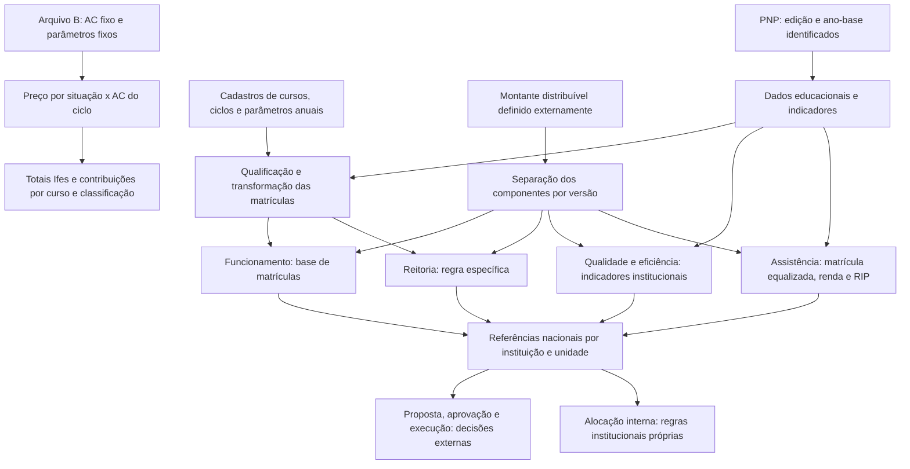

# Matriz Orçamentária da Rede Federal: fonte canônica do domínio

## 0. Metadados e controle de versão

| Campo | Conteúdo |
|---|---|
| Finalidade | Consolidar evidências para compreender a matriz, auditar o caso Ifes 2026 e orientar futuros requisitos e cálculos. |
| Escopo | Livro de 2025; pasta de participação das matrículas de 2026; verificação externa dos atos e de documentação institucional. Nenhum simulador foi implementado. |
| Exercícios | Histórico descrito no livro até 2025; caso operacional denominado 2026, com dados de 2024 (elaborado antes de N3); N3 publicada em 12/03/2026, íntegra lida na v1.2.0 e aplicável, no mínimo, à matriz 2027 em diante. |
| Data da análise e das consultas externas | Consultas em 08/11/2026; auditoria concluída em 09/11/2026; revisão crítica e incorporação de N3 (v1.2.0) em 09/11/2026, America/Sao_Paulo. |
| Versão | **1.2.2** — 1.2.1 com conciliação PROAD por universo comparável e RMO-075 reclassificada para HIPÓTESE; base: 1.2.0 (revisão crítica e N3) acrescida da distribuição interna publicada pela PROAD (RMO-075, L-28), 09/11/2026; preserva IDs e o histórico das versões 1.0.0 e 1.1.0. |
| Situação | N3 lida integralmente; regra operacional de produção da MT (RMO-066) reproduz 100% dos ciclos de B e de C5, divergindo do texto de N2/N3 (L-24); homologações institucionais e definição de %ME (L-25) pendentes. |
| Responsável pela análise | v1.0.0–1.1.0: agente Codex; v1.2.0: Claude (revisão crítica), a pedido do projeto Prumo/Ifes. |
| Responsável pela validação de domínio | Não indicado. Recomenda-se responsável pela matriz no Ifes e, nas questões nacionais, Comissão Paritária/Setec/Forplan. |
| Limite de autoridade | Esta consolidação não substitui os atos oficiais nem certifica valores de LOA ou receita. Uma fórmula reproduzida pode implementar um parâmetro incorreto. |
| Prontidão | Reprodução de B e de AC PRONTAS; MT por ciclo PRONTA como regra (entrada QTM condicional); fatores N3 de Funcionamento e faixas de Qualidade PRONTOS; degraus por campus BLOQUEADOS; alocação interna CONDICIONAL (§ 13.1). |

### 0.1. Registro das fontes

Identificadores de fonte são usados em todo o documento. Referências de páginas de **A** usam primeiro a página impressa, seguida da posição no PDF quando necessário. Neste exemplar, das páginas numeradas examinadas, a página impressa corresponde à posição no PDF mais um. Assim, **p. 44 = PDF 43**. Os nomes das abas e os endereços de **B** são literais.

| ID | Fonte e identificação | Exame efetivo e condição de uso |
|---|---|---|
| A | *A Matriz Orçamentária da Rede Federal de Educação Profissional, Científica e Tecnológica: um guia abrangente*, Editora IFSertãoPE, 2025. Arquivo `LIVRO-MATRIZ-NOVA-CONFIGURACAO.pdf`, 65 páginas físicas, ISBN digital 978-65-89380-47-4. [Registro editorial](https://releia.ifsertaope.edu.br/jspui/handle/123456789/1651). | Texto integral extraído e lido; figuras, tabelas e equações relevantes renderizadas e examinadas visualmente. Evidência metodológica/histórica, não confirmação automática de norma vigente. |
| B | `6ª Fase - Participação matrículas totais 2026 IFES - cópia.xlsx`, arquivo fornecido na raiz do projeto. | Todas as quatro abas e todas as células não vazias, fórmulas, resultados armazenados e estruturas do pacote XLSX examinados sem salvar ou alterar o original. |
| N1 | [Decreto nº 7.313, de 22/09/2010, texto do Planalto](https://www.planalto.gov.br/ccivil_03/_ato2007-2010/2010/decreto/d7313.htm), especialmente art. 4º, caput e §§ 1º–2º. | Texto oficial consultado integralmente. A página consultada não exibia indicação de revogação; isto não equivale a certidão de vigência ou pesquisa exaustiva de atos posteriores. |
| N2 | Portaria MEC nº 646, de 25/08/2022: [publicação original](https://www.in.gov.br/web/dou/-/portaria-n-646-de-25-de-agosto-de-2022-425194865), [republicação](https://www.in.gov.br/en/web/dou/-/portaria-n-646-de-25-de-agosto-de-2022-%2A-430796902), [DOU de 21/09/2022, seção 1, p. 122](https://pesquisa.in.gov.br/imprensa/servlet/INPDFViewer?captchafield=firstAccess&data=21%2F09%2F2022&jornal=515&pagina=122). | Na v1.0.0 a íntegra não foi recuperada: DOU retornou erro de acesso. Eram verificáveis, no texto indexado da página oficial 122, art. 1º, art. 2º e parágrafo único, início do art. 3º e abertura do Anexo sobre os quatro blocos e sua granularidade. Esse era o limite da v1.0.0. **v1.1.0:** íntegra da republicação recuperada no [repositório institucional Cefet-MG](https://www.audit.cefetmg.br/wp-content/uploads/sites/169/2022/09/MATRIZ-OR%C3%87-PORT-646-25AGO22-SETEC.pdf?download=1), 4 páginas DOU 122–125, texto e equações/tabelas examinados visualmente. [Cópia preservada](evidencias/2026-11-08/portaria-646-republicacao.pdf). O aviso final informa original no DOU de 31/08/2022, pp.106–109; não foi obtida a íntegra dessa primeira versão para um diff literal. |
| N3 | [Portaria MEC nº 243, de 10/03/2026](https://www.in.gov.br/web/dou/-/portaria-mec-n-243-de-10-de-marco-de-2026-692098706). | Ato localizado, mas íntegra e anexos inacessíveis: respostas 502 pelo leitor web, 403 ou encerramento de conexão na obtenção direta; navegador indisponível. Dispositivos, data de vigência, transição e diferenças metodológicas NÃO confirmados. **v1.2.0:** íntegra obtida em impressão da página do DOU (publicação 12/03/2026, DOU nº 48, Seção 1, p. 63), fornecida pelo usuário; [cópia preservada](evidencias/2026-11-09/portaria-243-2026-dou-impressao-web.pdf) e [manifesto](evidencias/2026-11-09/manifesto.json). Texto lido integralmente; equação do IEA (imagem) conferida visualmente. A página adverte não substituir a versão certificada. |
| C1 | [IFMT, Orçamento Anual](https://ifmt.edu.br/pro-reitorias/administracao/orcamento/orcamento-anual/), seções 2026 e documentos relacionados. | Página institucional consultada. Informa uso de dados 2024/1 e 2024/2 na matriz 2026 e identifica a nº 646/2022 como revogada pela nº 243/2026. É evidência institucional da atualização, não leitura do dispositivo revogador. Os valores orçamentários do IFMT não foram importados como parâmetros do Ifes. |
| C2 | [IFPB, Principais Normas e Legislação](https://www.ifpb.edu.br/ead/principais-normas-e-legislacao), portarias nacionais. | Página institucional confirma título, data, objeto e link de N3. Não fornece seu articulado. |
| C3 | [Protocolo Integrado, processo 23000.029104/2020-53](https://protocolointegrado.gov.br/Protocolo/documento/detalhes_documento.jsf?protocolo=23000029104202053). | Histórico oficial de tramitação consultado: registro de encaminhamento da publicação de N3 em 12/03/2026. Não utilizado para inferir suas equações ou vigência. |
| C4 | [Conif, página do Guia de Análise e Interpretação de Indicadores](https://portal.conif.org.br/estudos/guia-de-analise-e-interpretacao-de-indicadores-da-matriz-orcamentaria-da-rede-federal-de-educacao-profissional-cientifica-e-tecnologica). | Página de apresentação consultada; descreve conexão PNP–matriz e menciona custeio e capital da 20RL. Na v1.0.0 o PDF não foi incorporado. Na v1.1.0 o guia foi recuperado como C7; continua sendo apoio metodológico, não ato normativo. |
| C5 | [IFMT, Matriz Orçamentária 2026 — PLOA](https://docs.google.com/spreadsheets/d/1Y742qTN3Svetk9B2ggAefjKF8-rAjs8heIqJncXYwRE/edit), vinculado por C1. [Cópia XLSX](evidencias/2026-11-08/ifmt-matriz-2026.xlsx). | 11 abas examinadas, fórmulas e resultados salvos; cabeçalhos S:AL de Ciclos documentam a fase anterior à monetização. É outro demonstrativo institucional, com parâmetros diferentes de B; não homologa o Ifes nem prova identidade da fase/versão. |
| C6 | [Cadastro público de cursos/pesos vinculado pelo IFMT](https://docs.google.com/spreadsheets/d/1voCoeyf8ByxxhAvDihep-weld6XcpVxzYOAVffxOH5I/edit). [Cópia XLSX](evidencias/2026-11-08/cadastro-publico.xlsx). | Aba PLOA 2025: nome, tipo, eixo, peso, esforço, CH e agro. Usada para cotejo de amostras, sem transferir vigência para B. Há chaves ambíguas e ausentes; aba Cópia de PLOA 2027 contém números interpretados como datas e não foi adotada como parâmetro. |
| C7 | Oliveira, Claudemiro Soares de; Pinto, Leandro Rafael. *Guia de análise e interpretação de indicadores da Matriz Orçamentária*, produto educacional IFPR, 2025. [PDF EduCAPES](https://educapes.capes.gov.br/bitstream/capes/1133623/2/GUIA%20DE%20OR%C3%87AMENTO%20RFEPCT.pdf). | Texto de apoio examinado, especialmente pp.27–44. Cinco situações temporais, pesos e percentuais; não substitui N2/N3. Tabelas têm imprecisões editoriais de operadores. |
| C8 | [PROAD/Ifes — Orçamento 2026](https://proad.ifes.edu.br/orcamento-2026), publicada em 01/04/2026, atualizada em 05/08/2026. [HTML preservado](evidencias/2026-11-09/proad-orcamento-2026.html); [extrato](evidencias/2026-11-09/distribuicao-interna-ifes-2026.json). | Valores de custeio e assistência 2026 por unidade (total de custeio R$ 77.513.000,00) e descrição do método: critérios institucionais vigentes com piso e teto, Câmara de Orçamento, aprovação do Colégio de Dirigentes. Não publica fórmulas nem parâmetros. Usada na v1.2.1. |
| R1 | [Revisão independente das regras](revisao-critica-regras-prumo.md), 09/11/2026, com [script](evidencias/2026-11-09/reproduzir_revisao_critica.py) e [testes](../../tests/auditoria_matriz/test_ro_mt.py). | Origem das correções da v1.2.0. Reprocessou os 2.322 ciclos de B e os 1.086 ciclos e 41 indicadores institucionais de C5 sem usar AC/AL como entrada. Não é fonte normativa. |
| P1 | `contexto_projeto_inteligencia_estrategica_educacional_ifes_v1_1.md`, especialmente § 11. | Contexto de produto e pista para buscar N3. Não é fonte comprobatória de regra da matriz. |

Identidade dos originais, SHA-256:

```text
A  43b62247deb2beec8cfe415737899f823a91060a749343b43992f91584499486
B  7f62a6ebcf6fac12a7b63805e6f936a68469d2e13e3f71759c7d550cb5de5d33
```

A v1.0.0 registrou uma edição parcial do FNDE de 30/08/2022 como pista de N2, sem resolver a íntegra. **Correção temporal:** o aviso na republicação agora recuperada identifica a publicação original de N2 em 31/08/2022, pp.106–109; a referência anterior não é evidência de publicação em 30/08. Nenhuma notícia secundária foi usada para confirmar fórmulas de N3. A exportação PNP específica de B e o cadastro nacional de seus parâmetros continuam ausentes. C5 fornece uma memória anterior de outra instituição; não é a fase produtora de AC do Ifes. URLs, hashes, data de consulta e limites das novas fontes constam do [manifesto](evidencias/2026-11-08/manifesto.json).

### 0.2. Convenções de evidência e manutenção

| Classificação | Como interpretar |
|---|---|
| NORMATIVA | Comportamento expresso em dispositivo oficial efetivamente verificável; a extensão da verificação consta da fonte. |
| METODOLÓGICA | Descrição técnica do livro ou de fonte institucional identificada; pode conter ambiguidade, erro editorial ou versão anterior. |
| OPERACIONAL | Comportamento observado em B; válido para essa cópia, não automaticamente para outros exercícios. |
| HISTÓRICA | Comportamento atribuído a um período passado por A. Não aplicar prospectivamente sem outra evidência. |
| DERIVADA | Consequência demonstrável de regras identificadas e de premissas expressas. |
| HIPÓTESE | Cenário ou interpretação ainda não comprovado. |
| NÃO DETERMINADA | As fontes não permitem estabelecer um procedimento completo. |

Confiança **alta** significa evidência direta e reprodução quando pertinente; **média**, descrição direta com alcance ou consistência incompletos; **baixa**, interpretação provisória ou ausência de prova. Confiança não substitui classificação nem aplicabilidade. “Confirmada” em regra OPERACIONAL confirma a observação, não sua legalidade. Não se reclassifica uma regra histórica como vigente apenas porque não se encontrou revogação.

Manter os IDs RMO ao revisar. Registrar nova versão, fonte, exercício e efeito da alteração; se um entendimento for substituído, preservar o anterior no histórico. Não substituir os parâmetros de B por números de outra fonte sem criar uma versão de cálculo distinta.

### 0.3. Consulta rápida, versão e resultado da auditoria complementar

**Estado ativo: versão 1.2.0.** As versões [1.0.0](evidencias/2026-11-08/matriz-orcamentaria-v1.0.0.md) e [1.1.0](evidencias/2026-11-09/matriz-orcamentaria-v1.1.0.md) integrais foram preservadas para comparação. A v1.2.0 acrescenta blocos **Revisão 1.2.0** nas RMO afetadas, sem apagar o entendimento anterior, cria RMO-066–074, F-28–29, V-12–13 e L-24–27, e atualiza §§ 13.1 e 14 a partir da [revisão crítica](revisao-critica-regras-prumo.md) e da íntegra de N3. A descrição original foi preservada por assunto e ID; correções e variantes estão no catálogo e nos acréscimos identificados. O [relatório complementar](auditoria-complementar-matriz-orcamentaria.md) registra antes/depois, tentativas, limitações e resultado individual das lacunas. A aprovação aritmética de B não prova conformidade de B com N2 nem com N3.

| Assunto | RMO | Consulta / situação de implementação |
|---|---|---|
| Escopo, dados e versões | 001–006, 028–033, 060, 065, 070, 074 | §§ 0/10/14; N3 lida (RMO-060); defasagem normativa (RMO-070); art. 7º de N3 com alcance não determinado (RMO-074, L-27). |
| Equalização, pesos, retenção e nova oferta | 007–015, 034–038, 047–050, 056, 061, 066, 073 | §§ 6.6/6.9, V-11/V-12; **RO-MT (RMO-066) PRONTA**, reproduz B e C5 integralmente; texto N2/N3 diverge (L-24); nova oferta CONDICIONAL apenas pela QTM projetada. |
| Preços, EAD, MOOC e fechamento | 013, 033, 037, 039–041, 063, 067 | §§ 6.2/6.7; reprodução de B PRONTA; N3: EAD 25%/80%, **MOOC 8%** (RMO-067); `/4` de B é anomalia (L-06 resolvida); MOOC dentro ou fora de F não determinado (L-26). |
| Qualidade e eficiência | 016–022, 062, 068, 069, 072 | §§ 6.7/6.9; faixas idênticas em N3; indicadores e submontantes 2026 de todas as instituições disponíveis (RMO-072); valor de degrau (RMO-069); IEA aplicado como 0,5×IEA em 2026, texto N3 ainda diverge (L-23). |
| Assistência, renda, IDH e RIP | 023–027, 064 | § 6.8; regras N2 e rateio com bases homologadas CONDICIONAIS; limites de renda e exercício atual BLOQUEADOS. |
| Reitoria, campi e orçamento efetivo | 004–006, 043–046, 058–059, 065, 071, 075 | §§ 7/13.1; base de Reitoria inclui MOOC em 2026 (RMO-071); alocação interna Ifes 2026: hipótese de matriz por campus com piso e teto (RMO-075, não demonstrada); parâmetros e conciliação em L-28. |
| Participação, causalidade e projeção | 051–057 | §§ 12/13.2; hipóteses explícitas e universo comparável, sem promessa de receita. |
| Evidências e testes | 001–065 conforme fonte/variante | §§ 11/15/16; [suíte de referência](../../tests/auditoria_matriz/README.md), manifesto e relatório. |

A situação de uma capacidade não é uma classificação jurídica da regra. “PRONTA” para reproduzir B admite manter uma anomalia operacional identificada; “confirmada N2” significa o dispositivo efetivamente lido, não vigência em novembro de 2026. Cadastros e parâmetros anuais continuam entradas de versão.

**Índice individual por ID:**

[RMO-001](#rmo-001) · [RMO-002](#rmo-002) · [RMO-003](#rmo-003) · [RMO-004](#rmo-004) · [RMO-005](#rmo-005) · [RMO-006](#rmo-006) · [RMO-007](#rmo-007) · [RMO-008](#rmo-008) · [RMO-009](#rmo-009) · [RMO-010](#rmo-010)

[RMO-011](#rmo-011) · [RMO-012](#rmo-012) · [RMO-013](#rmo-013) · [RMO-014](#rmo-014) · [RMO-015](#rmo-015) · [RMO-016](#rmo-016) · [RMO-017](#rmo-017) · [RMO-018](#rmo-018) · [RMO-019](#rmo-019) · [RMO-020](#rmo-020)

[RMO-021](#rmo-021) · [RMO-022](#rmo-022) · [RMO-023](#rmo-023) · [RMO-024](#rmo-024) · [RMO-025](#rmo-025) · [RMO-026](#rmo-026) · [RMO-027](#rmo-027) · [RMO-028](#rmo-028) · [RMO-029](#rmo-029) · [RMO-030](#rmo-030)

[RMO-031](#rmo-031) · [RMO-032](#rmo-032) · [RMO-033](#rmo-033) · [RMO-034](#rmo-034) · [RMO-035](#rmo-035) · [RMO-036](#rmo-036) · [RMO-037](#rmo-037) · [RMO-038](#rmo-038) · [RMO-039](#rmo-039) · [RMO-040](#rmo-040)

[RMO-041](#rmo-041) · [RMO-042](#rmo-042) · [RMO-043](#rmo-043) · [RMO-044](#rmo-044) · [RMO-045](#rmo-045) · [RMO-046](#rmo-046) · [RMO-047](#rmo-047) · [RMO-048](#rmo-048) · [RMO-049](#rmo-049) · [RMO-050](#rmo-050)

[RMO-051](#rmo-051) · [RMO-052](#rmo-052) · [RMO-053](#rmo-053) · [RMO-054](#rmo-054) · [RMO-055](#rmo-055) · [RMO-056](#rmo-056) · [RMO-057](#rmo-057) · [RMO-058](#rmo-058) · [RMO-059](#rmo-059) · [RMO-060](#rmo-060)

[RMO-061](#rmo-061) · [RMO-062](#rmo-062) · [RMO-063](#rmo-063) · [RMO-064](#rmo-064) · [RMO-065](#rmo-065) · [RMO-066](#rmo-066) · [RMO-067](#rmo-067) · [RMO-068](#rmo-068) · [RMO-069](#rmo-069) · [RMO-070](#rmo-070)

[RMO-071](#rmo-071) · [RMO-072](#rmo-072) · [RMO-073](#rmo-073) · [RMO-074](#rmo-074) · [RMO-075](#rmo-075)

## 1. Visão geral — Entenda a matriz em cinco minutos

A Matriz Orçamentária é um método de repartir um montante definido externamente entre instituições e componentes da Rede Federal. O Decreto nº 7.313/2010 exige sua observação na proposta anual dos institutos federais. A matrícula educacional passa por qualificadores para representar uma unidade de distribuição: duas pessoas matriculadas podem contribuir de maneira diferente segundo carga horária, ciclo, peso do curso e modalidade. O resultado é uma referência de participação e de valor distribuído, sujeita à versão da metodologia e ao orçamento disponível [RMO-001, 005–015].

O livro de 2025 apresenta custeio e assistência estudantil como foco. Após separar a assistência, divide o remanescente em Funcionamento (80%), Reitoria (10%) e Qualidade e Eficiência (10%). O Decreto também menciona despesas de capital, enquanto A exclui o investimento de sua descrição operacional e C4 menciona capital da 20RL: esta diferença de escopo está aberta em L-03. Folha de pagamento não é calculada pela pasta analisada. Não se deve usar essa pasta para estimar todo o orçamento institucional [RMO-001, 006; § 14].

As entradas gerais são dados educacionais da Plataforma Nilo Peçanha (PNP), parâmetros de cursos e ciclos, indicadores institucionais, renda e limites anuais de recursos. As saídas possíveis são matrículas ajustadas, coeficientes de participação, referências por componente e totalizações. A planilha recebida contém apenas dados do Ifes e parâmetros nacionais fixos: calcula valores de contribuição por ciclo e os agrega por curso e classificação. Não contém o cálculo dos indicadores de eficiência, o rateio de assistência, a parcela de Reitoria nem uma tabela das demais instituições.

**Exemplo conceitual fictício:** um componente dispõe de R$ 1.000; a instituição A tem 20 unidades elegíveis e as demais têm 80. Em um rateio proporcional, A participa com 20/(20+80) = 20%, correspondendo a R$ 200 de referência. Se A passa a 30 e as demais permanecem em 80, sua participação passa a 30/110 = 27,2727%, e não a 30%. Se todas crescem na mesma proporção, a participação não muda. Esses números não são parâmetros oficiais. Uma referência de R$ 200 não comprova aprovação, disponibilização financeira ou recebimento [RMO-053–058].

**Alerta de versão (v1.2.0):** N3 (Portaria MEC nº 243/2026, publicada em 12/03/2026) revogou N2 e está em vigor. Ela mantém blocos, faixas de Qualidade e o texto da cadeia de MT de N2, e fixa EAD externo em 25%, EAD próprio em 80% e **MOOC em 8%**. B e C5 (PLOA 2026) foram elaborados antes de N3 e documentam a **prática** de 2026, que diverge do texto em pontos identificados (L-24, L-23, MOOC a 80% em C5). Para exercícios 2027+, usar os fatores de N3 e tratar a forma de cálculo da MT como variante "prática 2026" × "texto N2/N3" até a confirmação da Setec [RMO-060, 066, 067].

**Leitura em uma frase (v1.2.0):** para ciclos regulares, a MT equivale a *matrículas ativas × horas do curso transcorridas no ano-base ÷ 800 × peso do curso (×1,5 se agropecuário)*; retidos valem ¼ por até três anos após o fim previsto (FIC: zero). O valor de Funcionamento é essa MT × preço comum da Rede × fator da modalidade [RMO-066, 067].

## 2. Mapa geral de funcionamento



O Anexo de N2, na abertura verificável, situa Funcionamento e Assistência no nível de unidades acadêmicas e Reitoria e Qualidade no nível institucional. Isso não prova que os percentuais de contribuição de B sejam percentuais de distribuição interna aprovados. Uma política interna do Ifes, eventuais reservas, fundos comuns e deliberações precisam de fontes próprias, ausentes nesta investigação [RMO-004, 043–046, 059].

### 2.1. Inventário do livro

| Parte | Páginas impressas (posição PDF) | Conteúdo e cobertura |
|---|---|---|
| Apresentação e introdução | 11–15 (10–14) | Propósito, planejamento e limites orçamentários; não fornece algoritmo completo. |
| Capítulo 1, §§ 1.1–1.2.1 | 16–26 (15–25) | História, formação do orçamento e categorias de despesa; figura 1 e quadro 1 examinados. |
| Capítulo 2, §§ 2.1–2.2 | 27–35 (26–34) | Evolução 2015–2023, fontes e marco regulatório; quadro de portarias examinado. |
| Capítulo 3 | 36–40 (35–39) | Dados e divisão dos recursos; figura 2 e gráfico 1 examinados. |
| Capítulo 4, bloco de matrículas | 41–45 (40–44) | Critérios, pesos, retenção, carga horária; quadro de qualificadores e figuras 3–4 examinados. |
| § 4.1, qualidade e eficiência | 45–51 (44–50) | IEA, RAP, IAPL; figuras 5–12 examinadas visualmente, inclusive tabelas de faixas e fluxos matemáticos. |
| § 4.2, assistência | 51–54 (50–53) | Matrícula equalizada, renda e RIP; figuras 13–15 examinadas. |
| § 4.3, conclusões, referências e organizadores | 54–65 (53–64) | Implicações de gestão, referências e autoria; sem cadeia adicional de cálculo. |

As duas capas e a contracapa foram examinadas visualmente. Texto restante de créditos, dedicatória, prefácio e agradecimentos lido. Não há um sumário formal extraído que substitua este mapeamento. O livro repete o rótulo “Quadro 2” para portarias e qualificadores: a página desambigua a referência.

### 2.2. Inventário integral da pasta B

| Aba | Dimensão gravada; área de dados efetiva | Fórmulas / valores fixos não vazios | Finalidade, entradas e saídas |
|---|---|---:|---|
| `Parâmetros` | A1:N220; conteúdo até linha 16 | 8 / 32 | Limite proposto, assistência proposta, percentuais, totais nacionais e preços unitários. Alimenta CICLOS. |
| `CLASSIFICAÇÕES` | A1:AH370; detalhe A7:N170, 164 grupos | 1.165 / 1.002 | Agrega CICLOS por instituição, unidade, modalidade, nível, tipo de curso e oferta. |
| `CURSOS` | A1:Z485; detalhe A7:N285, 279 grupos | 1.962 / 1.686 | Agrega CICLOS por instituição, unidade, modalidade, nível, tipo de curso e nome do curso. |
| `CICLOS` | A1:AS2329; detalhe linhas 7:2328, 2.322 ciclos | 46.448 / 48.806 | Entradas por ciclo; matrícula total já calculada; preços, valores, participações e diagnóstico auxiliar. |

Total: **49.583 fórmulas**, **51.526 valores fixos não vazios** e **101.109 células não vazias**. Dimensões gravadas incluem formatação vazia; não indicam registros adicionais. Todas as abas estão visíveis. Linha 1 oculta em CLASSIFICAÇÕES, CURSOS e CICLOS. Colunas ocultas: Parâmetros A, H, L:N; CLASSIFICAÇÕES P; CICLOS A. As colunas auxiliares AK:AS de CICLOS não estão ocultas. Não há agrupamentos por nível de estrutura de linhas/colunas.

Filtros: `CLASSIFICAÇÕES!B6:J6`, `CURSOS!A6:J6` e `CICLOS!A6:AS2328`; nenhum critério ativo nem estado de ordenação gravado. Os dois primeiros intervalos abrangem só o cabeçalho, uma limitação concreta da configuração. Não há linhas de dados ocultas no estado recebido. Não há tabelas estruturadas, nomes definidos, tabelas dinâmicas, gráficos, imagens, validações de entrada, conexões, macros ou vínculos externos no pacote. Ausência de vínculo XLSX não implica ausência de dados calculados externamente.

Dependências: `Parâmetros → CICLOS → CLASSIFICAÇÕES/CURSOS`. CICLOS usa seus totais para percentuais; estes totais leem valores dos ciclos, sem referência circular. As abas de resumo não alimentam o cálculo dos ciclos. Os comentários em J6 dos resumos e AF6 de CICLOS descrevem percentuais por campus, mas suas fórmulas usam totais da aba inteira. `CURSOS!H4` está vazio; a soma dos contabilizados está disponível nos detalhes e nos outros resumos.

## 3. Glossário de conceitos

As siglas não explicitamente expandidas pela fonte são identificadas como rótulos, evitando lhes atribuir um significado oficial inventado.

| Nome / sigla | Definição simples e técnica / cálculo | Unidade | Fonte e relações |
|---|---|---|---|
| Matriz de Distribuição Orçamentária / MDO | Método anual de repartir recursos; combina componentes e bases específicas segundo a versão aplicável. | Referências em R$ e participações | N1 art. 4º; N2 art. 1º; A caps. 2–4. |
| Matriz CONIF | Nome da metodologia desenvolvida pela Rede e designação ainda usada no material; não identifica sozinho uma versão. | Método | A pp. 18–20, 27–31. |
| Rede Federal / RFEPCT | Conjunto institucional educacional; o universo da Rede não deve ser confundido com o universo elegível de um ato. | Instituições/unidades | A pp. 16–17; N2 art. 1º delimita destinatários. |
| Instituição / autarquia | Unidade institucional que consolida unidades acadêmicas e indicadores. B contém apenas IFES. | Instituição | A p. 46; B CICLOS D7:D2328. |
| Campus / unidade acadêmica | Unidade de oferta e agregação; não é uma autarquia independente neste arquivo. | Unidade | B CICLOS E7:E2328; N2 Anexo, abertura. |
| PNP | Plataforma Nilo Peçanha, fonte consolidada de informações; separar edição publicada, ano-base educacional e exercício orçamentário. | Base de dados anual | N2 art. 2º; B Parâmetros E3:F3. |
| Alunos em curso | Contagem importada por ciclo em Y. Não comprova quantidade de pessoas únicas na instituição nem detalha situações acadêmicas individuais. | Registros de matrícula | B CICLOS Y7:Y2328. |
| Matrícula total / MT | Medida qualificada de participação, que envolve ajustes de carga, ciclo e peso. Em B, AC é entrada fixa; soma 57.061,7501, não 54.826 pessoas. | Unidade de matrícula ajustada | A pp. 27–28, 41–45; B AC7:AC2328; RMO-038. |
| RO-MT | Regra operacional de produção da MT observada em 2026 (B e C5): carga min(CHC, CHM) em ciclos ≥ 365 dias, CHM em curtos, FEDA de curtos relativo à duração do ciclo, elegibilidade de retidos pela DJ. | Regra de cálculo | RMO-066; F-28; L-24. |
| %ME legal (CT/FP/EJA) | Percentual de matrículas equivalentes em cursos técnicos, formação de professores e EJA, publicado pela PNP e usado no IAML. Não é derivável de MT (Ifes 2026: 44% PNP × 57,8% técnico em MECHDA de B). | Fração | RMO-072; L-25. |
| Matrícula equalizada / MECHDA | Matrícula ajustada por carga horária e dias ativos, anterior ao peso de curso e ao bônus agropecuário na descrição da assistência. | Unidade equalizada | A p. 51. AQ de B usa os NÃO contabilizados e pertence ao diagnóstico auxiliar: não é a base principal de assistência. |
| Matrícula ponderada / aluno-matriz | Expressões descritivas de medidas após ponderações; a equivalência exata com AC deve ser demonstrada para cada fonte/versão. | Unidade ajustada | A pp. 41–45; RMO-007, 056. |
| Matrícula equivalente | Medida mencionada no numerador da RAP, distinta da contagem simples do IEA; não há fórmula integral desta medida em B. | Matrícula equivalente | A pp. 46, 48. Não equiparar automaticamente a MT. |
| Ciclo de matrícula | Oferta/coorte com início, término previsto e carga horária; identificador N é único em B. | Ciclo | A p. 43; B N:Q. |
| DIC / DTC / DJ | Início do ciclo, término previsto e data de jubilamento do cadastro. Em B, datas são fórmulas de conversão de literais, não datas derivadas dinamicamente. | Data civil | B P:R. |
| CHC / CHMC / CHM | Carga horária do ciclo, do catálogo MEC e para matriz. U não é universalmente `MIN(S,T)`. | Horas | B S:U; RMO-014, 047. |
| PC | Peso do curso, entrada fixa W. | Multiplicador | A pp. 42–44; B W. |
| ICQA | Índice Correção Quantidade de aluno, expansão no comentário de Z6. Vale 0, 0,5 ou 1 conforme datas. | Multiplicador | B Z6:Z2328; RMO-035. |
| Alunos contabilizados / não contabilizados | AA = Y×Z; AB = Y−AA. Podem ser fracionários e não classificam individualmente pessoas como evadidas. | Unidades de contagem ajustada | B AA:AB; RMO-036. |
| Apto Matriz | Flag X importada, coincidente com Z>0 no arquivo; não aparece como condição nas fórmulas monetárias. | SIM/NÃO | B X; RMO-038. |
| EAD FP | Rótulo operacional de EAD “SEM PROGRAMA ASSOCIADO”, associado a fator 0,8. FP não é expandido formalmente na pasta. | Categoria | B AG e Parâmetros A16/E12. |
| EAD / EAD MOOC | Categorias de classificação financeira operacional; MOOC corresponde a “OUTROS MOOC” e não tem chave na tabela A14:A16. | Categoria | B AG; RMO-037, 041. |
| Valor Aluno / valor do ciclo | Coeficiente monetário por unidade de MT, não custo contábil; valor do ciclo é coeficiente×AC. | R$/MT e R$ | B Parâmetros D14:D16; CICLOS AE. |
| Contribuição | Participação no total monetizado do próprio Ifes em B; não participação nacional nem percentual aprovado para repasse ao campus. | Fração / % | B AF e resumos J; RMO-043. |
| IEA | Indicador de Eficiência Acadêmica; considera concluintes e potencial de conclusão de retidos no recorte descrito por A. | Índice / % | A pp. 46–48; RMO-016–018. |
| RAP / RAPP | Relação Aluno-Professor Presencial; matrículas equivalentes presenciais em relação a docentes ponderados pelo regime. | Alunos equivalentes/docente equivalente | A pp. 48–49; rótulo RAPP em N2. |
| IAPL / IAML | Livro usa Atendimento aos Percentuais Legais; N2 usa Marcos Legais. Relação conceitual é descrita, mas não se presume identidade de toda fórmula entre versões. | Índices / % | A pp. 49–51; N2; RMO-021–022. |
| RFP / renda per capita | Renda familiar dividida pelos integrantes, classificada em faixas de salário mínimo para ponderação. | Salários mínimos por pessoa | A pp. 51–54; sem microdados em B. |
| AE / RIP | Assistência Estudantil e Regime de Internato Pleno; componentes que exigem base própria. | R$ / estudantes | A § 4.2; RMO-023–027. |
| “Custo Evadido” | Nome da coluna AI; diagnóstico monetário auxiliar de alunos não contabilizados, sem prova de evasão ou despesa recuperável. | R$ de referência | B AI; RMO-051, 055. |
| PLOA / LOA | Proposta orçamentária / lei aprovada; não são a mesma etapa nem equivalem ao valor realizado de um componente. | R$ por exercício | A pp. 21–22; RMO-005, 058. |

## 4. Dicionário de dados

Nas tabelas abaixo, **c** significa ciclo; **g**, grupo de classificação/curso; **i**, instituição; **R**, universo da Rede. Campos de B são do retrato recebido, não conexão automática à PNP. A periodicidade é **por edição anual da matriz**, salvo datas e cadastros, atualizados conforme a oferta. “Obrigatório” significa necessário para reproduzir a regra indicada, não uma exigência de cadastro oficialmente homologada. Validações propostas para implementação são requisitos de integridade; não se afirma que o arquivo as aplique (não há validação de entrada gravada).

### 4.1. Entradas e cadastros efetivamente disponíveis

| ID / campo de B | Tipo; unidade; granularidade | Fonte, periodicidade e obrigatoriedade | Validação e uso / disponibilidade |
|---|---|---|---|
| D01 / Parâmetros E3:F3 | Datas; intervalo anual; edição | B; anual; obrigatório ICQA e referência temporal | 01/01/2024–31/12/2024. E3 é usado em Z; F3 não é usado nas fórmulas da pasta. RMO-034–035. |
| D02 / D4 | Decimal; R$; R | B; anual; obrigatório preço | 2.803.219.878,73 fixo; rótulo diz “Matriz 2025 (proposta)”. Não renomear como valor homologado 2026. RMO-033. |
| D03 / D5 | Decimal; R$; R | B; anual; obrigatório preço | 597.241.857,2028826 fixo. Exigir coerência com D4 antes de nova versão. RMO-033, 039. |
| D04 / D6 | Decimal; fração; R | B; anual; obrigatório preço | 0,8 fixo; condição 0≤f≤1 para uso prospectivo. RMO-039. |
| D05 / D9:D12 | Decimais; MT por situação; R | B; anual; obrigatório denominador | Valores nacionais fixos; não reconciliáveis à base da Rede ausente. Não calcular a partir apenas do Ifes. RMO-033, 039. |
| D06 / E9:E12 | Decimais; fatores; situação | B; anual; obrigatório preço | 1; 0,25; 0; 0,8. Fórmula D15 contém ainda `/4`. RMO-039–040. |
| D07 / A14:A16 | Textos; categoria; situação | B; por versão; obrigatório busca | PRESENCIAL, EAD, EAD FP. Chave EAD MOOC ausente. RMO-041. |
| D08 / CICLOS A | Identificador de campus; c | B; cadastro; indisponível | Todas as 2.322 células vazias e coluna oculta. Não usar como chave sem completar. |
| D09 / B:C | Textos; UF e cidade; c | B; cadastro; não usados diretamente em fórmula | ES e municípios; não existe cálculo de IDH ou custo regional a partir deles. |
| D10 / D:E | Textos; instituição e unidade; c | B; cadastro; obrigatórios agrupamentos | IFES e 22 nomes de unidade distintos; nenhuma chave externa de campus preenchida. RMO-044–045. |
| D11 / F:G | Textos; modalidade e financiamento; c | B; por oferta; obrigatórios AG | Correspondência exata na tabela § 9.3, inclusive espaços/acentos. Categoria nova provoca falha de MATCH, não autorização para assumir presencial. RMO-037. |
| D12 / H:I | Textos; nível e tipo de curso; c | B; cadastro; obrigatórios agrupamentos | Preservar diferenças SUPERIOR/GRADUAÇÃO. Não inferir oferta a partir de nível. RMO-044–045. |
| D13 / J:K | Textos; nome e área/eixo; c | B; cadastro; J obrigatório CURSOS | Nome não é identificador único nacional de curso. K não é usado nas fórmulas principais. |
| D14 / L | Texto; flag agropecuária; c | B; cadastro; obrigatório AR | Todas as linhas são SIM, inclusive Administração e Informática. Não homologado semanticamente. RMO-011, 050; L-08. |
| D15 / M | Texto; tipo de oferta; c | B; cadastro; obrigatório CLASSIFICAÇÕES | '-', INTEGRADO, CONCOMITANTE, SUBSEQUENTE e duas categorias PROEJA; não existe fórmula de piso de peso aqui. |
| D16 / N:O | Inteiro/texto; ID e descrição do ciclo; c | B; por oferta; para rastreabilidade | 2.322 IDs N distintos. Descrição não substitui datas P:Q. |
| D17 / P:Q | Datas via DATEVALUE de literal; dias civis; c | B; por oferta; obrigatórias duração/ICQA | Q≥P e duração inclusiva positiva; todas as fórmulas de data conferidas. RMO-034, 048. |
| D18 / R | Data via DATEVALUE de literal; c | B; por oferta; obrigatória ICQA | R−Q=1.095 nos 1.267 não FIC; R=Q nos 1.055 FIC. Não existe fórmula que a atualize ao alterar Q. RMO-034–035. |
| D19 / S:T | Decimais; horas de ciclo e catálogo; c | B; cadastro; S obrigatório auxiliares; T informativo aqui | Origem dos catálogos não fornecida. Valores fixos, não fórmulas. RMO-014, 047–048. |
| D20 / U | Decimal; horas para matriz; c | B; por versão; obrigatório V/auxiliares | Valor fixo; não é universalmente min(S,T), nem T. Não recomputar silenciosamente. RMO-047–048. |
| D21 / W | Decimal; multiplicador; c | B; por versão; obrigatório AR | 1; 1,5; 2; 2,5; 3,75 observados. Todos os 73 stricto sensu têm 3,75; nenhuma fórmula de atribuição do peso. RMO-009–012. |
| D22 / X | Texto; aptidão; c | B; por edição; informativo no grafo principal | SIM/NÃO; coincide com Z>0 em todas as linhas, mas X não governa AE. RMO-038. |
| D23 / Y | Inteiro; alunos em curso; c | B; anual; obrigatório AA/AB/AI | Não negativo; 54.826 registros somados, sem identificador de pessoa para deduplicação. RMO-036. |
| D24 / AC | Decimal; MT; c | B; anual; obrigatório valor principal | Entrada fixa com quatro casas observadas, sem fórmula upstream. 57.061,7501 no total. RMO-038, 056. |
| D25 / A:F dos resumos | Textos; dimensões de agrupamento; g | B; por edição; obrigatórios SUMIFS | 164 classificações e 279 cursos/grupos. Todas as chaves cobrem os ciclos uma única vez em cada resumo. RMO-044–045. |

### 4.2. Indicadores derivados disponíveis

| Campo | Tipo/unidade/grão | Origem, obrigatoriedade e validação | Uso |
|---|---|---|---|
| Parâmetros D7/F9:F12/D14:D16 | Decimais, R$ / MT / R$/MT; R/situação | Fórmulas, por edição; necessários AE; denominador positivo no retrato | F-01–03; RMO-039–041. |
| CICLOS V | Decimal, horas/c | S−U; anual; pode ser negativo; não tem piso zero | RMO-047. |
| CICLOS Z/AA/AB | Fator e contagens ajustadas/c | Datas e Y; anual; Z∈{0;0,5;1}, AA+AB=Y | RMO-035–036. |
| CICLOS AE/AF/AG | R$, fração e categoria/c | AC×preço, razão ao total e classificação; anual | RMO-037, 042–043. |
| CICLOS AK:AS | Dias, h/dia, h/ano, fatores, ME auxiliar, MT auxiliar, R$/c | Diagnóstico; sem vínculo de saída para AC | RMO-048–050. |
| CICLOS AI | Decimal, R$/c | Diagnóstico nomeado “Custo Evadido”; obrigatório apenas seus resumos | RMO-051, 055. |
| Resumos G:H/I:J/L:N | Contagens, R$, fração, horas, contagem, R$/g | SUMIFS e participação; anual; cobertura e unicidade conferidas | RMO-044–046. |
| Totais na linha 4 | Mesmas unidades das colunas; i/visão | SUBTOTAL(109); dependem de visibilidade das linhas | RMO-046. |

### 4.3. Dados necessários, ausentes ou não confirmados

| ID | Campo e tipo/unidade/grão | Fonte esperada e periodicidade | Obrigatoriedade, validação e disponibilidade real |
|---|---|---|---|
| D26 | Dias ativos por matrícula; inteiro/dias/pessoa-ciclo | PNP/Sistec, anual | Trajetórias individuais não presentes. N2 calcula dias por ciclo com cinco situações; isso permite reconstrução parcial por QTM, sem prova de trajetória individual nem substituição pelo dia do ano de Q. RMO-056/061. |
| D27 | Situação, conclusão, evasão, retenção; categoria/evento | PNP e registros, anual | Necessários IEA e causalidade; contagens AB não substituem estes eventos. Ausentes. |
| D28 | IEA, RAP, IAML/IAPL e denominadores nacionais; decimais/i/R | PNP, por edição | Necessários rateios de qualidade; validar recorte e faixas por versão; ausentes. |
| D29 | Docentes por regime e afastamento; quantidade/horas/i | Base de pessoal/PNP, anual | Necessários RAP; ponderações completas não verificadas; ausentes. |
| D30 | Renda per capita, faixa e declaração; SM/matrícula | PNP, anual | Necessária AE; validar limites e faltantes; ausente. |
| D31 | Estudantes RIP elegíveis e parâmetros de manutenção; quantidade/R$/unidade | PNP e regulamento anual | Necessários RIP; ausentes e algoritmo não determinado. |
| D32 | Montantes por componente, atos de atualização, transição, pisos e unidades novas | Setec/Comissão/atos, por exercício | Necessários matriz inteira; D4:D6 não comprovam estes montantes e tratamentos. |
| D33 | Base das demais instituições, universos e exclusões | PNP/Setec, anual | Necessária participação nacional e sensibilidades; só agregados fixos D9:D12 disponíveis. |
| D34 | Regra interna Ifes, orçamento aprovado e execução | Atos e sistemas institucionais, por exercício | Necessários alocação interna e estimativa financeira efetiva; ausentes. |
| D35 | Versão de catálogo, pesos e relação de programas financiadores | Setec/MEC, por atualização | Necessária atribuição de U/W/AC; há valores fixos, sem cadastro de origem ou regra de importação. |

## 5. Catálogo de regras de negócio

<a id="rmo-001"></a>

#### RMO-001 — Escopo legal da matriz na proposta orçamentária

**Objetivo:** Delimitar o objeto da distribuição.

**Explicação simples:** A matriz orienta a divisão de recursos na proposta anual dos institutos.

**Definição técnica:** O art. 4º determina observar matriz na alocação de Outras Despesas Correntes e de Capital; não especifica neste dispositivo uma fórmula de matrícula nem um preço unitário.

**Classificação:** NORMATIVA

**Vigência/aplicabilidade:** Decreto de 2010, texto oficial consultado em 08/11/2026; execução depende dos atos aplicáveis ao exercício.

**Entradas:** Proposta anual e classificação das despesas.

**Fórmula ou algoritmo:** Procedimento: identificar as despesas abrangidas e aplicar a versão documentada da matriz.

**Saídas:** Referência de alocação orçamentária.

**Condições:** Elaboração da proposta dos IFs.

**Exceções:** Não autoriza inferir cobertura de qualquer ação ou da folha de pessoal.

**Dependências:** RMO-002, 005.

**Exemplo:** O 0,8 de B não consta do art. 4º: é outro nível de evidência.

**Fonte:** N1 art. 4º, caput; A pp. 32–33.

**Situação da validação:** confirmada

**Nível de confiança:** alta

**Observações:** Há divergência de escopo de capital entre A e C4; ver L-03. A norma não comprova que todo investimento efetivo passe pela planilha B.

<a id="rmo-002"></a>

#### RMO-002 — Parâmetros definidos por comissão e critérios amplos

**Objetivo:** Registrar a governança dos parâmetros.

**Explicação simples:** Os pesos e critérios precisam de definição institucional competente.

**Definição técnica:** Comissão paritária MEC/representação dos reitores define parâmetros; o § 2º enumera matrículas, ingressantes, concluintes, relação aluno/docente, áreas/eixos e outros critérios acadêmicos, científicos e institucionais. A enumeração não significa presença de cada critério na fórmula operacional.

**Classificação:** NORMATIVA

**Vigência/aplicabilidade:** N1, versão consultada; parâmetros concretos exigem ato/metodologia anual.

**Entradas:** Critérios e deliberações da comissão.

**Fórmula ou algoritmo:** Procedimento de definição de parâmetros; não há equação única no decreto.

**Saídas:** Parâmetros formalizados.

**Condições:** Construção/revisão da matriz.

**Exceções:** A não implementação de um critério em B não prova que o decreto o excluiu.

**Dependências:** RMO-001.

**Exemplo:** Patentes são citadas no decreto, mas não há campo nem fórmula de patente em B.

**Fonte:** N1 art. 4º, §§ 1º–2º, incisos I–XI; A pp. 32–37.

**Situação da validação:** confirmada

**Nível de confiança:** alta

**Observações:** Não extrapolar além da versão e da cobertura das fontes indicadas.

<a id="rmo-003"></a>

#### RMO-003 — Base PNP e responsabilidade pela informação

**Objetivo:** Fixar a proveniência institucional dos dados.

**Explicação simples:** A qualidade dos dados enviados pela instituição afeta o cálculo.

**Definição técnica:** N2 adota a última versão publicada da PNP e atribui às instituições o fornecimento fidedigno e tempestivo das informações. Deve-se registrar qual edição foi usada, sem confundir publicação com ano-base.

**Classificação:** NORMATIVA

**Vigência/aplicabilidade:** Regime documentado da N2 republicada em 21/09/2022; edição PNP e ajustes anuais precisam ser identificados. N3 não verificada.

**Entradas:** Edição PNP, dados institucionais e exercício.

**Fórmula ou algoritmo:** Selecionar e identificar a edição publicada exigida pela versão normativa.

**Saídas:** Base de cálculo com proveniência.

**Condições:** Aplicação da metodologia de N2.

**Exceções:** A íntegra do ato referenciado de criação da PNP não foi examinada.

**Dependências:** RMO-034, 060.

**Exemplo:** B define ano-base 2024 em E3:F3, mas não informa identificador do arquivo de exportação da PNP.

**Fonte:** N2 republicada, art.2º e abertura do Anexo, p.122, agora lida integralmente; preserva-se a observação anterior de B e A.

**Situação da validação:** parcialmente validada

**Nível de confiança:** alta

**Observações:** Alta confiança no conteúdo do trecho; confirmação incompleta da vigência e da edição PNP efetivamente usada em B.

**Auditoria 1.1.0:** Alteração rastreada no [relatório complementar](auditoria-complementar-matriz-orcamentaria.md#mudanças-nas-regras). Ver também §§ 6.6–6.8, 13.1 e 14; nenhuma extensão automática a N3.


**Revisão 1.2.0:** N3 (Anexo) torna normativa a defasagem: "A Matriz de Distribuição Orçamentária de um dado ano é sempre elaborada com dados da PNP do ano anterior". Ver RMO-070.

<a id="rmo-004"></a>

#### RMO-004 — Quatro blocos e duas granularidades de distribuição

**Objetivo:** Evitar a aplicação de uma base única a todos os componentes.

**Explicação simples:** Funcionamento, Reitoria, Qualidade e Assistência têm funções e níveis próprios.

**Definição técnica:** A abertura verificável do Anexo de N2 enumera quatro blocos e situa Funcionamento e Assistência nas unidades acadêmicas, Reitoria e Qualidade nas instituições. O agrupamento didático em três blocos de A reúne visualmente matrículas e Reitoria.

**Classificação:** NORMATIVA

**Vigência/aplicabilidade:** Regime documentado da N2 republicada em 21/09/2022; edição PNP e ajustes anuais precisam ser identificados. N3 não verificada.

**Entradas:** Componente e unidade destinatária.

**Fórmula ou algoritmo:** Classificar o componente antes de selecionar base e nível de agregação.

**Saídas:** Identificação do nível de cálculo.

**Condições:** Interpretação dos resultados nacionais e locais.

**Exceções:** Não estabelece por si só a regra interna de alocação do Ifes.

**Dependências:** RMO-005, 059.

**Exemplo:** Um índice institucional de qualidade não pode ser dividido por campus usando J de CURSOS sem uma regra interna adicional.

**Fonte:** N2 republicada, art.3º e abertura do Anexo, p.122, agora lida integralmente; preserva-se a observação anterior de B e A.

**Situação da validação:** parcialmente validada

**Nível de confiança:** alta

**Observações:** Não extrapolar além da versão e da cobertura das fontes indicadas.

**Auditoria 1.1.0:** Alteração rastreada no [relatório complementar](auditoria-complementar-matriz-orcamentaria.md#mudanças-nas-regras). Ver também §§ 6.6–6.8, 13.1 e 14; nenhuma extensão automática a N3.


<a id="rmo-005"></a>

#### RMO-005 — Referência de distribuição e orçamento efetivo

**Objetivo:** Evitar promessa de recursos a partir de um indicador.

**Explicação simples:** A matriz reparte um montante; o orçamento aprovado e sua execução são outras etapas.

**Definição técnica:** O montante é definido fora do cálculo das participações. A descreve a passagem da proposta para aprovação orçamentária. Valores de contribuição calculados com propostas não comprovam LOA, liberação ou receita.

**Classificação:** METODOLÓGICA

**Vigência/aplicabilidade:** A, metodologia explicada em 2025; distinção necessária para interpretar B.

**Entradas:** Montante proposto, regra de rateio e estágio orçamentário.

**Fórmula ou algoritmo:** Manter campos distintos para referência, proposta, aprovado e realizado; não há conversão automática entre eles.

**Saídas:** Valores identificados por estágio, em R$.

**Condições:** Qualquer interpretação financeira.

**Exceções:** A nomenclatura “arrecadação” de A não comprova receita própria ou disponibilidade financeira.

**Dependências:** RMO-001, 058.

**Exemplo:** AE4 de B é R$ 62.782.149,757751994 calculados com parâmetros propostos; não há prova de que este seja o orçamento aprovado do Ifes.

**Fonte:** A pp. 20–22, 37, 41; B Parâmetros C4:C7 e CICLOS AE4.

**Situação da validação:** confirmada

**Nível de confiança:** alta

**Observações:** Não extrapolar além da versão e da cobertura das fontes indicadas.

<a id="rmo-006"></a>

#### RMO-006 — Divisão do remanescente em 80%, 10% e 10%

**Objetivo:** Separar parcelas com finalidades diferentes.

**Explicação simples:** Primeiro se separa a assistência; depois se divide o restante.

**Definição técnica:** N2 art.3º § 3º e Anexo p.122 confirmam F=0,8×(OT−AE), R=0,1×(OT−AE), QE=0,1×(OT−AE).

**Classificação:** NORMATIVA

**Vigência/aplicabilidade:** Variante N2 republicada em 21/09/2022, com aplicação anual sujeita aos arts.5º e 10; não comprova vigência após N3.

**Entradas:** B: montante global; A_E: assistência.

**Fórmula ou algoritmo:** F=0,8×(B−A_E); Re=0,1×(B−A_E); Q=0,1×(B−A_E).

**Saídas:** Três montantes em R$.

**Condições:** Mesma versão e mesmo conjunto de recursos, com B≥A_E.

**Exceções:** Não comprova o modo de fixar A_E nem o rateio de Reitoria/Qualidade em B.

**Dependências:** RMO-005, 026, 039.

**Exemplo:** Exemplo fictício: B=1.000 e A_E=200 resultam em 640, 80 e 80.

**Fonte:** N2 republicada, articulado/Anexo no dispositivo indicado; A mantida como referência histórica/metodológica.

**Situação da validação:** confirmada no alcance do dispositivo citado; parametrização anual e N3 pendentes

**Nível de confiança:** alta

**Observações:** Não extrapolar além da versão e da cobertura das fontes indicadas.

**Auditoria 1.1.0:** Alteração rastreada no [relatório complementar](auditoria-complementar-matriz-orcamentaria.md#mudanças-nas-regras). Ver também §§ 6.6–6.8, 13.1 e 14; nenhuma extensão automática a N3.


<a id="rmo-007"></a>

#### RMO-007 — Separação das medidas de matrícula

**Objetivo:** Preservar a unidade de cada variável.

**Explicação simples:** Pessoa matriculada, aluno contabilizado e matrícula ajustada são medidas diferentes.

**Definição técnica:** A distingue matrícula de registro e aluno-matriz; define MECHDA antes do peso de curso e do bônus. A contagem AA de B, a MT em AC e a matrícula equivalente da RAP não são sinônimos.

**Classificação:** METODOLÓGICA

**Vigência/aplicabilidade:** Conceitos de A e nomes de B, sem equivalência universal entre fontes.

**Entradas:** Contagem bruta, dados de qualificação e definição da medida.

**Fórmula ou algoritmo:** Selecionar a medida exigida pela regra; não converter uma na outra sem cadeia comprovada.

**Saídas:** Medida com unidade e proveniência explícitas.

**Condições:** Toda agregação ou comparação.

**Exceções:** Não deduplicar pessoas com base apenas em ciclos ou nomes de curso.

**Dependências:** RMO-023, 036, 038, 056.

**Exemplo:** Em B: Y4=54.826; AA4=50.591; AC4=57.061,7501. São três resultados distintos.

**Fonte:** A pp. 41–45, 48, 51; B CICLOS Y4/AA4/AC4.

**Situação da validação:** confirmada

**Nível de confiança:** alta

**Observações:** Não extrapolar além da versão e da cobertura das fontes indicadas.

<a id="rmo-008"></a>

#### RMO-008 — Referência anual de 800 horas para equalização

**Objetivo:** Comparar cargas de formação em uma base comum.

**Explicação simples:** A carga de referência usada nos ajustes é de 800 horas anuais.

**Definição técnica:** N2 Anexo pp.122–123 confirma referência de 800 horas; anualização usa 365 dias, enquanto o denominador temporal é o número real de dias do período (§ 6.6).

**Classificação:** NORMATIVA

**Vigência/aplicabilidade:** Variante N2 republicada em 21/09/2022, com aplicação anual sujeita aos arts.5º e 10; não comprova vigência após N3.

**Entradas:** Carga de referência e duração.

**Fórmula ou algoritmo:** No auxiliar de B: AN=AM/800 se AK>365; caso contrário AN=U/800.

**Saídas:** Fator adimensional de carga horária.

**Condições:** Cálculo auxiliar e interpretação conceitual.

**Exceções:** Não usar automaticamente essa expressão como fórmula completa de AC.

**Dependências:** RMO-048, 056.

**Exemplo:** AN7=753,0085959885387/800=0,9412607449856734.

**Fonte:** N2 republicada, articulado/Anexo no dispositivo indicado; A mantida como referência histórica/metodológica.

**Situação da validação:** confirmada no alcance do dispositivo citado; parametrização anual e N3 pendentes

**Nível de confiança:** alta

**Observações:** Não extrapolar além da versão e da cobertura das fontes indicadas.

**Auditoria 1.1.0:** Alteração rastreada no [relatório complementar](auditoria-complementar-matriz-orcamentaria.md#mudanças-nas-regras). Ver também §§ 6.6–6.8, 13.1 e 14; nenhuma extensão automática a N3.


**Revisão 1.2.0:** Na prática de 2026 (B e C5), ciclos de exatamente 365 dias seguem o ramo longo (`QTDC ≥ 365`), e em ciclos curtos o FEDA é relativo à duração do ciclo, não ao período. N3 repete o texto de N2 ("> 365"; FEDA ÷ período). Ver RMO-066, F-28 e L-24.

<a id="rmo-009"></a>

#### RMO-009 — Pesos de curso segundo infraestrutura descrita

**Objetivo:** Representar diferenças de estrutura exigida pela oferta.

**Explicação simples:** O livro associa mais laboratórios a maior peso de curso.

**Definição técnica:** N2 Anexo p.123 confirma pesos 1/1,5/2/2,5 para 1/2/3/4 ou mais laboratórios, além dos critérios por tipo. O cadastro anual efetivo não se deduz só do nome.

**Classificação:** NORMATIVA

**Vigência/aplicabilidade:** Variante N2 republicada em 21/09/2022, com aplicação anual sujeita aos arts.5º e 10; não comprova vigência após N3.

**Entradas:** Exigência de infraestrutura e versão do catálogo.

**Fórmula ou algoritmo:** Consultar o cadastro homologado da versão; tabela de A não autoriza contar laboratórios físicos arbitrariamente.

**Saídas:** Peso PC, adimensional.

**Condições:** Ofertas abrangidas pelo cadastro da metodologia.

**Exceções:** Integrado e stricto sensu têm tratamentos específicos; mapeamento de todos os bacharelados não fornecido.

**Dependências:** RMO-010, 012.

**Exemplo:** W7=2,5 é verificável; a justificativa cadastral desse peso não pode ser reconstituída pelo arquivo.

**Fonte:** N2 republicada, articulado/Anexo no dispositivo indicado; A mantida como referência histórica/metodológica.

**Situação da validação:** confirmada no alcance do dispositivo citado; parametrização anual e N3 pendentes

**Nível de confiança:** média

**Observações:** Não extrapolar além da versão e da cobertura das fontes indicadas.

**Auditoria 1.1.0:** Alteração rastreada no [relatório complementar](auditoria-complementar-matriz-orcamentaria.md#mudanças-nas-regras). Ver também §§ 6.6–6.8, 13.1 e 14; nenhuma extensão automática a N3.


<a id="rmo-010"></a>

#### RMO-010 — Piso de peso para oferta integrada

**Objetivo:** Registrar a particularidade da formação integrada.

**Explicação simples:** O livro atribui peso mínimo 1,5 à oferta integrada.

**Definição técnica:** N2 Anexo p.123 confirma piso de peso 1,5 para integrados; não confundir com piso financeiro de campus (RMO-065).

**Classificação:** NORMATIVA

**Vigência/aplicabilidade:** Variante N2 republicada em 21/09/2022, com aplicação anual sujeita aos arts.5º e 10; não comprova vigência após N3.

**Entradas:** Tipo de oferta, peso-base de cadastro.

**Fórmula ou algoritmo:** Conceitualmente PC≥1,5 para INTEGRADO no recorte descrito; atribuição completa depende do cadastro.

**Saídas:** Peso mínimo adimensional.

**Condições:** Ofertas explicitamente enquadradas como integrado.

**Exceções:** Não estender automaticamente a todas as variantes PROEJA por semelhança de nome.

**Dependências:** RMO-009.

**Exemplo:** Exemplo fictício: peso-base 1 em oferta elegível integrada passa ao piso 1,5.

**Fonte:** N2 republicada, articulado/Anexo no dispositivo indicado; A mantida como referência histórica/metodológica.

**Situação da validação:** confirmada no alcance do dispositivo citado; parametrização anual e N3 pendentes

**Nível de confiança:** média

**Observações:** Não extrapolar além da versão e da cobertura das fontes indicadas.

**Auditoria 1.1.0:** Alteração rastreada no [relatório complementar](auditoria-complementar-matriz-orcamentaria.md#mudanças-nas-regras). Ver também §§ 6.6–6.8, 13.1 e 14; nenhuma extensão automática a N3.


<a id="rmo-011"></a>

#### RMO-011 — Bonificação agropecuária descrita no livro

**Objetivo:** Representar infraestrutura de fazenda e manutenção específica.

**Explicação simples:** O livro prevê acréscimo de 50% para cursos da área agrícola/agropecuária.

**Definição técnica:** N2 Anexo p.123 confirma bônus de 50% quando o curso é de agropecuária. B!L não é cadastro confiável para novas ofertas; L-08 permanece parcial.

**Classificação:** NORMATIVA

**Vigência/aplicabilidade:** Variante N2 republicada em 21/09/2022, com aplicação anual sujeita aos arts.5º e 10; não comprova vigência após N3.

**Entradas:** Matrícula ajustada, peso e enquadramento agropecuário.

**Fórmula ou algoritmo:** Fator agro=1,5 se elegível; caso contrário 1, segundo a descrição.

**Saídas:** Unidade ponderada bonificada.

**Condições:** Enquadramento documentado.

**Exceções:** L de B não está semanticamente validada e não permite afirmar bonificação de todo o Ifes em AC.

**Dependências:** RMO-009, 050, 056.

**Exemplo:** AR33=0,021575342465753423×3,75×1,5=0,121361301369863; este é o auxiliar, não AC33=0,2109.

**Fonte:** N2 republicada, articulado/Anexo no dispositivo indicado; A mantida como referência histórica/metodológica.

**Situação da validação:** confirmada no alcance do dispositivo citado; parametrização anual e N3 pendentes

**Nível de confiança:** média

**Observações:** A observação de L uniforme precisa de saneamento ou explicação humana antes de qualquer atribuição nova de bônus.

**Auditoria 1.1.0:** Alteração rastreada no [relatório complementar](auditoria-complementar-matriz-orcamentaria.md#mudanças-nas-regras). Ver também §§ 6.6–6.8, 13.1 e 14; nenhuma extensão automática a N3.


**Revisão 1.2.0:** Inferindo o fator agro livremente (1 ou 1,5) com RO-MT, o bônus aparece **exclusivamente** em 117 ciclos de 13 cursos agrários (Agronomia, Técnico em Agropecuária, Agricultura, Agroindústria, Florestas, Zootecnia, Pesca, Aquicultura; Engenharias de Pesca e de Aquicultura; Zootecnia; Cafeicultura; Ciências Agrárias). Esse conjunto é proposto como cadastro agro de referência do Ifes 2026, a homologar. B!L universal permanece irrelevante para AC [T-R04].

<a id="rmo-012"></a>

#### RMO-012 — Peso final de pós-graduação stricto sensu

**Objetivo:** Distinguir o peso-base do acréscimo já incorporado.

**Explicação simples:** O livro informa peso final 3,75 para stricto sensu.

**Definição técnica:** N2 Anexo p.123 confirma peso final 3,75 de stricto sensu, incluindo a bonificação própria; não multiplicar novamente por 1,5 como se o peso ainda fosse 2,5.

**Classificação:** NORMATIVA

**Vigência/aplicabilidade:** Variante N2 republicada em 21/09/2022, com aplicação anual sujeita aos arts.5º e 10; não comprova vigência após N3.

**Entradas:** Tipo de curso e cadastro de peso.

**Fórmula ou algoritmo:** 2,5×1,5=3,75; se W já contém 3,75, não reaplicar esse bônus específico.

**Saídas:** Multiplicador PC.

**Condições:** Stricto sensu no enquadramento descrito.

**Exceções:** Não confundir este acréscimo com o fator agrícola de AR nem concluir que ambos se aplicam legitimamente a todo curso.

**Dependências:** RMO-009, 011.

**Exemplo:** W33=3,75; AR33 multiplica esse W novamente por L=SIM, cuja validade está aberta.

**Fonte:** N2 republicada, articulado/Anexo no dispositivo indicado; A mantida como referência histórica/metodológica.

**Situação da validação:** confirmada no alcance do dispositivo citado; parametrização anual e N3 pendentes

**Nível de confiança:** alta

**Observações:** Não extrapolar além da versão e da cobertura das fontes indicadas.

**Auditoria 1.1.0:** Alteração rastreada no [relatório complementar](auditoria-complementar-matriz-orcamentaria.md#mudanças-nas-regras). Ver também §§ 6.6–6.8, 13.1 e 14; nenhuma extensão automática a N3.


<a id="rmo-013"></a>

#### RMO-013 — Fatores de modalidade e financiamento do livro

**Objetivo:** Diferenciar financiamento próprio e externo de EAD.

**Explicação simples:** Presencial, EAD de esforço próprio e EAD com fomento externo recebem fatores diferentes.

**Definição técnica:** N2 Anexo p.123 confirma EAD próprio 80% e externo 25%. Não há nesse dispositivo divisor adicional por quatro. O 6,25% de B é outra variante, RMO-040; N3 não lida.

**Classificação:** NORMATIVA

**Vigência/aplicabilidade:** Variante N2 republicada em 21/09/2022, com aplicação anual sujeita aos arts.5º e 10; não comprova vigência após N3.

**Entradas:** Modalidade e fonte de financiamento.

**Fórmula ou algoritmo:** Valor de referência da situação=fator×valor presencial.

**Saídas:** Coeficiente monetário relativo.

**Condições:** Enquadramento documental do financiamento.

**Exceções:** B D15 aplica ainda /4 ao fator 0,25; registrar a diferença, sem corrigi-la. MOOC exige tratamento próprio.

**Dependências:** RMO-037, 040.

**Exemplo:** Com preço presencial de B, 25% seriam R$ 305,0997143462381; B usa R$ 76,27492858655953 para EAD externo.

**Fonte:** N2 republicada, articulado/Anexo no dispositivo indicado; A mantida como referência histórica/metodológica.

**Situação da validação:** confirmada no alcance do dispositivo citado; parametrização anual e N3 pendentes

**Nível de confiança:** alta

**Observações:** Não extrapolar além da versão e da cobertura das fontes indicadas.

**Auditoria 1.1.0:** Alteração rastreada no [relatório complementar](auditoria-complementar-matriz-orcamentaria.md#mudanças-nas-regras). Ver também §§ 6.6–6.8, 13.1 e 14; nenhuma extensão automática a N3.


**Revisão 1.2.0:** N3 confirma EAD com financiamento externo = 25% e próprio = 80% da matrícula presencial e **acrescenta MOOC = 8%** (CMTM08). Ver RMO-067. C5 (pré-N3) fecha F com 25% (RMO-063).

<a id="rmo-014"></a>

#### RMO-014 — Carga horária de referência e excesso de PPC

**Objetivo:** Distinguir horas ofertadas de horas reconhecidas no rateio.

**Explicação simples:** Horas acrescentadas ao projeto do curso não aumentam necessariamente sua base orçamentária.

**Definição técnica:** A limita a carga pela referência aplicável, mas B!U permanece entrada fixa; não é MIN(S,T) em 452 linhas. N2 p.122 chama CHM de carga ajustada de acordo com catálogo e usa CHM/QTDC; para ciclos ≤365 dias o passo FECH usa CHC, e não CHM (p.123). U>S em 83 linhas, e A/B auxiliar usam MIN(S,U); os procedimentos não são intercambiáveis. A formação anual de CHM de integrado, geral e exceções continua sem memória homologada.

**Classificação:** METODOLÓGICA

**Vigência/aplicabilidade:** A, descrição de 2025; B como cadastro de exercício específico.

**Entradas:** Carga de ciclo, de catálogo e enquadramento da oferta.

**Fórmula ou algoritmo:** Procedimento de seleção de CHM pelo cadastro da versão; fórmula universal não determinada.

**Saídas:** Horas consideradas.

**Condições:** Oferta sujeita ao catálogo/metodologia respectiva.

**Exceções:** FIC, bacharelados e outras diferenças de U requerem cadastro; não corrigir cargas negativas de V automaticamente.

**Dependências:** RMO-047, 056.

**Exemplo:** Em B, S7=3.660, T7=U7=3.600; V7=60. Há 83 linhas com S<U.

**Fonte:** A pp.43–45; N2 Anexo pp.122–123; B S:U, AL; C5 Ciclos N:V.

**Situação da validação:** parcialmente validada; cadastro upstream e divergências de carga abertos

**Nível de confiança:** média

**Observações:** Não extrapolar além da versão e da cobertura das fontes indicadas.

**Auditoria 1.1.0:** Alteração rastreada no [relatório complementar](auditoria-complementar-matriz-orcamentaria.md#mudanças-nas-regras). Ver também §§ 6.6–6.8, 13.1 e 14; nenhuma extensão automática a N3.


**Revisão 1.2.0:** A prática de 2026 usa **CH = min(CHC, CHM)** em ciclos ≥ 365 dias e **CHM** em ciclos curtos (o texto de N2/N3 escreve CHM e CHC, respectivamente). B tem 81 ciclos longos com CHC < CHM, 55 deles com MT > 0, todos reproduzidos com o mínimo. L-12 resolvida operacionalmente (RMO-066).

<a id="rmo-015"></a>

#### RMO-015 — Ciclo regular, retenção e limite temporal descritos

**Objetivo:** Considerar o vínculo dentro do período de referência.

**Explicação simples:** A permanência além do término pode reduzir ou eliminar a contabilização.

**Definição técnica:** N2 Anexo p.123 distingue ciclo ainda regular, ciclo encerrado com matrículas ativas e exclusão após três anos. Para encerrados, aplica FEDA=0,5 e também QTM×50%: duas reduções, não apenas ICQA. Início anterior ao período não exclui ciclo regular. N2 não explicita exceção FIC R=Q; a concretização em 1.095 dias está em C5 e B, sem resolver todos os aniversários bissextos.

**Classificação:** NORMATIVA

**Vigência/aplicabilidade:** Variante N2 republicada em 21/09/2022, com aplicação anual sujeita aos arts.5º e 10; não comprova vigência após N3.

**Entradas:** Início, término, limite e período de análise.

**Fórmula ou algoritmo:** Procedimento conceitual de elegibilidade; algoritmo operacional específico em RMO-035.

**Saídas:** Fator de contagem.

**Condições:** Vínculo e datas da versão examinada.

**Exceções:** Em B, FIC tem R=Q; o prazo adicional não está cadastrado para esses ciclos.

**Dependências:** RMO-034–036.

**Exemplo:** P7 é 2022, anterior ao ano-base 2024, e Z7=1; logo “fora do período” não pode ser transplantado literalmente.

**Fonte:** N2 republicada, articulado/Anexo no dispositivo indicado; A mantida como referência histórica/metodológica.

**Situação da validação:** confirmada no alcance do dispositivo citado; parametrização anual e N3 pendentes

**Nível de confiança:** média

**Observações:** Não extrapolar além da versão e da cobertura das fontes indicadas.

**Auditoria 1.1.0:** Alteração rastreada no [relatório complementar](auditoria-complementar-matriz-orcamentaria.md#mudanças-nas-regras). Ver também §§ 6.6–6.8, 13.1 e 14; nenhuma extensão automática a N3.


**Revisão 1.2.0:** A elegibilidade de retidos é governada pela data de jubilamento importada (R/DJ): não FIC com DJ = DTC + 1.095 dias; FIC com DJ = DTC, portanto retido FIC vale zero. Ver RMO-073; L-13 resolvida operacionalmente.

<a id="rmo-016"></a>

#### RMO-016 — Conceito e recorte do IEA

**Objetivo:** Relacionar conclusão e retenção ao componente de eficiência.

**Explicação simples:** O IEA considera êxito e potencial de conclusão no recorte de ciclos definido.

**Definição técnica:** A usa matrículas, não matrículas equivalentes, de ciclos com término previsto no ano anterior ao ano de referência. Cita conclusão, evasão e retenção, mas não oferece em texto a equação completa do indicador de origem.

**Classificação:** METODOLÓGICA

**Vigência/aplicabilidade:** A, § 4.1 de 2025; edição PNP necessária.

**Entradas:** IEA publicado ou eventos e coortes necessários à sua apuração.

**Fórmula ou algoritmo:** Usar indicador da PNP com seu recorte; cálculo upstream completo não determinado nesta investigação.

**Saídas:** IEA, índice ou %.

**Condições:** Mesma edição e universo da metodologia de qualidade.

**Exceções:** N2 p.123 exclui Escolas Técnicas Vinculadas e Qualificação Profissional da média usada no IEA. B não calcula o indicador. C5 Indicadores traz valores institucionais fixos, sem eventos/coortes ou documentação da edição que permita recalculá-los.

**Dependências:** RMO-017–018.

**Exemplo:** Dois valores fictícios de IEA, 50% e 60%, podem alimentar a etapa de ponderação; não são calculados com Y4 de B.

**Fonte:** A p.46; N2 Anexo pp.123–124; C5 Indicadores E:J.

**Situação da validação:** parcialmente validada

**Nível de confiança:** média

**Observações:** Não extrapolar além da versão e da cobertura das fontes indicadas.

**Auditoria 1.1.0:** Alteração rastreada no [relatório complementar](auditoria-complementar-matriz-orcamentaria.md#mudanças-nas-regras). Ver também §§ 6.6–6.8, 13.1 e 14; nenhuma extensão automática a N3.


**Revisão 1.2.0:** C5 (Indicadores, 41 instituições) mostra que o IEA PNP usado é `conclusão ÷ (conclusão + evasão)` dos ciclos considerados (Ifes 2026: 0,4618/(0,4618+0,4796) = 0,4905). Ver RMO-068.

<a id="rmo-017"></a>

#### RMO-017 — IEA: variante ilustrada de A e cinco faixas de N2

**Objetivo:** Registrar os limiares efetivamente publicados no livro.

**Explicação simples:** A figura atribui pesos por intervalos de eficiência.

**Definição técnica:** A figura 6 mantém registro ilustrativo 42,07–47,07→0,5; 47,08–51,78→1,5; 51,79–56,48→2; 56,49–100→2,5, insuficiente para parametrizar toda faixa. N2 p.123 tabela 1 define, para média m: IEA<0,9 m→0,5; [0,9 m;m)→1; [m;1,1 m)→1,5; [1,1 m;1,2 m)→2; ≥1,2 m→2,5. Há cinco faixas e limiares relativos, incluindo peso 1 ausente de A. A equação de p.124 imprime constante 0,5 no primeiro ramo, enquanto tabela e roteiro mandam multiplicar IEA pelo peso: nova L-23.

**Classificação:** METODOLÓGICA

**Vigência/aplicabilidade:** Tabela ilustrada por A com fonte MEC (2022); não comprovada como tabela fixa de 2026.

**Entradas:** IEA e tabela de faixas versionada.

**Fórmula ou algoritmo:** Tabela relativa acima para o peso. Não selecionar implicitamente entre IEA×0,5 e constante 0,5 para o primeiro ramo ponderado; registrar variante/homologação L-23.

**Saídas:** Peso adimensional do IEA.

**Condições:** Valor e regra de arredondamento compatíveis com a tabela.

**Exceções:** A tabela relativa de N2 supera lacunas da ilustração de A; a equação de seu primeiro ramo permanece em L-23. Não selecionar uma variante ponderada silenciosamente.

**Dependências:** RMO-016, 018.

**Exemplo:** Com média hipotética 50%, limites 45/50/55/60%; IEA=40% tem peso 0,5 pela tabela, ponderado 0,20 pelo roteiro, mas 0,5 na equação literal. Não confundir estes valores.

**Fonte:** A p.47 figura 6 preservada; N2 republicada p.123 tabela 1 e p.124 equação/roteiro; C7 p.36.

**Situação da validação:** tabela normativa confirmada; primeiro ramo da equação divergente; N3 pendente

**Nível de confiança:** média

**Observações:** Não extrapolar além da versão e da cobertura das fontes indicadas.

**Auditoria 1.1.0:** Alteração rastreada no [relatório complementar](auditoria-complementar-matriz-orcamentaria.md#mudanças-nas-regras). Ver também §§ 6.6–6.8, 13.1 e 14; nenhuma extensão automática a N3.


**Revisão 1.2.0:** N3 mantém a Tabela 1 (peso 0,5) e a equação com **constante 0,5** no primeiro ramo: L-23 persiste na norma vigente. C5 2026 aplica **0,5×IEA** às 13 instituições abaixo de 0,9×média (T-Q01). Padrão de cenário: 0,5×IEA, rotulado "prática 2026".

<a id="rmo-018"></a>

#### RMO-018 — Ponderação, normalização e valor do IEA

**Objetivo:** Transformar indicadores em participação no subcomponente.

**Explicação simples:** O indicador ponderado é comparado com o de todas as instituições.

**Definição técnica:** IEA_i×peso_i, normalizado pelo somatório dos ponderados do mesmo universo. N2 pp.123–124 confirma roteiro e normalização, mas o primeiro ramo de sua equação diverge (L-23). Orçamento IEA=25% de QE na variante A/C5 (RMO-062), não QE inteiro.

**Classificação:** METODOLÓGICA

**Vigência/aplicabilidade:** A, § 4.1; montante e pesos precisam ser confirmados por exercício.

**Entradas:** IEA e pesos de todas as instituições; orçamento IEA.

**Fórmula ou algoritmo:** F-21.

**Saídas:** Fração e R$.

**Condições:** Denominador positivo e mesmo universo.

**Exceções:** Denominador zero não tem redistribuição determinada; não transferir IFERROR de B para qualidade. Para IEA, preservar L-23.

**Dependências:** RMO-006, 016–017.

**Exemplo:** Exemplo fictício: 0,5×1,5=0,75 e 0,6×2,5=1,5; participações 1/3 e 2/3.

**Fonte:** A figuras 5/7/9 e N2 republicada p.124; C5 Cálculo Custeio linhas 46/50; § 6.7.

**Situação da validação:** normalização confirmada; submontantes corroborados metodológica/operacionalmente; índices anuais e N3 pendentes

**Nível de confiança:** média

**Observações:** Não extrapolar além da versão e da cobertura das fontes indicadas.

**Auditoria 1.1.0:** Alteração rastreada no [relatório complementar](auditoria-complementar-matriz-orcamentaria.md#mudanças-nas-regras). Ver também §§ 6.6–6.8, 13.1 e 14; nenhuma extensão automática a N3.


<a id="rmo-019"></a>

#### RMO-019 — RAP presencial e faixas de ponderação

**Objetivo:** Representar relação entre atendimento e força docente.

**Explicação simples:** A relação usa alunos presenciais equivalentes e professores ponderados.

**Definição técnica:** N2 Anexo p.123 tabela 2 e p.124 fixam faixas contínuas: RAP<18→0; 18≤RAP<20→1; 20≤RAP<22→2; RAP≥22→2,5. Supera as lacunas de centésimos da figura de A. Indicador de origem continua dependente da edição PNP; CP II usa média da Rede (art.6º).

**Classificação:** NORMATIVA

**Vigência/aplicabilidade:** Variante N2 republicada em 21/09/2022, com aplicação anual sujeita aos arts.5º e 10; não comprova vigência após N3.

**Entradas:** Numerador de matrículas equivalentes, denominador docente, RAP publicado e pesos.

**Fórmula ou algoritmo:** RAP de origem não integralmente reconstruída; peso por faixa publicada.

**Saídas:** Relação alunos/docente e multiplicador.

**Condições:** Ofertas presenciais e recorte próprio da PNP.

**Exceções:** N2 resolve lacunas entre centésimos e não fixa teto 100. RAP não é Y/número bruto de professores; denominador docente zero exige documentação da origem PNP.

**Dependências:** RMO-020.

**Exemplo:** RAP fictícia 20,5 recebe peso 2; denominador docente zero não tem tratamento descrito em A.

**Fonte:** N2 republicada, articulado/Anexo no dispositivo indicado; A mantida como referência histórica/metodológica.

**Situação da validação:** confirmada no alcance do dispositivo citado; parametrização anual e N3 pendentes

**Nível de confiança:** média

**Observações:** Não extrapolar além da versão e da cobertura das fontes indicadas.

**Auditoria 1.1.0:** Alteração rastreada no [relatório complementar](auditoria-complementar-matriz-orcamentaria.md#mudanças-nas-regras). Ver também §§ 6.6–6.8, 13.1 e 14; nenhuma extensão automática a N3.


<a id="rmo-020"></a>

#### RMO-020 — Normalização e valor do subcomponente RAP

**Objetivo:** Ratear o montante específico de RAP.

**Explicação simples:** A participação depende do indicador de todas as instituições.

**Definição técnica:** RAP_i×peso_i, normalizado pela soma dos ponderados do mesmo universo, confirmado em N2 p.124. Orçamento RAP=25% de QE na variante A/C5 (RMO-062), não QE inteiro.

**Classificação:** METODOLÓGICA

**Vigência/aplicabilidade:** A, § 4.1; parâmetros anuais não confirmados.

**Entradas:** RAP e pesos da Rede; montante RAP.

**Fórmula ou algoritmo:** F-22.

**Saídas:** Fração e R$.

**Condições:** Denominador positivo.

**Exceções:** Denominador zero não tem redistribuição determinada; não transferir IFERROR de B para qualidade. Para IEA, preservar L-23.

**Dependências:** RMO-006, 019.

**Exemplo:** Com RAP fictícias 20 e 22, os ponderados são 40 e 55; participações 40/95 e 55/95.

**Fonte:** A figuras 5/7/9 e N2 republicada p.124; C5 Cálculo Custeio linhas 46/50; § 6.7.

**Situação da validação:** normalização confirmada; submontantes corroborados metodológica/operacionalmente; índices anuais e N3 pendentes

**Nível de confiança:** média

**Observações:** Não extrapolar além da versão e da cobertura das fontes indicadas.

**Auditoria 1.1.0:** Alteração rastreada no [relatório complementar](auditoria-complementar-matriz-orcamentaria.md#mudanças-nas-regras). Ver também §§ 6.6–6.8, 13.1 e 14; nenhuma extensão automática a N3.


<a id="rmo-021"></a>

#### RMO-021 — Estrutura e faixas de atendimento aos percentuais legais

**Objetivo:** Separar as prioridades técnicas, formação docente e EJA.

**Explicação simples:** O livro divide o subcomponente legal em três partes.

**Definição técnica:** N2 Anexo tabelas 3–5, pp.123–125: CT<0,5→0, [0,5;0,6)→1, ≥0,6→2; FP<0,1→0, [0,1;0,15)→1, [0,15;0,2)→2, ≥0,2→2,5; EJA<0,025→0, [0,025;0,05)→1, [0,05;0,1)→2, ≥0,1→2,5. Pesos internos CT/FP/EJA=7/2/1; Cefets/CP II têm tratamento do art.6º. A preservada como descrição anterior; percentuais monetários em RMO-062.

**Classificação:** NORMATIVA

**Vigência/aplicabilidade:** Variante N2 republicada em 21/09/2022, com aplicação anual sujeita aos arts.5º e 10; não comprova vigência após N3.

**Entradas:** Percentuais legais publicados e pesos por faixa.

**Fórmula ou algoritmo:** Consulta à tabela versionada e divisão do orçamento IAPL em 0,7/0,2/0,1.

**Saídas:** Pesos e montantes por subindicador.

**Condições:** Instituições e ofertas elegíveis da versão.

**Exceções:** As lacunas da figura de A são superadas pelas tabelas de N2. Denominadores nacionais zero, edição dos índices e vigência posterior continuam pendentes.

**Dependências:** RMO-022.

**Exemplo:** Exemplo fictício: orçamento IAPL=100 produz parcelas 70, 20 e 10.

**Fonte:** N2 republicada, articulado/Anexo no dispositivo indicado; A mantida como referência histórica/metodológica.

**Situação da validação:** confirmada no alcance do dispositivo citado; parametrização anual e N3 pendentes

**Nível de confiança:** média

**Observações:** O texto da p. 50 diz “5% da parcela” do bloco, incompatível com a leitura de 5 pontos percentuais da figura. Ver L-04.

**Auditoria 1.1.0:** Alteração rastreada no [relatório complementar](auditoria-complementar-matriz-orcamentaria.md#mudanças-nas-regras). Ver também §§ 6.6–6.8, 13.1 e 14; nenhuma extensão automática a N3.


<a id="rmo-022"></a>

#### RMO-022 — Ponderação e normalização dos subindicadores legais

**Objetivo:** Consolidar três rateios em uma participação IAPL.

**Explicação simples:** Cada tipo de atendimento é comparado com seu próprio total na Rede.

**Definição técnica:** N2 Anexo pp.124–125 confirma normalizar separadamente CT, FP e EJA ponderados e depois combinar 0,7/0,2/0,1. Não se normaliza apenas a soma bruta dos três indicadores. Denominadores zero e universo anual continuam dependentes de regra específica.

**Classificação:** NORMATIVA

**Vigência/aplicabilidade:** Variante N2 republicada em 21/09/2022, com aplicação anual sujeita aos arts.5º e 10; não comprova vigência após N3.

**Entradas:** Percentuais a, pesos de faixa, β e montante IAPL.

**Fórmula ou algoritmo:** F-23, com β=(0,7;0,2;0,1).

**Saídas:** Participação e R$.

**Condições:** Denominadores de cada k positivos.

**Exceções:** Se um denominador for zero, a redistribuição não está especificada. Limites de faixa N2 agora confirmados; edição e norma posterior pendentes.

**Dependências:** RMO-021.

**Exemplo:** Se a instituição tem 20% de participação normalizada em cada k, recebe 0,7×0,2+0,2×0,2+0,1×0,2=20% do subcomponente.

**Fonte:** N2 republicada, articulado/Anexo no dispositivo indicado; A mantida como referência histórica/metodológica.

**Situação da validação:** confirmada no alcance do dispositivo citado; parametrização anual e N3 pendentes

**Nível de confiança:** média

**Observações:** Não extrapolar além da versão e da cobertura das fontes indicadas.

**Auditoria 1.1.0:** Alteração rastreada no [relatório complementar](auditoria-complementar-matriz-orcamentaria.md#mudanças-nas-regras). Ver também §§ 6.6–6.8, 13.1 e 14; nenhuma extensão automática a N3.


<a id="rmo-023"></a>

#### RMO-023 — Base própria de assistência estudantil

**Objetivo:** Evitar usar a matrícula ponderada de funcionamento na assistência.

**Explicação simples:** Assistência usa matrícula equalizada e renda, com tratamento próprio de internato.

**Definição técnica:** N2 art.3º IV inclui presenciais/EAD, RIP e FIC. Anexo p.125 restringe o roteiro de renda a matrículas de orçamento próprio, excluindo financiamento externo; separa modalidades e define MECHDA anterior a peso de curso e bônus. Não aplicar ao conjunto inteiro Y de B nem usar AC/AQ como base AE. A seleção operacional de C5 AE EAD e seu /4 exigem justificativa anual.

**Classificação:** METODOLÓGICA

**Vigência/aplicabilidade:** A, § 4.2; parâmetros anuais e norma atual não integralmente verificados.

**Entradas:** MECHDA, renda e enquadramento presencial/EAD/RIP.

**Fórmula ou algoritmo:** Selecionar base específica de assistência; não substituir por AC ou AQ de B.

**Saídas:** Base elegível de assistência.

**Condições:** Cálculo do componente AE.

**Exceções:** FIC é abrangido no art.3º IV, mas a base anual precisa respeitar financiamento e elegibilidade. Não atribuir automaticamente AE a todo FIC/MOOC de B.

**Dependências:** RMO-024–027.

**Exemplo:** O peso W33=3,75 não deve ser multiplicado automaticamente na base de AE descrita por A.

**Fonte:** N2 art.3º IV e Anexo p.125; A § 4.2; C5 AE; § 6.8.

**Situação da validação:** parcialmente validada

**Nível de confiança:** alta

**Observações:** Não extrapolar além da versão e da cobertura das fontes indicadas.

**Auditoria 1.1.0:** Alteração rastreada no [relatório complementar](auditoria-complementar-matriz-orcamentaria.md#mudanças-nas-regras). Ver também §§ 6.6–6.8, 13.1 e 14; nenhuma extensão automática a N3.


<a id="rmo-024"></a>

#### RMO-024 — Ponderação por faixa de renda e suas inconsistências

**Objetivo:** Registrar a relação de vulnerabilidade com o peso.

**Explicação simples:** Rendas mais baixas recebem pesos maiores na descrição do livro.

**Definição técnica:** Variante A preservada: tabela/texto contradizem a última faixa. N2 p.125 tabela 6 confirma 0<RFP≤0,5→2,5; 0,5<RFP≤1→2; 1<RFP≤1,5→1,5; 1,5<RFP≤2,5→1; 2,5<RFP≤3,5→0,5; RFP≥3,5→0. O próprio ato sobrepõe RFP=3,5 nas duas últimas faixas e não enquadra renda zero. Não declarantes ficam fora da proporção entre declarantes do roteiro, não simplesmente como observações de peso zero no denominador.

**Classificação:** METODOLÓGICA

**Vigência/aplicabilidade:** A, p. 52; não homologado como tabela atual.

**Entradas:** RFP em salários mínimos e declaração.

**Fórmula ou algoritmo:** Aplicar apenas faixas inequívocas; renda zero, exatamente 3,5 SM e ausência total de declarantes requerem deliberação/codificação da PNP. Não escolher limite por suposição.

**Saídas:** Peso de renda, adimensional.

**Condições:** Dados de renda e versão identificados.

**Exceções:** Não transformar peso zero de distribuição em decisão individual de indeferimento de benefício.

**Dependências:** RMO-023, 025.

**Exemplo:** RFP fictícia de 0,75 SM recebe peso 2 nas duas descrições compatíveis. Para RFP=0, a figura não define enquadramento inequívoco.

**Fonte:** A p.52 figura 13/texto; N2 republicada p.125 tabela 6 e roteiro; C5 Alunos R:AG.

**Situação da validação:** parcialmente esclarecida; renda zero e fronteira 3,5 divergentes

**Nível de confiança:** média

**Observações:** Não extrapolar além da versão e da cobertura das fontes indicadas.

**Auditoria 1.1.0:** Alteração rastreada no [relatório complementar](auditoria-complementar-matriz-orcamentaria.md#mudanças-nas-regras). Ver também §§ 6.6–6.8, 13.1 e 14; nenhuma extensão automática a N3.


**Revisão 1.2.0:** N3 reescreve a Tabela 6: 0<RFP≤0,5→2,5; 0,5<RFP≤1→2; 1<RFP≤1,5→1,5; 1,5<RFP≤2,5→1; 2,5<RFP≤3,5→0,5; RFP≥3,5→0. A sobreposição em exatamente 3,5 SM e a ausência de faixa para renda zero **persistem** (L-11).

<a id="rmo-025"></a>

#### RMO-025 — Agregação de renda e limite da equação publicada

**Objetivo:** Preservar a fórmula da fonte sem convertê-la em algoritmo falso.

**Explicação simples:** O livro soma participações de renda ponderadas, mas o rateio final está inconsistente.

**Definição técnica:** Preserva-se como divergente a equação de A figura 15 com “Orçamento IEA”. N2 p.125 define proporções entre declarantes, VR=Σ(proporção_f×peso_f), ID_RPC=MECHDA×VR e MAE_RPC=ID_RPC×VAE_RPC. O valor unitário VAE_RPC não está expandido no ato; C5 evidencia VAE_RPC=montante da modalidade/Σ_Rede ID_RPC, equivalente à participação normalizada (RMO-064). Essa reconstrução é derivada/operacional, não leitura de fórmula explícita de normalização monetária em N2.

**Classificação:** METODOLÓGICA

**Vigência/aplicabilidade:** A, figura 15 de 2025. Não pronta para implementação de valor de assistência.

**Entradas:** Percentuais por faixa, pesos, MECHDA e montante correto ainda a confirmar.

**Fórmula ou algoritmo:** VR e ID_RPC conforme N2; MAE_s=AE_s×ID_s/Σ_Rede ID_s conforme C5/derivação, com universo, modalidade e versão identificados. F-X1 de A continua excluída.

**Saídas:** VR, índice elegível e referência financeira condicionada aos parâmetros anuais.

**Condições:** Leitura crítica da fonte.

**Exceções:** Não corrigir silenciosamente “Orçamento IEA” para AE nem inventar denominador.

**Dependências:** RMO-023–024.

**Exemplo:** Exemplo fictício da parte verificável: 60% ×2,5+40% ×2=2,3 de VR. Isso não basta para determinar R$ de AE.

**Fonte:** A pp.53–54 figura 15; N2 p.125; C5 Alunos AA:AG, Cálculo AE PRESENCIAL C:O e EAD C:Q.

**Situação da validação:** parte normativa confirmada e fechamento derivado corroborado em C5; B sem dados; fronteiras L-11 abertas

**Nível de confiança:** baixa

**Observações:** Não é apropriado contar a expressão monetária como fórmula de rateio reconstruída.

**Auditoria 1.1.0:** Alteração rastreada no [relatório complementar](auditoria-complementar-matriz-orcamentaria.md#mudanças-nas-regras). Ver também §§ 6.6–6.8, 13.1 e 14; nenhuma extensão automática a N3.


<a id="rmo-026"></a>

#### RMO-026 — Separação prévia e atualização do montante de assistência

**Objetivo:** Distinguir fixação do montante e sua repartição.

**Explicação simples:** O livro propõe preservar assistência e acrescentar inflação antes dos demais blocos.

**Definição técnica:** N2 Anexo p.125 determina atualização das referências AE presencial/EAD/RIP do ano anterior pelo IPCA e pela variação das matrículas; a v1.0.0, limitada a A, não identificava o índice. Faltam janela do IPCA, bases/taxas anuais, deliberações e parâmetros homologados para calcular um novo montante. Art.7º contém esforço de manutenção do referencial, condicionado à disponibilidade; não garantia de ganho real.

**Classificação:** NORMATIVA

**Vigência/aplicabilidade:** Variante N2 republicada em 21/09/2022, com aplicação anual sujeita aos arts.5º e 10; não comprova vigência após N3.

**Entradas:** Montante anterior, índice e decisão anual.

**Fórmula ou algoritmo:** Atualizar referências anterior por IPCA e variação das matrículas, conforme N2. Janelas, bases e eventual ordem de aplicação exigem memória anual; em B somente D5 fixo/dedução são reproduzíveis.

**Saídas:** Montante AE em R$.

**Condições:** Parâmetros anuais documentados.

**Exceções:** Exemplo de A mistura anos e não permite inferir taxa de inflação.

**Dependências:** RMO-006, 039.

**Exemplo:** Exemplo fictício condicionado: 200×1,05=210 se o índice autorizado for 5%; não é taxa oficial.

**Fonte:** N2 republicada, articulado/Anexo no dispositivo indicado; A mantida como referência histórica/metodológica.

**Situação da validação:** confirmada no alcance do dispositivo citado; parametrização anual e N3 pendentes

**Nível de confiança:** média

**Observações:** Não extrapolar além da versão e da cobertura das fontes indicadas.

**Auditoria 1.1.0:** Alteração rastreada no [relatório complementar](auditoria-complementar-matriz-orcamentaria.md#mudanças-nas-regras). Ver também §§ 6.6–6.8, 13.1 e 14; nenhuma extensão automática a N3.


<a id="rmo-027"></a>

#### RMO-027 — RIP: fórmula de rateio confirmada em N2; entradas anuais ausentes

**Objetivo:** Impedir que RIP seja tratado como simples matrícula presencial.

**Explicação simples:** Internato tem população e montante próprios; não é apenas peso de matrícula presencial.

**Definição técnica:** A v1.0.0 não determinava a fórmula. N2 p.125 determina MAERIP_i=QRIP_i/Σ_Rede QRIP×AERIP e coleta de QRIP por ofício do gestor. C5 reproduz o rateio e usa quantidades médias em duas datas; isto não comprova que as duas datas sejam exigência geral. B continua sem QRIP e AERIP segregado.

**Classificação:** NORMATIVA

**Vigência/aplicabilidade:** Regime N2; exercício exige ofícios, universo e montante aprovados; N3 não verificada.

**Entradas:** Cadastro elegível RIP, parâmetros e montante.

**Fórmula ou algoritmo:** F-26/§ 6.8: rateio proporcional do montante RIP, denominador positivo.

**Saídas:** Referência RIP calculável com entradas anuais completas; não calculável apenas com B.

**Condições:** Exigência de simular ou repartir RIP.

**Exceções:** Ausência de campo não significa inexistência desse componente na Rede.

**Dependências:** RMO-023, 060.

**Exemplo:** C5, Cálculo AE RIP linha 4: 119/7812×46.811.139,0126=713.072,9061059139. Valores do IFMT, não parâmetros Ifes.

**Fonte:** N2 republicada p.125; C5 Cálculo AE RIP C4:K4 e Instituíção H:J.

**Situação da validação:** fórmula confirmada; dados Ifes/Rede e norma posterior pendentes

**Nível de confiança:** alta para fórmula de N2

**Observações:** Não extrapolar além da versão e da cobertura das fontes indicadas.

**Auditoria 1.1.0:** Alteração rastreada no [relatório complementar](auditoria-complementar-matriz-orcamentaria.md#mudanças-nas-regras). Ver também §§ 6.6–6.8, 13.1 e 14; nenhuma extensão automática a N3.


<a id="rmo-028"></a>

#### RMO-028 — Blocos e pisos descritos para 2015

**Objetivo:** Preservar o desenho anterior sem aplicá-lo a 2026.

**Explicação simples:** A matriz antiga distinguia expansão, pré-expansão e parcelas de incentivo.

**Definição técnica:** A relata Reitoria com piso+complemento por campus; pré-expansão com mais de 5 anos e complemento ao mínimo; expansão com menos de 5 anos e tipologias agrícola/capital/padrão; assistência com matrículas/IDH; EAD 80% MT+20% linear; pesquisa e extensão 50% linear+50% proporcional.

**Classificação:** HISTÓRICA

**Vigência/aplicabilidade:** 2015, segundo A; sem comprovação das tabelas originais.

**Entradas:** Campi, idades, tipologias, MT, IDH e pisos históricos.

**Fórmula ou algoritmo:** Procedimentos históricos; valores de pisos e denominadores originais indisponíveis.

**Saídas:** Parcelas históricas.

**Condições:** Consulta histórica.

**Exceções:** Situação de exatamente 5 anos não esclarecida pela redação.

**Dependências:** RMO-029–032.

**Exemplo:** Não usar a divisão EAD 80/20 de 2015 no preço EAD de B.

**Fonte:** A pp. 28–29.

**Situação da validação:** parcialmente validada

**Nível de confiança:** média

**Observações:** Não extrapolar além da versão e da cobertura das fontes indicadas.

<a id="rmo-029"></a>

#### RMO-029 — Alterações de EAD e inovação em 2016–2017

**Objetivo:** Versionar ajustes de incentivo e operação.

**Explicação simples:** A relata outra divisão de EAD e critérios para pisos.

**Definição técnica:** 2016: EAD 90% com base em MT e 10% linear, criação do bloco de inovação; 2017: sistema de suporte e critérios de pisos/complementos baseados na necessidade anterior.

**Classificação:** HISTÓRICA

**Vigência/aplicabilidade:** 2016–2017 conforme A.

**Entradas:** Dados e parâmetros históricos.

**Fórmula ou algoritmo:** Distribuição 90/10 é relato histórico; fórmula integral dos pisos não disponível.

**Saídas:** Parcelas e cadastros históricos.

**Condições:** Reconstituição histórica.

**Exceções:** Não tratar sistema de suporte como nova equação de matrícula.

**Dependências:** RMO-028, 030.

**Exemplo:** As proporções 90/10 não aparecem como regra do preço da pasta 2026.

**Fonte:** A p. 29.

**Situação da validação:** parcialmente validada

**Nível de confiança:** média

**Observações:** Não extrapolar além da versão e da cobertura das fontes indicadas.

<a id="rmo-030"></a>

#### RMO-030 — Mudança de EAD e critérios de pesos em 2018

**Objetivo:** Distinguir mudança na contagem de mudança no rateio de incentivo.

**Explicação simples:** O livro passa a descrever esforço próprio a 80% e financiamento externo a 25%.

**Definição técnica:** Em 2018, A registra percentuais sobre as matrículas por tipo de financiamento e pesos segundo exigência de laboratórios dos catálogos. Isso é distinto das divisões linear/proporcional de 2015–2016.

**Classificação:** HISTÓRICA

**Vigência/aplicabilidade:** 2018 conforme A; continuidade posterior descrita em RMO-009 e 013, sem prova normativa atual.

**Entradas:** MT por financiamento e cadastro de cursos.

**Fórmula ou algoritmo:** Fatores históricos 0,8 e 0,25.

**Saídas:** Unidades ponderadas históricas.

**Condições:** Consulta histórica e comparação de versões.

**Exceções:** Não somar 80% e 25% como se repartissem um mesmo bolo; são fatores de grupos diferentes.

**Dependências:** RMO-009, 013, 028–029.

**Exemplo:** 100 unidades próprias e 100 externas ponderam 80+25=105 unidades, no exemplo fictício.

**Fonte:** A p. 29.

**Situação da validação:** parcialmente validada

**Nível de confiança:** média

**Observações:** Não extrapolar além da versão e da cobertura das fontes indicadas.

<a id="rmo-031"></a>

#### RMO-031 — PNP, carga de catálogo e assistência em 2019–2021

**Objetivo:** Registrar a mudança das bases de dados e da assistência.

**Explicação simples:** A relata adoção da PNP e transição do fator IDH para renda.

**Definição técnica:** 2019: PNP substitui Sistec como base consolidada e carga de catálogo orienta orçamento; 2020: projetos de ensino e custo amazônico; 2021: FIC e matrícula equalizada entram em AE, com transição de 25% renda e 75% IDH.

**Classificação:** HISTÓRICA

**Vigência/aplicabilidade:** 2019–2021 conforme A; não presumir persistência das proporções em 2026.

**Entradas:** PNP, ME, renda, IDH e parâmetros históricos.

**Fórmula ou algoritmo:** Procedimentos e mistura histórica de critérios; cadeia completa não fornecida.

**Saídas:** Bases e parcelas históricas.

**Condições:** Consulta histórica.

**Exceções:** Não há IDH, custo amazônico nem fórmula de transição de AE em B.

**Dependências:** RMO-023, 032.

**Exemplo:** O 25/75 de renda/IDH de 2021 não é o 25% de EAD externo.

**Fonte:** A p. 30.

**Situação da validação:** parcialmente validada

**Nível de confiança:** média

**Observações:** Não extrapolar além da versão e da cobertura das fontes indicadas.

<a id="rmo-032"></a>

#### RMO-032 — Tipificação em 2022 e descontinuidade relatada em 2023

**Objetivo:** Separar pisos tipológicos da metodologia posterior.

**Explicação simples:** A descreve uma matriz por tipo de unidade que deixou de ser usada.

**Definição técnica:** A relata tipificação agrícola/não agrícola para pisos e análise de despesas em 2022 e sua descontinuidade em 2023 na metodologia associada a N2.

**Classificação:** HISTÓRICA

**Vigência/aplicabilidade:** 2022–2023 conforme A, sem concluir que todo piso futuro foi extinto.

**Entradas:** Tipificação, despesas e pisos do período.

**Fórmula ou algoritmo:** Classificação e atribuição de pisos históricos, sem tabela numérica fornecida.

**Saídas:** Referências por unidade do período.

**Condições:** Consulta histórica.

**Exceções:** Um eventual novo piso de N3 não foi verificado e não pode ser descartado por este relato.

**Dependências:** RMO-028, 060.

**Exemplo:** Nenhuma fórmula de tipificação de campus está presente nas quatro abas de B.

**Fonte:** A pp. 30–31.

**Situação da validação:** parcialmente validada

**Nível de confiança:** média

**Observações:** Não extrapolar além da versão e da cobertura das fontes indicadas.

<a id="rmo-033"></a>

#### RMO-033 — Parâmetros fixos e universo nacional da cópia recebida

**Objetivo:** Tornar o cenário financeiro auditável.

**Explicação simples:** A pasta usa números nacionais digitados/importados, não calcula a Rede inteira.

**Definição técnica:** D4=2.803.219.878,73; D5=597.241.857,2028826; D6=0,8. D9:D12=(1.371.414,6047;66.307,6637;23.139,6926;72.598,3466), para presencial/EAD/MOOC/FP. Todos são valores fixos, sem vínculo externo.

**Classificação:** OPERACIONAL

**Vigência/aplicabilidade:** Somente B, nomeado 2026; C4 mantém rótulo 2025 proposta.

**Entradas:** D02–D06.

**Fórmula ou algoritmo:** Usar os valores armazenados para reproduzir este retrato; não homologá-los como atuais.

**Saídas:** Parâmetros em R$, MT e frações.

**Condições:** Auditoria de B.

**Exceções:** Não reconciliáveis à base nacional ausente; outro valor publicado para 2026 não deve substituí-los.

**Dependências:** RMO-039, 060.

**Exemplo:** O total nacional ponderado reconstruído é 1.446.070,197905, não o total MT do Ifes.

**Fonte:** B Parâmetros C4:F12.

**Situação da validação:** confirmada

**Nível de confiança:** alta

**Observações:** C1 informa proposta nacional 2026 de R$ 2.951.996.744,68, distinta de D4 de B. C5 também usa preço/denominadores diferentes. Não substituir D4/D5 de B: ano, fase e natureza dos parâmetros precisam de homologação (L-02/L-16). Metadado bruto core.xml de B traz modificação 25/02/2026; não prova data de elaboração/homologação.

**Auditoria 1.1.0:** Alteração rastreada no [relatório complementar](auditoria-complementar-matriz-orcamentaria.md#mudanças-nas-regras). Ver também §§ 6.6–6.8, 13.1 e 14; nenhuma extensão automática a N3.


**Revisão 1.2.0:** `D7 = (D4−D5)×0,8 = 1.764.782.417,22` é idêntico (diferença R$ 0,01) à soma dos valores nacionais de presencial, EAD e EAD FP em C5 (PLOA 2026). O rótulo "Matriz 2025 (proposta)" está obsoleto; B é fase anterior (6ª) do mesmo exercício 2026, com bases nacionais ligeiramente distintas (preço 1.220,3989 × 1.220,3527 final). L-02 resolvida quanto à identidade de F [T-C01].

<a id="rmo-034"></a>

#### RMO-034 — Ano-base e datas literais dos ciclos

**Objetivo:** Registrar a defasagem e as dependências reais das datas.

**Explicação simples:** As datas dos ciclos já vieram prontas; não são derivadas umas das outras na pasta.

**Definição técnica:** E3:F3=01/01/2024–31/12/2024. P:R são DATEVALUE de literais ISO em 6.966 fórmulas. Nos 1.267 ciclos não FIC, R−Q=1.095; nos 1.055 FIC, R=Q. Alterar Q não atualiza R.

**Classificação:** OPERACIONAL

**Vigência/aplicabilidade:** Retrato B para ano-base 2024/exercício intitulado 2026.

**Entradas:** Literais de P:R e E3:F3.

**Fórmula ou algoritmo:** Converter literal em data civil. Não interpretar DATEVALUE como regra que produziu a data.

**Saídas:** Datas.

**Condições:** Leitura dos ciclos.

**Exceções:** F3 não participa de nenhuma fórmula atual; não há corte explícito pelo fim de 2024 em Z.

**Dependências:** RMO-015, 035.

**Exemplo:** P7=14/03/2022; Q7=22/12/2026; R7=21/12/2029.

**Fonte:** B Parâmetros E3:F3; CICLOS P7:R2328.

**Situação da validação:** confirmada

**Nível de confiança:** alta

**Observações:** Não extrapolar além da versão e da cobertura das fontes indicadas.

<a id="rmo-035"></a>

#### RMO-035 — ICQA por término e jubilamento em relação ao início do ano-base

**Objetivo:** Reconstituir o fator de contagem observado.

**Explicação simples:** Ciclos encerrados reduzem a contagem; os já fora do limite recebem zero.

**Definição técnica:** Z=0 se R<E3; senão Z=1 se Q≥E3; senão Z=0,5. O teste de R ocorre antes do de Q; igualdade R=E3 não exclui, e Q=E3 dá 1.

**Classificação:** OPERACIONAL

**Vigência/aplicabilidade:** B, ano-base 2024.

**Entradas:** D17–D18, E3.

**Fórmula ou algoritmo:** F-06; Excel: `=IF(R7<Parâmetros!$E$3,0,IF(Q7>=Parâmetros!$E$3,1,0.5))`.

**Saídas:** Fator 0/0,5/1.

**Condições:** Todos os ciclos de B com datas válidas.

**Exceções:** Não testa P ou F3. Não reproduz dias ativos individuais.

**Dependências:** RMO-034, 036.

**Exemplo:** Z11=0,5, pois R11=28/02/2024 e Q11=28/02/2021. Distribuição: 1.668 linhas em 1, 418 em 0,5 e 236 em 0.

**Fonte:** B CICLOS Z7:Z2328 e comentário Z6.

**Situação da validação:** confirmada

**Nível de confiança:** alta

**Observações:** Não extrapolar além da versão e da cobertura das fontes indicadas.

**Revisão 1.2.0:** ICQA coincide com a regra de elegibilidade por DJ de RMO-073; não é preciso recalcular 1.095 dias a partir de Q.

<a id="rmo-036"></a>

#### RMO-036 — Contabilizados e não contabilizados por ICQA

**Objetivo:** Quantificar a redução de contagem do diagnóstico.

**Explicação simples:** A contagem é multiplicada pelo fator e a diferença é registrada.

**Definição técnica:** AA=IFERROR(Y×Z,0); AB=Y−AA. Contagens fracionárias são preservadas.

**Classificação:** OPERACIONAL

**Vigência/aplicabilidade:** B, ano-base 2024.

**Entradas:** Y e Z.

**Fórmula ou algoritmo:** F-07.

**Saídas:** AA e AB em unidades de contagem ajustada.

**Condições:** Entradas numéricas; em erro de AA, retorno operacional zero.

**Exceções:** AB não mede evasão individual e não gera AC por fórmula.

**Dependências:** RMO-035, 038, 051.

**Exemplo:** Linha 11: Y=3, Z=0,5, AA=1,5, AB=1,5; totais 54.826=50.591+4.235.

**Fonte:** B CICLOS AA7:AB2328; Y4/AA4/AB4.

**Situação da validação:** confirmada

**Nível de confiança:** alta

**Observações:** Não extrapolar além da versão e da cobertura das fontes indicadas.

<a id="rmo-037"></a>

#### RMO-037 — Classificação de situação por modalidade e financiamento

**Objetivo:** Selecionar o preço de cada tipo de oferta.

**Explicação simples:** A pasta combina modalidade e financiamento para escolher uma categoria.

**Definição técnica:** AG faz MATCH exato da concatenação F+"."+G em 12 chaves e INDEX de situações, reproduzidas no § 9.3. O resultado é PRESENCIAL, EAD, EAD FP ou EAD MOOC.

**Classificação:** OPERACIONAL

**Vigência/aplicabilidade:** B, cadastro fechado da fórmula AG.

**Entradas:** Modalidade F e financiamento G.

**Fórmula ou algoritmo:** F-04 e tabela § 9.3.

**Saídas:** Categoria textual.

**Condições:** Uma das 12 chaves existentes.

**Exceções:** Chave desconhecida produz erro de correspondência; não existe IFERROR nessa fórmula.

**Dependências:** RMO-013, 041.

**Exemplo:** ENSINO A DISTANCIA.SEM PROGRAMA ASSOCIADO→EAD FP; ENSINO A DISTANCIA.UAB→EAD.

**Fonte:** B CICLOS AG7:AG2328; comentário AG6.

**Situação da validação:** confirmada

**Nível de confiança:** alta

**Observações:** Não extrapolar além da versão e da cobertura das fontes indicadas.

<a id="rmo-038"></a>

#### RMO-038 — Matrícula total como entrada fixa da cadeia principal

**Objetivo:** Definir o limite da engenharia reversa.

**Explicação simples:** O valor orçamentário usa a matrícula total pronta da coluna AC.

**Definição técnica:** AC7:AC2328 contém 2.322 números fixos, não fórmulas. AE depende de AC e do preço por AG. AA, X, U, W e auxiliares não são precedentes computacionais de AC ou AE nessa pasta.

**Classificação:** OPERACIONAL

**Vigência/aplicabilidade:** B recebido; não se infere como AC foi produzido anteriormente.

**Entradas:** AC e AG/preço.

**Fórmula ou algoritmo:** AE=AC×preço(AG); etapa anterior de AC não disponível.

**Saídas:** MT importada e valor em R$.

**Condições:** Reprodução com AC preservado.

**Exceções:** Ausência de fórmula não elimina regras upstream. Os 236 X=NÃO têm AC=0, compatibilidade observada sem prova de algoritmo gerador.

**Dependências:** RMO-041–042, 056.

**Exemplo:** AC7=141,1891 e preço presencial=1.220,3988573849524 geram AE7=172.307,01631520977.

**Fonte:** B CICLOS AC7:AC2328 e AE7:AE2328.

**Situação da validação:** confirmada

**Nível de confiança:** alta

**Observações:** A fronteira operacional permanece: AC é entrada fixa sem produtor em B. N2/C5 agora permitem reconstrução parcial externa (§ 6.6), sem transformar AR no produtor de AC e sem homologar o cadastro de B.

**Auditoria 1.1.0:** Alteração rastreada no [relatório complementar](auditoria-complementar-matriz-orcamentaria.md#mudanças-nas-regras). Ver também §§ 6.6–6.8, 13.1 e 14; nenhuma extensão automática a N3.


**Revisão 1.2.0:** AC deixa de ser fronteira opaca: RO-MT (RMO-066) reproduz os 2.322 valores de AC sem usá-los como entrada, e os 1.086 de C5 com as flags agro do IFMT [T-R01/R02]. AC continua sendo entrada no modo de reprodução de B.

<a id="rmo-039"></a>

#### RMO-039 — Montante de funcionamento, denominador e preço-base

**Objetivo:** Reproduzir a base monetária comum da pasta.

**Explicação simples:** O total de funcionamento é dividido pelas matrículas nacionais ponderadas.

**Definição técnica:** D7=(D4−D5)×D6; F9:F12=D9:D12×E9:E12; p=D7/ΣF9:F12, com IFERROR retornando zero em D14.

**Classificação:** OPERACIONAL

**Vigência/aplicabilidade:** B, parâmetros fixos RMO-033.

**Entradas:** D02–D06.

**Fórmula ou algoritmo:** F-01–03.

**Saídas:** R$ de funcionamento, MT ponderada e R$/MT.

**Condições:** Denominador não nulo no retrato.

**Exceções:** A origem nacional não está validada; IFERROR também mascara erros além de divisão por zero.

**Dependências:** RMO-033.

**Exemplo:** D7=1.764.782.417,221694; denominador=1.446.070,197905; D14=1.220,3988573849524.

**Fonte:** B Parâmetros D7/F9:F12/D14.

**Situação da validação:** confirmada

**Nível de confiança:** alta

**Observações:** Não extrapolar além da versão e da cobertura das fontes indicadas.

<a id="rmo-040"></a>

#### RMO-040 — Redução adicional por quatro no preço EAD externo

**Objetivo:** Expor a diferença entre fator declarado e preço utilizado.

**Explicação simples:** A pasta usa 6,25% do preço presencial para a categoria EAD.

**Definição técnica:** D15=D14×E10/4. Com E10=0,25, a proporção efetiva é 0,0625. O denominador F10 usa apenas 0,25. A razão dessa assimetria não está documentada.

**Classificação:** OPERACIONAL

**Vigência/aplicabilidade:** Apenas B; não é norma geral de 2026.

**Entradas:** Preço-base e E10.

**Fórmula ou algoritmo:** p_EAD=p×0,25/4.

**Saídas:** Preço EAD externo em R$/MT.

**Condições:** AG=EAD.

**Exceções:** A p. 42 descreve 25%, sem esse divisor. Não corrigir automaticamente a pasta.

**Dependências:** RMO-013, 039, 041.

**Exemplo:** D15=76,27492858655953; 25% de D14 seriam 305,0997143462381.

**Fonte:** B Parâmetros D15/F10; N2 Anexo p.123; C5 Cálculo Custeio E28 e Ciclos AN3; RMO-063.

**Situação da validação:** divergente

**Nível de confiança:** alta

**Observações:** N2/C5 funcionamento corroboram 25%, sem /4 adicional. C5 AE EAD contém /4 em outra etapa e outra base: não prova legitimidade do segundo /4 de B. Impacto isolado Ifes: +R$ 1.100.623,1242541133 se mantidos preço e MT e usado 25%; contrafactual, não correção autorizada nem receita devida.

**Auditoria 1.1.0:** Alteração rastreada no [relatório complementar](auditoria-complementar-matriz-orcamentaria.md#mudanças-nas-regras). Ver também §§ 6.6–6.8, 13.1 e 14; nenhuma extensão automática a N3.


**Revisão 1.2.0:** N2 e N3 fixam 25%; C5 fecha F exatamente com 25% (RMO-063). O `/4` adicional de B não tem respaldo normativo nem operacional: **anomalia de B** (L-06 resolvida). Efeito no Ifes: R$ 1.100.623,12 de subestimação no retrato.

<a id="rmo-041"></a>

#### RMO-041 — Busca de preço e ausência da chave MOOC

**Objetivo:** Documentar o tratamento de categorias na monetização.

**Explicação simples:** O preço é buscado numa pequena tabela, e MOOC acaba sem valor.

**Definição técnica:** SUMIF em A14:A16 retorna D14 para PRESENCIAL, D15 para EAD e D16=p×0,8 para EAD FP. EAD MOOC não consta da tabela e a soma sem correspondência retorna zero.

**Classificação:** OPERACIONAL

**Vigência/aplicabilidade:** B, tabela e fórmulas atuais.

**Entradas:** AG, A14:A16 e D14:D16.

**Fórmula ou algoritmo:** preço(s)=Σ preços das linhas cuja chave=s.

**Saídas:** R$/MT.

**Condições:** Categoria classificada por AG.

**Exceções:** Zero de MOOC decorre da ausência da chave e coincide com E11=0; a fórmula não lê E11 diretamente nessa busca. Duplicar uma chave somaria preços.

**Dependências:** RMO-037, 039–040.

**Exemplo:** AG99=EAD MOOC; AC99=0,175; AE99=0. D16=976,319085907962.

**Fonte:** B Parâmetros A14:A16/D14:D16 e CICLOS AE/AS.

**Situação da validação:** confirmada

**Nível de confiança:** alta

**Observações:** Não extrapolar além da versão e da cobertura das fontes indicadas.

**Revisão 1.2.0:** A base nacional MOOC de B (D11 = 23.139,6926) é idêntica à de C5, que paga MOOC a 0,8p **fora de F** em 2026 (R$ 22.590.866,05 na Rede). N3 fixa MOOC em **8%**. O zero de B é artefato da tabela de preços. Ver RMO-067 e L-26.

<a id="rmo-042"></a>

#### RMO-042 — Valor por ciclo e total institucional da cadeia principal

**Objetivo:** Consolidar as contribuições monetizadas.

**Explicação simples:** Cada ciclo multiplica MT pelo preço de sua situação.

**Definição técnica:** AE_r=preço(AG_r)×AC_r; AE4=SUBTOTAL(109,AE7:AE2328). Em estado sem linhas de dados ocultas, equivale à soma dos 2.322 ciclos.

**Classificação:** OPERACIONAL

**Vigência/aplicabilidade:** B, parâmetros e estado de filtro recebidos.

**Entradas:** AC, AG e tabela de preços.

**Fórmula ou algoritmo:** F-05.

**Saídas:** Valor do ciclo e total de referência, R$.

**Condições:** Entradas numéricas e classificação válida.

**Exceções:** Não soma Reitoria, qualidade ou assistência; subtotal muda com visibilidade.

**Dependências:** RMO-038–041, 046.

**Exemplo:** AE4=62.782.149,757751994; soma por situações consta do § 9.4.

**Fonte:** B CICLOS AE7:AE2328 e AE4.

**Situação da validação:** confirmada

**Nível de confiança:** alta

**Observações:** Não extrapolar além da versão e da cobertura das fontes indicadas.

<a id="rmo-043"></a>

#### RMO-043 — Contribuição percentual com denominador do Ifes

**Objetivo:** Esclarecer qual universo está sendo comparado.

**Explicação simples:** Os percentuais comparam cada linha com todo o Ifes presente na aba.

**Definição técnica:** AF_r=IFERROR(AE_r/$AE$4,0). Nos resumos, J_r=IFERROR(I_r/$I$4,0). Não há condição de campus no denominador.

**Classificação:** OPERACIONAL

**Vigência/aplicabilidade:** B, estado de visibilidade atual.

**Entradas:** Valor da linha e total monetizado da aba.

**Fórmula ou algoritmo:** F-19.

**Saídas:** Fração adimensional, exibida em %.

**Condições:** Total não nulo; IFERROR retorna zero nos erros.

**Exceções:** Comentários AF6 e J6 dizem campus; conflitam com as fórmulas. Não é participação nacional.

**Dependências:** RMO-042, 044–046.

**Exemplo:** AF7=0,002744522399759563=0,2744522399759563% do total Ifes.

**Fonte:** B CICLOS AF7/$AE$4; CLASSIFICAÇÕES e CURSOS J7/$I$4; comentários dos cabeçalhos.

**Situação da validação:** divergente

**Nível de confiança:** alta

**Observações:** Não extrapolar além da versão e da cobertura das fontes indicadas.

**Revisão 1.2.1:** AF/J continuam sendo contribuição, não repasse. Mas a distribuição interna publicada para 2026 acompanha de perto essa contribuição por campus, ajustada por piso e teto (RMO-075).

<a id="rmo-044"></a>

#### RMO-044 — Agregação por classificação com seis critérios

**Objetivo:** Somar contribuições equivalentes por tipo de oferta.

**Explicação simples:** Cada classificação reúne ciclos com as mesmas seis características.

**Definição técnica:** A:F da linha de CLASSIFICAÇÕES correspondem a CICLOS D,E,F,H,I,M. SUMIFS soma Y→G; AA→H; AE→I; V→L; AB→M; AI→N; J calcula participação. Todos os intervalos de dados dos critérios são $7:$2328.

**Classificação:** OPERACIONAL

**Vigência/aplicabilidade:** B, 164 grupos em linhas 7:170.

**Entradas:** D10–D12, D15 e medidas dos ciclos.

**Fórmula ou algoritmo:** F-20: soma apenas quando todas as seis dimensões correspondem.

**Saídas:** Contagens, R$, horas e frações por grupo.

**Condições:** Chaves de agrupamento exatas.

**Exceções:** Linha 1 oculta contém modelos contra linha 999999; não integra o detalhe.

**Dependências:** RMO-036, 042–043, 047, 051.

**Exemplo:** CLASSIFICAÇÕES I7=540.472,4281353299; J7=0,008608695787270262.

**Fonte:** B CLASSIFICAÇÕES G7:N170, linha 4; CICLOS D:M e medidas.

**Situação da validação:** confirmada

**Nível de confiança:** alta

**Observações:** Não extrapolar além da versão e da cobertura das fontes indicadas.

<a id="rmo-045"></a>

#### RMO-045 — Agregação por curso e rótulo de tipo de oferta

**Objetivo:** Documentar a chave real do resumo de cursos.

**Explicação simples:** O resumo agrupa pelo tipo e pelo nome do curso, além de campus e modalidade.

**Definição técnica:** CURSOS A:F correspondem a CICLOS D,E,F,H,I,J. Coluna E tem cabeçalho Tipo de Oferta, mas compara CICLOS I, Tipo de Curso. Medidas e participação seguem o mesmo mapeamento de RMO-044.

**Classificação:** OPERACIONAL

**Vigência/aplicabilidade:** B, 279 grupos em linhas 7:285.

**Entradas:** D10–D13 e medidas dos ciclos.

**Fórmula ou algoritmo:** F-20, com chave distinta da classificação.

**Saídas:** Medidas por curso/grupo.

**Condições:** Correspondência exata das seis dimensões.

**Exceções:** Não agrupa pelo código de curso; ofertas M distintas podem ser combinadas pelo mesmo nome/tipo. H4 está vazio.

**Dependências:** RMO-044.

**Exemplo:** CURSOS I7, AGRONOMIA/ALEGRE=486.414,0064682633; J7=0,007747648150710296.

**Fonte:** B CURSOS E6/E7, G7:N285 e fórmulas; CICLOS I/J.

**Situação da validação:** divergente

**Nível de confiança:** alta

**Observações:** Aritmética e cobertura conferidas; divergência é semântica do cabeçalho e dos comentários de participação.

<a id="rmo-046"></a>

#### RMO-046 — Subtotais sensíveis à visibilidade e limites dos filtros

**Objetivo:** Preservar o efeito da interface na leitura dos totais.

**Explicação simples:** Ocultar linhas pode mudar totais e percentuais.

**Definição técnica:** Totais usam SUBTOTAL(109), que exclui linhas filtradas e manualmente ocultas. SUMIFS dos grupos não se converte em soma apenas das linhas visíveis de CICLOS. Resumos têm filtros gravados só no cabeçalho; CICLOS tem filtro completo.

**Classificação:** OPERACIONAL

**Vigência/aplicabilidade:** B, estado recebido sem filtros ativos e sem dados ocultos.

**Entradas:** Visibilidade de linhas e intervalos das fórmulas.

**Fórmula ou algoritmo:** Somar valores numéricos visíveis do intervalo; aplicar razões ao subtotal resultante.

**Saídas:** Totais de uma visão e percentuais.

**Condições:** Reprodução deve registrar o estado de visibilidade.

**Exceções:** Filtrar apenas CICLOS pode reduzir AE4 e alterar AF, mantendo resumos calculados sobre todos os ciclos; o denominador não é total imutável.

**Dependências:** RMO-042–045.

**Exemplo:** Sem filtros, AF4≈1. Se uma linha com AE>0 é ocultada, o subtotal diminui e a fração de uma linha visível aumenta, mantidas as entradas.

**Fonte:** B linhas 4 das três abas e autoFilter descritos no § 2.2.

**Situação da validação:** confirmada

**Nível de confiança:** alta

**Observações:** Efeito deduzido da semântica SUBTOTAL/SUMIFS; não houve alteração nem teste interativo no Excel original.

<a id="rmo-047"></a>

#### RMO-047 — Excedente de carga horária como diferença simples

**Objetivo:** Mostrar horas fora da referência importada.

**Explicação simples:** A coluna subtrai horas para matriz das horas de ciclo.

**Definição técnica:** V=S−U; não usa MAX(0,...). Totais somam diferenças por ciclo, sem multiplicar por alunos ou duração anual. U é entrada fixa.

**Classificação:** OPERACIONAL

**Vigência/aplicabilidade:** B recebido.

**Entradas:** S e U.

**Fórmula ou algoritmo:** F-08.

**Saídas:** Horas por ciclo e soma de horas-ciclo.

**Condições:** Entradas numéricas.

**Exceções:** 83 diferenças negativas; soma não é carga anual institucional perdida nem receita. U coincide com min(S,T) em 1.870 linhas e diverge em 452.

**Dependências:** RMO-014, 048.

**Exemplo:** V7=3.660−3.600=60; V280=2.870−3.200=−330; V4=240.989.

**Fonte:** B CICLOS V7:V2328/V4, S:U; resumos L.

**Situação da validação:** confirmada

**Nível de confiança:** alta

**Observações:** Não extrapolar além da versão e da cobertura das fontes indicadas.

<a id="rmo-048"></a>

#### RMO-048 — Duração e equalização de carga no diagnóstico auxiliar

**Objetivo:** Reconstituir a preparação da medida auxiliar.

**Explicação simples:** O diagnóstico calcula duração inclusiva e uma carga anualizada.

**Definição técnica:** AK=Q−P+1; AL=min(S,U)/AK; se AK>365, AM=AL×365, senão AM=U; AN=AM/800 se AK>365, senão U/800.

**Classificação:** OPERACIONAL

**Vigência/aplicabilidade:** B, colunas auxiliares, sem substituição de AC.

**Entradas:** P,Q,S,U.

**Fórmula ou algoritmo:** F-09–12, nessa ordem.

**Saídas:** Dias; h/dia; h/ano de referência; fator de carga.

**Condições:** Duração positiva.

**Exceções:** Ramo curto usa U mesmo se S<U. Divisor fixo 365, inclusive para anos bissextos.

**Dependências:** RMO-034, 047, 049–050.

**Exemplo:** AK7=1.745; AL7=3.600/1.745; AM7=753,0085959885387; AN7=0,9412607449856734.

**Fonte:** B CICLOS AK7:AN2328.

**Situação da validação:** confirmada

**Nível de confiança:** alta

**Observações:** Não extrapolar além da versão e da cobertura das fontes indicadas.

<a id="rmo-049"></a>

#### RMO-049 — Fator auxiliar de dias calculado pelo término do ciclo

**Objetivo:** Impedir confusão entre dias ativos observados e posição no calendário.

**Explicação simples:** O auxiliar usa o dia do ano da data prevista de término.

**Definição técnica:** AO=(Q−DATE(YEAR(Q),1,1)+1)/365. Não usa ano-base de E3/F3, data individual de saída, nem interseção entre ciclo e ano-base.

**Classificação:** OPERACIONAL

**Vigência/aplicabilidade:** B, diagnóstico auxiliar.

**Entradas:** Q.

**Fórmula ou algoritmo:** F-13.

**Saídas:** Fator adimensional rotulado feda.

**Condições:** Data válida.

**Exceções:** 120 linhas resultam em fator>1, em 31/12 de ano bissexto. Não limitar a 1 sem criar outra regra.

**Dependências:** RMO-034, 048, 050.

**Exemplo:** AO19=366/365=1,0027397260273974, pois Q19=31/12/2024; AO7=356/365.

**Fonte:** B CICLOS AO7:AO2328.

**Situação da validação:** confirmada

**Nível de confiança:** alta

**Observações:** AO é diagnóstico auxiliar; não produz AC nem AE. N2 FEDA divide dias do ciclo no período pelos dias reais do período; em 2024 são 366, com 183 no caso retido. O365 da anualização de carga em N2 tem outra função. L-09 encerrada quanto à interpretação e dependência, sem editar AO.

**Auditoria 1.1.0:** Alteração rastreada no [relatório complementar](auditoria-complementar-matriz-orcamentaria.md#mudanças-nas-regras). Ver também §§ 6.6–6.8, 13.1 e 14; nenhuma extensão automática a N3.


<a id="rmo-050"></a>

#### RMO-050 — Cadeia auxiliar para valor suposto dos não contabilizados

**Objetivo:** Separar a estimativa auxiliar da matrícula principal importada.

**Explicação simples:** O diagnóstico estima uma medida para as contagens não reconhecidas.

**Definição técnica:** AP=AN×AO; AQ=AP×AB; AR=AQ×W×IF(L="SIM",1,5,1); AS=preço(AG)×AR. O grafo termina em AS/AI, sem alimentar AC.

**Classificação:** OPERACIONAL

**Vigência/aplicabilidade:** B, diagnóstico auxiliar apenas.

**Entradas:** AN,AO,AB,W,L,AG e preços.

**Fórmula ou algoritmo:** F-14–17.

**Saídas:** Fatores, ME auxiliar, MT auxiliar e valor suposto em R$.

**Condições:** Dependências válidas.

**Exceções:** AQ usa AB, não Y/AA; todas as flags L são SIM; peso stricto já pode conter bônus próprio. Validade de negócio não homologada.

**Dependências:** RMO-011–012, 036–041, 048–049.

**Exemplo:** Na linha 11, AR=0,908624229979466 e AS=1.108,8839720592225, diferentes de AC/AE.

**Fonte:** B CICLOS AP7:AS2328, especialmente AQ11/AR11/AS11.

**Situação da validação:** parcialmente validada

**Nível de confiança:** alta

**Observações:** AR usa AB e bônus de L=SIM em todo o arquivo; portanto não produz AC. A cadeia principal de N2 usa QTM elegível, cinco situações temporais e flag válida (§ 6.6). Coincidência em algum ciclo não permite reutilizar AR para nova MT.

**Auditoria 1.1.0:** Alteração rastreada no [relatório complementar](auditoria-complementar-matriz-orcamentaria.md#mudanças-nas-regras). Ver também §§ 6.6–6.8, 13.1 e 14; nenhuma extensão automática a N3.


<a id="rmo-051"></a>

#### RMO-051 — Cálculo da coluna denominada Custo Evadido

**Objetivo:** Reproduzir o diagnóstico sem alterar seu significado.

**Explicação simples:** A pasta atribui um valor auxiliar aos não contabilizados.

**Definição técnica:** Se Z=0, AI=AS; senão AI=IFERROR(AE/Y×AB,0). No ramo parcial, AE já é valor produzido a partir de AC importado; AI não desfaz necessariamente a redução original de AC.

**Classificação:** OPERACIONAL

**Vigência/aplicabilidade:** B, diagnóstico.

**Entradas:** Z,AS,AE,Y,AB.

**Fórmula ou algoritmo:** F-18.

**Saídas:** R$ de referência auxiliar.

**Condições:** Aplicar a ordem dos ramos.

**Exceções:** Não é custo contábil nem prova de evasão. Não converter AI em receita recuperável; a expressão não faz novo rateio da Rede.

**Dependências:** RMO-036, 050, 055.

**Exemplo:** AI11=2.286,6613390821853/3×1,5=1.143,3306695410927; AI57=AS57=4.805,982482011378; total AI4=1.767.883,2646845004.

**Fonte:** B CICLOS AI7:AI2328 e AI4; resumos N.

**Situação da validação:** confirmada

**Nível de confiança:** alta

**Observações:** Não extrapolar além da versão e da cobertura das fontes indicadas.

<a id="rmo-052"></a>

#### RMO-052 — Precisão, erros e modelos ocultos

**Objetivo:** Definir o comportamento computacional efetivamente presente.

**Explicação simples:** A exibição arredonda valores, mas as fórmulas preservam casas internas.

**Definição técnica:** Não há ROUND/ARRED nas fórmulas. AC contém números fixos com até quatro casas observadas; monetários exibem duas e participações três casas percentuais. IFERROR em AA, AF, J, D14 e ramo de AI retorna zero. Linha 1 de CLASSIFICAÇÕES usa referências à linha 999999 como modelos e resultados zero.

**Classificação:** OPERACIONAL

**Vigência/aplicabilidade:** B recebido; sem regra geral de arredondamento oficial.

**Entradas:** Valores numéricos, fórmulas e formatos.

**Fórmula ou algoritmo:** Preservar números armazenados e aritmética; arredondar apenas apresentação, salvo nova regra comprovada.

**Saídas:** Resultados com precisão interna.

**Condições:** Reprodução do retrato.

**Exceções:** Erro mascarado como zero não comprova integridade. Pequenas diferenças de soma decorrem da ordem binária; não alterar para forçar igualdade textual.

**Dependências:** RMO-039, 043–046, 051.

**Exemplo:** AF4=0,9999999999999991 e CURSOS J4=1,0000000000000009 são compatíveis com total unitário na precisão numérica.

**Fonte:** B formatos AC/AE/AF, fórmulas das quatro abas e CLASSIFICAÇÕES G1:N1.

**Situação da validação:** confirmada

**Nível de confiança:** alta

**Observações:** Não extrapolar além da versão e da cobertura das fontes indicadas.

**Revisão 1.2.0:** Com RO-MT há 33 empates exatos na 5ª casa em B: 32 arredondados para cima (ex.: linha 173) e 1 para baixo (linha 1080); em C5, 3 empates. É compatível com arredondamento em ponto flutuante binário pelo produtor, e não com uma política decimal definida. L-17 atualizada [T-R06].

<a id="rmo-053"></a>

#### RMO-053 — Participação nacional condicionada e efeito do denominador

**Objetivo:** Explicar por que crescimento próprio não produz ganho linear garantido.

**Explicação simples:** A participação depende também de todas as outras instituições.

**Definição técnica:** Sob rateio proporcional coerente, q_i=x_i/Σx_j e V_i=B_c q_i. Se apenas i cresce em Δ, q_i'=(x_i+Δ)/(S+Δ). Para S>x_i e Δ>0 a participação aumenta, mas com efeito relativo.

**Classificação:** DERIVADA

**Vigência/aplicabilidade:** Somente componentes proporcionais e parâmetros mantidos; não comprova a normalização global assimétrica de B.

**Entradas:** Base própria x_i, base total S, montante do componente B_c.

**Fórmula ou algoritmo:** q_i'−q_i=Δ(S−x_i)/(S(S+Δ)); dV_i/dx_i=B_c(S−x_i)/S².

**Saídas:** Fração e R$.

**Condições:** S>0, S+Δ>0, universo e pesos consistentes.

**Exceções:** Pisos, transições, fatores diferentes e nova norma podem alterar o comportamento.

**Dependências:** RMO-005, 039–042.

**Exemplo:** Exemplo fictício do § 1: 20/100→30/110.

**Fonte:** Derivação algébrica da proporcionalidade de A figura 4 p. 45 e RMO-039–042.

**Situação da validação:** confirmada

**Nível de confiança:** alta

**Observações:** Não extrapolar além da versão e da cobertura das fontes indicadas.

<a id="rmo-054"></a>

#### RMO-054 — Cancelamento do preço comum nas contribuições internas

**Objetivo:** Distinguir participação interna de valor monetário.

**Explicação simples:** Se todos os preços mudam pela mesma proporção, os percentuais internos permanecem iguais.

**Definição técnica:** Em B, AE_r=p×α_s×AC_r, com α=(1;0,0625;0,8;0). Sem filtros, AF_r=α_s AC_r/Σα_s AC_r. O fator monetário p cancela quando p≠0.

**Classificação:** DERIVADA

**Vigência/aplicabilidade:** B, pesos e visibilidade mantidos.

**Entradas:** AC, situações e fatores α.

**Fórmula ou algoritmo:** F-19 na forma cancelada.

**Saídas:** Participação interna.

**Condições:** Mesmo preço-base multiplicativo e total positivo.

**Exceções:** Se p=0, IFERROR retorna zero; filtros ou alteração relativa de modalidade invalidam o cancelamento comparativo simples.

**Dependências:** RMO-039–043, 046.

**Exemplo:** Dobrar D7 dobraria AE7/AE4 na mesma proporção, deixando AF7 em 0,2744522399759563%.

**Fonte:** Derivação das fórmulas B Parâmetros D14:D16, CICLOS AE/AF.

**Situação da validação:** confirmada

**Nível de confiança:** alta

**Observações:** Não extrapolar além da versão e da cobertura das fontes indicadas.

<a id="rmo-055"></a>

#### RMO-055 — Limite causal do diagnóstico Custo Evadido

**Objetivo:** Evitar interpretar um indicador auxiliar como contrafactual de receita.

**Explicação simples:** Recuperar uma matrícula não significa receber exatamente o valor da coluna AI.

**Definição técnica:** AI usa AC fixo ou auxiliar baseado em datas de término e AB; não recalcula denominadores nacionais, indicadores, transições nem aprovação orçamentária. Portanto sua soma não é uma diferença validada entre dois orçamentos possíveis.

**Classificação:** DERIVADA

**Vigência/aplicabilidade:** Interpretação de B, sob dependências observadas.

**Entradas:** AI e grafo de precedentes.

**Fórmula ou algoritmo:** Não existe algoritmo validado AI→receita recuperável.

**Saídas:** Limitação de interpretação.

**Condições:** Análises de permanência e orçamento.

**Exceções:** Uma nova simulação com bases completas pode calcular um efeito condicionado distinto.

**Dependências:** RMO-005, 038, 049–053.

**Exemplo:** AI57>0, mas AE57=0; não há garantia de acréscimo de R$ 4.805,98 se os dois alunos forem mantidos.

**Fonte:** Derivação do grafo B CICLOS AI/AS/AE/AC e RMO-051.

**Situação da validação:** confirmada

**Nível de confiança:** alta

**Observações:** L-19 resolvida no alcance semântico/matemático: o diagnóstico não é evasão observada nem contrafactual financeiro; o nome da coluna permanece literal. Uma projeção exige coortes e denominador da Rede, não somar AI à dotação.

**Auditoria 1.1.0:** Alteração rastreada no [relatório complementar](auditoria-complementar-matriz-orcamentaria.md#mudanças-nas-regras). Ver também §§ 6.6–6.8, 13.1 e 14; nenhuma extensão automática a N3.


<a id="rmo-056"></a>

#### RMO-056 — Nova oferta → MT: cadeia identificada, reprodução integral ainda parcial

**Objetivo:** Delimitar a implementação possível de um futuro simulador.

**Explicação simples:** Não basta editar alunos ou carga horária para obter uma nova matrícula total confiável.

**Definição técnica:** N2 Anexo pp.122–123 agora estabelece QTDC→CHMD→CHA→FECH→DACP1..5→FEDA→FECHDA→MECHDA→MP→BA→MT; C5 explicita as etapas. Doze amostras de B foram reconstruídas sem AC como entrada (T-M01), usando CHM, peso e agro identificados. Há contraexemplos em ciclo curto/FIC e CHM>S (T-M02). A fase produtora de B e o cadastro anual continuam ausentes. A v1.0.0 considerava toda a transformação não determinada; a v1.1.0 restringe a lacuna à compatibilidade de versão, cadastros e exceções documentadas.

**Classificação:** METODOLÓGICA

**Vigência/aplicabilidade:** Algoritmo N2 documentado e amostras B de 2024; implementação histórica condicionada. Não equivale ao regime N3.

**Entradas:** Datas, QTM elegível por ciclo/período, CHC, CHM ajustada e homologada, peso, flag agro, tipo/oferta, versão e regras de retenção/curtos.

**Fórmula ou algoritmo:** F-24/§ 6.6 e RMO-061. Não usar AC, AA ou AR como entrada do recálculo.

**Saídas:** MT de cenário condicionado calculável; reprodução integral de B e nova oferta vigente não homologadas.

**Condições:** Simular vagas, turmas, duração, retenção ou modalidade desde o dado educacional.

**Exceções:** Vagas não determinam QTM; conversão e permanência são hipóteses. Para curtos/FIC, U>S, cadastro ambíguo e versão posterior não resolvida, recusar rótulo de reprodução oficial.

**Dependências:** RMO-007–015, 034–038, 050.

**Exemplo:** Mudar Y7 sem alterar AC7 muda AA7, mas não AE7; isto é dependência de B, não efeito causal completo da oferta.

**Fonte:** N2 republicada pp.122–123; C5 Ciclos K:AL; C6 PLOA 2025; T-M01/M02; exemplos§ 11 V-11.

**Situação da validação:** parcialmente reconstruída; CONDICIONAL no alcance documentado e BLOQUEADA para cálculo oficial vigente integral

**Nível de confiança:** alta na cadeia explícita de N2; limitada na equivalência com B

**Observações:** Não extrapolar além da versão e da cobertura das fontes indicadas.

**Auditoria 1.1.0:** Alteração rastreada no [relatório complementar](auditoria-complementar-matriz-orcamentaria.md#mudanças-nas-regras). Ver também §§ 6.6–6.8, 13.1 e 14; nenhuma extensão automática a N3.


**Revisão 1.2.0:** Com RO-MT, a função oferta→MT está determinada para o regime 2026; a nova oferta permanece CONDICIONAL **apenas** pela QTM projetada (vagas→ingressos→ativos) e pelo cadastro do curso novo (CHM, PC, agro, DJ). Para 2027+, declarar a variante (prática 2026 × texto N3).

<a id="rmo-057"></a>

#### RMO-057 — Crescimento da Rede como premissa prospectiva

**Objetivo:** Tornar explícito o que o cenário não observa.

**Explicação simples:** Projetar as outras instituições exige uma premissa separada.

**Definição técnica:** Fixar as demais instituições ou adotar uma taxa de crescimento é escolha de cenário, não regra extraída de B. Totais nacionais recebidos são uma fotografia sem série nem microdados.

**Classificação:** HIPÓTESE

**Vigência/aplicabilidade:** Somente cenários futuros declarados, nunca validação histórica automática.

**Entradas:** Taxas, horizonte e universo projetados.

**Fórmula ou algoritmo:** Aplicar RMO-053 somente depois de fornecer bases projetadas e versão da metodologia.

**Saídas:** Participação prospectiva condicionada.

**Condições:** Premissas registradas pelo cenário.

**Exceções:** Não selecionar taxa oficial inexistente nem usar D9:D12 indefinidamente como universo futuro.

**Dependências:** RMO-053, 056, 060.

**Exemplo:** “Demais instituições constantes” no exemplo do § 1 é hipótese, não previsão do MEC.

**Fonte:** Ausência de base e série da Rede em B; derivação de RMO-053.

**Situação da validação:** pendente

**Nível de confiança:** baixa

**Observações:** Não extrapolar além da versão e da cobertura das fontes indicadas.

<a id="rmo-058"></a>

#### RMO-058 — Passagem para LOA e execução do Ifes não determinada

**Objetivo:** Separar valor de referência de disponibilidade real.

**Explicação simples:** O arquivo não contém atos que garantam os valores calculados.

**Definição técnica:** Não há quadro homologado do orçamento Ifes 2026, LOA por ação, ajustes, recomposições, limites ou execução que reconciliem AE4 ao recebido.

**Classificação:** NÃO DETERMINADA

**Vigência/aplicabilidade:** Caso Ifes 2026, limitado aos arquivos fornecidos.

**Entradas:** D34 e memória da proposta/aprovação/execução.

**Fórmula ou algoritmo:** Não determinado; exigir conciliação por estágio, exercício, ação e fonte.

**Saídas:** Valor aprovado/realizado não apurado.

**Condições:** Pedido de estimar recursos disponíveis ou validar receita.

**Exceções:** D4 é total nacional proposto, não prova de dotação Ifes.

**Dependências:** RMO-005, 042.

**Exemplo:** Não se pode somar AE4 com um percentual genérico para reconstruir a LOA inteira.

**Fonte:** Inventário integral de B; A pp. 21–26.

**Situação da validação:** pendente

**Nível de confiança:** baixa

**Observações:** Não extrapolar além da versão e da cobertura das fontes indicadas.

**Revisão 1.2.1:** para 2026, o valor efetivamente distribuído pelo Ifes (custeio de R$ 77.513.000,00) é publicado por unidade em C8; a passagem LOA → distribuição interna passa a ser observável (RMO-075).

<a id="rmo-059"></a>

#### RMO-059 — Parcela de Reitoria e política interna do Ifes incompletas

**Objetivo:** Evitar rateio interno inventado.

**Explicação simples:** O livro informa a parcela de Reitoria, mas o arquivo não a calcula.

**Definição técnica:** N2 art.3º II/§ 3º: Reitoria=10% do remanescente e mesma base do Funcionamento. C5 Cálculo Custeio C37:H42 operacionaliza participação=referência de Funcionamento institucional/Σ_Rede referências, multiplicada pelo montante Reitoria. Isso permite regra nacional condicional; não prova rateio interno do Ifes, reservas ou repasse por AF/J. Pisos, complementos e efeitos na base anual precisam de memória (RMO-065).

**Classificação:** NÃO DETERMINADA

**Vigência/aplicabilidade:** A/N2 e caso B; nenhum ato interno homologado recebido.

**Entradas:** MT institucional/nacional, montante Reitoria e ato interno D34.

**Fórmula ou algoritmo:** Referência nacional condicional R_i=R×F_i/Σ_Rede F_i na variante observada em C5; validar componentes incluídos e pisos. Rateio interno Ifes não determinado.

**Saídas:** Valor de Reitoria/interno não apurado.

**Condições:** Consolidar todos os componentes ou distribuir recursos aos campi.

**Exceções:** Não adotar como regra Ifes uma metodologia interna de outra instituição.

**Dependências:** RMO-004–006, 043.

**Exemplo:** AF7 não prova que 0,27445224% de todo o orçamento Ifes deva ir ao ciclo 7.

**Fonte:** N2 art.3º II/§ 3º, arts.8º–10; C5 Cálculo Custeio C37:H42; B não calcula esse bloco; ato interno Ifes não obtido.

**Situação da validação:** parcialmente esclarecida; nacional condicional, alocação interna bloqueada

**Nível de confiança:** baixa

**Observações:** Não extrapolar além da versão e da cobertura das fontes indicadas.

**Auditoria 1.1.0:** Alteração rastreada no [relatório complementar](auditoria-complementar-matriz-orcamentaria.md#mudanças-nas-regras). Ver também §§ 6.6–6.8, 13.1 e 14; nenhuma extensão automática a N3.


**Revisão 1.2.0:** Em C5, a participação da instituição na Reitoria usa a soma dos seus valores de matriz **incluindo MOOC** sobre a soma da Rede (RMO-071).

<a id="rmo-060"></a>

#### RMO-060 — Regime da Portaria nº 243/2026 e regras de transição pendentes

**Objetivo:** Impedir que o livro de 2025 seja declarado norma vigente integral.

**Explicação simples:** Foi localizada nova portaria; suas regras precisam ser lidas antes de codificar a versão atual.

**Definição técnica:** C1 declara revogação de N2 por N3, C2 identifica o objeto de N3 e C3 registra sua publicação. A íntegra do dispositivo revogador, anexos, vigência, pisos e transições não pôde ser obtida. Não há confirmação de aplicação retroativa à elaboração da pasta 2026.

**Classificação:** NORMATIVA (v1.2.0; v1.1.0: NÃO DETERMINADA)

**Vigência/aplicabilidade:** Consulta de 08/11/2026; versão jurídica atual incompletamente verificada.

**Entradas:** N3 íntegra, anexos e eventuais alterações até a data de análise.

**Fórmula ou algoritmo:** Não determinado; registrar os regimes separadamente e não reaproveitar automaticamente constantes.

**Saídas:** Versão atual ainda não homologada neste documento.

**Condições:** Implementação que pretenda cumprir norma vigente ou simular exercício futuro.

**Exceções:** Uma referência institucional de revogação não comprova cada fórmula da nova portaria.

**Dependências:** RMO-001–004, 028–033, 056–059.

**Exemplo:** Não atribuir a N3 o divisor /4 observado em B sem texto que o fundamente.

**Fonte:** N3 URL oficial inacessível; C1 documentos relacionados; C2 portarias nacionais; C3 movimentação de 12/03/2026.

**Situação da validação:** pendente

**Nível de confiança:** baixa

**Observações:** Nova tentativa em 08/11/2026 incluiu DOU com parâmetro de download (403/indisponível), buscas pelo título exato/alterações e repositórios institucionais. Não se recuperou a íntegra de N3. N2 republicada foi recuperada e lida; isso não resolve N3. C3 registra encaminhamento em 12/03, não comprova data de publicação ou entrada em vigor. Ver relatório para campos ainda não determinados.

**Auditoria 1.1.0:** Alteração rastreada no [relatório complementar](auditoria-complementar-matriz-orcamentaria.md#mudanças-nas-regras). Ver também §§ 6.6–6.8, 13.1 e 14; nenhuma extensão automática a N3.


**Revisão 1.2.0:** **N3 obtida e lida** (publicação em 12/03/2026; art. 11 revoga N2; art. 12 vigor na publicação). Diferenças em relação a N2: art. 4º, V (RFP); novo art. 7º (referencial anterior + IPCA, RMO-074); defasagem explícita no Anexo (RMO-070); MOOC 8% (RMO-067); Tabela 6 reescrita. Mantidos: blocos e percentuais, cadeia de MT (texto idêntico), pesos de curso, faixas de Qualidade, piso de campus novo e prazo do art. 9º (já esgotado). Classificação revista de NÃO DETERMINADA para NORMATIVA.

<a id="rmo-061"></a>

#### RMO-061 — Cadeia de MT documentada em N2 e limite de equivalência com B

**Objetivo:** Permitir cálculo rastreável por ciclo sem usar a MT conhecida como entrada.

**Explicação simples:** Ajustar carga e tempo, aplicar matrículas elegíveis, peso e bônus, em etapas distintas.

**Definição técnica:** A cadeia normativa recuperada está transcrita em § 6.6. Para retidos há dois fatores de 0,5; para anualização de carga usa 365 e para FEDA o total real de dias do período. Curto/FIC e carga ajustada não podem ser substituídos silenciosamente pela cadeia auxiliar de B.

**Classificação:** NORMATIVA

**Vigência/aplicabilidade:** N2 republicada, Anexo pp.122–123; cadastros e ajustes anuais exigem identificação; N3 não verificada.

**Entradas:** Início/fim do ciclo e período, QTM, CHC, CHM, PC e flag agro homologados; regra anual de elegibilidade/retidos.

**Fórmula ou algoritmo:** F-24, § 6.6. Não recebe AC nem AB; não usa AO/AR de B.

**Saídas:** MECHDA, MP, bônus e MT, todas medidas de matrícula, não pessoas únicas nem reais.

**Condições:** Datas válidas, período identificado, cadastro versionado e universo de QTM documentado.

**Exceções:** CHM não derivada de forma universal; interpretação de três anos versus 1.095 dias e exceção FIC dependem de versão. Contraexemplos T-M02 impedem declarar equivalência integral com B.

**Dependências:** RMO-007–015, 056; L-08/10/12/13/17.

**Exemplo:** B linha 11, sem bônus: (3200×365/1461/800)×0,5×(3×0,5)×2,5=1,8737166324; comparação quatro casas 1,8737.

**Fonte:** N2 pp.122–123; C5 Ciclos S:AL; C6; V-11.

**Situação da validação:** cadeia normativa documentada; reprodução parcial; T-M01/M02/M05.

**Nível de confiança:** alta no texto e nos casos reproduzidos, limitada na universalização.

**Revisão 1.2.0:** O texto desta cadeia é idêntico em N3. Ele reproduz 1.300/2.322 ciclos de B e 993/1.086 de C5, enquanto a variante operacional RO-MT reproduz todos. Os cinco "contraexemplos" (99, 284, 511, 585, 586) são casos positivos de RO-MT (V-12). Manter esta regra como variante "texto N2/N3" e registrar a divergência em L-24 [T-T01].

<a id="rmo-062"></a>

#### RMO-062 — Submontantes de qualidade na variante A/C5

**Objetivo:** Evitar multiplicar cada índice pelo bloco QE inteiro.

**Explicação simples:** IEA e RAP repartem metade de QE; os três marcos legais repartem a outra metade.

**Definição técnica:** QE=0,1×(OT−AE); IEA=0,25QE; RAP=0,25QE; IAML=0,5QE. Internamente IAML usa 0,7/0,2/0,1. Assim, os montantes são 2,5%,2,5%,3,5%,1% e 0,5% do remanescente, somando 10%.

**Classificação:** METODOLÓGICA

**Vigência/aplicabilidade:** A figura 5 e demonstrativo C5 denominado 2026; não atribuir o detalhamento monetário a N3 ou a dispositivo explícito inexistente de N2.

**Entradas:** Montante QE e indicadores ponderados/normalizados de todo o universo.

**Fórmula ou algoritmo:** F-25/§ 6.7; orçamento específico×participação específica.

**Saídas:** Referências IEA/RAP/CT/FP/EJA em reais.

**Condições:** Denominadores positivos e versão dos índices/ponderadores registrada.

**Exceções:** A prosa divergente permanece histórica em L-04; N2 confirma pesos dos índices, mas não discrimina os 25/25/50 do montante. Primeiro ramo IEA de N2 diverge em L-23.

**Dependências:** RMO-006, 016–022.

**Exemplo:** C5 E46=E50=55.149.450,54; o conjunto IAML usa 110.298.901,08, subdividido 70/20/10. Não são cinco aplicações de QE inteiro.

**Fonte:** A figura 5; C5 Cálculo Custeio E46/E50/E54/E56/E58; T-H02.

**Situação da validação:** corroborada metodológica e operacionalmente; homologação anual pendente.

**Nível de confiança:** alta para a variante observada, sem certificação normativa vigente.

**Revisão 1.2.0:** C5 confirma os submontantes 2026: IEA = RAP = R$ 55.149.450,54; IAML = 2×55.149.450,54, repartidos em CT 77.209.230,76, FP 22.059.780,22 e EJA 11.029.890,11. N3, como N2, não discrimina 25/25/50 monetariamente. Ver RMO-072.

<a id="rmo-063"></a>

#### RMO-063 — Teste condicional de fechamento nacional do EAD

**Objetivo:** Quantificar a assimetria sem declarar erro financeiro comprovado.

**Explicação simples:** Ponderar a base nacional com 25% e pagar os mesmos alunos a6,25% deixa parte do montante sem distribuição nesse modelo.

**Definição técnica:** Se as MT nacionais de B forem comparáveis às MT dos ciclos e não existirem ajustes fora do arquivo, Σvalores=F−p×N_EAD×(0,25−0,0625). MOOC tem fator/preço zero em B. Essas premissas não foram confirmadas pela base nacional ausente.

**Classificação:** DERIVADA

**Vigência/aplicabilidade:** Somente as premissas e os parâmetros de B; não é fechamento real da Rede.

**Entradas:** D7,D9:D12,E9:E12 e preços de B; universos comparáveis.

**Fórmula ou algoritmo:** F-27/§ 6.7; déficit algébrico condicionado à comparabilidade.

**Saídas:** Resíduo hipotético em reais e teste de integridade do denominador.

**Condições:** Nenhuma MT adicional, piso ou complemento fora do modelo considerado.

**Exceções:** Não lançar o resíduo como verba retida nem como crédito ao Ifes. Se N_EAD já incorporar equalização diferente, o diagnóstico muda e exige memória nacional.

**Dependências:** RMO-033, 039–041; L-06/L-16.

**Exemplo:** Com B: déficit condicional 15.172.836,940377317; montante resultante 1.749.609.580,2813168 frente a F=1.764.782.417,221694.

**Fonte:** Álgebra das fórmulas de B; T-H05. N2/C5 corroboram apenas o fator 25% de funcionamento.

**Situação da validação:** derivação demonstrada; fechamento real não determinado.

**Nível de confiança:** alta na álgebra, condicionado nos universos.

**Revisão 1.2.0:** C5 fecha F exatamente com fatores (1; 0,25; 0,8) e MOOC fora de F; o resíduo de R$ 15,17 mi decorre só do `/4` de B. Fechamento confirmado no retrato C5 2026 (L-06).

<a id="rmo-064"></a>

#### RMO-064 — Normalização da assistência por modalidade e renda

**Objetivo:** Completar a parte monetária com evidência explícita e natureza correta.

**Explicação simples:** Renda pondera uma base elegível; essa base compete com a mesma medida da Rede na modalidade.

**Definição técnica:** VR_i=Σ_f(q_declarantes_if/Σ_f q_declarantes_if)×peso_f; ID_is=MECHDA_is×VR_i; MAE_is=AE_s×ID_is/Σ_j ID_js. A forma normalizada vem de C5 e da exigência de repartir um montante, não de uma expansão explícita de VAE_RPC no texto de N2. RIP é somado à parte, RMO-027.

**Classificação:** DERIVADA

**Vigência/aplicabilidade:** Variante de renda de N2, transição IDH2021–2023 e 100% renda a partir de 2024 nesse regime; operação C5 como corroboração. Não comprova N3.

**Entradas:** MECHDA elegível por modalidade, declarantes por faixa, pesos sem fronteiras ambíguas, denominadores nacionais e AE_s.

**Fórmula ou algoritmo:** F-26/§ 6.8. Não usar orçamento IEA de A figura 15; não incluir não declarantes no denominador de VR como se tivessem renda declarada de peso zero.

**Saídas:** Índice e referência financeira AE, sem decisão individual de benefício.

**Condições:** Mesma modalidade, fonte de financiamento, período e edição em numerador/denominador; renda não declarada é ausência de informação, não renda zero.

**Exceções:** Renda0, exatamente 3,5SM e nenhum declarante não têm decisão automática confirmada. C5 usa /4 na base de AE EAD; sua aplicabilidade/seleção difere do roteiro N2 e permanece pendente, sem extrapolar ao custeio.

**Dependências:** RMO-023–027; L-11/L-14/L-16.

**Exemplo:** C5 AE PRESENCIAL linha 4: 3943,4816×1,7611=6944,86544576; dividido por 1.082.173,5063 e multiplicado por 531.089.605,14 resulta 3.408.275,868984 aproximadamente.

**Fonte:** N2 p.125; C5 Alunos AA:AG e cálculos AE; T-H03 e exemplo§ 6.8.

**Situação da validação:** fórmula derivada corroborada; entradas do Ifes e critérios anuais pendentes.

**Nível de confiança:** alta para C5, condicionada à aplicação institucional/anual.

<a id="rmo-065"></a>

#### RMO-065 — Piso para campi novos e transição do regime N2

**Objetivo:** Identificar complementos antes de afirmar fechamento proporcional puro.

**Explicação simples:** Campus novo tem proteção própria; isso pode impedir que todo valor resulte apenas de MT×preço.

**Definição técnica:** N2 art.8º estabelece piso de R$ 700.000 por cinco anos desde autorização por portaria MEC. Autorização após publicação da PNP implica ingresso na matriz no exercício seguinte. Art.9º prevê período de três anos a partir da LOA 2023 para ajuste de indicadores das instituições que não alcancem o valor anterior. Art.7º condiciona esforços de atualização do referencial ao IPCA e disponibilidade; arts.5º/10 admitem análise/ajustes anuais pela Comissão.

**Classificação:** NORMATIVA

**Vigência/aplicabilidade:** Regime N2 recuperado; não prorrogar automaticamente a transição após 2025 nem o piso depois de N3.

**Entradas:** Autorizações e datas, exercício, PNP publicada, referências anteriores, deliberação e memória de complemento.

**Fórmula ou algoritmo:** Verificar elegibilidade ao piso/à transição; ordem de abatimento e financiamento do complemento não foi reconstruída integralmente. Fronteira exata de cinco anos depende do calendário/ato anual; não inventar critério de aniversário.

**Saídas:** Elegibilidade documentada; valor/efeito no fechamento nacional condicionado à memória anual.

**Condições:** Unidade nova elegível; regra não deve ser confundida com pesos de curso ou políticas internas.

**Exceções:** Piso histórico descrito por A para 2015–2023 não substitui N2. C5 tem valor específico de 733.819 para Campo Verde; não foi adotado como piso normativo geral.

**Dependências:** RMO-004–006, 028–033, 059–060; L-15/16/21.

**Exemplo:** Não aplicar min(MT×preço,700000); piso não é teto. A forma max isolada também não resolve de onde sai a complementação ou os efeitos nos demais.

**Fonte:** N2 republicada p.122 arts.5º/7º–10; C5 Cálculo Custeio B25/G24.

**Situação da validação:** texto confirmado; calendário, ordem operacional e versão posterior pendentes.

**Nível de confiança:** alta no dispositivo, limitada no fechamento anual.

**Revisão 1.2.0:** N3 mantém o piso (art. 8º) e repete o art. 9º ("três anos a partir da LOA de 2023"), prazo esgotado na LOA 2025. N3 cria o art. 7º: a Setec envidará esforços para manter o referencial do ano anterior atualizado pelo IPCA (RMO-074; alcance em L-27).


<a id="rmo-066"></a>

#### RMO-066 — Regra operacional de produção da MT (RO-MT, prática 2026)

**Objetivo:** Calcular a MT de um ciclo exatamente como foi produzida na matriz 2026, sem usar AC como entrada.

**Explicação simples:** Cada matrícula ativa vale a fração de 800 horas do curso que efetivamente transcorre no ano-base, multiplicada pelo peso do curso e pelo bônus agropecuário; retidos valem um quarto por até três anos.

**Definição técnica:** Longo se QTDC ≥ 365; CH = min(CHC, CHM) se longo, CHM se curto. Retido (DTC < DIP): MT = 0 se DJ < DIP; caso contrário DACP = NP/2 e fator 0,5. Regular: DACP = dias da interseção [DIC, DTC] ∩ período. FECHDA = (CH/QTDC×365/800)×(DACP/NP) se longo; (CH/800)×(DACP/QTDC) se curto. MT = FECHDA×QTM×PC×(1,5 se agro)×fator. Ver F-28.

**Classificação:** OPERACIONAL

**Vigência/aplicabilidade:** Exercício 2026 (ano-base 2024), observado em B (Ifes, 6ª fase) e C5 (IFMT, PLOA). Diverge do texto de N2 e N3 em quatro pontos (L-24). Aplicação em 2027+ depende de confirmação da Setec.

**Entradas:** DIC, DTC, DJ, CHC, CHM, PC, flag agro, QTM do ciclo; período analisado (DIP, DFP).

**Fórmula ou algoritmo:** F-28, § 6.9.

**Saídas:** MT do ciclo, em unidades de matrícula ajustada (não pessoas, não reais).

**Condições:** QTDC > 0; DJ informada; agro e CHM do cadastro da edição.

**Exceções:** Empates exatos na 5ª casa decimal arredondam de forma não determinística (RMO-052, L-17). Ramo curto com CHM ≠ CHC tem só 6 ocorrências em B (evidência mais fraca que os demais ramos).

**Dependências:** RMO-008, 011, 014, 015, 038, 056, 061, 073; L-24.

**Exemplo:** B linha 99 (FIC MOOC, 31 dias, CHM 20, QTM 7, PC 1): 20/800×31/31×7 = 0,1750 = AC. Pelo texto N2/N3: 20/800×31/366×7 = 0,0148. Ver V-12.

**Fonte:** B CICLOS P:AC (2.322 ciclos); C5 Ciclos K:AL (1.086 ciclos); R1; testes T-R01–R06.

**Situação da validação:** reproduz 2.322/2.322 ciclos de B (agro inferido, coincidente com cursos agrários) e 1.086/1.086 de C5 (flags agro do IFMT), a quatro casas.

**Nível de confiança:** alta para 2026; não determinada para exercícios posteriores.

**Observações:** Para ciclos regulares, equivale a "horas do curso transcorridas no ano-base ÷ 800", com fator 365/366 nos ciclos longos em ano bissexto. O texto literal penaliza duas vezes os ciclos curtos (MT de curtos em B: 1.594,5 aplicada × 431,0 pelo texto).

<a id="rmo-067"></a>

#### RMO-067 — Fatores de modalidade de Funcionamento em N3, incluindo MOOC 8%

**Objetivo:** Fixar os fatores de valor por matrícula para exercícios regidos por N3.

**Explicação simples:** Matrícula EAD paga por recurso próprio vale 80% da presencial; com financiamento externo, 25%; matrícula em curso MOOC, 8%.

**Definição técnica:** MEAD = CMTD25 + CMTD80 + CMTM08; CMTM08 = MTM08 do campus × VMTM08, sendo VMTM08 = 8% do valor da matrícula total presencial. Presencial = 1; EAD externo = 0,25; EAD próprio = 0,8; MOOC = 0,08.

**Classificação:** NORMATIVA

**Vigência/aplicabilidade:** N3, desde 12/03/2026. Em 2026 (pré-N3), C5 pagou MOOC a 0,8p fora de F e B a zero: não projetar esses valores.

**Entradas:** MT por situação de financiamento; preço-base do exercício.

**Fórmula ou algoritmo:** valor = p × fator(situação) × MT.

**Saídas:** R$ de referência por ciclo, campus ou instituição.

**Condições:** Situação classificada (presencial, EAD externo, EAD próprio, MOOC).

**Exceções:** N3 não diz se a MOOC integra o denominador de F; C5 2026 a manteve fora (L-26).

**Dependências:** RMO-013, 039–041, 063; L-06, L-26.

**Exemplo:** MT de B sob N3: R$ 63.873.167,58 (MOOC no denominador) ou R$ 63.954.934,31 (MOOC fora de F), contra R$ 62.782.149,76 em B. MOOC do Ifes ≈ R$ 72 mil [T-T02].

**Fonte:** N3 Anexo, "Cálculo da Matrícula Total EaD com base na PNP".

**Situação da validação:** dispositivo lido; aplicação anual a confirmar.

**Nível de confiança:** alta no texto; média na aplicação (L-26).

<a id="rmo-068"></a>

#### RMO-068 — Definição operacional do IEA PNP usado na matriz

**Objetivo:** Ligar permanência e êxito ao indicador de Qualidade.

**Explicação simples:** O IEA é a proporção de concluintes entre os estudantes que concluíram ou evadiram; retidos não entram.

**Definição técnica:** IEA_i = conclusão_i ÷ (conclusão_i + evasão_i), com as taxas de ciclo publicadas na PNP, excluídos os cursos de qualificação profissional (N3, Quadro 1).

**Classificação:** OPERACIONAL

**Vigência/aplicabilidade:** Matriz 2026 (C5, 41 instituições); a fórmula PNP de origem por ciclo não foi lida.

**Entradas:** Taxas de conclusão e evasão de ciclo da instituição (PNP).

**Fórmula ou algoritmo:** H = E ÷ (E + F) na aba Indicadores de C5.

**Saídas:** IEA institucional (fração).

**Condições:** Ciclos encerrados no recorte da PNP.

**Exceções:** A média da Rede usada nas faixas não é a média simples dos 41 índices (0,4561); as fronteiras observadas restringem-na a (0,4606; 0,4619] em 2026.

**Dependências:** RMO-016–018, 069, 072; L-20, L-23.

**Exemplo:** Ifes 2026: 0,4618/(0,4618+0,4796) = 0,4905; faixa [média, 1,1×média) → peso 1,5.

**Fonte:** C5 Indicadores E:H; N3 Quadro 1.

**Situação da validação:** identidade verificada nas 41 instituições [T-Q02].

**Nível de confiança:** alta para 2026.

<a id="rmo-069"></a>

#### RMO-069 — Valor marginal de cruzar uma faixa de Qualidade

**Objetivo:** Quantificar o efeito de uma mudança de faixa institucional, que é descontínuo.

**Explicação simples:** Melhorar um indicador não rende nada até cruzar o limiar; ao cruzá-lo, o peso salta e a participação da instituição no subcomponente muda de uma vez.

**Definição técnica:** Para subcomponente k com submontante B_k, peso ponderado w_i e soma S_k da Rede: V_i = w_i/S_k × B_k. Mudando w_i para w_i′, mantidos os demais: ΔV_i = [w_i′/(S_k − w_i + w_i′) − w_i/S_k] × B_k. Se w_i′ = 0, V_i′ = 0.

**Classificação:** DERIVADA

**Vigência/aplicabilidade:** Faixas idênticas em N2 e N3; valores dependem dos submontantes e indicadores do exercício.

**Entradas:** Indicadores da Rede (RMO-072), faixas (RMO-017, 019, 021), submontantes (RMO-062).

**Fórmula ou algoritmo:** F-29, § 6.9.

**Saídas:** R$ de referência condicional, "mantidos os demais".

**Condições:** Demais instituições constantes; para IEA, a média da Rede também pode mudar.

**Exceções:** Não é previsão: a posição relativa depende da Rede no ano-base.

**Dependências:** RMO-018, 020, 022, 053, 062, 072.

**Exemplo:** Ifes 2026: CT 44% → 50% vale +R$ 2.055.405; → 60%, +R$ 4.755.727; RAP < 18 custaria −R$ 726.914 (margem de 224,39 MEq). Ver V-13.

**Fonte:** Derivação sobre N3 Tabelas 1–5 e C5 Indicadores/Cálculo Custeio.

**Situação da validação:** valores reproduzidos [T-Q03]; sem homologação institucional.

**Nível de confiança:** alta na álgebra; condicional nos valores.

<a id="rmo-070"></a>

#### RMO-070 — Defasagem entre matriz, PNP e ano-base

**Objetivo:** Situar no tempo o efeito orçamentário de uma decisão de oferta.

**Explicação simples:** A matriz de um ano usa a PNP do ano anterior, que retrata o ano letivo de dois anos antes.

**Definição técnica:** Matriz N ← PNP N−1 ← ano-base educacional N−2 (2024 → PNP 2025 → matriz 2026). A MT do ano-base usa a interseção dos ciclos com o ano civil (RMO-066).

**Classificação:** NORMATIVA

**Vigência/aplicabilidade:** N3, Anexo; observado em B, C1 e C5 para 2026.

**Entradas:** Datas dos ciclos; edição PNP; exercício.

**Fórmula ou algoritmo:** exercício = ano-base + 2.

**Saídas:** Calendário decisão → ano-base → exercício.

**Condições:** Calendário de publicação da PNP mantido.

**Exceções:** Unidade autorizada após publicação da PNP entra no exercício seguinte (art. 8º, parágrafo único).

**Dependências:** RMO-003, 034, 066.

**Exemplo:** Turma iniciada em agosto de 2027 contribui com cerca de 5/12 do ano-base 2027 → matriz 2029.

**Fonte:** N3 Anexo, parágrafo inicial; B Parâmetros E3:F3; C1.

**Situação da validação:** dispositivo lido e coerente com 2026.

**Nível de confiança:** alta.

<a id="rmo-071"></a>

#### RMO-071 — Base de rateio da Reitoria inclui MOOC (prática 2026)

**Objetivo:** Completar RMO-059.

**Explicação simples:** A parcela de Reitoria segue a participação da instituição na soma de todos os valores de matriz, inclusive MOOC.

**Definição técnica:** R_i = (pres_i + EAD_i + MOOC_i + FP_i) ÷ Σ_Rede(...) × R.

**Classificação:** OPERACIONAL

**Vigência/aplicabilidade:** C5, PLOA 2026.

**Entradas:** Valores de Funcionamento por situação da instituição e da Rede; R.

**Fórmula ou algoritmo:** C5 Cálculo Custeio H42 = C42/D42 × F42.

**Saídas:** R$ de referência de Reitoria.

**Condições:** Mesma versão de preços.

**Exceções:** Com MOOC a 8% (N3) o peso da MOOC na base cai.

**Dependências:** RMO-006, 059, 067.

**Exemplo:** IFMT 2026: 60.021.378,66/1.787.373.283 × 220.597.802,15 = 7.407.844,99.

**Fonte:** C5 Cálculo Custeio C37:H43.

**Situação da validação:** reproduzido em C5.

**Nível de confiança:** alta para 2026.

<a id="rmo-072"></a>

#### RMO-072 — Indicadores e submontantes de Qualidade 2026 como dado observado

**Objetivo:** Evitar reconstruir a Rede: usar os valores publicados por exercício.

**Explicação simples:** Para 2026 há, num único arquivo público, os indicadores de Qualidade das 41 instituições e os valores de cada subcomponente.

**Definição técnica:** Por instituição: conclusão, evasão, retenção, IEA, IEA ponderado, RAP, MEq presencial, professor-equivalente, %CT, %FP, %EJA. Submontantes: IEA = RAP = 55.149.450,54; CT = 77.209.230,76; FP = 22.059.780,22; EJA = 11.029.890,11. Somas ponderadas da Rede: IEA 25,443; RAP 1.376,84; CT 18,28; FP 8,064; EJA 0,8606.

**Classificação:** OPERACIONAL

**Vigência/aplicabilidade:** PLOA 2026 (ano-base 2024).

**Entradas:** Arquivo C5 (abas Indicadores e Cálculo Custeio).

**Fórmula ou algoritmo:** Importação versionada por exercício.

**Saídas:** Linha de base observada para RMO-069 e cenários.

**Condições:** Mesma edição para todas as instituições.

**Exceções:** %ME (CT/FP/EJA) e MEq de RAP não são deriváveis de MT (L-25).

**Dependências:** RMO-016–022, 062, 068, 069.

**Exemplo:** Ifes 2026: IEA 0,4905 (peso 1,5); RAP 18,148 (peso 1); CT 0,44 (fator 0); FP 0,1206 (fator 1); EJA 0,0186 (fator 0); valor total de Qualidade ≈ R$ 2.652.225.

**Fonte:** C5 Indicadores linhas 8–50; Cálculo Custeio E46:E58.

**Situação da validação:** somas da Rede reproduzidas [T-Q03].

**Nível de confiança:** alta para 2026.

<a id="rmo-073"></a>

#### RMO-073 — Elegibilidade de retidos pela data de jubilamento

**Objetivo:** Substituir o cálculo ambíguo de "três anos" pela data informada.

**Explicação simples:** Um retido conta enquanto não passou a data de jubilamento; em FIC essa data é o próprio fim do ciclo, então FIC retido não conta.

**Definição técnica:** Se DTC < DIP: elegível se DJ ≥ DIP. Observado: DJ = DTC + 1.095 dias (não FIC); DJ = DTC (FIC).

**Classificação:** OPERACIONAL

**Vigência/aplicabilidade:** B e C5, 2026. N3 (como N2) fala em "três anos" sem exceção FIC.

**Entradas:** DTC, DJ, DIP.

**Fórmula ou algoritmo:** elegível = DJ ≥ DIP.

**Saídas:** Elegibilidade; fator 0,5 e DACP = NP/2 quando elegível (RMO-066).

**Condições:** DJ presente no cadastro do ciclo.

**Exceções:** A exceção FIC não tem dispositivo localizado em N2/N3 (parte de L-24).

**Dependências:** RMO-015, 034, 035, 066.

**Exemplo:** 77 FIC de B encerrados antes de 2024 têm DJ = DTC e AC = 0 [T-R05].

**Fonte:** B CICLOS Q:R/AC; C5 Ciclos L:M/AL.

**Situação da validação:** confirmada em B e C5.

**Nível de confiança:** alta para 2026.

<a id="rmo-074"></a>

#### RMO-074 — Manutenção do referencial anterior atualizado pelo IPCA (N3, art. 7º)

**Objetivo:** Registrar um mecanismo de N3 que pode amortecer variações da matriz.

**Explicação simples:** A Setec se compromete a tentar manter, no mínimo, o referencial do ano anterior corrigido pelo IPCA, dentro da disponibilidade.

**Definição técnica:** "Na distribuição orçamentária anual, a Secretaria de Educação Profissional e Tecnológica envidará esforços, nos limites da disponibilidade orçamentária, para manter, no mínimo, o referencial orçamentário do ano anterior atualizado pelo IPCA."

**Classificação:** NORMATIVA

**Vigência/aplicabilidade:** N3, desde 12/03/2026.

**Entradas:** Referencial do ano anterior; IPCA; disponibilidade.

**Fórmula ou algoritmo:** Não determinado: não se sabe se o referencial é da Rede ou de cada instituição, nem a forma de complementação.

**Saídas:** Possível piso por instituição.

**Condições:** Disponibilidade orçamentária.

**Exceções:** O art. 9º repete o prazo de transição de N2 (desde a LOA 2023), já esgotado.

**Dependências:** RMO-005, 065; L-21, L-27.

**Exemplo:** C5 2026 menciona complementação da Setec "no período de transição" até a LOA anterior.

**Fonte:** N3 arts. 7º e 9º; C5 Custeio D31:D33.

**Situação da validação:** dispositivo lido; alcance pendente.

**Nível de confiança:** alta no texto; baixa na aplicação.


<a id="rmo-075"></a>

#### RMO-075 — Distribuição interna de custeio do Ifes 2026: hipótese de matriz por campus com piso e teto

**Objetivo:** Ligar a referência da matriz ao orçamento efetivamente distribuído a cada campus.

**Explicação simples:** Em 2026, cada campus recebeu aproximadamente o que a matriz calcula para ele; alguns foram protegidos por um piso, outros contidos por um teto, para evitar variações bruscas em relação ao ano anterior.

**Definição técnica:** Custeio_campus ≈ ajuste(valor de Funcionamento do campus na matriz; piso, teto relativos ao exercício anterior). Unidades sem histórico (campi novos) recebem valor de piso. A Reitoria recebe parcela própria (R$ 11.705.437,42), e o Cefor (R$ 1.581.820,45) aparece como unidade separada.

**Classificação:** HIPÓTESE (v1.2.2; v1.2.1: OPERACIONAL)

**Vigência/aplicabilidade:** Exercício 2026 do Ifes (C8). A forma de piso e teto não foi publicada; não estender a outros exercícios sem nova publicação.

**Entradas:** Valor da matriz por campus; distribuição do exercício anterior; parâmetros de piso e teto; total de custeio do exercício.

**Fórmula ou algoritmo:** Não determinada nos parâmetros. Evidência agregada: razão PROAD ÷ B entre 0,98 e 1,02 em 8 dos 22 campi de B e entre 0,98 e 1,03 em 10; demais desvios em ambos os sentidos (até cerca de +22% e −16%), compatíveis com piso e teto. Soma dos 22: 62.527.959,83 × 62.782.149,76 (0,996). A tabela por campus derivada de B é resultado de auditoria local e não é publicada.

**Saídas:** Custeio por campus (R$ efetivamente distribuídos).

**Condições:** Mesmo exercício e mesma fase da matriz; B é a 6ª fase, e não a final.

**Exceções:** Campi novos (Laranja da Terra, Pedro Canário, Presidente Kennedy) recebem R$ 848.891,15 cada; [HIPÓTESE] piso de R$ 700 mil (art. 8º de N3) atualizado pelo fator 1,2127. A parcela de Qualidade e Eficiência não aparece repartida por campus.

**Dependências:** RMO-004, 042–046, 058–059, 065, 069, 074; L-15, L-28.

**Exemplo:** Valores publicados pela PROAD (C8): campi novos com R$ 848.891,15 cada; os valores de referência por campus derivados de B não são reproduzidos aqui.

**Fonte:** C8; B CICLOS E/AE; [script](evidencias/2026-11-09/reproduzir_revisao_critica.py), chave `distribuicao_interna_vs_matriz`.

**Situação da validação:** comparação reproduzida; regra **não demonstrada** (fórmula, parâmetros, exceções e natureza do recurso desconhecidos).

**Conciliação por universo (v1.2.2):** todas as unidades exceto Reitoria 65.807.562,58 × B 62.782.149,76 (+4,8%); excluídos Cefor (1.581.820,45) e os campi novos ausentes de B (Laranja da Terra e Pedro Canário, 1.697.782,30), as 22 unidades comuns somam 62.527.959,83 (−0,4%); excluído também Presidente Kennedy (unidade de piso; valor de matriz desprezível), os **21 campi consolidados somam 61.679.068,68 × 62.779.760,83 (−1,75%)**. O custeio total (R$ 77.513.000,00) supera em cerca de R$ 4,3 mi a soma estimada dos blocos da matriz do Ifes; diferença não explicada.

**Nível de confiança:** média como hipótese; não usar como regra de cálculo.

**Observações:** Implicação para governança: decisões do campus alcançam o orçamento do próprio campus, amortecidas por piso e teto, enquanto ganhos de Qualidade (institucionais) não aparecem repartidos por campus. A apropriação desses ganhos pela Reitoria é hipótese não comprovada: a PROAD não decompõe os R$ 11,7 mi por componente da matriz.

## 6. Fórmulas matemáticas consolidadas

### 6.1. Notação, unidades e execução

`r` é linha de ciclo (7:2328); `i` é instituição; `j` percorre todas as instituições do universo aplicável; `k` é subindicador legal; `s` é situação de financiamento. `B` e `A_E` são montantes em R$, `f` é fração de funcionamento, `N_s` é MT nacional fixa por situação e `w_s` é seu peso no denominador. `p` é preço-base em R$/MT. `m_r` designa AC importado, `v_r` designa AE e `T` seu total. `n_r` é Y; `z_r` é Z; `a_r` é AA; `b_r` é AB. `S_r`/`U_r` são horas S/U, `P_r`/`Q_r`/`R_r` são datas P/Q/R e `t_0` é E3. `PC_r` é W; `g_r` é 1,5 se L=SIM, caso contrário 1, **somente no auxiliar observado**.

Subtrair datas significa dias civis, sem fuso/horário; duração inclusiva soma um dia. Multiplicações e divisões seguem os parênteses indicados. Não há arredondamento explícito nas fórmulas operacionais; manter precisão interna, formatos de exibição e ordem das somas. Não converter entrada ausente em zero fora do comportamento observado. Para novos dados, denominadores zero, datas invertidas e chaves desconhecidas exigem erro explícito ou decisão de domínio documentada; o retorno zero de IFERROR de B é uma característica daquela pasta.

Os números apresentados usam vírgula decimal no texto. Fórmulas Excel foram preservadas em inglês, com ponto decimal e vírgula de argumentos. Cada entrada da tabela é uma **família de cálculo**, não uma contagem de todas as operações algébricas contidas nela. A v1.0.0 identificou **23 famílias**, F-01–F-23:20 operacionais/derivadas de B e três metodológicas de A. A auditoria acrescenta F-24–27, totalizando 27 famílias com limites explícitos; a cadeia N2 de MT foi recuperada, sem equivalência integral a AC. F-X1 continua divergente e excluída da contagem.

### 6.2. Cadeia principal de B

| ID | Expressão, ordem e parâmetros | Condições e unidades | Exemplo reproduzível e rastreabilidade |
|---|---|---|---|
| F-01 | `F=(B−A_E)×f` | Primeiro deduzir assistência, depois multiplicar; B=D4, A_E=D5 e f=D6; saída R$. | (2.803.219.878,73−597.241.857,2028826)×0,8=1.764.782.417,221694. `Parâmetros!D7`; RMO-006/039. |
| F-02 | `D=Σ_s N_s w_s`; termos F9:F12 | MT ponderada. N=D9:D12; w=E9:E12=(1;0,25;0;0,8). | 1.371.414,6047+16.576,915925+0+58.078,67728=1.446.070,197905. RMO-033/039. |
| F-03 | `p=F/D`; `p_P=p`; `p_E=p×0,25/4`; `p_FP=p×0,8` | D>0 no retrato. IFERROR em D14 retorna 0 nos erros. Saídas R$/MT. `/4` é literal adicional, não parâmetro anual nomeado. | p=1.220,3988573849524; p_E=76,27492858655953; p_FP=976,319085907962. `Parâmetros!D14:D16`; RMO-039–040. |
| F-04 | `s_r=mapa_exato(F_r,G_r)`; `p(s)=Σ preços com chave=s` | Classificar por § 9.3, depois somar preços na tabela A14:A16. Ausência de chave MOOC→0. | Linha 21→EAD FP→976,319085907962; linha 99→EAD MOOC→0. `CICLOS!AG/AE`, RMO-037/041. |
| F-05 | `v_r=m_r×p(s_r)`; `T=SUBTOTAL109(v)` | AC é MT fixa, p é R$/MT; saída R$. T usa linhas visíveis. | 141,1891×1.220,3988573849524=172.307,01631520977 em AE7. T=62.782.149,757751994 em AE4. RMO-038/042. |
| F-06 | `z_r=0 se R_r<t_0; senão 1 se Q_r≥t_0; senão 0,5` | Testes ordenados, datas; saída fator. t_0=01/01/2024, não F3. | R11≥t_0 e Q11<t_0→Z11=0,5. `CICLOS!Z`; RMO-035. |
| F-07 | `a_r=IFERROR(n_r z_r,0)`; `b_r=n_r−a_r` | Contagens ajustadas, preservando frações. | Y11=3→AA11=1,5; AB11=1,5. `CICLOS!AA:AB`; RMO-036. |
| F-08 | `V_r=S_r−U_r` | Horas por ciclo; valores negativos permitidos operacionalmente; não multiplicar por Y. | V7=60; V280=−330. `CICLOS!V`; RMO-047. |

### 6.3. Cadeia auxiliar de B, que não produz AC

Nos identificadores F-09–F-18, as variáveis de saída têm os mesmos nomes das colunas auxiliares. Todas as fórmulas estão preenchidas em 7:2328, sem exceção de fórmula relativa detectada. Seus significados de negócio estão limitados pelas divergências de L, de dias ativos e de “Custo Evadido”. Não utilizar esta cadeia como substituta da metodologia principal de matrícula.

| ID | Expressão e ordem | Unidade, condições e parâmetros | Exemplo / fonte / regra |
|---|---|---|---|
| F-09 | `AK=Q−P+1` | Dias de ciclo, duração inclusiva; exigir >0 para entradas novas. | AK7=1.745; B AK7; RMO-048. |
| F-10 | `AL=min(S,U)/AK` | h/dia; requer AK positivo. Usa U, não T diretamente. | AL7=3.600/1.745=2,0630372492836675; B AL7; RMO-048. |
| F-11 | `AM=AL×365 se AK>365; senão U` | Horas por referência anual/curta; 365 literal fixo. Ramo curto ignora min(S,U) calculado em AL. | AM7=753,0085959885387; no ciclo 99, AK=31 e AM=20. B AM; RMO-048. |
| F-12 | `AN=AM/800 se AK>365; senão U/800` | Fator de carga, divisor literal 800. | AN7=0,9412607449856734; AN99=0,025. B AN; RMO-008/048. |
| F-13 | `AO=(Q−1º/01 do ano de Q+1)/365` | Fator de posição no calendário; não dias ativos do ano-base. | AO7=356/365=0,9753424657534246; AO19=366/365. B AO; RMO-049. |
| F-14 | `AP=AN×AO` | Fator combinado adimensional. | AP11=0,999315537303217×0,16164383561643836=0,16153319644079397. B AP11; RMO-050. |
| F-15 | `AQ=AP×AB` | ME auxiliar dos não contabilizados, não matrícula equalizada da instituição. | AQ11=0,16153319644079397×1,5=0,24229979466119095. B AQ11; RMO-050. |
| F-16 | `AR=AQ×PC×g` | MT auxiliar; PC=W, g=(1,5 se L=SIM; 1 caso contrário). | AR11=0,24229979466119095×2,5×1,5=0,908624229979466. B AR11; RMO-011/050. |
| F-17 | `AS=p(s)×AR` | R$ supostos, mesmo preço usado em AE. | AS11=1.108,8839720592225. B AS11; RMO-041/050. |
| F-18 | `AI=AS se Z=0; senão IFERROR(AE/Y×AB,0)` | R$ auxiliares. Executar primeiro teste Z=0; somente outro ramo divide por Y. | AI11=1.143,3306695410927; AI57=4.805,982482011378. B AI11/AI57; RMO-051. |

### 6.4. Agregação e participação em B

| ID | Expressão e variáveis | Unidades, condições e parâmetros | Exemplo e fonte |
|---|---|---|---|
| F-19 | `q_r=v_r/T`; em grupos, `q_g=I_g/I4`; IFERROR(...,0). Com preço comum e T>0, `q_r=α_s m_r/Σ α_s m_r`. | Fração; α=(1;0,0625;0,8;0), segundo a monetização efetiva de B. Denominador é total da visão da aba, não soma por campus. Exibir ×100 para %. | AF7=0,002744522399759563. RMO-043/046/054; B AF e resumos J. |
| F-20 | `M_g=Σ_{r: chave(r)=g} medida_r` para G,H,I,L,M,N | Somar medidas apenas na interseção dos seis critérios; chaves de § 9.2. Cada medida preserva sua unidade. Campos fixos da chave são parâmetros de seleção, não pesos. | CURSOS I7=486.414,0064682633 e CLASSIFICAÇÕES I7=540.472,4281353299; RMO-044–045. |

### 6.5. Rateios metodológicos de qualidade em A

| ID | Expressão com variáveis definidas | Condições, unidades e orçamento | Exemplo fictício auditável / fonte |
|---|---|---|---|
| F-21 | `z_i=e_i w_i`; `q_i=z_i/Σ_j z_j`; `V_i=q_i B_IEA` | e=IEA como índice na mesma escala em todas as instituições; w=peso da versão; z é índice ponderado; q é fração; B_IEA é R$ próprios do subcomponente, distinto do total de qualidade. Denominador>0; sem regra de arredondamento confirmada. | e=(0,5;0,6), w=(1,5;2,5)→z=(0,75;1,5), q=(1/3;2/3). Com B_IEA=90, valores 30/60. A figs. 5–7; RMO-016–018; L-04/L-05. |
| F-22 | `z_i=rap_i w_i`; `q_i=z_i/Σ_j z_j`; `V_i=q_i B_RAP` | rap=alunos equivalentes por docente equivalente; w=peso; B_RAP é R$ específicos. Denominador>0; a fórmula de origem da RAP exige dados externos. | rap=(20;22), w=(2;2,5)→z=(40;55). Com B_RAP=95, valores 40/55. A figs. 8–9; RMO-019–020. |
| F-23 | `z_ik=a_ik w_ik`; `q_ik=z_ik/Σ_j z_jk`; `q_i=Σ_k β_k q_ik`; `V_i=q_i B_IAPL` | a=percentual/índice de atendimento, w=peso da faixa, β=(0,7;0,2;0,1); cada k tem denominador próprio. B_IAPL em R$. Cada denominador>0; intervalos de pesos ainda incompletos. | Se q_ik=0,2 em todos os k, q_i=0,2; B_IAPL=100→V_i=20. A figs. 10–12; RMO-021–022. |

**F-X1, expressão divergente não pronta para implementação:** A figura 15 publica `RF ponderada=%MD×Peso`, `VR=Σ RF ponderada`, `R$ Renda=VR×MECHDA×Orçamento IEA`. O fluxo não define `%MD` de maneira completa, não mostra o denominador de normalização entre unidades e usa o nome do orçamento IEA em assistência. A p. 54 define ID RPC, VR e MECHDA, mas não resolve a cadeia. É possível reproduzir uma soma ponderada com percentuais explicitamente fornecidos; não é possível validar um rateio nacional de AE com essa expressão [RMO-025].

### 6.6. F-24 — Cadeia de MT de N2, agora recuperada

> **v1.2.0:** esta é a variante **texto N2/N3** (o texto de N3 é idêntico). A variante que reproduz a produção de 2026 em 100% dos ciclos de B e C5 é RO-MT, em § 6.9 (F-28) e RMO-066. A divergência entre ambas está em L-24.

A coluna AC de B permanece fixa. A seguinte cadeia é **externa a B** e tem suporte no Anexo de N2 pp.122–123; os cabeçalhos de C5 ajudam a comparar etapas. Não se afirma que C5 seja o arquivo produtor de B.

| Etapa | Entrada → saída; unidade | Regra do regime N2 / ressalva |
|---|---|---|
| Cadastro | Curso/oferta → CHM, PC, agro | Cadastro anual homologado. Não gerar CHM universalmente por MIN(S,T). CHM é carga ajustada conforme catálogo; C6 não comprova a edição de B. |
| Duração | DIC,DTC → QTDC; dias | DTC−DIC+1. Ciclo inválido/negativo não deve receber projeção silenciosa. |
| Carga diária | CHM,QTDC → CHMD; h/dia | CHM/QTDC. N2 não escreve MIN(CHC,CHM) aqui; o auxiliar de B escreve esse mínimo. |
| Anualização | CHMD,CHM → CHA; h/ano | Se QTDC>365: CHMD×365; senão CHM. O365 é uma referência de carga anual, não regra de calendário de FEDA. |
| Equalização de carga | CHA,CHC → FECH; fator | Se QTDC>365: CHA/800; senão **CHC/800**, conforme texto literal de N2. B auxiliar usa U/800 na segunda situação. |
| Tempo do período | Datas → DACP1..5; dias | Casos abaixo. Para retido o fator de tempo é metade do período; não usar o dia do ano de DTC. |
| Fator temporal | DACP, DIP,DFP → FEDA; fator | ΣDACP/(DFP−DIP+1). Em2024, denominador 366; retido 183/366=0,5. |
| Equalização conjunta | FECH,FEDA → FECHDA; fator | Produto dos fatores. |
| Matrículas elegíveis | FECHDA,QTM → MECHDA; matrículas equalizadas | Regular: FECHDA×QTM. Encerrado antes de DIP, até limite de retenção: FECHDA×QTM×0,5. Após limite:0. Não usar AA como substituto sem explicar o ajuste. |
| Ponderação | MECHDA,PC → MP; matrículas ponderadas | MECHDA×PC. PC stricto 3,75 já inclui seu acréscimo próprio. |
| Bônus agro | MP,flag válida → BA; matrículas | 0,5MP se agro; senão 0. B!L=SIM universal não é cadastro homologado. |
| Finalização | MP,BA → MT; unidades ajustadas | MT=MP+BA. Fatores financeiros EAD são etapa posterior; MT não é valor em reais. |

Os cinco casos de dias ativos de N2 são: (1) ciclo iniciado antes do período e terminado depois dele: duração integral do período; (2) iniciado dentro e terminado depois: DFP−DIC+1; (3) iniciado antes e terminado dentro: DTC−DIP+1; (4) iniciado e terminado dentro: DTC−DIC+1; (5) terminado antes de DIP com matrículas ainda ativas: metade dos dias do período. Para ciclos regulares, a interseção inclusiva das datas é uma tradução matemática desses casos. Ausência de interseção de ciclo futuro não gera dias ativos. Os cabeçalhos de C5 ainda contêm marcadores antigos e desigualdade estrita DIC<DFP no caso 2; não são código executável nem homologam toda fronteira de data.

N2 menciona **três anos**; C5 explicita 1.095 dias. B possui datas R importadas e, em FIC, R=Q. Não equivaler três aniversários civis a1.095 dias em todos os recortes bissextos nem aplicar a exceção FIC como regra geral de N2. O ensaio usa a tradução de N2 com limite de 1.095 dias de C5, documentado como variante, sem usar R para escolher o resultado.

**Resultado independente:** T-M01 reproduz doze amostras reais, com PC/CHM fornecidos e agro de chave unívoca em C6. T-M02 preserva cinco contraexemplos. No ensaio, Y de B é tratado como QTM para testar compatibilidade; a coincidência não prova seleção de matrículas elegíveis nem a origem dessa contagem. Na exploração dos 1.267 ciclos não FIC,1.060 têm chave unívoca de agro em C6; deles 1.005 coincidem a quatro casas e 55 divergem na aplicação literal.207 têm cadastro ausente/ambíguo. C6 é rotulado PLOA 2025, logo essas contagens são indícios de compatibilidade, não percentual de conformidade de 2026. Não se ajustaram flags ou fórmulas usando AC como critério. A política oficial de arredondamento não foi obtida; quatro casas é a convenção de comparação com o arquivo.

**Conclusão para nova oferta:** a equação de um ciclo sob N2 é documentável, mas o cálculo oficial de qualquer nova oferta do Ifes ainda exige a versão atual, cadastro homologado, QTM elegível projetada e resolução dos curtos/FIC/cargas. Uma função parametrizada com essas limitações é CONDICIONAL; substituir AC para todos os casos ou afirmar conformidade vigente é BLOQUEADO [RMO-056/061].

### 6.7. F-25 e F-27 — Qualidade e teste de fechamento EAD

Na variante corroborada por A figura 5 e C5, `QE=0,1(OT−AE)`, `B_IEA=0,25QE`, `B_RAP=0,25QE`, `B_IAML=0,5QE`. Cada participação normalizada multiplica **seu submontante**. O IAML combina as participações de CT/FP/EJA com 0,7/0,2/0,1; pode ser calculado como três valores separados equivalentes. Não usar 25% do remanescente para IEA nem 5% de QE para IAML. N2 discrimina os indicadores e seus pesos; não foi localizada em seu Anexo uma expressão dos 25/25/50 monetários. O suporte desses submontantes é metodológico/operacional, sem atribuição falsa a N3.

A cadeia é `índice PNP da edição → faixa/peso → índice ponderado → divisão pela soma dos ponderados da Rede → participação × submontante`. Para IEA, a média de referência exclui Escolas Técnicas Vinculadas e Qualificação Profissional; CP II e Cefets têm exceções dos arts.6º/Anexo. C5 traz índices fixos de instituições, mas não seus eventos e denominadores de origem. Reconstruir essa origem exige metadados e base PNP, não as contagens AA/AB de B. Em N2 a tabela e o roteiro de IEA divergem da constante 0,5 do primeiro ramo da equação (L-23); o caminho escolhido deve permanecer explícito e pendente de homologação.

Para o EAD, `p=F/Σ_s N_s w_s`. B pondera N_EAD com 0,25, mas paga por AC_EAD com 0,25/4. Sob a hipótese de que os N_s são a mesma medida de MT dos ciclos, a soma nacional seria `F−p N_EAD(0,25−0,0625)`, faltando R$ 15.172.836,940377317. Isso é **teste condicional**, não apuração de recurso não repassado. A primeira dependência ausente é a definição e a reconciliação dos N_s com a base nacional de ciclos; a seguir vêm pisos, complementos e resíduos. Não há base para declarar o fechamento nacional reproduzido.

No Ifes, manter MT e preço-base e trocar só 6,25% por 25% levaria o EAD externo de R$ 366.874,3747513711 a R$ 1.467.497,4990054844, diferença R$ 1.100.623,1242541133. É contrafactual isolado; a nova referência total seria R$ 63.882.772,88200611. Não é correção aplicada a B nem crédito devido. C5 usa preço EAD=25% do presencial no Funcionamento; o `/4` de sua AE EAD usa outra base e não fundamenta esse segundo divisor de B.

### 6.8. F-26 — Assistência, renda e RIP no regime N2

O Anexo p.125 separa atualização do montante e repartição. As referências de presencial, EAD e RIP do exercício anterior são atualizadas pelo IPCA e pela variação das matrículas. Não há taxas/janelas suficientes para reconstruir D5 de B. Preservam-se as transições descritas:2021=75% IDH/25% renda;2022=50/50;2023=25/75; a partir de 2024,100% renda **nesse regime**. Não transportar o IDH histórico para uma projeção atual sem versão.

A base é MECHDA antes de PC e bônus, elegível pelo financiamento; o roteiro de renda de N2 exclui financiamento externo. A proporção por faixa é calculada entre **declarantes**, incluindo faixas declaradas de peso zero; não declarantes não entram nesse denominador. Renda não declarada não significa renda zero. N2 tabela 6 não enquadra renda 0 e sobrepõe exatamente 3,5SM nas últimas faixas. C5 distribui não declarantes em coluna separada e usa S:X como denominador das proporções. Seu cabeçalho da última faixa usa RFP>3,5, enquanto a tabela de N2 imprime RFP≥3,5; essa variante operacional não corrige a norma nem comprova a classificação dos microdados. Renda zero continua sem enquadramento demonstrado.

Com `VR=Σ_f proporção_f×peso_f`, `ID_s=MECHDA_s×VR`, a forma operacional de C5 é `AE_s×ID_is/Σ_j ID_js`. O Anexo escreve `ID_RPC×VAE_RPC`; a expansão de VAE_RPC como preço unitário do mesmo universo é corroborada por C5, classificada DERIVADA em RMO-064. AE EAD em C5 usa `MECHDA/4` e agrega categorias próprias; o detalhamento de elegibilidade e a comparabilidade do seu denominador 36196,8687 com o roteiro de N2 não foram homologados. Não aplicar 80% ou 6,25% de Funcionamento à assistência por analogia.

RIP tem fórmula explícita: `AE_RIP_i=QRIP_i/Σ_Rede QRIP×B_RIP`. Quantidades são informadas por ofício do gestor. C5 usa média de duas datas (448 e 427→437,5 em São Vicente); não há prova de que esse par de datas seja regra geral. O rateio agregado não seleciona beneficiários individuais nem resolve renda, permanência ou política de assistência do Ifes.

A fórmula RIP é confirmada em N2, enquanto parâmetros/população Ifes e vigência posterior continuam pendentes. Para renda, a versão sem casos ambíguos e com bases completas é CONDICIONAL; para um cálculo integral atual com dados de B é BLOQUEADA.

### 6.9. F-28 e F-29 — Regra operacional de MT e valor de degrau (v1.2.0)

**F-28 (RO-MT, RMO-066).** Execução por ciclo; NP = dias do período (366 em 2024).

```text
QTDC = DTC − DIC + 1                       ; erro se QTDC ≤ 0
longo = QTDC ≥ 365
CH    = min(CHC, CHM) se longo; CHM se curto
se DTC < DIP:
    se DJ < DIP: MT = 0 ; fim
    DACP = NP/2 ; fret = 0,5
senão:
    DACP = |[DIC, DTC] ∩ [DIP, DFP]| em dias ; fret = 1
FECHDA = (CH/QTDC × 365/800) × (DACP/NP)  se longo
       = (CH/800) × (DACP/QTDC)            se curto
MT = FECHDA × QTM × PC × (1,5 se agro) × fret
```

| Diferença em relação ao texto N2/N3 (L-24) | Texto | Prática 2026 | Ciclos em B que a evidenciam |
|---|---|---|---|
| Limiar do ramo longo | QTDC > 365 | QTDC ≥ 365 | 4 (365 dias); só é distinguível combinado com o FEDA de curtos abaixo |
| Carga nos longos | CHM | min(CHC, CHM) | 55 com MT > 0 |
| Carga nos curtos | CHC | CHM | 6 |
| FEDA nos curtos | DACP ÷ dias do período | DACP ÷ QTDC | ~1.040 |
| Retidos | "três anos" | DJ informada; FIC sem tolerância | 77 FIC |

Cobertura: texto 1.300/2.322 (B) e 993/1.086 (C5); prática 2.322/2.322 e 1.086/1.086. Comparação a quatro casas, aceitando os dois lados em empate exato da 5ª casa (L-17). O mesmo algoritmo, com `variante="TEXTO"`, está em [test_ro_mt.py](../../tests/auditoria_matriz/test_ro_mt.py).

**F-29 (RMO-069).** Valor marginal de mudança de faixa no subcomponente k: `ΔV_i = [w′/(S_k − w + w′) − w/S_k] × B_k`, em que w e w′ são o indicador ponderado antes e depois, S_k é a soma ponderada da Rede e B_k o submontante. Pressupõe os demais constantes; para IEA, as faixas são relativas à média da Rede, que também pode mudar.

## 7. Componentes da distribuição orçamentária

| Componente | Finalidade e abrangência | Critérios, entradas, fórmula e agregação | Evidência, exceções e prontidão |
|---|---|---|---|
| Funcionamento / bloco de matrículas | Manutenção e desenvolvimento das atividades; referência por unidade acadêmica na abertura do Anexo N2. | A: 80% do remanescente após AE, matrículas qualificadas e fatores de modalidade. B: F-01–05, valores por ciclo, somados por instituição/curso/classificação. | RMO-006–015/033–043. A cadeia monetária de B é reproduzível; a produção de MT desde o aluno e a versão normativa atual permanecem abertas. |
| Reitoria/Direção-Geral | Manutenção da unidade gestora central, nível institucional. | N2 art.3º:10% do remanescente e mesma base de Funcionamento; C5 corrobora proporção institucional×montante Reitoria. B não calcula. | RMO-059/065. Nacional CONDICIONAL à base anual; política interna Ifes BLOQUEADA. |
| Qualidade e Eficiência | Indicadores institucionais de eficiência e marcos legais. | N2 confirma ponderação/normalização; A/C5 corroboram 25/25/50 de QE. Faixas contínuas N2 em RMO-017/019/021. | RMO-016–022/062. Índices e montantes anuais pendentes; conflito IEA L-23; implementação CONDICIONAL. |
| AE presencial | Acesso, permanência e êxito de estudantes presenciais. | N2/C5: MECHDA elegível×VR, com proporções entre declarantes, normalizada na mesma base da Rede. | RMO-023–026/064. CONDICIONAL; base B ausente, fronteiras de renda e versão atual pendentes. |
| AE EAD | Assistência EAD com base e montante próprios. | N2 restringe roteiro a orçamento próprio; C5 usa MECHDA/4 e denominador específico, sem homologação de sua seleção para o Ifes. Não transportar fatores de Funcionamento. | RMO-023–025/064. CONDICIONAL no alcance identificado; regra anual EAD e N3 pendentes. |
| AE RIP | Apoio a estudantes em internato pleno. | N2 p.125 confirma QRIP/ΣQRIP×AERIP, coleta por ofício; C5 corrobora. | RMO-027. Fórmula N2 confirmada; população/montante Ifes e versão atual ausentes. |
| FIC em AE | Inclusão histórica desde 2021 e previsão expressa em N2 art.3º IV. | MECHDA elegível, renda e financiamento da versão; a previsão geral não prova base anual de cada FIC/MOOC. | RMO-023/031/064. Não transportar percentuais históricos nem aplicar AE a todo Y de B. |
| Expansão, pré-expansão, tipificação, pesquisa, extensão, inovação, projetos de ensino e custo amazônico | Componentes ou tratamentos históricos, com pisos/incentivos em versões anteriores. | Regras e datas no § 10. B não contém esses componentes, nem dados que permitam reconstruí-los. | RMO-028–032. Não há prova de continuidade dos blocos históricos na versão atual. Novos tratamentos de N3 exigem íntegra. |

Orçamento abrangido, ação e grupo de natureza de despesa são dimensões distintas. O quadro 1 de A cita 20RL, 20RG, 2994, 21B3, 00PW, 4572, 216H e 212B ao explicar o orçamento institucional. A presença de uma ação nesse quadro **não prova sua distribuição por B**. A afirmação do livro de que investimento não passa pela matriz deve ser conciliada com o alcance de capital de N1 e a descrição C4; até isso ocorrer, a cobertura deve ser declarada por componente, ação, natureza e exercício [L-03].

## 8. Particularidades por tipo de oferta

| Oferta | Tratamento documentado | Observação em B e limites para aplicar |
|---|---|---|
| Técnico concomitante/subsequente | Peso e carga segundo cadastro; qualificadores de ciclo e modalidade de A. | Tipo TECNICO em I e oferta específica em M. Nenhuma fórmula de peso em função de M na pasta. Não há base para declarar uma destas ofertas sempre superior à outra. |
| Ensino médio integrado | A descreve piso de peso 1,5. | Cadastro W fixo; integrado é tipo de oferta M. A transformação de PPC e duração em AC não está disponível [RMO-010/056]. |
| PROEJA integrado/concomitante | A relaciona EJA ao indicador legal. | M contém duas variantes PROEJA, mas B não calcula o indicador legal nem determina como essas matrículas integram sua base. Não estender automaticamente o piso de integrado a toda categoria semelhante. |
| Bacharelado | Cursos superiores entram no relato geral de qualificadores. | H pode ser SUPERIOR; I=BACHARELADO. Não existe regra comprovada de mesmo peso para todo bacharelado. A coluna U apresenta particularidades de cadastro. |
| Licenciatura e formação de professores | A relaciona formação de professores ao subcomponente legal. | H=GRADUAÇÃO e I=LICENCIATURA; B calcula contribuição de matrículas, não o atendimento ao percentual legal. O nome do tipo não substitui o enquadramento do indicador. |
| Tecnologia | Cadastro de pesos e cargas associado aos catálogos na descrição de A. | H=GRADUAÇÃO, I=TECNOLOGIA. Um aluno retido pode permanecer em Y e contribuir zero em AC; exemplo linha 57. |
| Pós-graduação lato sensu | Integra o universo descrito por A; não há bônus específico geral comprovado para lato sensu. | Entradas próprias S/T/U/W, presencial ou EAD. Não usar 3,75 só por ser pós-graduação. Exemplo EAD FP na linha 21. |
| Pós-graduação stricto sensu | A informa peso final 3,75; B confirma W em 73 ciclos de mestrado/mestrado profissional/doutorado. | A multiplicação agrícola adicional do diagnóstico não comprova bonificação dupla da matrícula principal [RMO-012/050]. |
| Especialização técnica | Oferta presente em B, com um ciclo no tipo ESPECIALIZACAO TECNICA. | Não se encontrou regra diferenciada completa na descrição de A; usar cadastro fornecido somente para reprodução do retrato. |
| Formação Inicial e Continuada / FIC | A relata inclusão em AE em 2021 e qualificação geral de matrículas. | 1.055 ciclos. Todos têm R=Q, ao contrário do prazo adicional de 1.095 dias dos não FIC. Isso é observação de cadastro; origem da política não fornecida [RMO-034/035]. **v1.2.0:** FIC retido vale zero (RMO-073); FIC curto entra pela fração do ciclo no ano-base (RMO-066), a 100% por hora. |
| EAD com esforço próprio | A: fator 0,8 do presencial; B: SEM PROGRAMA ASSOCIADO→EAD FP. | D16=p×0,8. O fator é da monetização de funcionamento, sem comprovação de aplicação idêntica em AE. |
| EAD com financiamento externo | A: 0,25 do presencial. | B: categorias indicadas em § 9.3→EAD; D15 acrescenta /4. Divergência L-06, não regra normativa confirmada. **v1.2.0:** N3 confirma 25%; C5 fecha F com 25%; o /4 é anomalia de B (L-06 resolvida). |
| Cursos abertos / OUTROS MOOC | Não se confirmou em A/N2/N3 uma regra geral que converta certificados em MT elegível. | 938 ciclos EAD MOOC, MT fixa positiva, preço zero por ausência de chave de busca. Não confundir matrícula educacional, certificado, elegibilidade e valor monetizado [RMO-037/041]. **v1.2.0:** N3 fixa MOOC = 8% do presencial (RMO-067); C5 pagou 80% fora de F em 2026 (pré-N3); B zero por ausência de chave. |
| Área agrícola/agropecuária | A: bônus de 50% para enquadramento específico. | Todas as 2.322 flags L são SIM; a evidência é inconsistente com interpretação literal de classificação de área. Não usar como cadastro oficial de todos os cursos [L-08]. |

Estes tratamentos estão vinculados à fonte e à versão indicada. “Não encontrado” significa informação insuficiente nesta investigação, e não comprovação de igualdade de tratamento entre todas as ofertas ou autorização para usar um padrão genérico.

## 9. Regras específicas da planilha Ifes 2026

### 9.1. Cobertura real e temporalidade

B é uma pasta de contribuição do Ifes no **componente de matrículas monetizadas**, com diagnósticos de carga e contabilização. Contém 2.322 ciclos de uma instituição, agrupados em 22 nomes de unidades, 279 grupos de curso e 164 classificações. Os nomes das unidades são o identificador de fato; o código de campus A está vazio. Não contém pessoas identificadas nem linhas das demais instituições.

O período educacional é 2024. O título externo usa 2026 e o rótulo `Parâmetros!C4` usa “Matriz 2025 (proposta)”. A cronologia é compatível com uma matriz elaborada antes do exercício, mas o conflito do rótulo e a ausência de memória de cálculo impedem homologar D4 como limite oficial 2026. A página C1 confirma que o uso de dados de 2024 para uma matriz denominada 2026 ocorre na documentação institucional consultada; isto não confirma os valores de B.

Não há dependência por fórmula a outro arquivo nem vínculo externo gravado. Há **dependências materiais externas** em AC, U, W, X, R e nos totais/limites nacionais. Todos podem ser resultados previamente calculados. Suas origens não são recuperadas por abrir o XLSX com fórmulas.

### 9.2. Grafo efetivo de fórmulas

```text
Parâmetros D4,D5,D6 ──> D7 ───────────────────┐
Parâmetros D9:D12,E9:E12 ──> F9:F12 ──> D14 ├─> D15,D16
                                             └─> tabela A14:A16/D14:D16
CICLOS F,G ──> AG ──> preço da situação ──┐
CICLOS AC fixo ────────────────────────────┴─> AE ──> AE4 ──> AF
CICLOS Q,R + E3 ──> Z + Y ──> AA,AB
CICLOS S,U ──> V
CICLOS P,Q,S,U ──> AK:AN; Q ──> AO
AN,AO,AB,W,L ──> AP:AQ:AR; preço ──> AS
Z,AS,AE,Y,AB ──> AI
Dimensões dos ciclos + Y,AA,AE,V,AB,AI ──> SUMIFS dos resumos ──> totais/J
```

AC não recebe seta de AA, W ou AR na pasta. X não é usado em fórmula. T serve como informação de catálogo, sem referência direta na fórmula de AL, que usa U. F3 e os rótulos ocultos L1:N1 de Parâmetros não governam os cálculos. Os 12 pares de modalidade/financiamento estão escritos diretamente dentro da fórmula AG, não numa tabela auxiliar editável.

| Resumo | Chave A:F da própria aba | Colunas correspondentes de CICLOS | Medidas |
|---|---|---|---|
| CLASSIFICAÇÕES | Instituição, unidade, modalidade, nível, tipo de curso, tipo de oferta | D,E,F,H,I,M | Y→G; AA→H; AE→I; V→L; AB→M; AI→N; I/I4→J. |
| CURSOS | Instituição, unidade, modalidade, nível, **tipo de curso**, nome do curso | D,E,F,H,I,J | Mesmo mapeamento de medidas. E6 está rotulado Tipo de Oferta, embora a fórmula use I. |

Os critérios e intervalos de soma do detalhe são absolutos em CICLOS, por exemplo `$D$7:$D$2328`; as células de chave são relativas, por exemplo A7/B7. Denominadores `$AE$4`/`$I$4` são absolutos. Em AE e AS, o intervalo de preço aparece como `Parâmetros!$D$14:D$16`; sua primeira coluna não absoluta no segundo extremo não cria diferença no preenchimento vertical observado. Ao copiar horizontalmente, esta sintaxe precisa ser avaliada separadamente.

### 9.3. Mapeamento literal de situação

| Modalidade F | Financiamento G | Situação AG | Fator efetivo sobre D14 |
|---|---|---|---:|
| ENSINO A DISTANCIA | APRENDA MAIS | EAD | 0,0625 |
| ENSINO A DISTANCIA | E-TEC | EAD | 0,0625 |
| ENSINO A DISTANCIA | MEDIOTEC | EAD | 0,0625 |
| ENSINO A DISTANCIA | OUTROS MOOC | EAD MOOC | 0 por ausência de chave |
| ENSINO A DISTANCIA | OUTROS RECURSOS EXTERNOS | EAD | 0,0625 |
| ENSINO A DISTANCIA | PROGRAMA EJA INTEGRADA - EPT  (SEB/MEC) | EAD | 0,0625 |
| ENSINO A DISTANCIA | SEM PROGRAMA ASSOCIADO | EAD FP | 0,8 |
| ENSINO A DISTANCIA | UAB | EAD | 0,0625 |
| ENSINO PRESENCIAL | MEDIOTEC | PRESENCIAL | 1 |
| ENSINO PRESENCIAL | OUTROS RECURSOS EXTERNOS | PRESENCIAL | 1 |
| ENSINO PRESENCIAL | PROGRAMA EJA INTEGRADA - EPT  (SEB/MEC) | PRESENCIAL | 1 |
| ENSINO PRESENCIAL | SEM PROGRAMA ASSOCIADO | PRESENCIAL | 1 |

No literal do programa EJA há **dois espaços** antes de `(SEB/MEC)`. O mapeamento contém categorias sem registros neste retrato; não confundir chave prevista na fórmula com ocorrência efetiva. As cinco fontes de financiamento efetivamente encontradas são SEM PROGRAMA ASSOCIADO, OUTROS MOOC, UAB, OUTROS RECURSOS EXTERNOS e o programa EJA indicado. Contagens por situação monetária: 1.248 presenciais, 27 EAD, 109 EAD FP e 938 EAD MOOC.

### 9.4. Resultados reconstruídos

| Situação | Ciclos | Soma Y | Soma AC (MT) | Soma AE (R$, precisão interna aproximada) |
|---|---:|---:|---:|---:|
| PRESENCIAL | 1.248 | 26.698 | 49.665,7545 | 60.612.030,042961605 |
| EAD externo | 27 | 7.095 | 4.809,8947 | 366.874,3747513711 |
| EAD FP | 109 | 5.987 | 1.846,9836 | 1.803.245,3400389964 |
| EAD MOOC | 938 | 15.046 | 739,1173 | 0 |
| Total | 2.322 | 54.826 | 57.061,7501 | 62.782.149,757751994, conforme AE4 |

Somar valores agrupados em ordens diferentes pode produzir diferenças nas últimas casas binárias. Total de AA=50.591; AB=4.235; V=240.989 horas-ciclo; AI=R$ 1.767.883,2646845004. CLASSIFICAÇÕES e CURSOS reconciliam às mesmas medidas, sem grupos faltantes nem chaves duplicadas nos resumos. A soma de H de CURSOS foi conferida independentemente em 50.591, embora H4 esteja vazio.

**Denominador nacional versus contribuição interna:** AC4 inclui MT de MOOC, mas seu peso monetário é zero; portanto AC4 não deve ser usado diretamente como denominador de AF. F9:F12 ponderam as matrículas nacionais por `(1;0,25;0;0,8)`, enquanto AE monetiza com `(1;0,0625;0;0,8)`. Assim, reproduzir B não demonstra que a aplicação desta mesma monetização à Rede inteira esgote D7. Sob a hipótese adicional de que D9:D12 sejam bases comparáveis à soma nacional de AC por situação, a diferença seria `p×N_EAD×(0,25−0,0625)` = **R$ 15.172.836,940377317**. É um diagnóstico algébrico condicionado, não valor de orçamento perdido confirmado [L-06].

### 9.5. Correspondência operacional de células

| Regras | Referências exatas / extensão |
|---|---|
| RMO-033/039–040 | Parâmetros C4:F12, D14:D16. |
| RMO-034–036 | Parâmetros E3:F3; CICLOS P7:R2328, Y7:AB2328. |
| RMO-037/041 | CICLOS F7:G2328, AG7:AG2328; Parâmetros A14:A16 e D14:D16. |
| RMO-038/042–043 | CICLOS AC7:AC2328, AE7:AF2328, AE4/AF4. |
| RMO-044 | CLASSIFICAÇÕES A7:N170; G4:J4/L4:N4; G1:J1/L1:N1 são modelos ocultos. |
| RMO-045 | CURSOS A7:N285; G4/I4/J4/L4:N4; H4 vazio. |
| RMO-046 | SUBTOTAL da linha 4 das três abas; autoFilter B6:J6, A6:J6 e A6:AS2328, respectivamente. |
| RMO-047 | CICLOS S7:V2328/V4; resumos L7:L170 e L7:L285. |
| RMO-048–050 | CICLOS AK7:AS2328, com dados P:Q/S/U/W/L e AB/AG. |
| RMO-051/055 | CICLOS AI7:AI2328/AI4; resumos N7:N170 e N7:N285. |
| RMO-052 | Formatos de AC/AE/AF e de I/J dos resumos; IFERROR em D14/AA/AI/AF/J; modelos ocultos da linha 1. |

### 9.6. Alcance da validação

O resultado integral a seguir é registro da v1.0.0. A verificação complementar 1.1.0 está em§6.6/V-11 e na suíte de auditoria; não reapresenta a execução anterior como um novo teste de 49.583 fórmulas.

Foram reexecutadas em Python as famílias matemáticas, a classificação exata, a leitura das 6.966 datas literais, as somas condicionais, os subtotais no estado recebido e as participações, comparando **cada uma das 49.583 células de fórmula** ao valor salvo correspondente. Não houve divergências numéricas ou textuais; neste retrato a maior diferença encontrada foi zero. Verificaram-se cobertura e unicidade dos grupos, ausência de erros salvos e uniformidade do preenchimento relativo de todas as fórmulas de detalhe, exceto literais de data que variam por ciclo.

Isso é uma reconstrução independente das equações e uma comparação com resultados armazenados, **não uma execução do Excel** nem prova da correção dos dados importados. A inspeção preservou os originais. Não foram atualizados vínculos, recalculados AC/U/W/R a partir de fontes externas, alterados filtros no aplicativo ou executados cenários em uma cópia nativa. As condições de erro, limites de ICQA e efeitos de visibilidade foram analisados a partir das expressões e de seus operadores; não se afirma validação de comportamento interativo em todos os motores de planilha.

## 10. Histórico e versionamento das regras

| Período | Regra anterior e alteração identificada | Natureza e evidência | Confirmação / limite temporal |
|---|---|---|---|
| Antecedentes até 2008 | Evolução de escolas, autarquias e rede multicampi; A figura 1 situa a matriz na expansão dos IFs. | Contexto histórico, A pp. 16–20. | Não se extrai algoritmo dos relatos sobre alocação discricionária de períodos antigos; parte da redação de A é conjectural. |
| Decreto de 2010 | Exigência de observar matriz em propostas, com parâmetros de comissão paritária e critérios amplos. | NORMATIVA, N1 art. 4º. | Texto oficial verificado; não fornece a fórmula operacional atual. RMO-001–002. |
| Modelo inicial / 2015 | Pré-expansão, expansão, Reitoria, EAD, assistência e incentivos; pisos e complementos descritos; EAD 80/20 linear/proporcional; pesquisa/extensão 50/50. | HISTÓRICA, A pp. 27–29. | Sem tabelas originais de valores e limiares completos. RMO-028. |
| 2016 | EAD passa de 80/20 para 90/10 e surge bloco de inovação. | HISTÓRICA, A p. 29. | Apenas relato do livro. RMO-029. |
| 2017 | Sistema de suporte e critérios de pisos/complementos baseados em necessidade anterior. | HISTÓRICA, A p. 29. | Não se confunde inovação de processo com nova fórmula. RMO-029. |
| 2018 | Fatores EAD por esforço próprio/financiamento externo; critérios de pesos por laboratórios. | HISTÓRICA, A p. 29. | Os fatores operam sobre bases distintas; não são frações de um mesmo bolo. RMO-030. |
| 2019 | PNP substitui Sistec como base consolidada; carga de catálogo passa a orientar cálculo. | HISTÓRICA, A p. 30. | Não implica que Sistec deixe de existir como origem de dados. RMO-031. |
| 2020 | Projetos de ensino e custo amazônico no relato histórico. | HISTÓRICA, A p. 30. | Sem equação completa ou prova de vigência atual. RMO-031. |
| 2021 | FIC e matrícula equalizada em AE; mistura inicial 25% renda e 75% IDH. Comissão e portarias de organização relatadas. | HISTÓRICA, A pp. 30, 33–35. | Portarias nº 319/277/808/79 não tiveram íntegras verificadas nesta investigação; não classificadas como regras normativas adicionais. RMO-031. |
| 2022 | Tipificação agrícola/não agrícola e pisos; instituição de N2 em agosto; republicação localizada em setembro. | HISTÓRICA e trechos NORMATIVOS delimitados, A pp. 30–35; N2. | Não se presume identidade completa entre publicação original e republicação, cujas íntegras não foram comparadas. RMO-032/003–004. |
| A partir de 2023, segundo A | Descontinuidade da tipificação e adoção da metodologia associada a N2. | HISTÓRICA, A p. 31. | Não prova extinção definitiva de todo tratamento a campus novo. RMO-032. |
| Livro de 2025 | Descrição didática 80/10/10 após AE; qualificadores e indicadores. | METODOLÓGICA, A caps. 3–4. | Versão documental, sem garantia de validade integral em novembro de 2026. |
| Pasta denominada 2026 | Dados de 2024, AC e parâmetros nacionais fixos, cálculo de contribuição com /4 adicional para EAD externo. | OPERACIONAL, B; C1 corrobora defasagem em outro contexto institucional. | Não extrapolar o divisor a norma geral; rótulo 2025 de D4 precisa ser esclarecido. RMO-033–052. |
| Atualização localizada em março de 2026 | N3 é identificada institucionalmente como substituta de N2. | Registro institucional C1–C3; texto normativo íntegro não recuperado. | Exatos dispositivos, vigência, parâmetros, pisos e transições pendentes. RMO-060. |
| N3, publicada em 12/03/2026 (lida na v1.2.0) | Revoga N2; mantém blocos, pesos, faixas de Qualidade e texto da cadeia de MT; acrescenta RFP como indicador (art. 4º, V), art. 7º (referencial anterior + IPCA), defasagem explícita e MOOC 8%; reescreve a Tabela 6. | NORMATIVA, DOU 12/03/2026, Seção 1, p. 63 (impressão web). | Aplicável no mínimo à matriz 2027+; prática 2026 (B, C5) diverge do texto (L-23, L-24). RMO-060, 067, 070, 074. |

Defasagem observada: `ano-base educacional 2024 → elaboração não identificada precisamente → exercício indicado 2026`. Não se deduz um atraso universal de exatamente dois anos para qualquer mudança de oferta. Há edição da PNP, calendário de fechamento, elaboração da proposta e vigência metodológica que precisam ser parametrizados por exercício.

### 10.1. Cronologia e comparação auditada em 08–09/11/2026

| Marco | Evidência efetivamente disponível | Aplicabilidade e limite |
|---|---|---|
| 22/09/2010 — N1 | Decreto art.4º, proposta anual, outras despesas correntes e capital; critérios/Comissão | Marco de escopo; não fixa preço ou cadeia MT detalhada. |
| 25/08/2022 — data do ato N2 | Republicação integral informa a data; aviso final identifica original DOU31/08/2022, pp.106–109 | Data do ato não é publicação. A menção da v1.0.0 ao PDF FNDE de 30/08 não será usada para datar a publicação original. |
| 21/09/2022 — republicação N2 | DOU180, seção 1, pp.122–125; art.11: vigor na publicação; aviso de incorreção no original | Esta versão do texto foi lida integralmente. Sem a íntegra original, não se determinou quais palavras/equações mudaram na republicação, nem se atribuiu efeito temporal adicional. |
| LOA 2023 em diante no regime N2 | Art.9º: período de 3 anos para ajuste dos indicadores de instituições abaixo do referencial anterior; Anexo: transição AE até 2023 | Não prorrogar por inferência após 2025. IDH→renda chega a100% renda em 2024 no regime descrito. |
| Ano educacional 2024 | E3/F3 e datas dos ciclos de B; C1 descreve 2024/1 e 2024/2 para matriz 2026 | Ano-base confirmado no retrato; edição/exportação PNP específica não obtida. PNP2025 é hipótese cronológica plausível, não metadado confirmado de B. |
| Elaboração/proposta 2026 | Título de B; C1 proposta 2026 com dados 2024; C5 demonstrativo 2026 | B tem D4 rotulado proposta 2025; C1/C5 não homologa esse número. Proposta inicial, final e LOA devem ser conciliadas separadamente. |
| 25/02/2026,14:07:07Z — metadado de B | `docProps/core.xml`: modificação registrada, sem campo created | Sugere gravação anterior a N3, mas metadado editável não prova elaboração nem homologação. Não converter defaults de bibliotecas em data documental. |
| 10/03/2026 — data de N3 | Título oficial e C2; C1 a identifica como substituta/revogadora de N2 | v1.2.0: texto integral lido; publicação em 12/03/2026 (DOU nº 48, Seção 1, p. 63); art. 11 revoga N2; art. 12 vigor na publicação. |
| 12/03/2026 — C3 | Encaminhamento da publicação no histórico de processo | É data de tramitação, não prova autônoma de data de publicação/vigência. |
| 08/11/2026 — consultas;09/11/2026 — conclusão documental | Fontes examinadas, manifesto, scripts/testes | Não se declara ausência de alterações posteriores por falta de resultado em busca; N3/atos subsequentes continuam dependência. |

| Elemento | Referência anterior A/v1.0.0 | Resultado com N2/C5; posterior N3 | Impacto RMO |
|---|---|---|---|
| Blocos e granularidade | A e trechos de N2 | N2 art.3º/Anexo confirma 80/10/10 após AE e níveis unidade/instituição; N3 não comparável sem íntegra | 004/006 |
| MT/retidos | AC fixo; cadeia incompleta | N211 passos recuperados, duas metades para retidos; equivalência B parcial; N3 desconhecida | 014/015/056/061 |
| Pesos/bonificação | A descrevia critérios | N2 p.123 confirma critérios, piso integrado e stricto 3,75; falta cadastro anual B; não comprovada mudança em N3 | 008–013 |
| EAD | A25%/80%; B6,25%/80% | N2/C5 funcionamento 25%/80%; divisor extra de B sem fundamento; não se atribui a N3 | 013/040/063 |
| IEA | Quatro faixas ilustradas de A | N2 cinco faixas relativas à média; equação do primeiro ramo conflita com tabela/roteiro; N3 desconhecida | 016–018; L-23 |
| RAPP/IAML | Figuras sem intervalos completos | Tabelas contínuas N2; normalização por indicador e pesos 7/2/1 confirmados; origem PNP anual pendente | 019–022 |
| Montantes de qualidade | Texto/figuras divergentes | A figura 5 corroborada por C5:25/25/50 de QE; N2 não discrimina essa divisão monetária | 018/020/062 |
| AE/renda | Figura15 insuficiente; índice inflacionário não conhecido | N2 identifica IPCA+variação, seleção por orçamento próprio, declarantes, ID_RPC; C5 corrobora normalização; limites de renda não todos resolvidos | 023–026/064 |
| RIP | Fórmula não determinada | N2 p.125 dá QRIP/ΣQRIP×AERIP; C5 reproduz; entradas Ifes ausentes | 027 |
| Reitoria | Base referida, algoritmo ausente de B | N2 mesma base de Funcionamento; C5 aplica proporção institucional; atos internos Ifes ausentes | 059 |
| Pisos e ajustes | Descrição histórica insuficiente | N2 arts.5º/7º–10: piso 700 mil/5 anos, transição 3 anos, revisão anual; nenhuma equivalência automática com piso atual | 065 |

### 10.2. Histórico da fonte canônica

| Versão | Mudança e alcance |
|---|---|
| 1.0.0 —08/11/2026 | Primeira consolidação:60RMO,23 famílias,22 lacunas;49.583 fórmulas declaradas conferidas. Mantida como base histórica de comparação desta auditoria. |
| 1.2.2 — 09/11/2026 | Segundo parecer externo: conciliação PROAD por universo comparável (o "0,4%" incluía unidade de piso; 21 campi consolidados a −1,75%); RMO-075 reclassificada para HIPÓTESE; L-28 e § 13.1 ajustadas. Distinção entre meta legal, limiar orçamentário e meta pactuada registrada nas revisões (RPE-09). |
| 1.2.1 — 09/11/2026 | Distribuição interna publicada pela PROAD (C8): RMO-075, L-28; L-15 e L-25 atualizadas; RMO-043/058 com bloco "Revisão 1.2.1"; capacidade de distribuição interna passa a CONDICIONAL. Parecer externo incorporado nas revisões (degraus como consequência, valores como potencial). |
| 1.2.0 — 09/11/2026 | Revisão crítica independente ([revisão](revisao-critica-regras-prumo.md)) e íntegra de N3. 22 RMO com bloco **Revisão 1.2.0**; RMO-060 reclassificada; RMO-066–074 criadas; F-28–29, V-12–13, § 6.9; L-01, L-02, L-06, L-10, L-12 e L-13 resolvidas no alcance indicado; L-24–27 abertas; 13 testes novos (32 no total). Nenhum dado ou fórmula das planilhas alterado. [Cópia integral da v1.1.0](evidencias/2026-11-09/matriz-orcamentaria-v1.1.0.md). |
| 1.1.0 —09/11/2026 |32RMO existentes revisadas,5 adicionadas; N2 republicada íntegra; cadeia MT recuperada com contraexemplos;4 famílias adicionais F-24–27; L-01–22 preservadas e novaL-23;19 testes e verificação de fontes; prontidão por capacidade. Nenhuma fórmula/dado original ou regra de produto alterado. |


## 11. Exemplos completos de cálculo

Os casos V-01–V-08 têm entradas reais de B e resultados conferidos contra valores salvos. A apresentação mostra casas suficientes para auditar; formatos monetários da planilha exibem duas casas. Não se arredondam os intermediários para calcular o próximo passo. V-09 e V-10 são verificações conceituais fictícias/algébricas, separadas dos resultados operacionais.

### V-01 — Preparação financeira e total Ifes

1. Entradas: `Parâmetros!D4=2.803.219.878,73`, `D5=597.241.857,2028826`, `D6=0,8`; totais e pesos D9:E12 da RMO-033.
2. Funcionamento: D7 = (D4−D5)×D6 = **1.764.782.417,221694**.
3. Parcelas do denominador: 1.371.414,6047; 16.576,915925; 0; 58.078,67728. Soma = **1.446.070,197905**.
4. Preço-base: D14=D7/soma = **1.220,3988573849524**. D15=**76,27492858655953**; D16=**976,319085907962**.
5. Para cada ciclo, buscar a situação e multiplicar preço por AC; somar AE nas linhas 7:2328. Resultado: **CICLOS!AE4=62.782.149,757751994**.
6. Conferência: soma por situação em § 9.4, totais dos dois resumos e correspondência de cada fórmula com seu resultado salvo. As três ordens de soma diferem apenas em últimas casas de representação.

Regras: RMO-033/037–042/046/052. Limite: não se validam a origem dos limites nacionais, a produção de AC ou a equivalência do total à LOA.

### V-02 — Ciclo presencial e agregação de Agronomia/Alegre

Entradas de `CICLOS!7`: IFES, CAMPUS ALEGRE, ENSINO PRESENCIAL, SEM PROGRAMA ASSOCIADO, BACHARELADO, AGRONOMIA; `AC7=141,1891`. AG7=PRESENCIAL. Portanto:

```text
AE7 = 141,1891 × 1.220,3988573849524
    = 172.307,01631520977
AF7 = AE7 / 62.782.149,757751994
    = 0,002744522399759563
    = 0,2744522399759563%
```

As linhas **7, 8 e 9** têm a mesma chave de CURSOS para esse grupo. Seus AC são 141,1891; 135,0584; 122,3222, somando 398,5697. Seus AE são 172.307,01631520977; 164.825,11704023986; 149.281,87311281363. Soma = **486.414,0064682633**, idêntica a `CURSOS!I7`. `CURSOS!J7=0,007747648150710296`, ou 0,7747648150710296% do total Ifes.

Regras: RMO-038/041–045. Não se reconstrói a geração de AC a partir de Y ou do PPC.

### V-03 — Ciclo encerrado com meia contabilização

Em `CICLOS!11`, P=01/03/2017, Q=28/02/2021, R=28/02/2024, Y=3 e AC=1,8737. Comparar primeiro R com 01/01/2024: não é anterior; Q é anterior; logo Z=0,5. AA=3×0,5=1,5 e AB=1,5.

AE=1,8737×1.220,3988573849524=**2.286,6613390821853**. AF=**0,000036422157379213365**. Como Z≠0, AI=AE/Y×AB=**1.143,3306695410927**. A cadeia auxiliar independente gera AR=0,908624229979466 e AS=1.108,8839720592225; **AI neste ramo não usa AS**.

Regras: RMO-034–036/038/042–043/048–051. Na v1.0.0 só a redução de 50% em AA era demonstrada. A auditoria v1.1.0 também reconstrói AC deste ciclo com FEDA 0,5 e quantidade 0,5, sem bônus agro, conforme N2/C6 e V-11; isso não resolve integralmente o upstream dos demais ciclos.

### V-04 — EAD com esforço próprio

Em `CICLOS!21`, F=ENSINO A DISTANCIA, G=SEM PROGRAMA ASSOCIADO, portanto AG=EAD FP. AC=8,7746 e D16=976,319085907962:

```text
AE21 = 8,7746 × 976,319085907962 = 8.566,809451208002
AF21 = AE21 / AE4 = 0,00013645294855724847
```

Mesmo com Y=25 e AA=25, o valor monetizado não é 25×preço: sua base é AC=8,7746. `CURSOS!I10` agrega a mesma oferta de especialização/Alegre e apresenta 8.566,809451208002. Regras RMO-013/037–045.

### V-05 — EAD externo e diagnóstico do divisor adicional

Em `CICLOS!281`, F=ENSINO A DISTANCIA, G=UAB, AG=EAD e AC=23,2874. O preço efetivo é p×0,25/4:

```text
AE281 = 23,2874 × 76,27492858655953 = 1.776,2447719666463
AA281 = 38 × 0,5 = 19; AB281=19
AI281 = AE281 / 38 × 19 = 888,1223859833232
```

Um cenário **meramente diagnóstico**, que elimina `/4` mantendo todos os demais parâmetros, multiplicaria esse AE por quatro. No conjunto dos 27 ciclos EAD, a referência passaria de R$ 366.874,3747513711 para R$ 1.467.497,4990054849, diferença de R$ 1.100.623,1242541135. Isso não é correção autorizada, nova estimativa oficial ou prova de perda efetiva. Regras RMO-013/039–043; questão L-06.

### V-06 — MOOC com matrícula positiva e monetização zero

Em `CICLOS!99`, F=ENSINO A DISTANCIA, G=OUTROS MOOC, AG=EAD MOOC, Y=7, Z=1, AA=7 e AC=0,175. SUMIF não encontra EAD MOOC em A14:A16; preço=0; AE=0 e AF=0. A matrícula existe no cadastro e na soma AC, mas não contribui monetariamente nesse retrato.

Regras RMO-035–038/041–043. A ausência de valor de contribuição não comprova falta de valor educacional nem autorização de conversão futura de certificados em recursos.

### V-07 — Ciclo não apto e valor auxiliar sem receita comprovada

Em `CICLOS!57`, Q=28/12/2020, R=28/12/2023 e t0=01/01/2024. Como R<t0, Z=0; Y=2; AA=0; AB=2; X=NÃO; AC=0; AE=0.

Auxiliar: AK=1.037, AL=2.000/1.037, AM=703,953712632594, AN=0,8799421407907425, AO=363/365=0,9945205479452055, AP=0,8751205400192864, AQ=1,7502410800385728; W=1,5 e L=SIM produzem AR=3,9380424300867887. AS=AR×p=**4.805,982482011378**. Como Z=0, AI=AS.

Regras RMO-035–036/047–051/055. Não há prova de evasão individual nem de que manter estes alunos geraria exatamente esse valor; a flag agrícola é parte da divergência L-08.

### V-08 — Totalizações, medidas distintas e cobertura dos grupos

Somar os detalhes de CICLOS sem filtros produz: Y=54.826, AA=50.591, AB=4.235, AC=57.061,7501, V=240.989 e AI=1.767.883,2646845004. A igualdade Y=AA+AB foi conferida por linha e no total.

Os 164 grupos de CLASSIFICAÇÕES e os 279 grupos de CURSOS foram comparados às chaves dos 2.322 ciclos: cada ciclo pertence a uma chave presente em cada resumo e nenhuma chave do resumo está duplicada. Todas as seis somas condicionais e a contribuição J foram reconstruídas. Isso valida a agregação do retrato; não valida a natureza das entradas fixas ou a semântica de seus rótulos.

Regras RMO-007/036/042–047/051–052. A ausência de `CURSOS!H4` foi mantida; a soma dos detalhes H resulta 50.591.

### V-09 — Qualidade com números fictícios

IEA de duas instituições fictícias: e=(0,50;0,60), pesos da tabela ilustrada=(1,5;2,5). Ponderados=(0,75;1,50); soma=2,25; participações=(1/3;2/3). Com **montante específico IEA fictício de R$ 90**, resultam R$ 30 e R$ 60. Soma dos valores=90. Não multiplicar cada participação pelo bloco inteiro de qualidade se o montante fornecido já é do subcomponente.

Para RAP fictícias 20 e 22, pesos 2 e 2,5: ponderados 40 e 55; com R$ 95 específicos de RAP, os resultados são 40 e 55. Para IAPL, uma participação normalizada de 0,2 em cada subindicador gera 0,2×0,7+0,2×0,2+0,2×0,1=0,2 do montante IAPL. São verificações algébricas de F-21–23; não validações de dados da Rede ou dos parâmetros anuais.

### V-10 — Fronteiras operacionais e limites semânticos

Análise determinística dos operadores de F-06: se R=t0 e Q<t0, o resultado é 0,5; se Q=t0 e R≥t0, é 1; se R<t0, é 0 mesmo que outra entrada inconsistente sugira término posterior. O teste é ordenado; não existe condição por P ou F3. No auxiliar, `AO19=366/365>1`, resultado real conferido, sem truncamento.

Estas verificações cobrem fronteiras importantes da expressão. Não são execução de um cenário no Excel. Faixas metodológicas de IEA/RAP com lacunas e o caso de denominadores zero de qualidade permanecem sem comportamento canônico definido. Nenhum exemplo cobre integralmente **decisão de oferta → dados individuais → MT nacional → todos os componentes → LOA**, por ausência de entradas e regras identificadas em § 14.

### V-11 — Reconstrução independente de MT e contraexemplos

As previsões abaixo não usam AC como entrada. Partem de P/Q, S/U, W, Y, período de 2024 e agro identificado por nome/tipo/eixo em C6 quando unívoco. O confronto usa AC somente como **resultado esperado**. C6 é rotulado PLOA 2025 e não homologa a versão de B. Arredondamento a quatro casas é convenção de comparação, não regra oficial de resíduos.

| CICLOS linha / situação | MT pela variante literal N2+C5 | AC de B | Conclusão |
|---|---:|---:|---|
|7 — Agronomia, presencial agro, ativo integral |141,1891 |141,1891 | Coincide; não usar L universal como cadastro. |
|9 — Agronomia, ingresso dentro de 2024 |122,3222 |122,3222 | Coincide; dias ativos 331/366. |
|11 — Biologia, retido, sem agro em C6 |1,8737 |1,8737 | Coincide com duas metades. |
|45 — Técnico Agropecuária integrado, retido |2,5997 |2,5997 | Coincide usando U fornecida e bônus válido. |
|57 — Tecnologia, limite de retenção ultrapassado |0 |0 | Coincide; AI positivo não muda esse resultado. |
|173 — Técnico Mecânica, empate de quatro casas |1,4063 |1,4063 | Comparação HALF_UP; política oficial ainda pendente. |
|191 — Administração, retido, sem agro em C6 |1,4015 |1,4015 | Coincide; L=SIM em B produziria resultado diverso. |
|281 — EAD UAB, licenciatura retida |23,2874 |23,2874 | Coincide; preço é etapa posterior, não entra no teste MT. |
|380/381 — Mestrado Profissional Ensino de Física |0,7207 /11,6440 |0,7207 /11,6440 | Coincidem com PC 3,75, sem reaplicar bônus stricto. |
|483 — EAD FP/FIC de duração 367 dias |6,8037 |6,8037 | Coincide; um FIC compatível não resolve os demais. |
|573 — EAD FP, Técnico Administração retido |0,2117 |0,2117 | Coincide na mesma cadeia. |
|99 — MOOC/FIC de 31 dias, CH20, QTM7 |0,0148 |0,1750 | Diverge: FECH=20/800; FEDA=31/366 na regra literal. O arquivo corresponde a QTM×20/800 nesse caso, mas não se generalizou uma nova regra a partir dele. |
|284 — Licenciatura Matemática, CHM maior que CHC |3,2473 |2,9530 | Diverge no uso literal de U. Usar mínimo faria outro modelo; falta memória da carga ajustada. |
|511 — Técnico Edificações, ciclo curto retido |13,1250 |14,2545 | Diverge; exceção de curto/retido não reconstruída. |
|585/586 — Técnico Comércio, ciclos curtos |12,6995 /25,2760 |14,5705 /29,0000 | Divergem; normalizar por duração do ciclo seria hipótese ainda não homologada. |

T-M01 cobre as 12 coincidências; T-M02 verifica que os cinco contraexemplos **continuam diferentes**. Isso preserva a fronteira do conhecimento: um teste verde de divergência não certifica conformidade de B. Exemplo adicional condicional: linha 21 de EAD FP, se agro=NÃO, resulta 8,7746, coincidente com AC, mas a chave correspondente não foi confirmada em C6; por isso não entrou entre os casos homologados de agro do teste MT.

### V-12 — RO-MT nos antigos contraexemplos e casos de fronteira (v1.2.0)

Entradas reais de B; AC usado só como resultado esperado. NP = 366.

| Linha / caso | Cálculo RO-MT | RO-MT | AC | Texto N2/N3 |
|---|---|---:|---:|---:|
| 99 — FIC MOOC 31 dias, CHM 20, QTM 7 | 20/800 × 31/31 × 7 | 0,1750 | 0,1750 | 0,0148 |
| 284 — Licenciatura retida, CHC 2.910 < CHM 3.200, QTM 5, PC 2,5 | 2.910/1.405×365/800 × 0,5 × 5 × 2,5 × 0,5 | 2,9530 | 2,9530 | 3,2473 |
| 511 — Técnico curto retido (337 dias), CHM 1.200, QTM 14, PC 2,5 | 1.200/800 × 183/337 × 14 × 2,5 × 0,5 | 14,2545 | 14,2545 | 13,1250 |
| 585/586 — Técnico Comércio, ciclos curtos | CHM/800 × DACP/QTDC × QTM × PC | 14,5705 / 29,0000 | 14,5705 / 29,0000 | 12,6995 / 25,2760 |
| 2064 — Especialização de exatamente 365 dias | ramo longo: 360/365×365/800 × 296/366 × 32 × 2,5 | 29,1148 | 29,1148 | 29,1148 (pelo ramo curto com DACP/QTDC daria 29,1945) |
| 197 — FIC encerrado em 2022, DJ = DTC | DJ < DIP → 0 | 0 | 0 | 0,2000 se "três anos" for lido como 1.095 dias após DTC (função M01 da v1.1.0) |

### V-13 — Valor de degrau de Qualidade do Ifes, 2026 (v1.2.0)

Dados de C5 (RMO-072), demais instituições constantes, F-29. Valor atual de Qualidade do Ifes: IEA R$ 1.595.393; RAP R$ 726.914; CT R$ 0; FP R$ 329.918; EJA R$ 0 (total ≈ R$ 2.652.225).

| Cenário isolado | Mudança de peso | ΔV (R$) |
|---|---|---:|
| CT 0,44 → 0,50 | 0 → 0,50 sobre ΣCT 18,282 | +2.055.405 |
| CT → 0,60 | 0 → 1,20 | +4.755.727 |
| RAP 18,148 → < 18 | 18,148 → 0 | −726.914 |
| RAP → 20 | 18,148 → 40 | +850.257 |
| FP 0,1206 → 0,15 | 0,1206 → 0,30 | +472.913 |
| EJA 0,0186 → 0,025 | 0 → 0,025 | +311.368 |
| IEA peso 1,5 → 2 | 0,736 → 0,981 | +510.793 |

Não são previsões nem receitas: cada linha supõe o resto da Rede igual ao de 2026.

## 12. Relações de dependência e sensibilidade

### 12.1. Efeitos diretos e efeitos condicionais

| Alteração | Efeito direto comprovado em B | Efeito indireto/condicional no domínio | O que não se pode afirmar |
|---|---|---|---|
| Aumento de AC de um ciclo | Aumenta AE se preço>0 e altera o total e participações da aba. Para MOOC, efeito monetário direto zero. | No rateio nacional, denominador também muda se AC representar efetivamente nova base elegível. | Ganho linear de receita ou suficiência de manter denominador nacional fixo para projeção real. |
| Aumento de Y, mantendo AC fixo | Altera AA/AB e pode alterar auxiliares/AI; **não altera AE**. | Uma nova base upstream poderia alterar AC e indicadores de qualidade. | Que a pasta modele causalmente a abertura de turma apenas editando Y. |
| Abertura/encerramento de cursos | Exige novos registros/chaves, datas, AC e extensão de intervalos fixos. | Pode afetar MT, indicadores legais, IEA/RAP e renda com defasagens distintas. | Efeito completo sem função oferta→MT e universo nacional. |
| Alteração de F/G (modalidade/financiamento) | Muda AG e preço se for uma chave conhecida; AE varia com AC mantido. | A matrícula elegível e outros blocos podem precisar ser recalculados por regra própria. | Que manter AC inalterado represente uma conversão educacional válida. |
| Alteração de S/U | Muda V e auxiliares; não muda AC ou AE automaticamente. | Pode afetar nova equalização upstream quando a metodologia e o cadastro forem conhecidos. | Que excesso de PPC sempre produza ganho, ou que U=min(S,T) universal. |
| Alteração de P/Q/R | Afeta Z/AA/AB e auxiliares conforme os precedentes; Q não atualiza automaticamente R. | Nova versão dos dados pode modificar elegibilidade e MT importada. | Que AO seja uma medida válida dos dias ativos individuais de 2024. |
| Alteração de W/L | Muda AR/AS e AI em certos ramos; não muda AC/AE diretamente. | Peso elegível e bônus podem alterar MT upstream. | Que toda flag L=SIM seja correta ou que alterar W só no auxiliar simule o efeito principal. |
| Crescimento de um campus | Se expresso em novas MT válidas, afeta sua contribuição no total Ifes. | Pode influenciar indicadores institucionais; depende de oferta, desempenho e demais campi. | Que contribuição de ciclo seja fórmula aprovada de distribuição interna. |
| Renda | Nenhum cálculo de renda existe em B. | Na descrição de A, afeta pesos e participação em AE, com base ME e normalização a confirmar. | Valor monetário completo ou direito individual de benefício a partir do peso da matriz. |
| Montante B ou dedução A_E | Muda D7, preços e todos os AE não nulos proporcionalmente se outros parâmetros forem mantidos. | Mudanças reais podem afetar outros componentes por atos anuais. | Que AE4 represente o orçamento total Ifes ou que AF varie quando só o preço comum muda. |
| Matrículas de outras instituições | B só muda se os parâmetros nacionais fixos forem atualizados. | Em universo proporcional coerente, crescimento alheio tende a reduzir a participação própria, mantida sua base e o montante. | Efeito completo sem base nacional comparável e sem tratar a assimetria EAD. |
| Nova norma/pisos/transição | Nenhuma atualização normativa automática. | Pode alterar elegibilidade, componentes, percentuais e limites. | Aplicação de constantes de A/B após N3 sem leitura dos atos. |

### 12.2. Derivações úteis e suas premissas

Para uma distribuição proporcional consistente, `S=Σx_j`, `q_i=x_i/S` e `V_i=B_c q_i`. Mantido B_c, o efeito de Δ próprio é `Δq_i=Δ(S−x_i)/(S(S+Δ))`. Crescimento alheio H com base própria fixa produz `q_i'=x_i/(S+H)`. Se todas as bases são multiplicadas por k>0, a participação permanece igual. Esses resultados valem para o componente proporcional, sem pisos ou transições [RMO-053].

No cálculo interno de B, para total `M=Σα_s m_r>0`, a participação de uma linha é `α_s m_r/M`. Para variação elegível Δm da própria linha e mesma situação, `q_r'=α_s(m_r+Δm)/(M+α_sΔm)`. O efeito de trocar situação s→t, **mantendo AC por hipótese**, é `Δv_r=p(α_t−α_s)m_r`; deve-se também recalcular M e as participações. O preço p cancela em todas as participações internas positivas [RMO-054].

Uma alteração simultânea de orçamento e matrículas mistura dois efeitos: escala monetária e posição relativa. Informar ambos separadamente. A simetria matemática de uma distribuição proporcional não elimina a necessidade de verificar a base nacional: B contém uma assimetria entre pesos do denominador e preços EAD [L-06].

## 13. Regras úteis para simulações

Esta seção descreve requisitos; não implementa um simulador. Todo resultado futuro precisa registrar exercício, edição PNP/ano-base, versão metodológica, população da Rede, parâmetros, hipóteses, estágio do orçamento e questões abertas que o afetem. Cenário não deve sobrescrever o retrato histórico.

| Decisão/cenário simulável | Entradas e regras afetadas | Indicadores e horizonte | Dependências, limitações e validade |
|---|---|---|---|
| Variar MT já fornecida por ciclo | AC de cenário, AG, preços e universo; RMO-038–043/053–054. | AE e contribuição interna; mesmo retrato e parâmetros. | Calculável como exercício condicionado. Deve declarar AC como entrada assumida; não afirma gerar MT a partir de vagas. |
| Variar o montante distribuível | B/A_E/f; RMO-006/033/039–043/054. | Valores de referência por ciclo/curso; mesmo universo. | Calculável com B. Percentuais internos não variam se só p escalar. Não projeta decisão de LOA. |
| Comparar fatores EAD de B e da descrição de A | Fator de monetização explicitamente selecionado; RMO-013/040/053–054. | Diferenças de valor e participação no mesmo cenário. | Comparação de versões/hipóteses, sem declarar correção oficial. Reconciliar o denominador e L-06. |
| Analisar redistribuição de MT entre campi | MT por unidade e demais entradas mantidas; RMO-043–046/053–054. | Contribuição relativa, total institucional; retrato anual. | Se peso e modalidade permanecem iguais e a base institucional não muda, apenas a composição interna muda no componente proporcional. Política interna continua ausente. |
| Abrir turmas, cursos ou aumentar vagas | Vagas, coortes, calendário, carga, permanência, pesos/catálogos e função MT; RMO-007–015/056. | Matrículas e participação em anos sucessivos. | **CONDICIONAL** como cenário N2 parametrizado: cadeia MT identificada, mas QTM/coortes, cadastro, curtos e calendário precisam de hipóteses/dados. Cálculo oficial vigente BLOQUEADO por N3 e exceções. |
| Alterar modalidade, portfólio ou duração | Classificação, financiamento, cadastro, elegibilidade e dias ativos; RMO-013–015/037/048–050/056. | Efeitos nos diferentes componentes por exercício. | Trocar só F/G em B é uma sensibilidade de preço com AC fixo, não uma conversão válida completa de oferta. |
| Melhorar permanência/conclusão | Eventos individuais e definição de IEA; RMO-015–018/051/055–056. | IEA, MT e contribuição; coortes e defasagem. | AI não é proxy validada de ganho. Faltam dados de trajetória, universo dos índices e regras integrais. |
| Alterar relação de atendimento e docentes | Matrículas equivalentes, regimes docentes e definição RAP; RMO-019–020. | RAP, peso e parcela específica de qualidade. | Álgebra calculável se índices e pesos homologados forem fornecidos; cálculo upstream pendente; faixas contínuas de N2 agora verificadas, sem confirmar N3. |
| Alterar percentuais de atendimento legal | Dados por oferta e definição IAML/IAPL; RMO-021–022. | Participações por subindicador e consolidada. | Operadores N2 confirmados; exige denominadores nacionais e edição dos indicadores. Não considerar nome de curso como prova legal. |
| Melhorar informação de renda | ME, distribuição de renda, regras AE e montantes; RMO-023–027. | Pesos e possível participação AE. | **CONDICIONAL** com bases/montantes completos: normalização C5 e RIP N2 identificados; renda 0/3,5 e regime atual pendentes. Não simular direitos individuais pelo fator de rateio. |
| Projetar crescimento da Rede | Série nacional, entradas próprias e hipóteses alheias; RMO-053/057/060. | Participação e intervalo de referências por ano. | Pode mostrar alternativas “Rede constante”, crescimento informado e cenários; cada taxa deve ser assumida e rastreada, não atribuída ao MEC sem fonte. |

Para futura implementação, distinguir cinco níveis de saída: (1) cálculo direto com entradas observadas; (2) resultado relativo dependente da Rede; (3) valor condicionado a orçamento externo; (4) projeção baseada em hipótese; (5) não estimável com as informações presentes. Mudança de oferta pode afetar mais de um nível e mais de um componente com calendários distintos. O resultado deve nomear essas condições na própria saída do cenário.

### 13.1. Prontidão por capacidade — estado ativo da v1.2.0

O quadro da v1.1.0 está preservado na [cópia integral](evidencias/2026-11-09/matriz-orcamentaria-v1.1.0.md).

| Capacidade | RMO | Dados necessários | Situação | Restrição |
|---|---|---|---|---|
| Reproduzir aritmética da sexta fase B | 033–052 | AC e parâmetros fixos de B | **PRONTA** | Preservar anomalias identificadas (`/4`, MOOC zero) como comportamento de B, não como regra. |
| Reproduzir AC de B e MT de C5 sem AC como entrada | 066, 073 | Datas, DJ, CHC, CHM, PC, agro, QTM por ciclo | **PRONTA (2026, operacional)** | Prática 2026; texto N2/N3 diverge (L-24); empates de 5ª casa indeterminados (L-17). |
| Calcular MT de nova oferta | 056, 066, 070 | Cadastro do curso (CHM, PC, agro, DJ) e QTM projetada por ano-base | **PRONTA como regra; CONDICIONAL na entrada** | Vagas→QTM é premissa de cenário; declarar variante (prática 2026 × texto N3) para 2027+. |
| Valor de Funcionamento com fatores de N3 | 039, 067 | MT por situação, F e bases da Rede do exercício | **PRONTA** com bases dadas | MOOC dentro ou fora de F (L-26); bases futuras da Rede são premissa. |
| Participação nacional de Funcionamento | 013, 053, 057, 063, 067 | Bases comparáveis do Ifes e da Rede, cenário de crescimento | **CONDICIONAL** | Numerador e denominador variam juntos; Rede futura é premissa. |
| Valor de Qualidade do Ifes e degraus institucionais | 016–022, 062, 068, 069, 072 | Indicadores e submontantes do exercício (C5 para 2026) | **PRONTA para 2026**, institucional | Faixas iguais em N3; valores condicionais aos demais; L-23 rotulada. |
| Degraus de Qualidade por campus (contribuições) | 069, 072 | %ME e MEq-RAP por campus, definição PNP | **BLOQUEADA** | Definição de %ME e MEq não extraída (L-25). |
| Simular Assistência Estudantil | 023–027, 064 | MECHDA elegível, renda, RIP, montantes | **CONDICIONAL** | Renda 0 e 3,5 SM ambíguos também em N3 (L-11). Baixa prioridade decisória. |
| Simular Reitoria nacional | 004–006, 059, 071 | Valores de matriz por situação, inclusive MOOC | **CONDICIONAL** | Base anual. |
| Distribuir internamente o orçamento do Ifes | 043–046, 058–059, 075 | Valor da matriz por campus; distribuição anterior; piso e teto; natureza do recurso | **CONDICIONAL como hipótese (v1.2.2)** | Mecanismo de piso e teto publicado (C8); fórmula não demonstrada; 21 campi consolidados a −1,75% da referência B. Não é pré-requisito da demonstração de metas (L-28). |
| Projetar cenários plurianuais | 053, 056–058, 066, 070, 074 | Coortes, permanência, Rede e regras por exercício | **CONDICIONAL** | Calendário exercício = ano-base + 2; art. 7º de N3 pode amortecer variações (L-27). |
| Estimar referência financeira | 005, 039, 053, 057, 062–064, 067 | Participação comparável e montante por componente | **CONDICIONAL** | Nunca equivaler automaticamente a LOA/receita. |
| Fechar a matriz nacional / validar conformidade vigente | 060, 063, 065 | Bases nacionais por ciclo, parâmetros finais, pisos | **BLOQUEADA** (baixo valor decisório para o Ifes) | N3 lida; fechamento 2026 de F confirmado em C5. |

### 13.2. Cadeia causal e defasagem de cenários

| Transformação | Conhecido / saída calculável | Dados e hipóteses necessários | Limite e defasagem |
|---|---|---|---|
| Decisão→vagas | Quantidade e calendário planejados | Vagas/turmas/capacidade e aprovação da oferta | É decisão, não matrícula. |
| Vagas→ingressantes | Conversão somente se fornecida | Procura, ocupação, chamadas, cancelamentos; taxa por cenário/coorte | Não assumir 100%; sem regra normativa de conversão. |
| Ingressantes→matrículas por ciclo/período | Estoque/coorte projetável | Trajetórias, evasão, conclusão, transferências, retenção e datas | Não inferir evasão de AB nem receita recuperável de AI. |
| Matrículas→ME/MT | Cadeia N2 e pesos documentados | QTM elegível, CHM/PC/agro, regra temporal e versão | Ainda há contraexemplos de B e edição atual pendente. |
| MT/índices→participação | Rateios relativos do componente | Mesma medida para Ifes e todos os demais; projeção da Rede separada | Crescimento proporcional geral pode manter participação; limiares de qualidade são descontínuos. |
| Participação→referência | Montante do componente×participação | Montante e ajustes conhecidos ou assumidos, pisos e estágio | Montante fixo é premissa; resultado pode cair mesmo com aumento de MT. |
| Referência→orçamento efetivo | Não é transformação automática | PLOA, LOA, alterações, limites, atos internos, disponibilidade/execução | Não calculável com B; depende de processos externos. |

No caso denominado 2026, os dados de B são de 2024. Isso demonstra defasagem deste retrato, não uma regra eterna de “dois anos”. N2 menciona PNP do ano anterior à elaboração; a edição/exportação efetiva de B não foi identificada. Cada cenário precisa registrar ano da decisão, período educacional, edição PNP, exercício da matriz e estágio financeiro. Uma oferta iniciada após 2024 não altera retroativamente a base congelada de B. As vagas de uma oferta nova só afetam cenário de matrículas se houver hipótese de ingresso e permanência e um calendário de incorporação de dados.


## 14. Divergências, lacunas e questões abertas

**Estado v1.2.0:** com N3 e a revisão crítica, L-01, L-02, L-06, L-10, L-12 e L-13 foram resolvidas no alcance indicado (as quatro de 2026 por evidência operacional de B e C5); L-17 e L-23 foram atualizadas; L-24–27 foram abertas. Total: 27 registros, sendo 10 resolvidos, 10 parcialmente esclarecidos e 7 abertos ou divergentes. **v1.2.1:** acrescida L-28 (aberta), totalizando 28: 10 resolvidos, 10 parciais e 8 abertos ou divergentes. A descrição da v1.1.0 segue abaixo de cada linha alterada, quando útil, e integralmente na cópia preservada.

Prioridades P0/P1/P2 mantêm o sentido original. Os IDs L-01–L-22 foram preservados. **Resolvida** significa conclusão comprovada no alcance indicado, não edição/correção da planilha. A versão 1.0.0 mantinha todas abertas; nesta versão quatro foram encerradas como questões de interpretação/estrutura,14 parcialmente esclarecidas e quatro continuam abertas entre as 22 originais. Nova L-23 eleva o total ativo a23:4 resolvidas,14 parciais e 5 abertas. Não há declaração de conformidade vigente.

| ID / tema | Situação | Fundamento/evidência e alcance | Informação ainda necessária / consequência | Prioridade |
|---|---|---|---|---|
| L-01 — Íntegra/vigência de N3 | **Resolvida (v1.2.0)** | N3 lida integralmente: publicação 12/03/2026, revogação de N2 (art. 11), vigor na publicação (art. 12); diferenças em RMO-060. Fonte é impressão web do DOU; a versão certificada não foi conferida. | Conferir a versão certificada antes de homologação formal. | P2 |
| L-02 — Exercício, edição e parâmetros | **Resolvida quanto a F (v1.2.0)** | D7 de B = F nacional de C5 (PLOA 2026), diferença R$ 0,01; rótulo "2025" obsoleto; B é fase anterior do exercício 2026 (bases nacionais ligeiramente distintas). Defasagem normativa em N3 (RMO-070). | Edição/exportação PNP de B não identificada; sem efeito sobre as regras. | P2 |
| L-03 — Capital e folha | **Permanece divergente** | N1 inclui outras despesas correntes e capital; N2 define objetivos, mas não reconcilia cada ação/natureza de B com a descrição restrita de A. Folha não é saída de B; frase de A não serve de classificação normativa. | Mapa de ações/naturezas e escopo por componente no exercício. | P1 |
| L-04 — Percentuais e bases de Qualidade | **Parcialmente esclarecida** | A figura 5 e C5 Cálculo Custeio corroboram 25/25/50 de QE, equivalente 2,5/2,5/5% do remanescente. N2 confirma normalizações/pesos internos 7/2/1; não explicita essa divisão monetária. | Homologação anual dos submontantes e confronto com N3; não usar o bloco inteiro por índice. | P0 |
| L-05 — Faixas contínuas de qualidade | **Parcialmente esclarecida** | N2 tabelas 1–5 resolve operadores/lacunas de A: IEA usa cinco faixas relativas à média; RAPP/CT/FP/EJA têm limites contínuos. Não há teto 100 para RAP. Nova L-23 impede resolver silenciosamente o primeiro ramo IEA; denominadores zero seguem sem regra oficial. | Homologar primeiro ramo IEA, universos e redistribuição zero; obter N3. | P1 |
| L-06 — Divisor adicional EAD | **Resolvida (v1.2.0): anomalia de B** | N2 e N3 fixam 25%; C5 fecha F exatamente com 25% e MOOC fora de F; o `/4` de B não tem fundamento e gera o resíduo de R$ 15,17 mi. | Perguntar à área responsável por B se a fase foi corrigida. | P1 |
| L-07 — Comentário por campus e denominador | **Resolvida com evidência** | Grafo e T-O05 comprovam AF/J como contribuição ao total do Ifes. A interpretação segura é explícita; não depende de confirmar intenção do autor. Comentário não foi editado, e política interna segue em L-15. | Nenhum bloqueio para interpretar/reproduzir o indicador; eventual correção visual é outra missão. | P1 |
| L-08 — Agro SIM em todos os ciclos | **Parcialmente esclarecida** | B!L altera AR/AS, não o cálculo já fixo de AC nem AE. C6 distingue agro; Agronomia/Agropecuária SIM e Biologia/Administração NÃO reproduzem amostras. Há chaves ambíguas/ausentes, e C6 não é cadastro homologado de B. | Cadastro agro da fase produtora do Ifes; não usar L universal para nova MT. | P1 |
| L-09 — AO, dias ativos e bissexto | **Resolvida com evidência** | N2/C5 distinguem FEDA do diagnóstico AO:183/366=0,5 para retidos em 2024; AO usa dia do ano de Q/365 e pode exceder 1. Grafo comprova que AO não produz AC/AE. A anualização 365 de carga tem função diferente. | Nenhum bloqueio semântico para separar principal/auxiliar; intenção do diagnóstico não foi homologada. | P1 |
| L-10 — Produção de AC/nova oferta | **Resolvida operacionalmente (v1.2.0)** | RO-MT (RMO-066) reproduz 2.322/2.322 ciclos de B e 1.086/1.086 de C5; os cinco contraexemplos de T-M02 são casos positivos (V-12). | Nova oferta depende apenas de QTM projetada e cadastro; forma de cálculo em 2027+ em L-24. | P1 |
| L-11 — Renda, zero e limites | **Parcialmente esclarecida** | N2 tabela 6 corrige a última faixa de A para≥3,5, mas sobrepõe exatamente 3,5 à faixa anterior e exclui zero do primeiro intervalo. Roteiro usa proporções entre declarantes. C5 corrobora denominador/VR e normalização; não resolve microdados ambíguos. | Tabela/codificação homologada para zero,3,5 e nenhum declarante; N3 e base do exercício. | P0 |
| L-12 — CHM fixa e carga de integrado | **Resolvida operacionalmente (v1.2.0)** | Longos usam min(CHC, CHM); curtos usam CHM (RMO-014/066). CHM própria do integrado (ex.: 3.000 para catálogo 800) continua sendo entrada do cadastro, não fórmula. | Cadastro CHM homologado para cursos novos. | P2 |
| L-13 — Retenção, FIC e datas | **Resolvida operacionalmente (v1.2.0)** | Elegibilidade por DJ informada; FIC com DJ = DTC → retido FIC vale zero (RMO-073); ciclos curtos com FEDA relativo à duração (RMO-066). | Ausência de dispositivo para a exceção FIC integra L-24. | P2 |
| L-14 — AE completa e RIP | **Parcialmente esclarecida** | N2 p.125 confirma RIP proporcional por QRIP/ofício, IPCA+variação de matrículas, transição IDH e renda; C5 corrobora rateios e segrega modalidades. B não fornece bases/quantidades; /4 e seleção EAD de C5 não foram homologados para o Ifes. | Bases ME/renda/financiamento e RIP por ofício, universos e montantes anuais; N3. | P0 |
| L-15 — Reitoria e alocação interna | **Parcialmente esclarecida (v1.2.1)** | N2/N3 definem 10% e mesma base de Funcionamento; C5 operacionaliza a proporção institucional. C8 publica a distribuição interna 2026 do Ifes (custeio R$ 77.513.000,00) e o método de piso e teto; a aderência à matriz por campus está em RMO-075. | Parâmetros e composição: ver L-28. | P1 |
| L-16 — Totais nacionais e fechamento | **Não determinada** | C5 contém outros parâmetros nacionais/índices, sem reconciliá-los a D9:D12 de B; C1 informa total nacional 2026 diferente de D4. Não há base nacional de ciclos, mesma edição, exclusões e homologação que permitam fechar a Rede. | Primeiro: definição/composição de D9:D12 e base nacional da mesma fase. Depois pisos, ajustes e resíduos. | P0 |
| L-17 — Precisão e resíduos | **Parcialmente esclarecida (v1.2.0)** | Com RO-MT, B tem 33 empates exatos na 5ª casa (32 sobem, 1 desce: linhas 173 e 1080) e C5 tem 3; compatível com arredondamento em ponto flutuante binário pelo produtor. Testes aceitam os dois lados apenas em empate exato. | Política oficial de precisão e de destino de resíduos. | P2 |
| L-18 — Filtros, H4 e cabeçalhos | **Resolvida com evidência** | Inspeção e fórmulas confirmam filtros de cabeçalho, CURSOS H4 vazio e critério tipo de curso sob rótulo oferta; total geral e visível têm semânticas diferentes. É diagnóstico delimitado, não erro oculto no fechamento recebido. | Nenhum bloqueio para documentar/reproduzir; arquivo original preservado. | P2 |
| L-19 — Custo Evadido e causalidade | **Resolvida com evidência** | T-O08 e exemplo linha 57 mostram AI>0 com Z=0/AE=0; AB não identifica evasão e o auxiliar não altera AC nem a Rede. Conclusão comprovada: não é receita recuperável nem contrafactual validado. | Novos estudos causais dependem de trajetória/contrafactual; não impedem interpretação segura do indicador atual. | P1 |
| L-20 — Origem dos indicadores | **Parcialmente esclarecida** | N2 define exclusões e a origem PNP; C5 disponibiliza índices institucionais fixos, sem eventos, coortes, docentes/filtros e metadados necessários para reconstruir a origem. Faixas/normalização não validam o índice de entrada. | Base/metodologia da edição PNP e universos; recálculo da origem ou indicadores anuais homologados. | P0 |
| L-21 — Pisos e transições | **Parcialmente esclarecida** | N2 arts.8º/9º documenta piso 700 mil por 5 anos e transição de 3 anos desdeLOA2023; C5 mostra aplicação particular. Isso não completa metodologias 2015–2021 nem autoriza prorrogar proteção após 2025 ou N3. | Autorizações/calendário, fontes históricas se necessárias e ordem de complementação/financiamento anual. | P2 |
| L-22 — Precisões editoriais/atualização | **Parcialmente esclarecida** | N2 identifica IPCA e variação de matrículas para AE; preserva-se rejeição das extrapolações de A sobre ganho real, datas e referências. Esses trechos não foram usados como fonte normativa; janelas/taxas anuais continuam ausentes. | Correção editorial e memória de atualização anual quando usada em cálculo. | P2 |
| L-23 — IEA: tabela/roteiro versus primeiro ramo da equação N2 | **Permanece divergente no texto; prática identificada (v1.2.0)** | N3 repete a Tabela 1 (peso 0,5) e a equação com constante 0,5. C5 2026 aplica 0,5×IEA às 13 instituições abaixo de 0,9×média (T-Q01). | Retificação ou orientação oficial; até lá, cenário padrão 0,5×IEA rotulado "prática 2026". | P1 |

| L-24 — Prática de produção da MT × texto de N2/N3 | **Divergente (nova, v1.2.0)** | RO-MT reproduz 100% de B e C5; o texto (idêntico em N2 e N3) reproduz 1.300/2.322 e 993/1.086. Diferenças: limiar 365, carga min(CHC, CHM)/CHM, FEDA de curtos pela duração do ciclo, exceção FIC por DJ (F-28). | Memória de cálculo da matriz 2027 junto à Setec/Comissão Paritária: qual forma será aplicada. | P0 |
| L-25 — Definição de %ME legal e MEq da RAP | **Não determinada (nova, v1.2.0; atualizada 1.2.1)** | Ifes 2026: %CT PNP 44% × 57,8% técnico em MECHDA de B; FP 12,06% × 8,3%; EJA 1,86% × 1,64%. Não derivável de MT. O guia de indicadores da PNP distingue matrículas equivalentes (`ALMTEC`) e vagas (`ALVTEC`); o art. 8º, § 1º, da Lei 11.892/2008 manda aferir os percentuais por aluno-equivalente. | Confirmar qual indicador PNP alimenta a matriz; reproduzir os 44%/12,06%/1,86%/18,15 do Ifes. | P0 |
| L-26 — MOOC no denominador de F | **Não determinada (nova, v1.2.0)** | N3 fixa MOOC = 8% sem dizer se integra o denominador de F; C5 2026 manteve a MOOC fora de F. Efeito no Ifes: R$ 63,87 mi (dentro) × R$ 63,95 mi (fora). | Memória de cálculo 2027. | P2 |
| L-28 — Parâmetros de piso e teto da distribuição interna e composição da Reitoria | **Não determinada (nova, v1.2.1)** | C8 confirma o mecanismo de piso e teto, mas não os parâmetros. Conciliação v1.2.2 (RMO-075): +4,8% (todas as unidades exceto Reitoria), −0,4% (22 comuns), −1,75% (21 campi consolidados); cerca de R$ 4,3 mi do custeio total sem correspondência nos blocos da matriz. Não se sabe se os R$ 11,7 mi da Reitoria incluem a Qualidade e Eficiência, nem se há regra para devolver aos campi ganhos institucionais. O valor de R$ 848.891,15 dos campi novos sugere piso atualizado. | Pedido à PROAD/Câmara de Orçamento; distribuição de 2025 para calibrar o teto. | P1 |
| L-27 — Alcance do art. 7º de N3 | **Não determinada (nova, v1.2.0)** | "Manter, no mínimo, o referencial do ano anterior atualizado pelo IPCA": não diz se é da Rede ou de cada instituição. O art. 9º repete prazo já esgotado. | Orientação Setec; memória de complementação 2027. Afeta a leitura de ganhos e perdas marginais. | P1 |

As descrições iniciais e sua evolução estão resumidas no relatório complementar; o livro/arquivo não foram alterados. Resolver a interpretação não transforma contribuição em repasse, AI em evasão ou uma reprodução operacional em regra vigente.

## 15. Matriz de rastreabilidade

Cada linha relaciona evidência e capacidade de verificação. As referências A/B/N/C remetem ao registro de § 0.1 e ao detalhamento da própria RMO. Ausência de caso integral é uma limitação declarada, não um teste aprovado.

| Regra | Fonte documental | Fórmula / referência de B | Entradas | Saída | Caso de validação / limite |
|---|---|---|---|---|---|
| RMO-001 | N1 art.4º caput; A pp.32–33 | Não é fórmula de B | Proposta/despesa | Escopo legal | Revisão N1; L-03 |
| RMO-002 | N1 art.4º §§ 1º–2º | Ausente de B | Critérios/deliberações | Parâmetros competentes | Revisão N1 |
| RMO-003 | N2 art.2º/Anexo p.122 | Parâmetros E3:F3 apenas identifica período | Edição PNP | Edição PNP ainda pendente | L-02/L-16 |
| RMO-004 | N2 art.3º/Anexo p.122 | B cobre apenas matrículas | Componente/unidade | Granularidade confirmada | § 13.1 |
| RMO-005 | A pp.20–22/37/41 | Parâmetros C4:C7; AE4 | Montante e estágio | Referência identificada | V-01; L-02 |
| RMO-006 | N2 art.3º § 3º | Parâmetros D7; F-01 | B, A_E, f | Montantes de blocos N2 | T-O01 |
| RMO-007 | A pp.41–45/48/51 | Y4/AA4/AC4 | Medidas de matrícula | Unidades distintas | V-08 |
| RMO-008 | N2 pp.122–123 | AN7:AN2328; F-12 | Carga anual auxiliar | FECH/carga | T-M01/M02 |
| RMO-009 | N2 p.123; C6 | W fixo, sem gerador | Catálogo/infraestrutura | Peso com cadastro anual | L-10 |
| RMO-010 | N2 p.123 | M/W fixos | Oferta/peso-base | Piso1,5 integrado | V-11 |
| RMO-011 | N2 p.123; C6 | AR7:AR2328; F-16 | AQ,W,L | Bônus com flag válida | T-M01 |
| RMO-012 | N2 p.123 | W=3,75 em 73 ciclos | Tipo stricto | PCstricto3,75 | T-M01 |
| RMO-013 | N2 p.123; C5 Custeio E28 | Parâmetros D15 diverge | Modalidade/financiamento | Fatores25%/80%; B diverge | T-O01; L-06 |
| RMO-014 | N2 pp.122–123; C5 N:V | U fixo; V=S−U | Cargas/oferta | CHM dependente de cadastro | T-M02; L-12 |
| RMO-015 | N2 p.123; C5 AB:AI | Z7:Z2328; F-06 | Datas e limite | Cinco situações e duas metades | T-M05; L-13 |
| RMO-016 | N2 pp.123–124; C5 Indicadores | Ausente de B | Coortes/resultados PNP | Origem PNP não recalculada | L-20 |
| RMO-017 | N2 tabelas 1/equação p.124 | Ausente de B | IEA/tabela | Cinco faixas; conflito do primeiro ramo | T-M04; L-23 |
| RMO-018 | N2 p.124; C5 Custeio E46 | Ausente de B; F-21 | IEA,peso,B_IEA | Normalização/valor condicional | T-H02; L-23 |
| RMO-019 | N2 tabelas 2/equação p.124 | Ausente de B | ME/docentes/RAP | Faixas contínuasRAP | T-M03 |
| RMO-020 | N2 p.124; C5 E50 | Ausente de B; F-22 | RAP,peso,B_RAP | Normalização/valor condicional | T-H02 |
| RMO-021 | N2 tabelas 3–5 | Ausente de B | Percentuais/β/pesos | Faixas CT/FP/EJA | T-M03 |
| RMO-022 | N2 pp.124–125 | Ausente de B; F-23 | Índices legais/Rede/B_IAPL | Normalização e combinação 7/2/1 | T-H02 |
| RMO-023 | N2 p.125; C5 AE | D5 é só montante fixo | ME/renda/modalidade | Base/financiamento próprios | L-14 |
| RMO-024 | N2 p.125 tabela 6; C5 Alunos | Ausente de B | Faixas de renda | Pesos com fronteiras pendentes | T-H03; L-11 |
| RMO-025 | N2 p.125; C5 AE | Ausente de B; F-X1 incompleta | Faixas/ME/montante | VR/ID e normalização derivada | RMO-064 |
| RMO-026 | N2 p.125 | D5 fixo; D7 deduz | Histórico AE/índice | IPCA+variação; taxas anuais ausentes | L-14/L-22 |
| RMO-027 | N2 p.125; C5 RIP | Ausente | RIP/parâmetros | Rateio QRIP confirmado | T-M06 |
| RMO-028 | A pp.28–29 | Não aplicável a B | Histórico 2015 | Pisos/parcelas históricas | L-21; sem recálculo integral |
| RMO-029 | A p.29 | Não aplicável a B | Histórico 2016–2017 | Regras históricas | Revisão A; L-21 |
| RMO-030 | A p.29 | Comparar a D15/D16, sem equivalência automática | Histórico 2018 | Fatores históricos | Exemplo fictício RMO-030 |
| RMO-031 | A p.30 | Não há IDH/renda em B | Histórico 2019–2021 | Fontes/blocos anteriores | Inventário; L-14/L-21 |
| RMO-032 | A pp.30–31 | Não há tipificação em B | Histórico 2022–2023 | Pisos históricos | Inventário; L-01/L-21 |
| RMO-033 | B; C1/C5 | D4:D6,D9:E12 fixos | Limites/bases/fatores | Parâmetros da fase não conciliados | T-O01; L-02/L-16 |
| RMO-034 | B Parâmetros E3:F3; CICLOS P:R | DATEVALUE; 6.966 células | Datas literais | Datas civis | V-02/V-03/V-07 |
| RMO-035 | B Z6/Z7:Z2328 | F-06 | Q,R,t0 | ICQA | V-03/V-07/V-10 |
| RMO-036 | B Y:AB | F-07 | Y,Z | AA/AB | V-03/V-08 |
| RMO-037 | B AG7:AG2328 | INDEX/MATCH exato; F-04 | F,G | AG | V-02/V-04/V-05/V-06 |
| RMO-038 | B; N2; C5 | AC fixo, fronteira de AE | MT importada | AC fixo; reconstrução externa parcial | T-M01/M02 |
| RMO-039 | B D7/F9:F12/D14 | F-01–03 | D4:D6,D9:E12 | Montante/denominador/preço | V-01 |
| RMO-040 | B D15; N2/C5 | p×0,25/4 | p,E10 | Preço operacional 6,25%;25% normativoN2 | T-H05 |
| RMO-041 | B A14:A16/D14:D16; AE/AS | SUMIF; F-04 | AG/tabela | Preço de situação | V-04/V-05/V-06 |
| RMO-042 | B AE7:AE2328/AE4 | F-05 | AC/preço/visibilidade | Valor por ciclo/total | V-01/V-02/V-08 |
| RMO-043 | B AF e resumos J; comentários | F-19 | AE/AE4 ou I/I4 | Fração institucional | V-02/V-08; L-07 |
| RMO-044 | B CLASSIFICAÇÕES G7:N170 | SUMIFS; F-20 | Chave D,E,F,H,I,M e medidas | 164 grupos | V-08; I7 conferido |
| RMO-045 | B CURSOS G7:N285/E6 | SUMIFS; F-20 | Chave D,E,F,H,I,J e medidas | 279 grupos | V-02/V-08; L-18 |
| RMO-046 | B linhas 4 e autoFilter | SUBTOTAL(109) | Valores/visibilidade | Totais da visão | V-08; análise § 9.6/L-18 |
| RMO-047 | B V7:V2328/V4 | F-08 | S,U | Horas excedentes | V-08; V280 negativo |
| RMO-048 | B AK7:AN2328 | F-09–12 | P,Q,S,U | Dias/carga/fator | V-03/V-07 |
| RMO-049 | B AO; N2 FEDA | F-13 | Q | Auxiliar não produzMT | T-O07 |
| RMO-050 | B AP:AS; N2 | F-14–17 | AN,AO,AB,W,L,preço | Auxiliar não é cadeiaMT | T-O08 |
| RMO-051 | B AI7:AI2328/AI4 | F-18 | Z,AS,AE,Y,AB | Valor auxiliar | V-03/V-05/V-07/V-08 |
| RMO-052 | B fórmulas/formatos/modelos linha 1 | IFERROR, ausência de ROUND | Entradas/formatos | Precisão e zeros de erro | Todas as fórmulas; L-17 |
| RMO-053 | Derivação de proporcionalidade A/B | Álgebra § 12.2 | x,S,Δ,B_c | Participação condicionada | Exemplo § 1; V-09 análogo |
| RMO-054 | Derivação de B D14:D16/AE/AF | Forma cancelada F-19 | α,AC,p | Participação interna | § 12.2; escala algébrica |
| RMO-055 | Grafo de B | Sem função AI→receita | Auxiliares e limites | Sem contrafactual validado | T-O08; L-19 resolvida |
| RMO-056 | N2/C5/C6 | F-24, equivalência parcial com B | D26/D27/D35 | Nova MT condicional; equivalência parcial | T-M01/M02; L-10 |
| RMO-057 | Ausência de série/base nacional | Cenário usa RMO-053 condicional | Premissas futuras da Rede | Participação prospectiva | Exemplo § 1 explicitamente fictício |
| RMO-058 | A pp.21–26; ausência em B | Sem conciliação LOA/execução | D34 | Valor efetivo não determinado | L-02; § 17.2 |
| RMO-059 | N2 art.3º; C5 Custeio | Rateio nacional condicional; ato interno ausente | MT/montante/ato Ifes | Reitoria nacional condicional; interno ausente | L-15 |
| RMO-060 | N3 não recuperada; C1–C3 | Sem expressão vigente confirmada | Íntegra/anexos/alterações | Versão atual pendente | L-01 |

| RMO-061 | N2 pp.122–123; C5/C6 | F-24, externa a B | Datas/QTM/CHM/PC/agro | ME/MP/MT condicionadas | T-M01/M02/M05; V-11 |
| RMO-062 | A figura 5; C5 E46:E58 | F-25 | QE/índices/Rede | Submontantes específicos | T-H02; L-04 |
| RMO-063 | Derivação B | F-27 | MT nacionais comparáveis | Resíduo condicional, sem fechamento real | T-H05; L-06/L-16 |
| RMO-064 | N2 p.125; C5 AE | F-26 | ME/renda/denominadores | AE normalizada condicional | T-H03; L-11/L-14 |
| RMO-065 | N2 arts.8º–10 | Fora do proporcional puro | Autorizações/referências/atos | Piso/transição no regime N2 | L-15/L-16/L-21 |
| RMO-066 | B CICLOS; C5 Ciclos; R1 | F-28, externa a B | Datas/DJ/CHC/CHM/PC/agro/QTM | MT por ciclo (prática 2026) | T-R01–R06; V-12; L-24 |
| RMO-067 | N3 Anexo | Fatores 1/0,25/0,8/0,08 | MT por situação, preço | R$ de referência | T-T02; L-26 |
| RMO-068 | C5 Indicadores E:H | IEA = E/(E+F) | Conclusão/evasão PNP | IEA institucional | T-Q02 |
| RMO-069 | N3 Tabelas 1–5; C5 | F-29 | Indicadores, somas, submontantes | ΔV de degrau | T-Q03; V-13 |
| RMO-070 | N3 Anexo | exercício = ano-base + 2 | Datas, edição PNP | Calendário de efeitos | B E3:F3; C1 |
| RMO-071 | C5 Cálculo Custeio H42 | Proporção × R | Valores por situação | Reitoria | Reprodução C5 |
| RMO-072 | C5 Indicadores; Cálculo Custeio | Dados observados 2026 | 41 instituições | Linha de base de Qualidade | T-Q01–Q03 |
| RMO-073 | B Q:R/AC; C5 L:M/AL | DJ ≥ DIP | DTC, DJ | Elegibilidade de retido | T-R05 |
| RMO-074 | N3 arts. 7º/9º | Não determinada | Referencial, IPCA | Possível piso | L-27 |
| RMO-075 | C8; B CICLOS E/AE | Matriz por campus com piso/teto (parâmetros não publicados) | Valor por campus, distribuição anterior | Custeio por campus 2026 | Script `distribuicao_interna_vs_matriz`; L-28 |

## 16. Guia de consulta para agentes de IA

1. **Defina a pergunta e o exercício.** Para entender conceitos, comece por §§ 1–4. Para reproduzir B, fixe o retrato de 2024/exercício denominado 2026 e use §§ 9/11. Para norma vigente, leia a limitação de N3/RMO-060 antes de reutilizar parâmetros.
2. **Localize o ID estável.** O catálogo § 5 contém RMO-001–065. Leia classificação, aplicabilidade, confiança e situação; “confirmada” operacional não significa normativa. Consulte a linha correspondente da matriz § 15.
3. **Selecione a medida correta.** Não troque Y, AA, AC, MECHDA ou matrícula equivalente. AQ/AR são auxiliares dos não contabilizados e não substituem AC ou a base de assistência.
4. **Siga as dependências.** Use o grafo de § 9.2 e famílias F-01–27 do § 6. As entradas fixas são fronteiras da reprodução, não fórmulas inexistentes a serem preenchidas por intuição.
5. **Registre o universo.** IFES, campus, grupo, situação e Rede são denominadores diferentes. O AF/J de B usa o total institucional da visão. Para cenário nacional, atualizar também o denominador sob hipóteses explícitas.
6. **Trate lacunas como resultado válido da investigação.** NÃO DETERMINADA significa que não há procedimento suficientemente evidenciado. Não substitua por zero, média ou fórmula conhecida de outra matriz. HIPÓTESE deve permanecer identificada em entradas e saídas de cenário.
7. **Não reaplique regra histórica.** Consulte § 10 para o período de RMO-028–032. Pesos de figuras do livro não estão automaticamente confirmados para 2026 ou para exercícios após N3.
8. **Preserve divergências.** Consulte L-01–23 e indique qual versão está sendo reproduzida. Ao obter nova evidência, registre quem confirmou, dispositivo/célula, data e efeito. Não apagar os resultados operacionais antigos.
9. **Valide uma implementação com casos concretos.** Reproduza V-01–08, os ramos Z=0/0,5/1, EAD FP/externo/MOOC, somas por grupo e unidades. Para qualidade, V-09 verifica álgebra fictícia; não é certificação dos parâmetros reais. V-10 expõe fronteiras e o efeito bissexto.
10. **Informe prontidão por cadeia.** A monetização de AC pronto é reproduzível; oferta→AC, matriz completa atual, AE/RIP e receita efetiva não estão prontas. Não apresentar referência condicional como garantia financeira.

11. **(v1.2.0) Para MT, use RMO-066/F-28 e declare a variante.** "Prática 2026" reproduz B e C5; "texto N2/N3" é o que a norma escreve. Para exercícios 2027+, use os fatores de RMO-067 (MOOC 8%) e registre a pendência L-24.
12. **(v1.2.0) Para Qualidade, parta dos dados observados (RMO-072)** e calcule degraus com F-29, sempre "mantidos os demais". Não derive %CT, %FP, %EJA ou RAP de MT (L-25).

> Nenhum agente deve tratar como regra confirmada uma hipótese, uma interpretação não validada ou um comportamento específico de uma planilha sem verificar sua aplicabilidade.

Se os originais forem substituídos, conferir SHA-256 e reabrir a auditoria: mesmo nome de arquivo não comprova mesmo retrato. Qualquer expansão da base exige rever limites 7:2328, chaves e totalizações; fórmulas de resumo não incluem automaticamente novas linhas além do intervalo fixo.

### 16.1. Contrato de uso em implementação e testes

Antes de implementar um cálculo, registrar **ID RMO, variante/exercício, fonte exata, dados/denominadores e situação de validação**. Consultar§ 13.1 e a lacuna associada antes de codificar. É permitido reproduzir regra OPERACIONAL confirmada como tal; é proibido apresentá-la como normativa vigente ou transformar regra BLOQUEADA em comportamento confirmado. Para hipóteses, declarar premissas em entradas e resultados.

Executar a [suíte de referência](../../tests/auditoria_matriz/README.md); selecionar testes O/M/H (v1.1.0) e R/T/C/Q (v1.2.0, `test_ro_mt.py`) pelo alcance. T-M02 continua válido como prova de que o **texto** diverge da prática; não o leia como falha de RO-MT. Acrescentar fonte e teste discriminante ao mudar uma regra; aprovação dos testes O não valida M nem H. Não importar os helpers de auditoria como código de produto. O repositório e os diretórios ancestrais foram verificados: não havia AGENTS.md aplicável nem orientação equivalente a editar; a exigência de consulta fica neste guia canônico.

## 17. Avaliação da cobertura da extração

### 17.1. Inventário final

| Item | Cobertura efetiva |
|---|---|
| Livro A | 65 páginas físicas inventariadas; texto integral lido. Capítulos 1–4 e referências mapeados; 15 figuras, gráfico 1 e três quadros de conteúdo examinados visualmente (o rótulo Quadro 2 se repete). Capas também examinadas. |
| Pasta B | 4/4 abas examinadas, inclusive áreas ocultas, comentários, todas as células não vazias, fórmulas, resultados salvos, formatos e estruturas relevantes do pacote XLSX. |
| Registros de B | 2.322 ciclos, 164 classificações, 279 grupos de curso e 22 nomes de unidades do Ifes. Não há base de pessoas nem de outras instituições. |
| Regras catalogadas | 75 (v1.2.2): 23 NORMATIVA, 12 METODOLÓGICA, 5 HISTÓRICA, 25 OPERACIONAL, 6 DERIVADA, 2 HIPÓTESE, 2 NÃO DETERMINADA. RMO-060 reclassificada para NORMATIVA (1.2.0); RMO-075 para HIPÓTESE (1.2.2); RMO-066–075 acrescentadas. Contagem descritiva; não mede completude nem vigência. |
| Fórmulas reconstruídas | 29 famílias: 23 da v1.0.0, F-24–27 da v1.1.0 e F-28–29 da v1.2.0 (RO-MT e valor de degrau). F-X1 divergente permanece excluída. |
| Conferência operacional | Registro da v1.0.0:49.583/49.583 fórmulas declaradas comparadas sem divergência; preenchimento/chaves examinados. Auditoria1.1.0:19 testes,23 extratos reais, monetização 2.322 ciclos,22 campi e estruturas críticas conferidos por rotina separada. Ver resultado-validacao.json; não é nova certificação das 49.583 células. |
| Exemplos | 8 casos reais V-01–08 conferidos; V-09 é álgebra com números fictícios; V-10 é análise de fronteiras e caso bissexto real. Nenhum deles representa cálculo integral até LOA. |
| Normativos | N1 e republicação integral de N2 lidos; N2 original não recuperado para diff; **N3 lida integralmente (v1.2.0)** a partir de impressão web do DOU. C1–C7 no alcance declarado. |
| Divergências e lacunas | 28 registros (v1.2.1): 10 resolvidos, 10 parciais, 8 abertos/divergentes; estados em § 14. |
| Dependências externas | Edição/exportação PNP, produção de AC, cadastro CHM/pesos/flags, totais da Rede, normativos integrais, indicadores de qualidade, renda/RIP, montantes/atos anuais, política interna e orçamento efetivo Ifes. |
| Modificações de produto | Nenhuma. Documentação, evidências públicas preservadas e testes/scripts de auditoria; originais A/B preservados. |

### 17.2. Avaliação de prontidão por alcance

**v1.2.0:** a MT por ciclo está reproduzida integralmente para 2026 (RO-MT), N3 foi lida e os fatores de Funcionamento e as faixas de Qualidade estão PRONTOS; os bloqueios remanescentes são L-24 (forma de cálculo em 2027+), L-25 (%ME por campus) e a alocação interna. Texto da v1.1.0 a seguir. O quadro ativo é§ 13.1. A reprodução aritmética de B com AC fornecida está PRONTA. A cadeia normativa de MT N2 foi recuperada e validada em amostras, com contraexemplos preservados; nova oferta é CONDICIONAL e sua equivalência integral com B continua BLOQUEADA. AE/RIP, Reitoria e qualidade têm regras recuperadas e aplicações condicionadas a dados/versões, com lacunas explícitas. Norma vigente N3, fechamento nacional e alocação interna/LOA Ifes permanecem BLOQUEADOS. Os19 testes não mudam esses limites.

### 17.3. Revisão e critérios de aceite

- [x] Fontes recebidas inventariadas e pertinentes examinadas, incluindo tabelas e equações visuais de A.
- [x] Todas as abas, fórmulas e áreas ocultas de B inspecionadas.
- [x] Regras identificáveis consolidadas com IDs, fonte, aplicabilidade, confiança e situação de validação.
- [x] Regras históricas separadas das observações de B e das atualizações normativas localizadas.
- [x] Principais famílias de fórmula observadas reconstruídas; fronteira de AC fixo explicitada.
- [x] Dependências, efeitos relativos, divergências e lacunas documentados sem resolução silenciosa.
- [x] Exemplos reais auditáveis conferidos e separados de exemplos fictícios/hipóteses.
- [x] Estrutura de consulta, dicionários e rastreabilidade preparados para pessoas e agentes.
- [x] Coerência matemática examinada, além de conferências estruturais do Markdown.
- [ ] Homologação por especialista/responsável institucional das questões de negócio abertas.
- [x] Republicação integral de N2 recuperada e examinada, inclusive tabelas/equações visuais.
- [x] N3 lida integralmente e confrontada com N2, B e C5 (v1.2.0).
- [x] Produção de AC reconstruída independentemente para todos os ciclos de B e C5 (v1.2.0).
- [ ] N2 original para diff literal; versão certificada de N3; memória de cálculo 2027 (L-24, L-26, L-27).
- [ ] Definição de %ME legal e MEq da RAP (L-25).
- [ ] Reconstrução independente dos valores fixos e dos componentes ausentes, dependente de novas fontes.

A entrega ativa é a **versão 1.2.2, com revisão crítica, N3 incorporada e 32 testes reproduzíveis**; as versões 1.0.0 e 1.1.0 permanecem no histórico de alterações. Não se declara completude da metodologia vigente nem prontidão para um simulador financeiro integral. Resolver as pendências acima exige novas fontes ou confirmação humana identificada, não testes que apenas procurem palavras neste arquivo.
